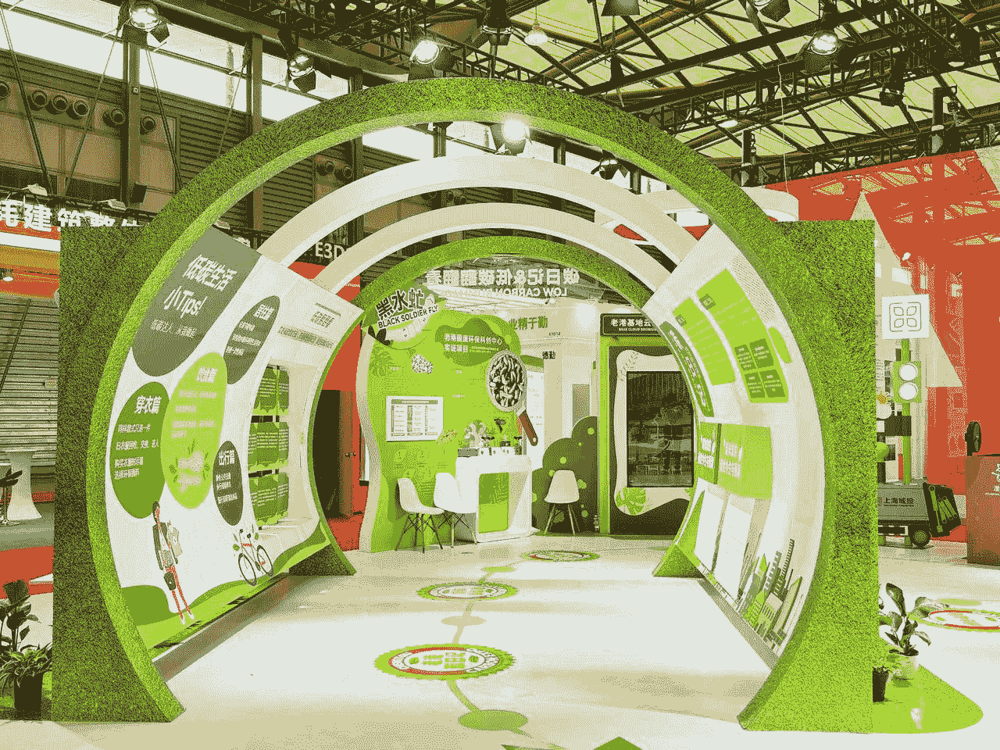
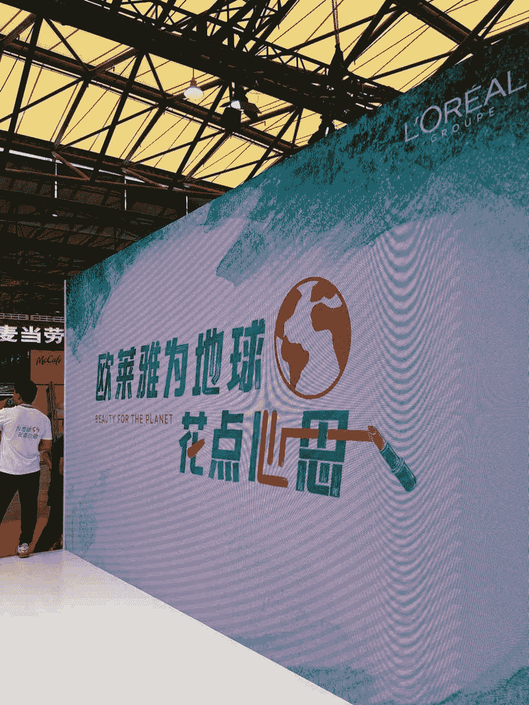
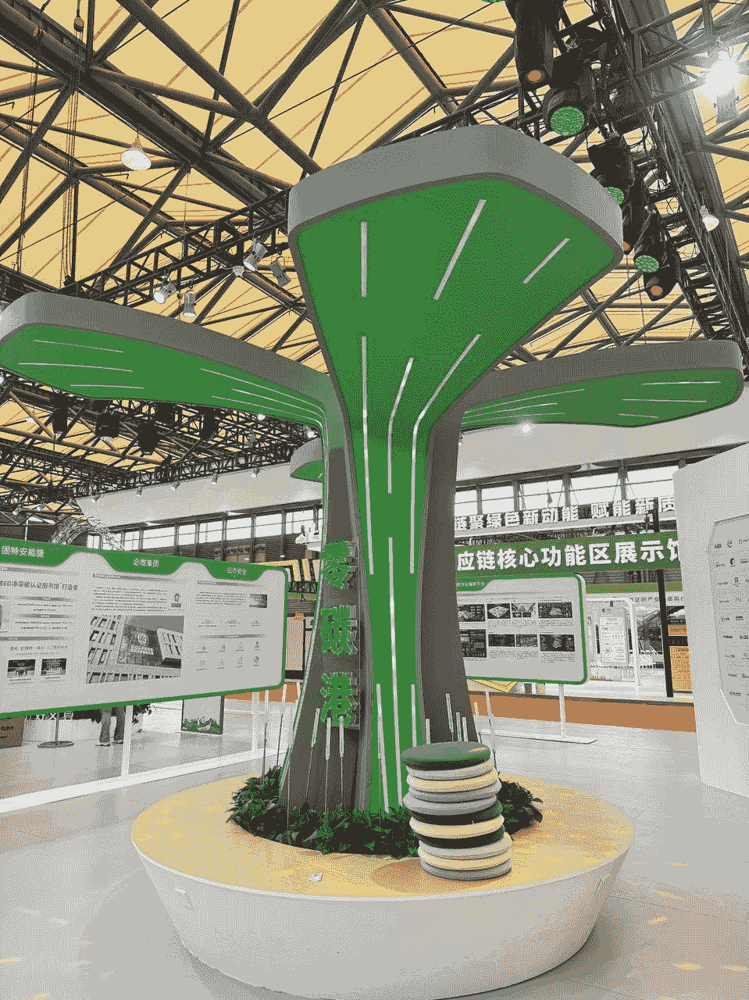

# 2024/06/09上海碳中和 · 博览会

> 来源：[https://docs.feishu.cn/docx/FsYXdTC7uoBPaEx6GLYcRVuynag](https://docs.feishu.cn/docx/FsYXdTC7uoBPaEx6GLYcRVuynag)

# 前言

上周有个小伙伴推荐了去看碳中和博览会，u1s1，第一回听到这种展会，眼前一亮，觉得好有趣。刚好最近也在寻找各个行业和AI之间的结合，于是就在端午那天，快乐地出门参展啦。

下面跟随周一来看看当下碳中和博览会一些很好玩的物件~

# 参观展览

## E1展厅

E1参观了中国能建、国家电网等展览，能建主要讲解了城市建筑相关的类型，在沙盘上看到最接近城市的地铁、公交和私家车在道路上流通，很有写实感。

在这个展中，还了解到了一些从未涉略过的概念：中能瑞新、磷酸铁锂电池的研发、光储一体化电站建设、储能全产业链解决方案。

在能建的时候，一位工作人员介绍到：宁德时代与能建的合作，一方提供技术，一方提供建设运营和规划，主要服务用户在B端，可以通过售卖电箱机箱等方式，来达到良性商业化的发展。

看他讲解的时候笑的好开心，我总感觉他非常热爱这份事业。

**看到**氢能的时候，边上一位小伙伴的一句话让我记忆犹新：氢能是未来新能源发展的重要路径。

## E2展厅

这个展主要看了申能在各个赛道的一些成果，其中包括：新引擎、新赛道、新结构、新金融。

| **新引擎** | **新金融** | **新赛道** |
| --- | --- | --- |
| +   燃料引擎 | +   风险检测 减少企业赔款 | +   冷能发电技术 |

## E3展厅

这个展厅主要参观了**旧衣服改造**和**咖啡胶囊回收**。

## E4展厅

**E4是**去之前最想去看的一个展览了！首先去看了欧莱雅的展厅。

欧莱雅展览部分主要讲述**化妆品行业**上下游合作伙伴的减碳战略和实践；帮助消费者了解欧莱雅全链路减碳的合作和创新成果。 成果不乏包括：

> **生物技术与发酵：**

> 化妆品行业正在广泛应用生物技术和发酵技术，以减少碳排放和资源消耗。通过利用细菌、微藻和真菌等微生物，企业可以生产出高效且环境友好的活性成分，从而降低传统化学合成带来的污染和能耗。

> **绿色化学与绿色萃取：**

> 绿色化学是化妆品行业的重要发展方向之一。企业通过改进化学合成工艺，减少有害化学物质的使用和排放。例如，在绿色萃取技术的应用中，企业通过使用无毒、可再生的溶剂，从天然原料中提取有效成分，减少了对环境的负面影响。

> **可持续种植：**

> 为确保原材料的可持续供应，化妆品企业与种植者合作，推广可持续的种植实践。这包括减少化肥和农药的使用、保护土壤健康和生物多样性等措施，确保原材料生产过程中的环境友好性。

---

除了欧莱雅的展厅外，还逛了临港集团的零碳港，以及看了中国华能的SCO2循环发电♻️。

## E5展厅

E5展厅介绍了很多银行在能源发展上的突破，包括减排市场、碳普惠等问题。btw……银行我还看不太出来跟碳之间的结合。

初步能想象的场景大概就是以前线下办理业务时，需要很多纸张的填写。到现在的时候，更多的是线上电子表单填写，那其中应该就能有一些减排的市场交易发生。

# 结语

想起19年去生态伙伴大会当志愿者的时候，也是提前一周就去培训，到真正大会的那三天，每天虽然很忙，但学到了非常非常多多东西。第三天回学校的时候，脑袋还久久沉浸在大会现场。

这次逛展的观后感就写到这啦！唯一的小遗憾大概就是去的时间有点晚，看到后半段的时候有些展商在陆续撤展。有些内容没来得及看，比如旧衣服改造的showtime时间、咖啡胶囊以及SONY的技术分享没追上。把这些遗憾留到明年的展会上。

期待下回去看更多好玩的展啦~

下期见🍻

# 直拍图

多维表格（PqkobYrOBaGfV9sWNWVcYjZSnbW_tblA4yWQuFqWbNzR）

# 一些疑惑

为什么装备生产基地都是集装箱类型？

# 彩蛋One More Things

重磅｜2024上海国际碳中和博览会展位图公布

[“可持续的一天”打卡全攻略](https://mp.weixin.qq.com/s?__biz=MzkwNzI3MTM3MA==&mid=2247500388&idx=1&sn=7b2489c656fb4e721219271dea46ba68&chksm=c1b9244b22305166f1a51d2632240dbb7f6ad1d0d8488a2b2a3ed9b27eb2bf0240372739ee79&scene=132&exptype=timeline_recommend_article_extendread_samebiz&show_related_article=1&subscene=0&scene=132#wechat_redirect)

还有3天！申能集团展台一大波亮点抢先Mark！