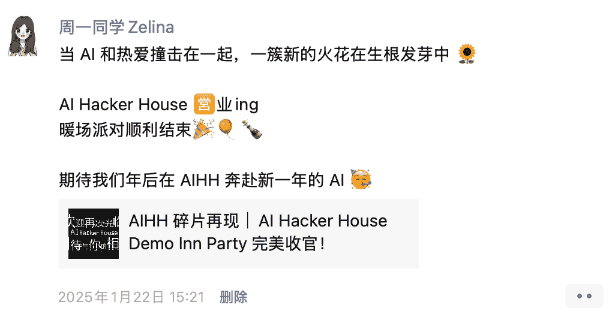
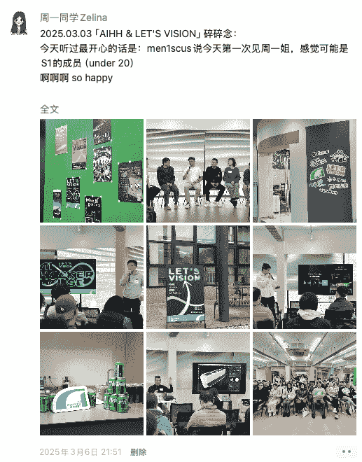
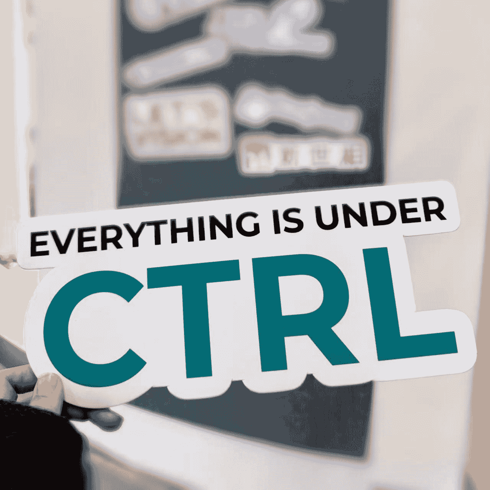
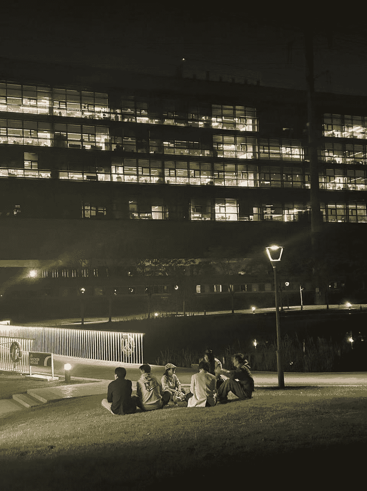
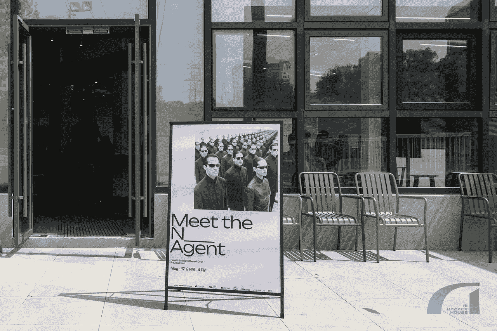
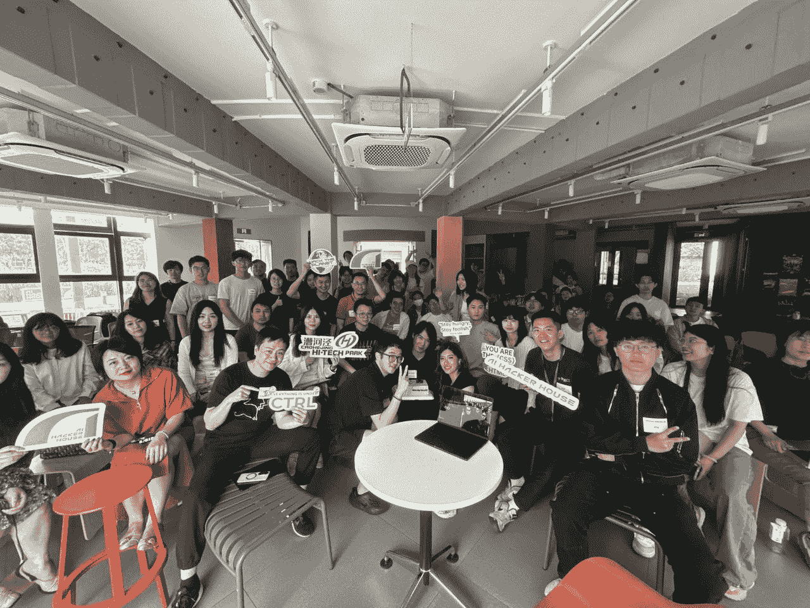
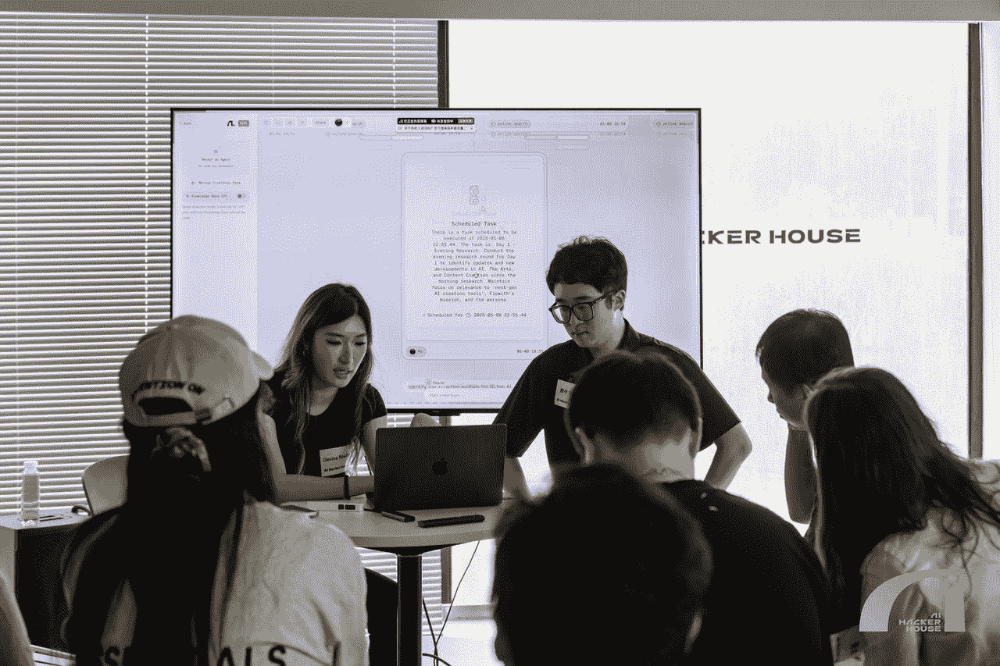

# 2025/01/18 AI Hacker House

> 来源：[https://docs.feishu.cn/docx/CGNsdxHauoxk7MxR0GRcG0GXn2f](https://docs.feishu.cn/docx/CGNsdxHauoxk7MxR0GRcG0GXn2f)

# 创客沙龙

## 01 AI 年终派对

## 02 iOS未来科技专场

> 2025.03.03 「AIHH & LET'S VISION」碎碎念：

> 今天听过最开心的话是：men1scus说今天第一次见周一姐，感觉可能是S1的成员（under 20）

> 啊啊啊 so happy

>

> 活动开始前半部分，在聊大家都在高度使用的 AI Cursor

> 在圆桌期间，有个老师说，有没有觉得自己写的代码，之后过来看的时候忘记了？

> 内心OS：有有有🙋🏻‍♀️（确实 因为生成很快 所以我经常 跑完优化并review完 觉得差不多了 就不看了 记忆点就没有那么深）

>

> 与徐骋老师和其他小伙伴聊了聊，平常工作中如何用cursor帮助研发写代码和提效

> 看到Cristian分享Vision Pro玩法的时候，对iOS生态的探索欲从20码力开到了100

>

> 邬老师看到men1scus弟弟的时候问：你是做技术的吗？

> men1scus说：是的。

> 然后说工科生看人都会一直很专注的看（学到了，原来心理学是这么用的）

>

> 还有一些碎片再记录下：

> 中间和Carol聊到能量石以及近期国内外对于能量学科的发展动向

>

> 快结束的时候与 Johnny 和 Qira 聊了聊，Johnny说他现在在创业，base地在重庆，Qira则在上海

> 于是我问Johnny，在聊到为什么会选择重庆这个城市

> Johnny说当时第一次去重庆的时候，就觉得这座城市的人文和生命力，吸引了自己想在这个地方

> 当时联想到我为什么喜欢上海，好像也是这个原因。22年刚到上海的时候，就很喜欢上海的人文，喜欢这里的一切，包括人文、城市风光、地理气息等等

> 对一座城市的喜欢，好像就是那个第一印象，刚来了之后，你就会想要一直在这里

>

> 在此之外，在Steven和其他分享小伙伴身上，也学到了很多新的 AI 工具的玩法技巧

>

> 太期待能源时代下更多人与人之间碰撞出来的火花💥

>

> 下次见 👋🏻👋🏻👋🏻

## 03 AI for Her

> 今天看到特别多的「她」经济项目 大家在各自的领域里 闪闪发光

> 报名表筛选的时候 看到15岁小朋友的介绍 特别的感动

> 数字化原住民 去学校化学习的女孩子

> 和父亲在真实社会里自我教育，使用AI和数字化学习工具探索自由求知

> 15岁的小妹妹在准备和爸爸回去赶车之前，专门过来道别一下

## 04 创投新机遇

> 2025.03.22 碎碎念上周末的创投活动

>

> 投资人视角下的2025：

> 在deepseek出来之后，对于投资人来说，有很大的惊喜在里面

> 好的创业者是创造了赛道的人

> 在当下时代下，因为更新迭代过快，要时刻换不同的帽子，去看不同的事情

>

> 真格聊了聊manus从刚开始爆发，到AI自媒体，再到最近大家继续持续谈论的一个过程

> 时代里每一个突然间的暗流涌动，总会经历一些起起伏伏的波动

> 但最终总会到达「因为相信所以看见」的彼岸

> 真格基金从2016年开始投manus，陪伴10年之久，嘉宾聊了聊与manus创始人在过去10年的一些合作动向，想起之前听播客「张小珺的商业访谈录」和red聊的那期，突然觉得异常亲切

>

> 高瓴投资人聊到：投资人有一个幸福，就是可以特别八卦

> 通过一些附加的问题，可以看到你在生活中为人处事的一些价值观

> 间接地可能是想要看到，你做事情的上限到哪，以及投了钱给你，你能不能去把项目给跑起来

> 突然又理解了心理学的另外一个切入点

>

> 最后聊了聊出海相关的一些小Tip，印象比较深的一句话是：

> 不能总是想到未来有什么困难，就不去做尝试

> 要先去把产品打磨好，机会有可能就在未来

>

> 创业者视角下的2025：

> 「①」

> 玉伯老师在被问到，为什么你会选择做yourmind的时候聊到：

> 在大厂的时候特别忙，忙到没有时间，后来创业的时候，跟更多的用户接触，是用户为我们找到了方向。

> 有个很小的感悟是，有时候一些东西确实是平常做的很熟悉，会觉得说应该所有用户都能懂。当用户找过来的时候，才发现了有更大的需求量，从用户端去解决用户的问题是比较重要的。

> 「②」

> 米棵AI的创始人聊到在时代的红利下，去做时代里顺势而为的事情

> 如果一个人能做好一件事情，做好很多件事情，那去其他地方，也能做好很多事情

> 「③」

> 最后海豚浏览器的创始人聊了聊，中外的创业氛围和创新氛围

> 中间说到一句话mark一下：乐观的人才能赚钱，悲观的人就是少亏钱

> 想起之前甲子光年某期播客的一句话：悲观者往往正确，乐观者往往成功

> 互联网时代，是流量为王。而在AI时代，是场景为王，针对对应的场景，去解决对应的问题。

> 历史的规律总是惊人的相似，但是，要学会『在港股和A股快速进化』🐱

>

> 后面开放麦环节听了听，和小伙伴们再一起聊了聊当前创投下的一些新机遇

> 结束的时候和Marc聊了聊当前时代下的PMO体系以及国内外的一些人文氛围

>

> 至此，活动结束~

> 在创新和创造的路上，依旧保持初心和迸发，期待下一个十字路口的精彩🍹🧃

>

## 05 小红书AfterParty

> 最快乐的事情可能是在别人口中听到你的合作方跟对方夸你的时候

> 草坪上聊起了各自的故事，太浪漫了

>

> 启师傅见面第一句，夸了一下周一的文档写的实在太好了（来源于第一次kick off会议的时候，在大家面前快速整理文档留下的印象）

>

> 这场活动把参会指南又升级了下

> 朋友说近十年来参加了大大小小的活动，付费的非付费的，从没有见过这么细的参会指南

>

> 和706的小伙伴聊了聊目前正在做的社区形态

>

## 06 Flowith产品发布会

> 在AI Hacker House听flowith的产品发布会

> 每天都在超欢呼地向小伙伴们推荐flowith

> flowith的产品理念实在是太美好了🌠

# 黑客松Hackthon

## 01 Hack Club

## 02

## 03