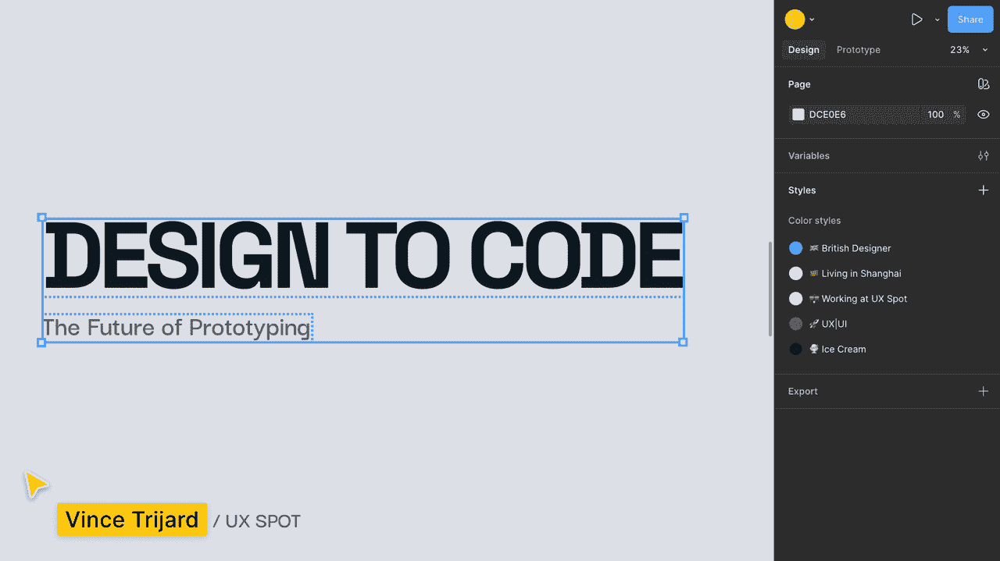
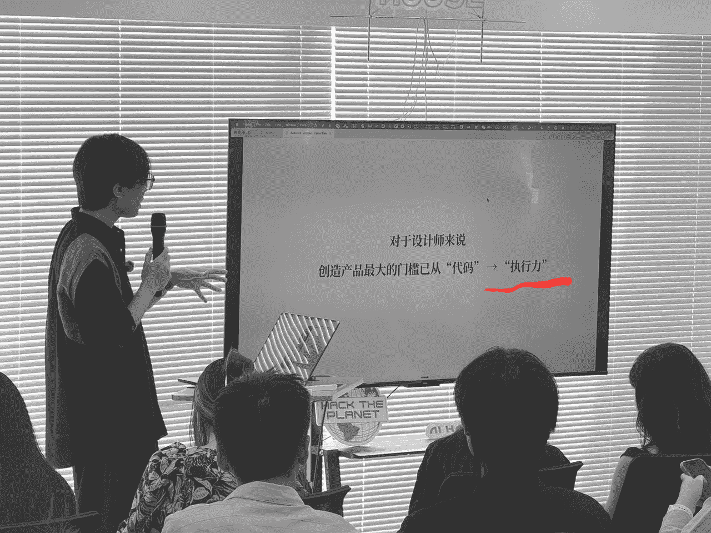

# 2025/09/06 friends of figma

> 来源：[https://docs.feishu.cn/docx/N5qCdYn07oXP3WxfZL6cxDJFnNh](https://docs.feishu.cn/docx/N5qCdYn07oXP3WxfZL6cxDJFnNh)

## Figma基础信息

https://friends.figma.com/shanghai/

## 相关问题

> 🙋‍♀️圆桌问题持续收集中～问题可加入tag，如 #某个嘉宾，或者 #产品定义，#设计，#Demo，#底层技术 等

| **序号** | **相关问题** | **备注** |
| --- | --- | --- |
| 01 | 🙋‍♀️想请教一下 Figma make 跟Cursor 配合的 workflow，尤其是在自己团队有design system 的时候，现在不知道有没有best practice？ 非常想请教各位老师关于设计+vibe coding 在企业级落地的经验[抱拳] |  |
| 02 | 做一个ai产品（如ai换脸，脸由模型自动生成，非真人），训练模型大概要用多少算力和时间？投入的成本大约多少？ |  |
| 03 | 大家提问的时候也可以帮助我们进行问题分类，比如对 #某个嘉宾，或者 #产品定义，#设计，#Demo，#底层技术…等～ |  |
| 04 | #原型 设计AI产品时，是否需要设计结合AI能力的可迭代高保真原型？有什么好的实现方法？ |  |
| 05 | #产品实践  在 Agent 产品方向设计或者实现中，关于 human in loop 有什么实践分享吗，实现方案、设计交互、基座模型选型等等 |  |
| 06 | #Demo 现在用户使用prompt和figma设计稿为输入（可能会引入figma相关的mcp），以前端代码demo项目为输出的工作流，可以满足像素级还原设计稿大致可用的需求吗？ |  |
| 07 | #Serene 在ikea的ai产品实践细节能否再展开讲讲呢？项目的投入产出比和预估业务价值是什么，是否能直接带动交易量或者收益提升？ |  |
| 08 | #设计师职业发展 AI带来了裁员潮，也改变了现有的职业发展体系。如何看待AI时代designer的职业发展，designer应该如何转型？ |  |
| 09 | #嘉宾5 你为什么觉得像素级还原设计的要求在未来ai driven的设计工作流中会消失呢？像素级还原的背后诉求如何在“功能还原”的新思路下得到满足呢？ |  |
| 10 | 问题@Edward，claude code vs ai ide like cursor，按你的经验，什么场景用哪个？或者如何搭配使用？ |  |
| 11 | #demo v0这类零门槛的ai原型生成app，转换成规范化组织的前端代码库时，有哪些好用的工具/prompt库可以推荐呢 |  |
| 12 |  |  |
| 13 |  |  |

## 相关PPT

Jolly：

[MCP_FoF_Slides_Jolly.pdf](https://internal-api-drive-stream.feishu.cn/space/api/box/stream/download/all/U8TfbVCW8oLugPxpWL4cUdWwnNd)

Vince：

[Vince _ Design to Code _ FOF.pdf](https://internal-api-drive-stream.feishu.cn/space/api/box/stream/download/all/NqQpbZE0loZxvAxsoFacUZrdnuh)

