# 2025年度好物 | 年度十佳好物清单

> 来源：[https://docs.feishu.cn/docx/MCvfdimbZoVTUOxyyUNcGbSjn0d](https://docs.feishu.cn/docx/MCvfdimbZoVTUOxyyUNcGbSjn0d)

# 前言

想来盘点下今年入手的最值得的10件好物，以及聊聊它们是如何让平日里的生活变得更快乐的。

# 实体类目

## （1）夸夸日历

今年ROI最高的一比投资了，20几块钱的日历，每天变着法让我开心的莫属于它了。

情绪价值upup~

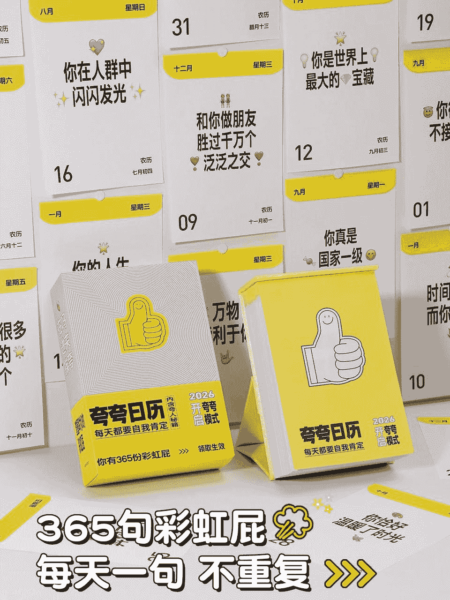

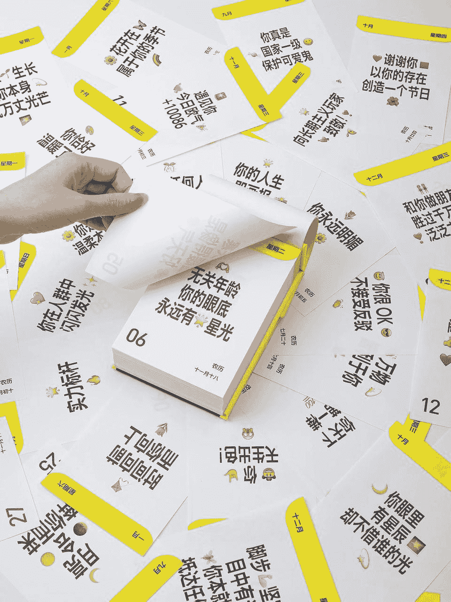

## （2）爵士舞课

八月份给自己报了一门爵士舞课，坚持每周末去一次。

从瑜伽/普拉提到爵士舞，只能知道人类的肢体要多不协调有多不协调🙈

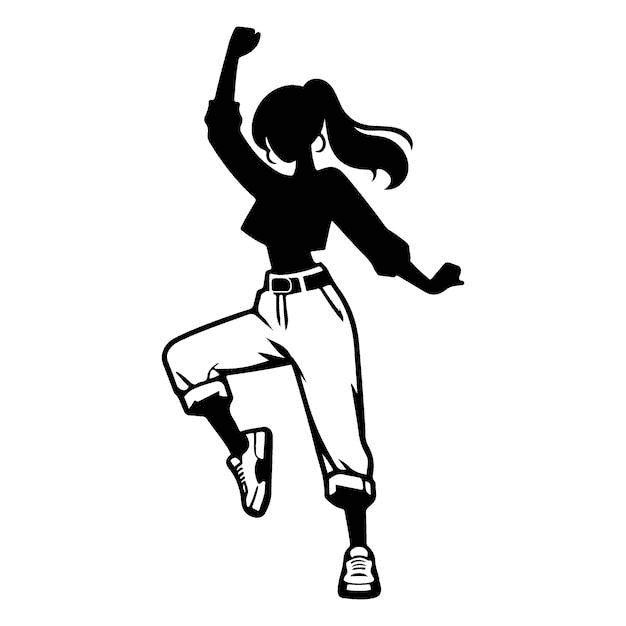

## （3）精呈标签打印机

收纳党的福音，强迫症患者的救星。

最早是在AI Hacker House办活动的时候，知道了这个牌子。

后来看到它的标签打印机，顺遂买一个。

打印并贴上的时候，只能说J人狂喜。

给各种调料罐、收纳盒、数据线、药盒贴上标签……整个家都变得井井有条。

最大的好处是：找不到东西的概率也变少了，生活效率直线上升。

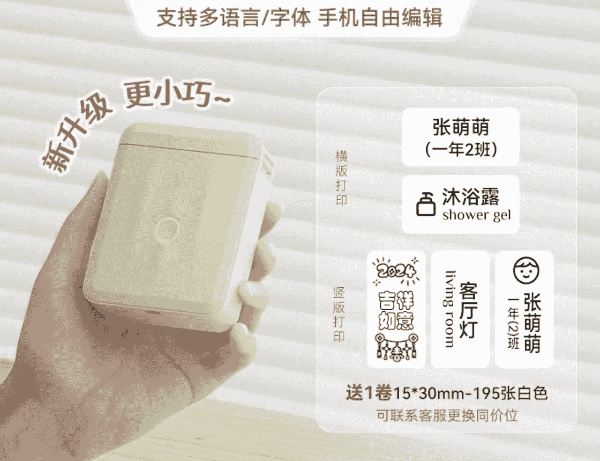

## （4）水晶

**今年**迷上了水晶，买了一些水晶用来搭配穿搭。

然后门后挂了个毛毡板，用来存放水晶。

这样，每天出门的时候，就可以根据当天的穿搭，挑选对应的水晶颜色。

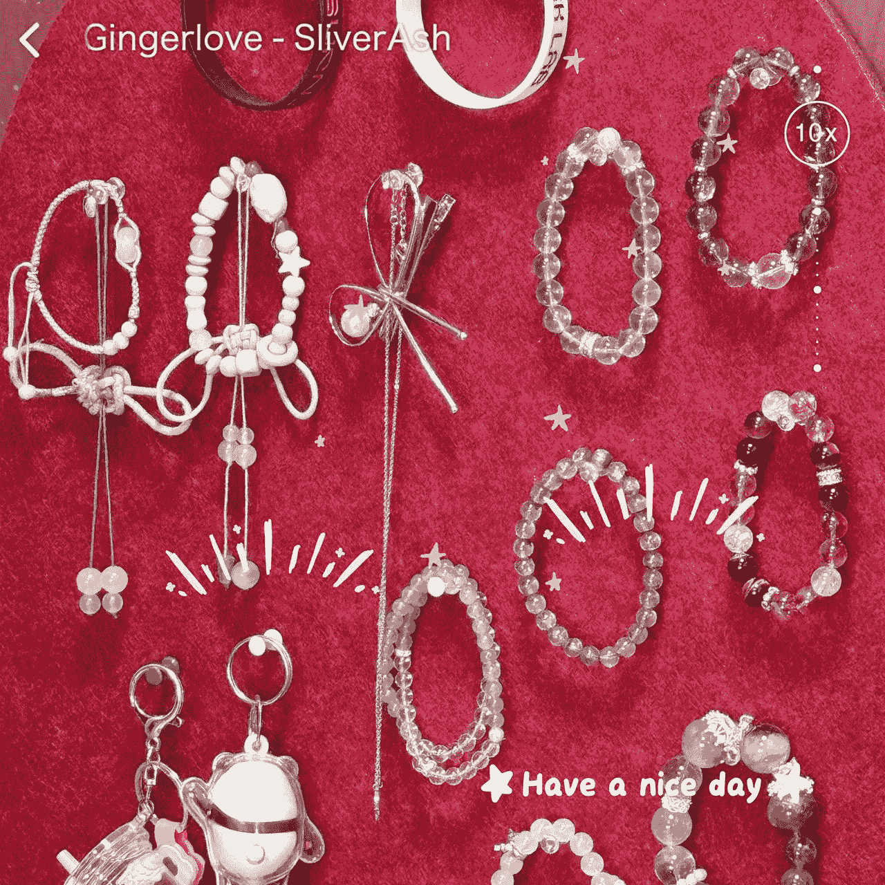

## （5）药盒工具箱

以前买过的药散落在家里的各个角落，然后今年买了个小药箱，把所有药都统一放在这个药箱里，创可贴、止痛药、晕车药、维生素、酒精棉片等等，现在要找药方便了非常多。

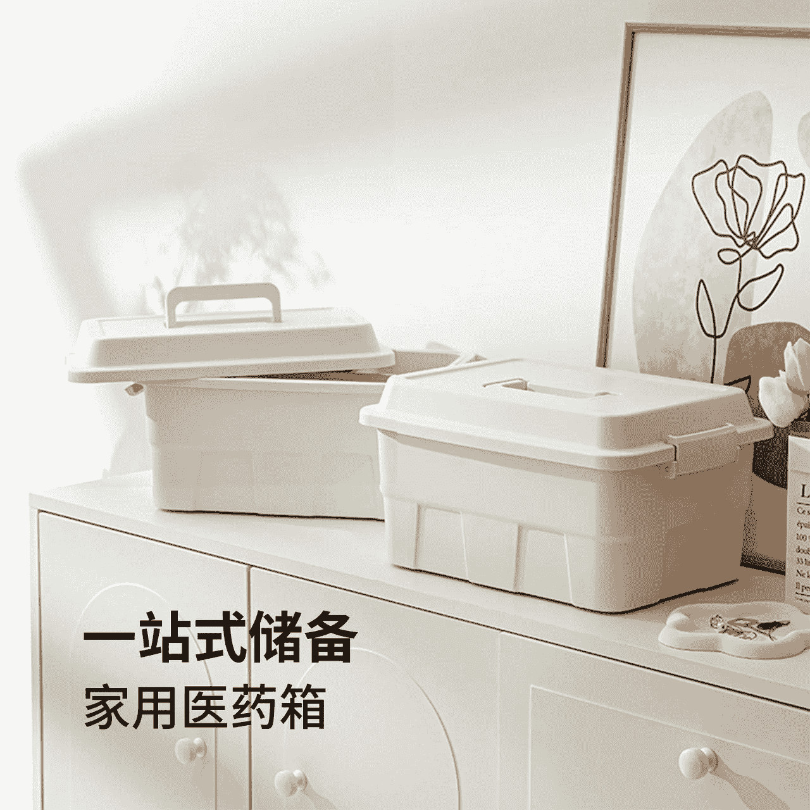

还有一个是**补剂盒**，买了一个防潮盒，也非常好用。出差的时候一次性装上，放包里，拿取也非常方便。

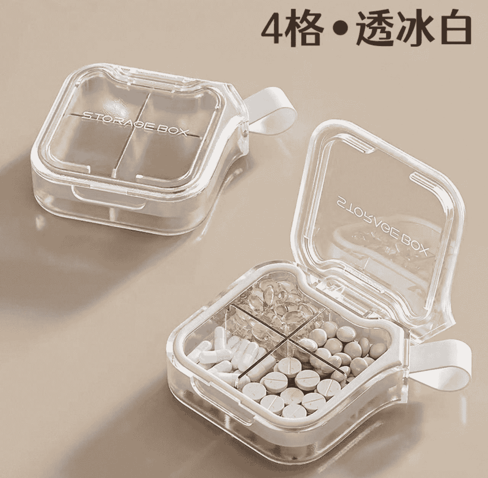

## （6）吸盘式挂钩

家里瓷砖特别多，以前经常用直接黏的挂钩，到年限一长，挂钩就会变旧变黑，要铲除下来也比较麻烦。然后今年挖掘到了这种吸盘式的双挂钩，亲测牢固易拆好用！

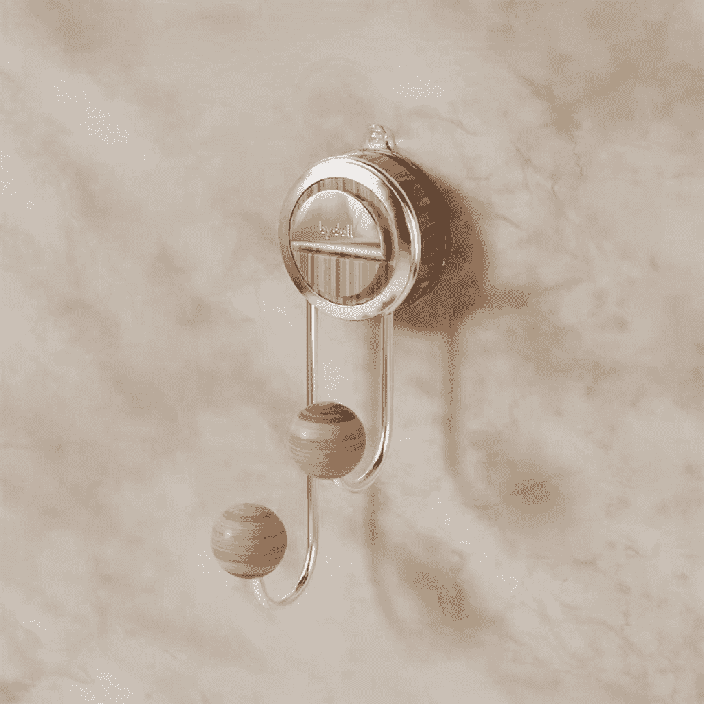

## （7）哑铃 + 瑜伽球 + 瑜伽砖

居家健身三件套，今年最实用的健身投资。

前面两年陆陆续续学了**瑜伽**和**普拉提**，然后自己在家锻炼了之后，就想要淘点类似的器械。今年进了1kg、1.5kg的哑铃，哑铃用来做肩颈运动非常nice。

然后还买个瑜伽球和瑜伽砖，居家**站立办公**好搭子。

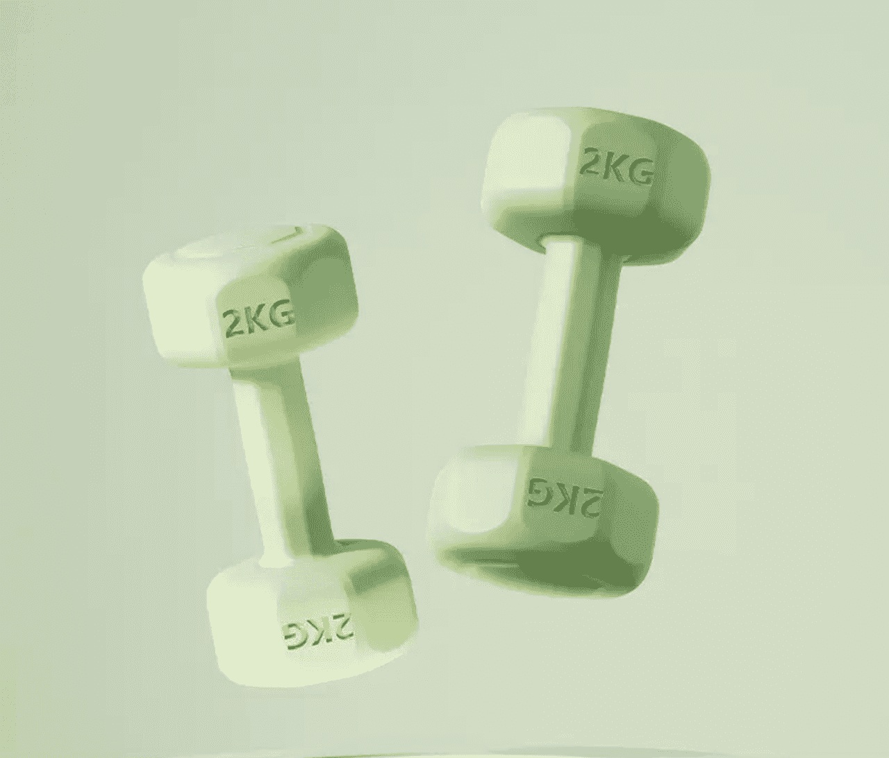

# 知识付费类目

## （1）搭搭App

2025年从1月份开始，就一直在学收纳。

然后从6月份开始，就在开始捣鼓**衣橱电子化**这件事情。

尝试了很多软件，最终选择了**搭搭App**。

到年底时，已经完成衣柜大概**80%以上**的衣物进行上传和搭配。

还剩最后一些穿搭在电子化的路上，预计2026年2月前掐个表完成一下子🧙🏻‍♀️

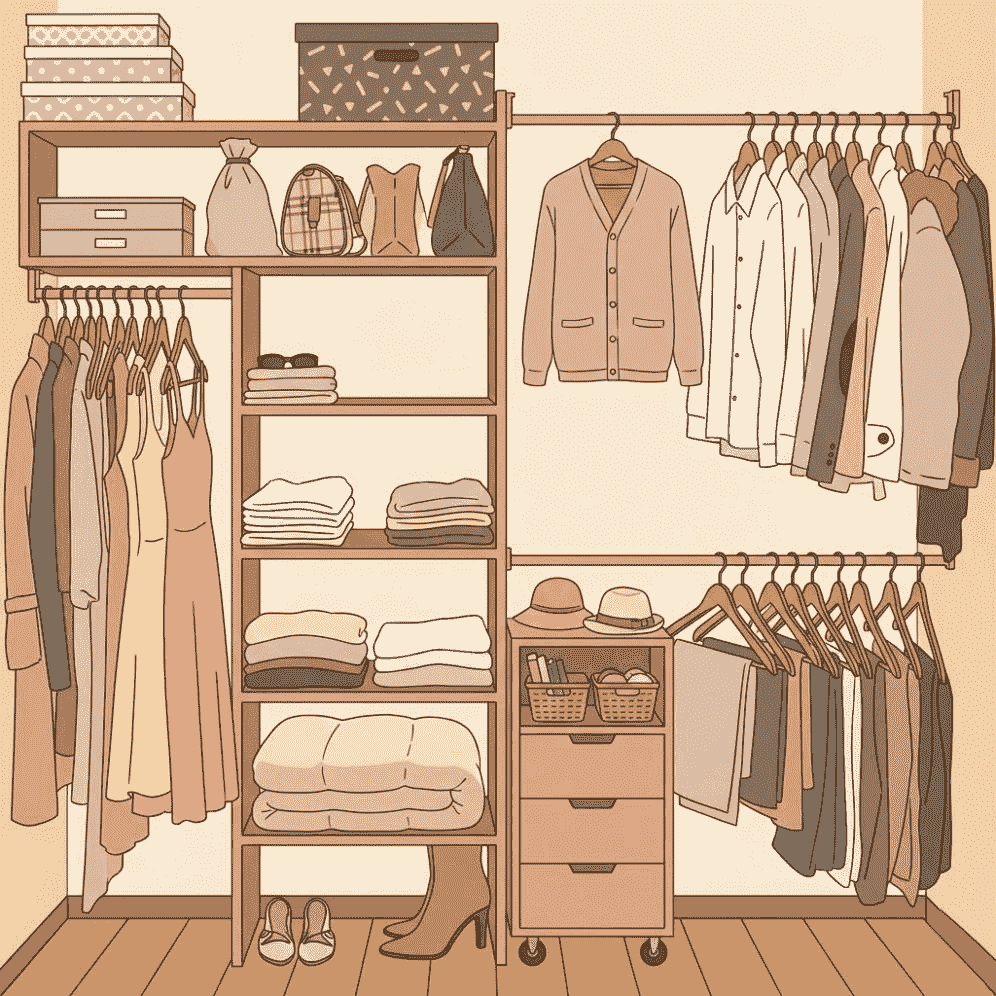

## （2）书籍：金钱心理学

https://book.douban.com/subject/37210893/

今年看了好几本书，如果要挑最喜欢的一本书，那可能率属于《金钱心理学》。

**这本**书不是教我们怎么赚钱，而更多是教会我们理解金钱背后的人性。

读完之后，对消费、储蓄、投资的看法都发生了微妙的变化，对人类的行为消费观也有了更深的理解和感悟。

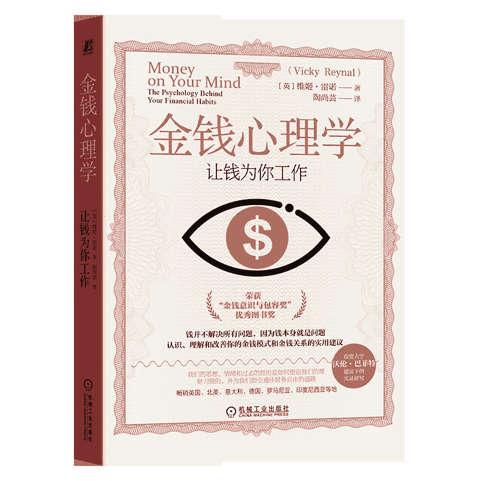

## （3）微信读书会员（闲鱼版）

https://weread.qq.com/

从**23年**开始高密度用微信读书，每回要读到要解锁会员的书籍时，就会通过打卡换读书币，来买下想要看的那本书。

但今年因为自己开年想看的几本书，都需要会员。所以就想**着买**一**个一年**的会员，这样可以不用每天都去打卡和补打卡。

比较省钱的操作是在**闲鱼**上买微信读书会员，比官方便宜一点。

后来朋友给我安利说在淘宝买还更便宜👵🏻（学到了.jpg）

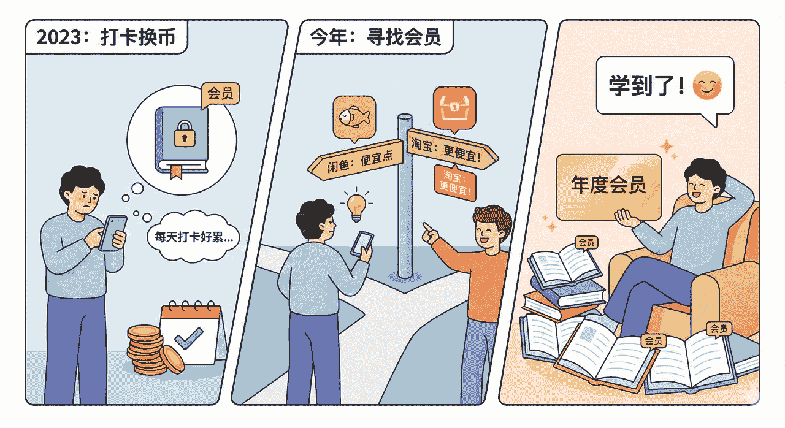

## 结语

在这10件好物里，有的提升了效率，有的改善了生活质量，有的带来了情绪价值。它们共同的特点是：都不贵，但都很实用\(^o^)/

**希望这份清单能**给朋友们带来一些灵感，也欢迎在评论区分享你的年度好物 Y(^o^)Y