# 2023年终总结 | 积极碰撞世界，尽情绽放快乐

> 来源：[https://docs.feishu.cn/docx/QE6XdfqtVovBqcxVlwLcs8H8nEg](https://docs.feishu.cn/docx/QE6XdfqtVovBqcxVlwLcs8H8nEg)

> 原文链接：2023年终总结 | 积极碰撞世界，尽情绽放快乐

# 🛵叮~

瑞雪霏霏，丰年岁末，复盘展望，无限欣然。回望2023，又到了年底时刻，周一同学开始拾起了这一年的年终总结。回顾这一年，或许有以下几点想要复盘：

+   努力很重要，但选择比努力更重要。知道更多的可选项，才能更好地做选择。

+   在工作中不断挖掘到自己的兴趣点，是一件多么快乐的事情呢？

+   毕业一年半，工作、生活和心态都发生了什么变化？

+   在魔都的日子，是每一天都很快乐的日子。

# 💡快乐工作

刚准备落笔的时候，在想从哪方面开始说起。不如就先来聊聊，快乐工作~

## 业务成长

**今年的快乐，可**以说有50%是工作给的，或者说工作是快乐老家。

一月的时候，部门内部有个历史用JQuery写的平台，准备重构，于是这项任务就落到了周一这边。刚开始听到的时候，还觉得虽说是迷你型项目，但从0到1搭建，似乎还有一点慌张。但秉承着接受挑战的态度，周一开始启航了这个项目。在这过程中，不断去学习历史已有产品的搭建步骤，其中不乏包括：

+   **技术选型** —— 基础选型、UI设计、架构选型、代码规范、引用库等；

+   **框架搭建** —— 页面架构、流水线配置、入口文件设置、基本页面布局、与后端通信交互等；

+   **系统静态设计** —— 模块结构设计、原型界面设计等；

+   **系统功能实现** —— 涉及要调用的接口等；

+   **部署相关** —— 用什么平台来部署、如何触发部署等等。

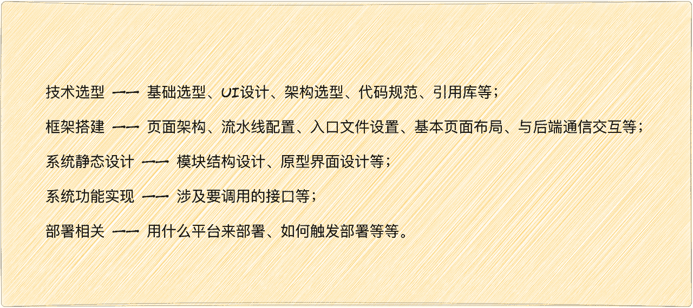

到整个平台搭建并做好功能完善之后，突然就理解了，为什么原来业务**平台里要这么去设计架**构，这样做从什么层面能够达到更高的可用性。发现很多东西，在一开始都是从不会到会的过程，踩一踩坑，很快就能领悟了。

**接着来到了二****月，二月底的时**候，正值大模型的爆发，厂内的AI氛围逐渐浓厚了起来。此时，周一所在的AI产品业务线，接到了新AI项目落地的紧急任务，于是整个部门很快速地做了分工和开发，重保AI项目落地。

到了**4月份**的时候，部门新项目重构。团队秉承着高可拓展**性、公私同栈的原**则，整个FE团队的整体往react技术栈过渡和迁移。不得不说，刚听到这个消息的时候真的太激动啦！因为过往产品里面有一半的项目是vue项目，react的开发量还在很浅层。

顺应着，就来到了Q2Q3季度。四五六七可以说是全年最忙的几个月，最忙碌的时候可能是五六个项目来回切换，脑袋里一直在公有云xxx、私有化xxx、公有云xxx、私有化xxx之间来回徘徊。不过在这过程中，也沉淀了很多东西，学到了很多新的东西。

同时，在Q2的时候，业务线里面的几个云上产品，准备做云上交互升级，这个季度也是跟UE**同学很紧**密合作的一个季度。在与UE团队的沟通交流过程中，让我更加明白了，一个产品从0到1的设计过程。其中不乏包括：移动端和PC端的组件库设计、各类型页面的设计规范和设计白皮书、颜色字体间距的统一等等。虽说有时候UE走查的时候会改的很痛苦，但换个角度来看，也都是为了产品好，争取努力好好改😶

Q4的时候，这个时候业务的发展趋于平稳期，但项目里面会存在一些历史债务。于是分模块进行拆解，对局部历史问题进行技术栈升级和代码重构。代码重构带来的快乐大概是：对业务细节更加了解，以及能够更好地owner未来的需求和业务。

今年**在业务上的收获**，或许是：**看着产品**在提升、自己也在提升**，这是一个非常**欣喜若**狂的过程。同时也意识到**，在了解一个东西时，要学会知道它是如何从0到1去运作的，这样才能将特定工具的技能转化为更广泛的、可迁移的能力。否则一旦离开了熟悉的工作环境和依赖的工具，可能又会陷入新的困境。

## 技术成长

聊完业务成长，接下来聊聊在前端这个方向上的一些突破。在二月份春节结束回沪后，开始了新一年的成长模式。

怎么说呢，年初给自己定下的目标很泛，没有说一定要学会一些什么东西。但算是在实践的过程中，慢慢地就去找到自己的突破点。

刚开始在二月份的时候，**顺着22年**没学完的TS，继续精进了下TS能力。TS精进了一段时间后，刚好听到同事在说函数式编程这个东西。越发地觉得这个东西好**像很神奇****，于是就**去**看了修言老师**的Java**Scri**pt 函数式编程实践指**南，等到看完**的时候，有一种打开了新世界的大门的感觉。不过这个东西，理论会了，离实践还有很长的距离。之后就是先去熟悉大佬们的函数式编程代码风格，然后自己再逐步地有意识地去把这种思想去运用到实际业务代码中。一番实践后有一点小感悟是：尽量不写面向过程代码，面向过程的代码写多了，很像是在⛰上写⛰。而对于面向函数和面向对象编程来说，感觉面向函数偏向于重数据轻行为，而面向对象编程，则更重行为轻数据。两者没有好坏之分，适合业务的才是最好的。

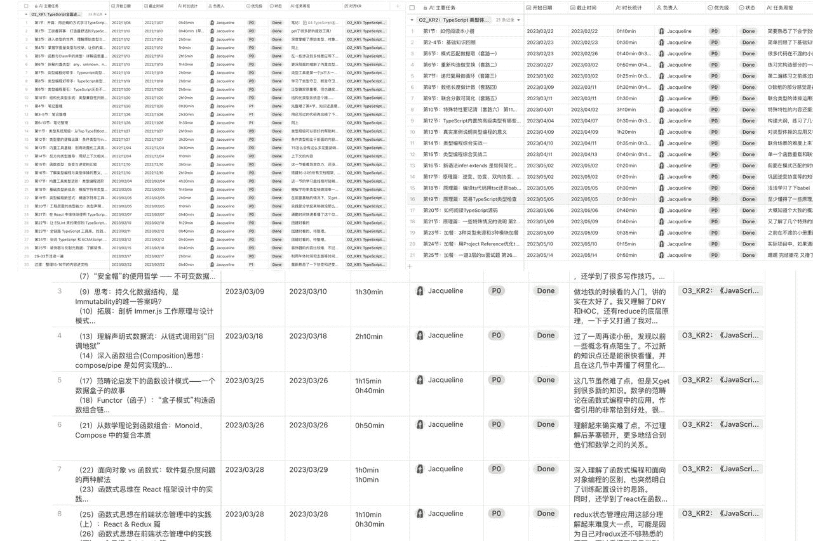

与此同时，三月份的时候，意识到自己在前[端调试方面有点薄](https://juejin.cn/book/7070324244772716556/section)弱，于是去看了神光老师的前端调试通关秘籍，看完之后，对一些基础工具的调试有了更深的了解的认识，也部分投产在项目的实践中去使用。

四月份的时候[，业务线里的所有云](https://juejin.cn/book/7161370789680250917/section)上产品要做全平台升级，基本上算是对整个项目的布局都做了很大的改动。此时大佬先对第一个产品平台做了整体的布局改动，然后周一负责对额外几个产品平台的布局做改动。在看大佬设计的平台布局过程中，突然发现原来CSS里面还有那么多学问，只能说之前的开发都是小打小闹写CSS。所以在此时，秉承着缺啥补啥的原则，去看了大漠老师的现代 Web 布局。一番知识输入后，有一种拨云见日、豁然开朗的感觉。原来CSS还能这么玩，原来布局还能这么写。

接着，来到五月。五月份的时候，新项目要公私同栈，新的架构全面用react。之前react项目经历较少的周一，对这一波即将要用react开发的业务，无疑是感到非常快乐的。因为从职业发展的长远角度来看，这能很大程度地提升个人竞争力。而且也意识到，学任何东西，能够直接投产于实践应用中，无疑是能够最快获得进步的。所以在今年，也提升了自身的react开发能力。

6月份的时候，随着交付的大模型项目越来越多，且依托于厂内浓厚的AI氛围，越发地觉得，不学点AI都会跟环境脱轨了。当时刚好掘金出了一本新的小册人人都能看懂的 ChatGPT 原理课，于是就去看了这个。看完之后，对新项目的业务也有了更深刻的认识，可能就在某个瞬间会突然想通一些问题：为什么ChatGPT会火，为什么模型训练是先奖励模型再RLHF……

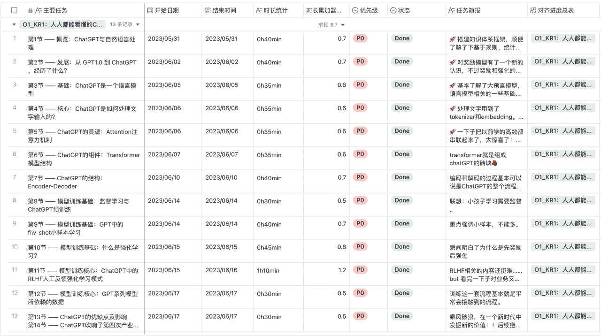

**到了下半**年的时**候，整个成长的重心从基础提**升转移到工程化提升和AI感知力提升。

**工程化上**，学了[从前端到全栈](https://juejin.cn/book/7133100888566005763)、[深入浅出微前端](https://juejin.cn/book/7258893482318626868/section) 和 Electron + Vue 3 桌面应用开发。

**AI上**，入门了Tensorflow.js，以及去学了一些大模型相关的入门知识。

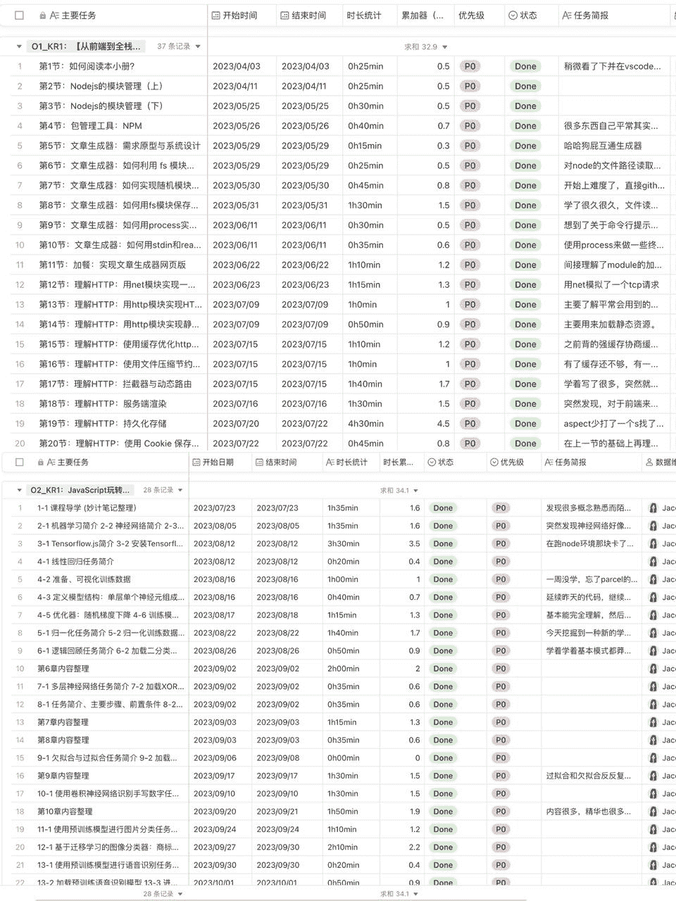

一年下来的技术成长，越发觉得，深度下的广度才是有效的。且东西不是等需要的时候才来学，而是学了，等哪一天需要的时候，就派上用场了。或许就是，只有知道更多的可选项，才可以更好地做选择。

**PS：**每天沉浸于知识的海洋里=。=

## 也谈“前端已死”

**2023**年年初的时候，最大的一个话题莫过于前端已死。此时要说焦虑，多多少少是会有一点的。不过感觉就是，与其说是前端已死，不如说是一个行业由快速发展期走向了平稳期。

想起一个同事在说，高三报志愿的时候选了最火爆的土木工程，四年后建筑行业的招聘已经趋于饱和，变成了彼时的夕阳行业。那这里所谈到的“前端已死”，可能也是同个道理。

但在这过程中，发现到与其焦虑，不如不断地去提升自己的核心竞争力。让自己能够更加明确自身未来的就业规划，能够更好地为所有忽然的不确定性做好准备。

# 📡以点连面

聊完技术上面的提升，接下来聊聊跟技术沾边的能力提升。

## 产品能力

6月份的时候，由于按捺不住学习的躁动，很**想把之前付费**过的产品课给学了，所以就把学产品基础知识这项事项给排上日程。

在学了课程的最基础知识之后，产品思维的提升给工作带来了很大的思维改变。

**在此之后，无论是需**求评审还是业务重构和开发，都更多地会从用户的角度去思考这个东西能给用户带来什么样的价值，能给用户带来什么样的效率提升。这也驱使着去把业务和产品做得更好，迈向一个更长维度的方向去前进。

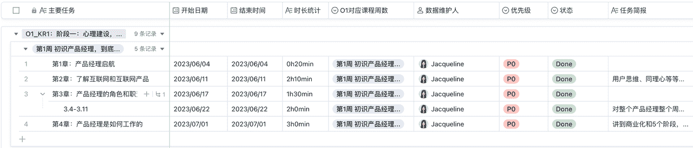

路漫漫其修远兮，2024还将继续精进产品能力~

## 与AI的缘分

**产品以外的另**一个想说的，应该就要聊聊与AI的缘分。起初我对AI其实是抱着一种不太上心的态度，甚至刚开始还觉得AI发展应该没那么快。

直到有一天早上在播客 [黄小刀](https://www.xiaoyuzhoufm.com/episode/64f8acc23fa4090b7459b54b) 里面听到一句话：一个东西，如果反复被提及到，本身就是一个异常值。这句话算是对自己的一个敲打。当时就在想，似乎就是这样。

然后还在思考，刚好所在的部门也是AI产品相关，比其他人也能够更快速地去了解到AI的发展，不如就抓住好这个机会，利用现有信息，再好好地去造一些东西。

从最基础的层面，就先去学了上面提到的《人人都能看懂的ChatGPT原理》，然后学完之后，就去问后端同事关于AI的一些值得学习的内容。随后后端同事给我分享了几个方向：机器学习、深度学习等等。后来，我就先找了与前端相关的方向，初学了Tensorflow.js，再后来，就是把稀土开发者大会关于大模型相关的专场给吃透了下，再然后现在就在探索AGI相关的内容。

说个很有趣的事情，刚开始想学AI，找的是一个算法相关的课程，只能说，还没入门就去听这些，就很容易差点就从入门到入土。

后来找到最最基础的课程，索性活过来了。也想通了一件事，在刚开始接受一个东西就觉得很困难的时候，那就不要强迫自己去学一些目前不适合自己的知识。

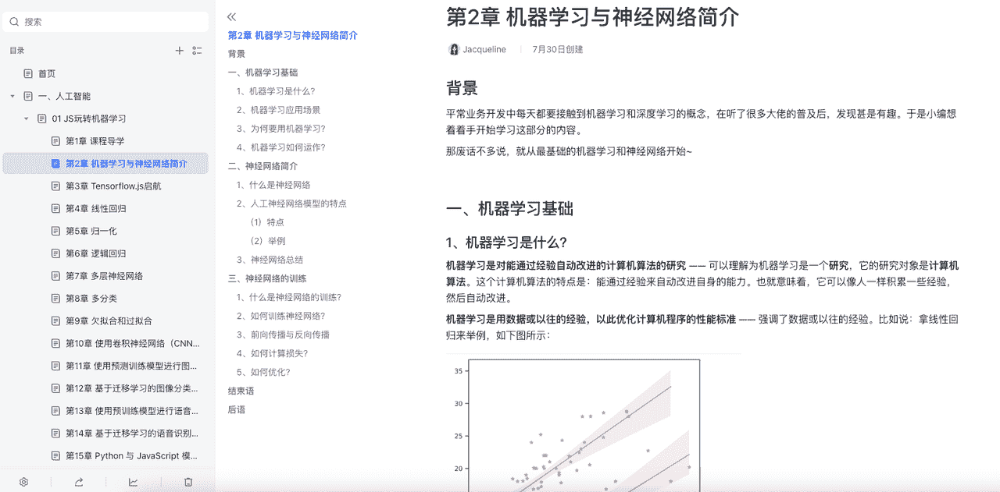

这里附上沉淀的一些内容：[01 大模型与AIGC](https://pzfqk98jn1.feishu.cn/wiki/AhEtwRMmhiWL9IkcmrTcvjtSnid)

**除此之外**，在11月初的时候，受到飞书用研同学的邀请，做了一场用户访谈。在用研同学身上也学到了很多关于访谈的技巧和思路。

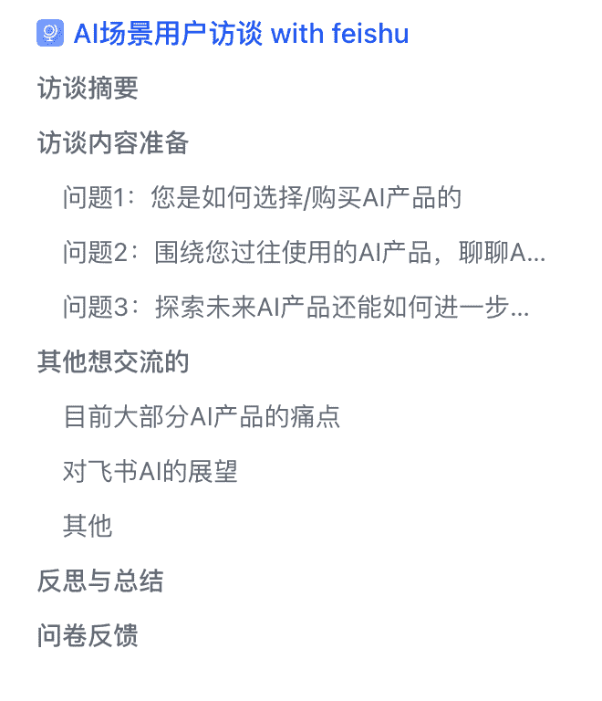

**或****许****驱**使着我不断去探索AI的动力可能有以下几点：①让我从畏难心理变成快乐心理的瞬间；②让我从线程生产内容变成批量生产内容的瞬间；③让我把更多的时间花在重要的思考上，而不是琐碎的重复操作上的瞬间。

越探索越觉得，AI真的很有趣，2024还将再继续探索一些好玩的东西~

# 🏕认知之外

聊完工作上相关的，下面聊聊认知之外的一些东西。

## 分叉口

以前写文章的风格，是写长文。而且还特别喜欢学完一个东西后，去从0到1输出。但在一段时间后，就发现，这样的创作模式在初期可能是可以去激发一些潜能的，在一段时间后，这种模式对自己的成长可能帮助就不太大了。

所以在4月中旬的时候，把自己目前所处的方向做了一遍新的复盘，对方向再进一步聚焦，或许说如何做到投入产出比最大化以及效益最大化是每一个时间段都需要去考虑和权衡的事情。在想要一些东西的时候，就要学会去舍弃一些东西。

## 打穿all in one

第二个想说的是all in one，今年的时间管理可以说是打穿all in one的一年。至于故事的由来，是什么呢？

在2023年3月份以前，周一在工作中一直都是『日报-月报-季度报』的形式进行复盘，使用的是『飞书文档』的形式。

久而久之，连续多个月的**手动填充数据**，到周五、月底或者季度末要复盘的时候，会感觉非常的繁琐和麻烦，『心智负担』也变得越来越重。

理论上，**复盘**是一件好事才是，结果因为流程繁琐，而让自己害怕起来，这怎么讲看着都是非常本末倒置的。

基于这个背景下，就去设计了一套all in one的多维表格模板，把之前像一盘散沙似的数据给联动起来。

在实践了all in one的多维表格后，发现心智负担降了不少。让我不再把精力放在周末月末的搬运和填写上，而是**把精力放在数**据上。简单填写后，等到需要相关某个模块的数据时，再打开相关的数据表来查找生产数据，即可快速对自己的工作内容进行回溯和总结。

真正做到了：**把琐碎的事情交给多维表格，让自己能够把所有时间和精力都投入到**重要的思考上，而不再是繁琐的搬运和填写。

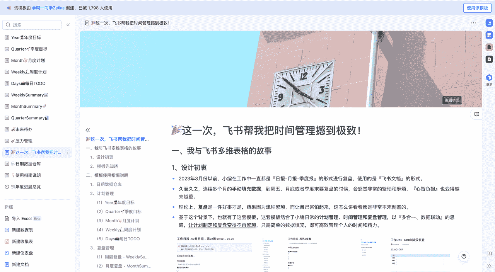

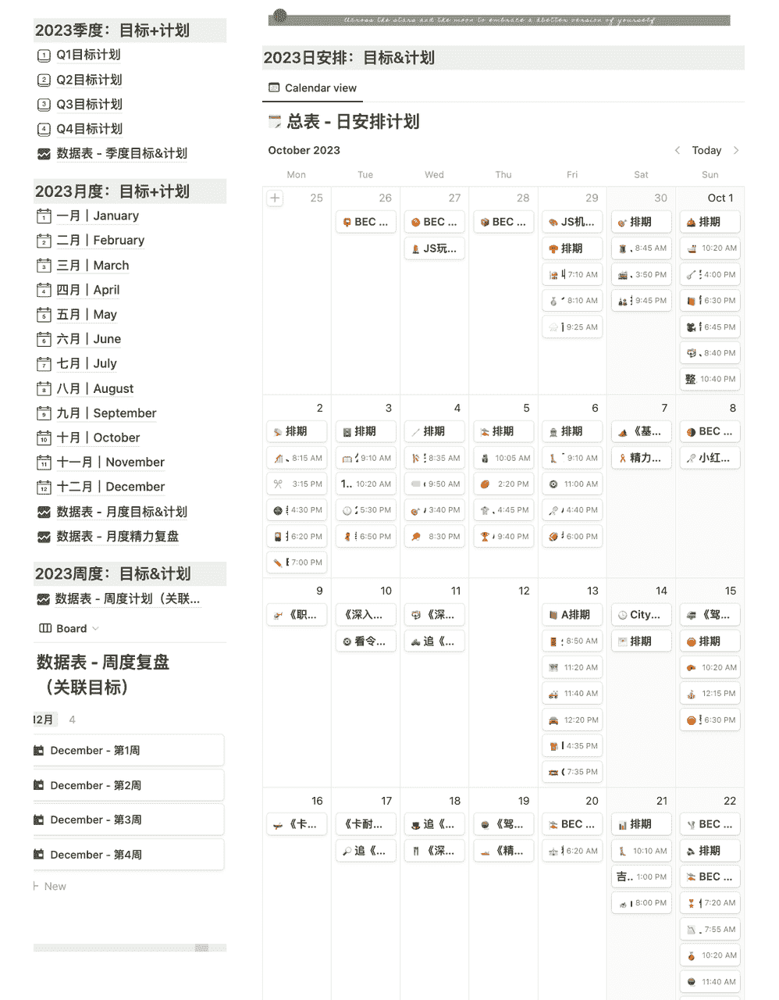

[九、模板宝库：创意工具箱](https://pzfqk98jn1.feishu.cn/wiki/wikcn1VjI3rZzuOatvk1HG9qeob)做了一些相关的模板，有需要的小伙伴自取：

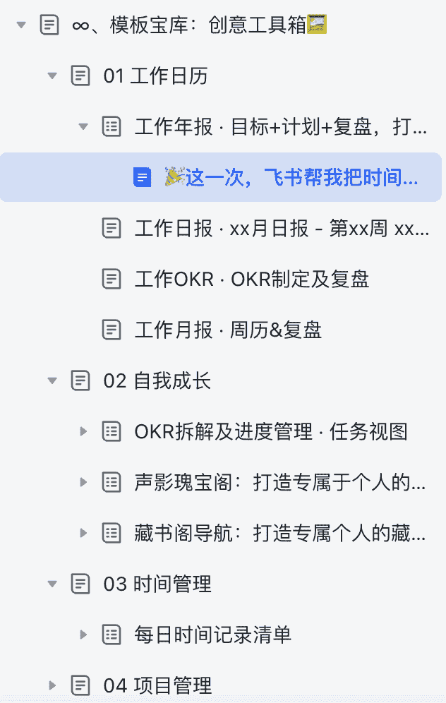

## 与闪亮猫的缘分

6月初的时候，先是参加了飞书多维表格工作坊。因为这场工作坊，结识了闪亮猫合伙人，后被邀请做了一场关于个人成长的分享。第一回做这种类型的分享，2天写了1w+字的逐字稿，但在完成之后，对这类型的演讲模式，也有了新的收获。在合作过程中，对媒体行业也有了新的理解和认识~

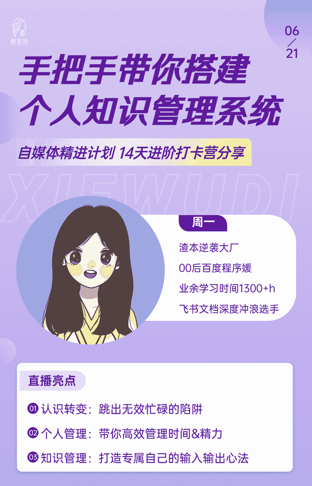

## 声影瑰宝阁

**第四**个**要谈**的**是今**年的声影瑰宝阁，分为阅读、播客和综艺来复盘。

**首先**谈今年每一周都在坚持的事情：阅读。以前更多的是阅读技术书籍，而今年换回来，阅读了更多成长相关的书籍。今年从这些书籍中得到最大的感悟大概就是：读书或许是最容易让我们快速在短时间内去学到别人几十年内吸收到的养分。

附上今年在阅读过程中，一些非常有感触的句子。

**读完《认知觉醒》，学到了：**

+   所谓天才，其实并不神秘，其实只是正确的方法+大量的练习；

+   去反思、去记录，批评哪里是什么坏事，那简直是上天给我们成长的信号。

**读完《掌控情绪》，学到了：**

+   当你正确面对自己所有的问题时，就没有人能够伤害你。

+   无法阻止痛苦的小鸟向你飞来，但能阻止它在你头顶上筑巢；

+   时间是一剂良药，用成长与流动的思维看待事物的发展与变化，往往就能发现，面对那些让我们无法前行的阻碍，我们已拥有了更多可以跨越它们的资源。

**读完《精力管理》，学到了：**

+   谁的生活也不是天天跑马拉松，要学会主动休息和适当放松，只有这样，才能保持更高的专注和更大效率的产出。

+   单线化的生活和运动方式可能会导致机能障碍甚至死亡，而波动和“张弛有度”的生活节奏更有利于保持健康和实现全情投入。

+   保持专注与乐观的秘诀在于间歇地**变换思维频道**，达到精力休息和再生的效果。

读完《卡耐基的沟通艺术与处世智慧》，学到了：

+   培养自己从对方的角度去思考，如同从你自己的立场出发一样——如果你只学到这一点，就足以为你的生活道路打开新的一页。

+   认真倾听对方的谈话，正是我们对他人的一种最高的恭维。

**读完《职场真话》，学到了：**

+   职场总会有各种各样的变化，人都需要有多面孔，有时候社交，有时候安静。

+   不管在哪里，千万不要恃才傲物。你有能力，那很好，但如果你既有能力也有很认可你的人，是不是更好？

+   遇到问题时，重要的不是升级矛盾，而是解决问题。

附上一些读书笔记：[01 阅读与思考Thinking](https://pzfqk98jn1.feishu.cn/wiki/FD9PwxGyPiPS4gkbXdtcfS0hn2c)

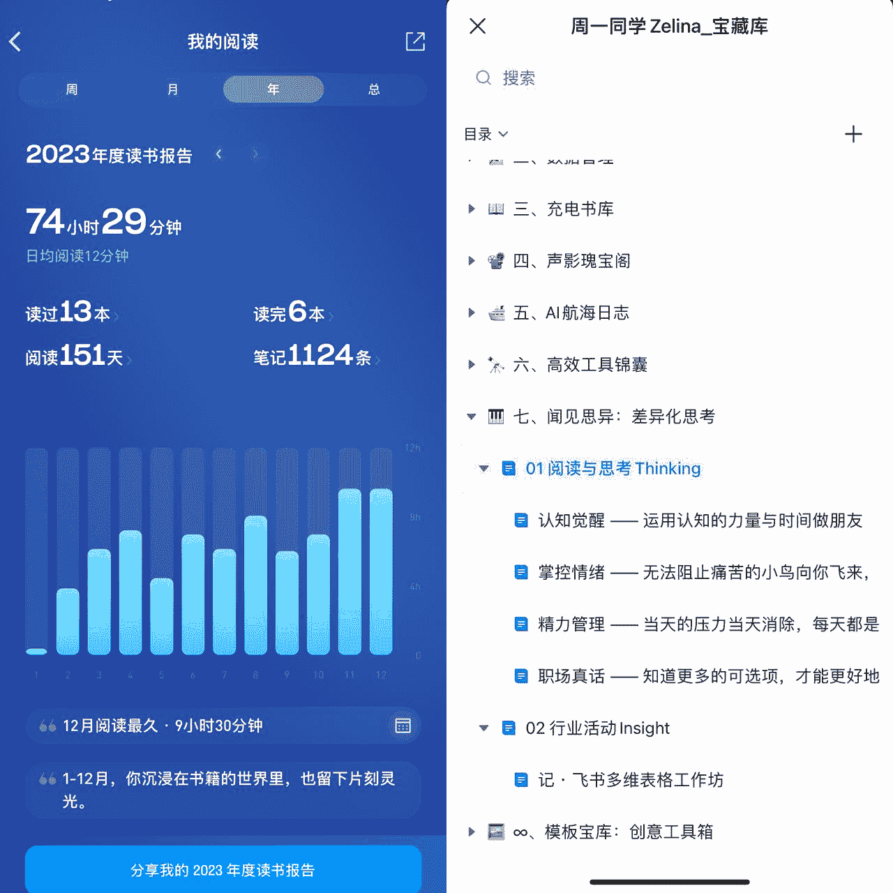

---

第二个要复盘的模块是**播客**，从去年开始就有听播客的习惯，今年依旧把这个习惯给**延续住。一般是工作**日出门前有30min的make up时间，这30分钟的时间就留给播客。

**播客给**我更多的感悟更**像是，带我看世界。**今年对播客，也从去年的简单听，衍生到今年的多方面听+写听后感。

同时，在今年12月份的时候，受到了某栏目的邀请，去录制了一期与AI相关的播客。在录制的准备过程中，也复盘出自己在某些方面的不足，同时也碰撞出更多的火花和未来更大的可能性。

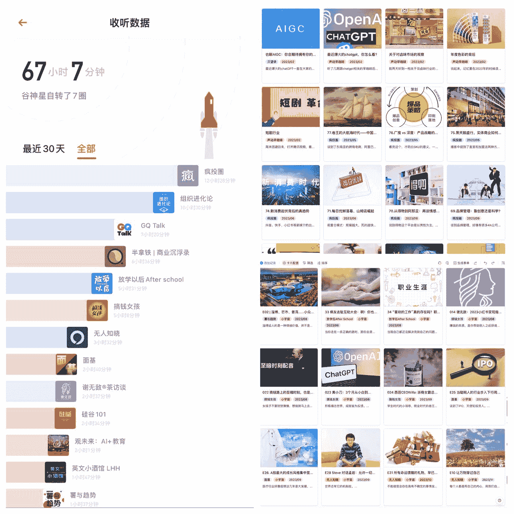

---

第三个要复盘的模块是**综艺和纪录片**。今年在闲暇时间追了些许综艺节目和纪录片。And 附上其中一个感触较为深刻的节目观后感。

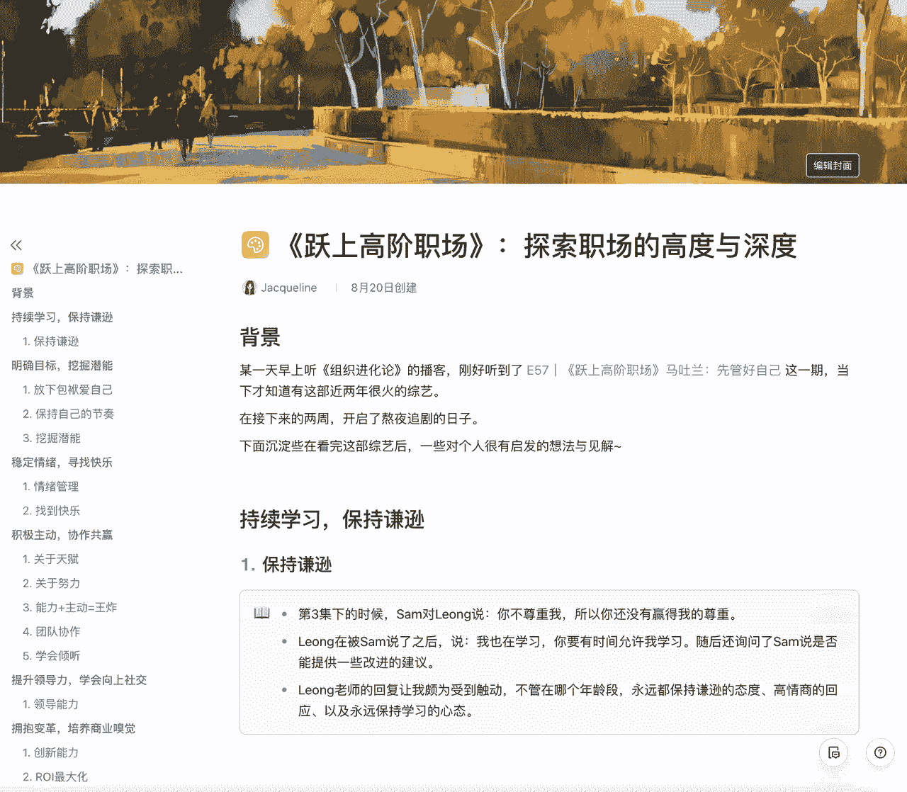

# 🔖精力管理

前两年在复盘的时候都谈**时间管理**，而今年更想来聊聊**精力管理**。

**在我看来，精力**管理更像是对待同一件事情，如何在最短的时间内更快速地且更高效率的完成任务。

下面分四个模块来讲讲今年在精力管理方面的收获。

## 身体健康

**正如《精**力管理》一书中所说的，体能是人体健康最基本的精力源，头痛背痛都会分散我们的注意力，让我们的注意力不集中。只有身体的体力足够支撑我们的脑力工作时，才能更好地高效工作。

而在今年，践行着让自己脑袋能够变得更灵活，思考能够更快些，也一直在坚持着健身和运动。

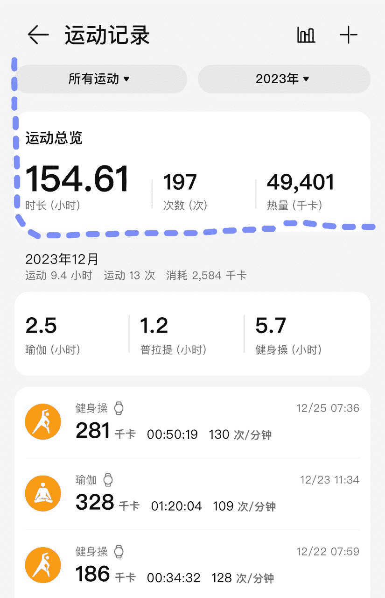

## 情绪稳定

第二个想说的是**情绪稳定**。以前觉得自己相对于身边的人还算情绪稳**定，但在今年年初，发现**自己的情绪偶尔也会被一些不重要的外界事情所影响到。

后来就去看了胡明喻老师[《掌控情绪》](https://book.douban.com/subject/35649631/)这本书，看完以后，把书中说到的观点不断地进行**实践和巩固。**在此**之后，遇到**问题时，更多地从对方的角度或者第三方角度去思考问题，不要让自己处于事情的漩涡中。像解题一样去探究每件事情的奥秘，会发现很多事情解开来看以后，事情原委跟我们自身可能都没有任何关系。

或许说，情绪中的10%由**发生在你身上的事情**组成，而另外的90%则由**你对所发生事情的反应**所决定。

到现在更是有一个**心态上的转变：**当你能正确面对所有遇到的问题时，那就没有人能够伤害你。

情绪稳定能够让我们遇到任何事情时不慌乱，不管是工作上的也好，家庭关系上的也好。允许一切发生，让万物穿过自己，去接受任何事情所带来的正面影响和负面影响，去包容、去理解，接受差异、尊重差异。

## 高度专注

第三个要说的是**思维精力的管理**。以前觉得，能够在同一时间干很多事情才是良好地利**用时间。直到在《认知觉醒》中看到这句话：真正**的行动力高手不是有能耐在同一时间做很多事的人，而是会想办法避免同时做很多事的人。

所以在**今年**，会更多地去避免同一时间做很多事情，且把复杂的事情进行细致分割，把时间的使用更集中在某一件事情上。培养多线程处理事情的能力和以及碎片化时间管理能力。比如，同类事情集中处理、任务优先级分割、通勤时间管理等等。同时，每个星期都会安排一定的时间进行冥想。

## 马上行动

第四个要说的是**意志力****。意**志力大概就是前面三个基础上的集合体，其中拖延是损坏意志力的重大表现之一。

个人认为：心里的一万个为什么，通过行动都可以打破一切困扰。大概就是：想，全是问题；做，全是答案；站着不动，永远是观众。

且在计划执行的时候，不能有完美主义倾向，事实上，目标是在实践中变得越来越清晰的。

因此，只有开始行动的时候，才有可能让事情往完美的方向走。不行动，就永远不知道在路途中会遇到什么困难，也就更加没有看到结果的那一天。

# 🏖沪时快乐日子

文章的最后一部分，说说生活上的转变：在魔都时的快乐日子。今年在Q4的课余时间里，开始学起了吉他和普拉提~

## 学吉他

犹记得第一节课的时候，吉他老师问我说：为什么学吉他？

当时我跟他说，觉得：①吉他可以带来快乐；②吉他里面音符之间会存在很多逻辑，学吉他应该可以增强人的逻辑能力。③……。

当**时一**开始学的时候，不太确定自己能不能学的下去，于是就先报了3个月的课。学了几节课之后，发现甚是感兴趣。或许吉他是每周六都期待的早八课，也是忙碌了一天回家后，仍然愿意投入时间和精力去学习的东西。

## 普拉提

为什么会去练习普拉提呢？主要在于从去年到今年都是在家里自我拉练，后来发现很多发力点并不正确，需要一个正确的指导。

于是就在家附近找了一家瑜伽馆去学习。学习了第一节课后，我跟老师说：突然在想我以前在家学的都是些什么东西？拉伸的发力点好像都没正确过。一段时间的矫正后，整个人的状态也在逐步变好。相信2024也是要不断坚持运动的一年~

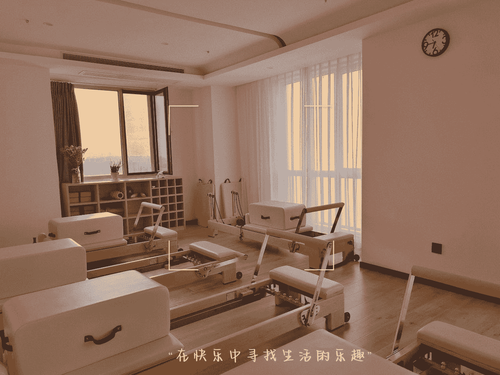

# 📽结语

2023的年终总结到此就告一段落啦！

总的来说，有成长，有快乐，有收获，有进步。

相比于22年来说，今年在工作和生活上也变得更加可控、更能沉着应对。工作和生活都是一个打怪升级的过程，遇到更复杂的问题，那就去解决更复杂的问题。

坚信量变到质变，把别人不看好的方向做好，不断打造新的差异化竞争。

最后的最后，展望下2024。希望持续保持这份热爱，去探索新的一年，去探索人生的下一片旷野。新年对自己的新期许是：

+   保持身体健康

+   保持情绪稳定

+   工程化能力提升

+   商业思维提升、商业能力突破

+   保持阅读、保持创作

+   扩大兴趣圈

静待24开花结果，交一份全新的答卷。