# 大学四年总结 | 海有舟可渡、山有路可循，大学四年圆满落幕

> 来源：[https://docs.feishu.cn/docx/TLmqdYmEtoXhOZxHSqZcJMDjnbf](https://docs.feishu.cn/docx/TLmqdYmEtoXhOZxHSqZcJMDjnbf)

> 原文链接：海有舟可渡、山有路可循 —— 大学四年圆满落幕

## ⛺前言

仅以此篇文章记录我的大学四年！

回忆大学四年，有惊喜、有快乐、有崩溃、有欢呼；

有过无数个为了赶策划、赶`ddl`的熬夜，更有凌晨2点做志愿活动、凌晨5点赶项目的通宵达旦。

梳理下大学四年的大事件：

+ 大一 —— 对一切新事物充满好奇，加入各种学生会和社团，扩宽认知和视野；

+ 大二 —— 各种活动策划，加入实验室团队，明确自己的就业方向，不断为了某一个目标而奋斗；

+ 大三 —— 考研 or 就业，把自己从迷茫中揪出来；

+ 大四 —— 顺利拿到梦想中的`offer`，开始为未来做规划，圆满落幕！

铛，下面就开始总结我的大学四年~

## 💭My Dream

### 沪漂梦

谈及我的梦想，时间回到2018年的那个夏天。高考的那一年，一直都很想来魔都。但因为高考的分数并不是很乐观，来魔都的机会几乎为零。于是在填志愿的时候，首选的就是先出省，之后再慢慢北上，最终选择的学校就从粤东来到了闽城。

大一的时候，心中只有一个小小的 `flag` ，就想着毕业后一定要来上海。但那会可能还比较天真，也不知道沪漂可以干什么职业。于是带着自己迷茫的方向，开始了自己的大学四年。

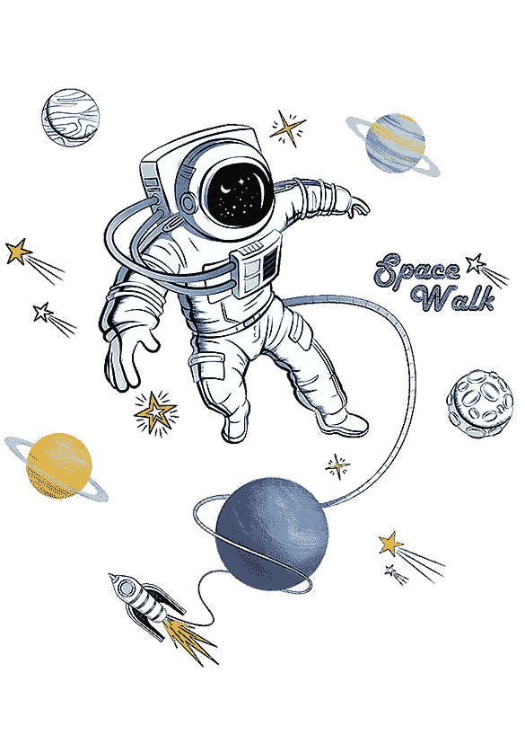

## 📚学业上

### 刚进大学时

刚进大学时，以为只是跟高中一样不断的读书就好，慢慢地发现这种只是老师眼中的乖孩子，但自身能力却很难得到提升。

入学前，我一直想着国贸、会计、经济学和金融是一样的学科，入学后……这几个学科的跨度还蛮大的。

入学前，总觉得学文科的人数学就不太好，入学后……各个学科的人都各有千秋，都有它们自己擅长或不擅长的领域。

### 转专业

还记得刚上大一时，我报道的是数字媒体技术专业。带着憧憬和向往的心情，踏进了大学的大门。第一学期的时候，竞选了班级负责人，从军训到团立项，再到课前一分钟，负责了大大小小的班级活动。当时几个班委只有我带了电脑💻，于是几乎工作日和休息日，都是在 `wps` 中做数据度过，班级各种信息的录入、报名表的收集、入党申请书的审核、军训服装的统计等等。

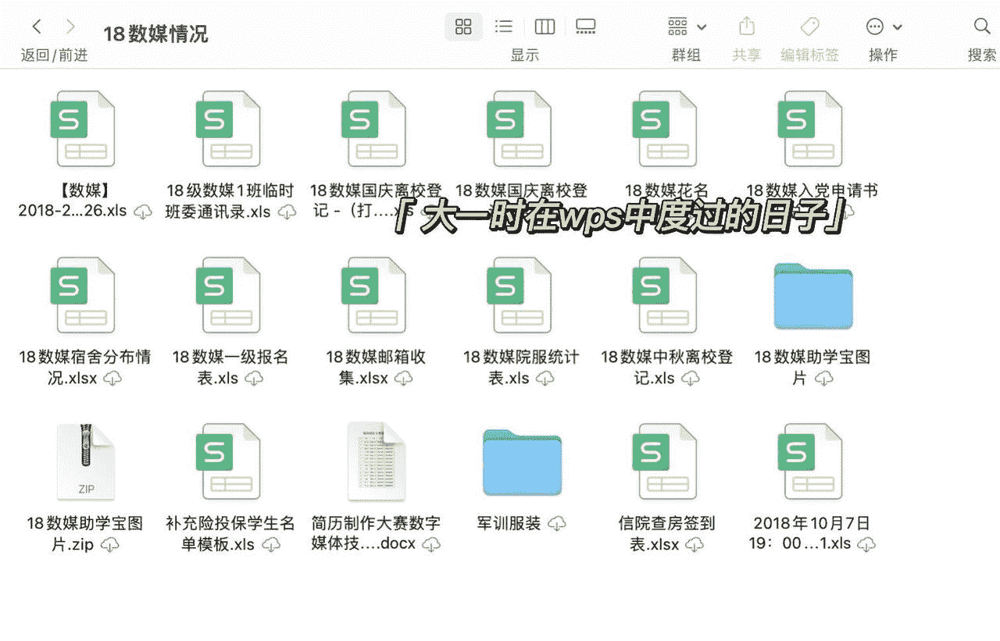

在读了树莓之后，大概觉得在这个专业里找不到我的存在感和天赋，不管是在摄影还是动画上，跟其他已经学过的同专业小伙伴比，都要差的太多了。于是在大一上后期，就有了转专业的想法。

最终通过笔试和面试，完成了转专业考核。转专业后来到了大一下学期，虽说已经落后软工专业同学一个学期，但我总感觉还是可以靠课后学习来多多弥补。于是每回没课的时候，都泡在图书馆看网课学C语言。那会大概的状态就是……大心课学C语言，下课后回图书馆继续接着学，还翻到了我自学C语言时做的笔记👇

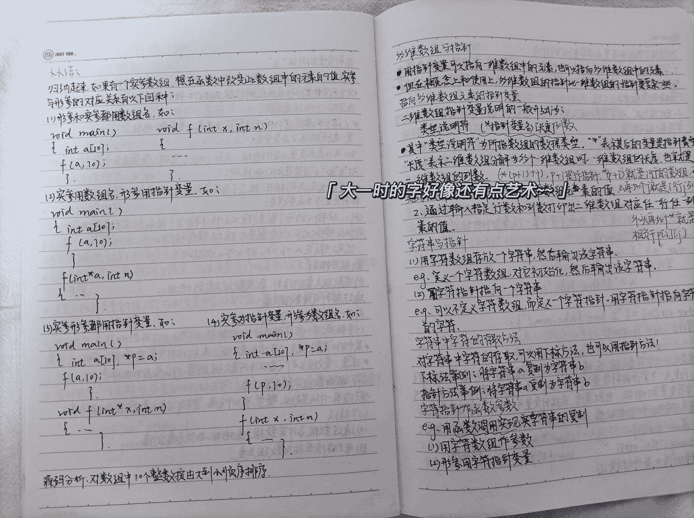

当然写程序最大的问题可能是卡着好久的 bug 一直没发现，同时 bug 找不出就总感觉有个心结在那里。于是上了第一节C语言课后，第一件事就是加老师的 `qq` 和🛰️，到实在不懂的时候，就厚着脸皮问。

有时候卡了好久的一个问题，老师一秒钟就解决了……

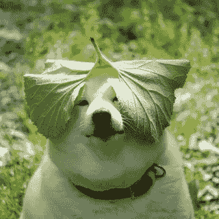

### 学习常驻点

下面想谈谈大学经常待的几个学习落脚点，分别有教学楼、图书馆、实验室和宿舍。

大一的时候，基本所有时间都是在教学楼和图书馆中度过，说来，那会还不懂什么时间管理，但是对时间的利用也还是蛮充分的。因为我们宿舍和教学楼离得有点远，而大一的时候课程又都比较多，所以我一般中午吃完饭以后会直接去图书馆学习会然后休息，之后等下午2点上课（ps：食堂离图书馆比较近）。

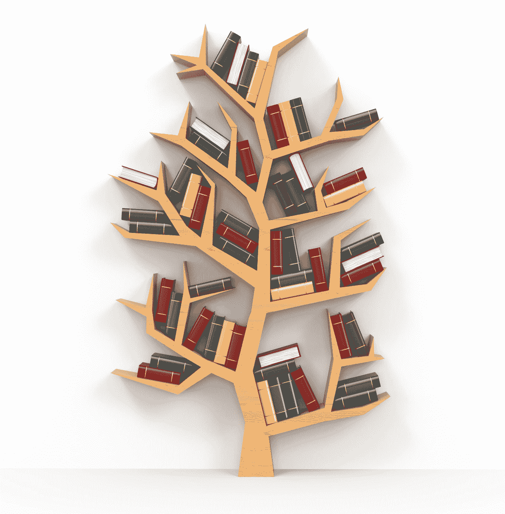

到大二的时候，因为一次偶然的机会，加入了学院科研老师的工作室。谈到实验室，自然而然地也就谈到了学习常驻点。原来大一是每天图书馆，到大二大三的时候，就是每天实验室打工人。再加上实验室离宿舍比较近，且在教学楼附近，于是每天除了上课和社团活动之外，其他时间基本都泡在实验室里。

### 奖项

谈到大学的另一大收获，莫过于是奖学金和比赛辽👏 。奖学金上，拿过多次一等奖学金，诸多单项奖学金。比赛上，拿过计算机大赛的国银、挑战杯的省金和一些不知名的奖项。统计了下得过的荣誉，大概是接近40+证书。最后在大四统计四年成绩的时候， 斩获了专业第一的成绩~

### 项目

从大二开始，跟着实验室老师做了一些大大小小的项目。从学校的教学平台，到地方政府乡村振兴门户网站的建设，再到公司宣传网站的搭建。经历过项目的重构、需求的变更等等问题，在一次又一次的实战中获取经验。

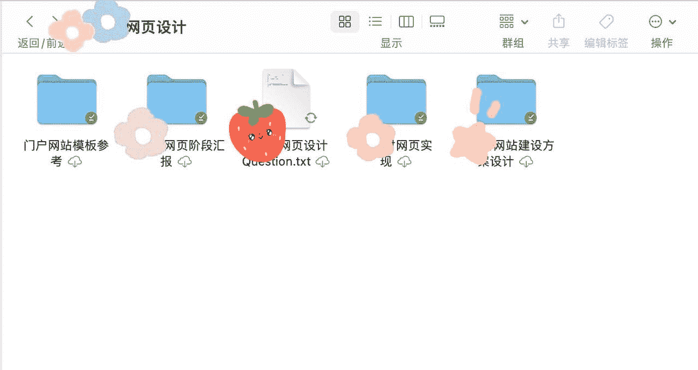

## 📑活动策划

### 社团活动

大一那年，参加了两场较为大型的志愿活动。一场是地方马拉松活动志愿者，另一场是生态伙伴大会。参加生态伙伴大会时，从志愿者培训，到上岗解读，短短3天的时候，收获颇丰。还记得当时是5G刚出现，而我当时上岗的岗位也是在5G的展厅里。短短几天的时间，学到了很多课本之外的知识，也更加明白了一山还比一山高的道理。这也让我在往后的学习悟出：不要仅局限于课本的知识，在空暇之余，也不要忘了多看看外面的世界。

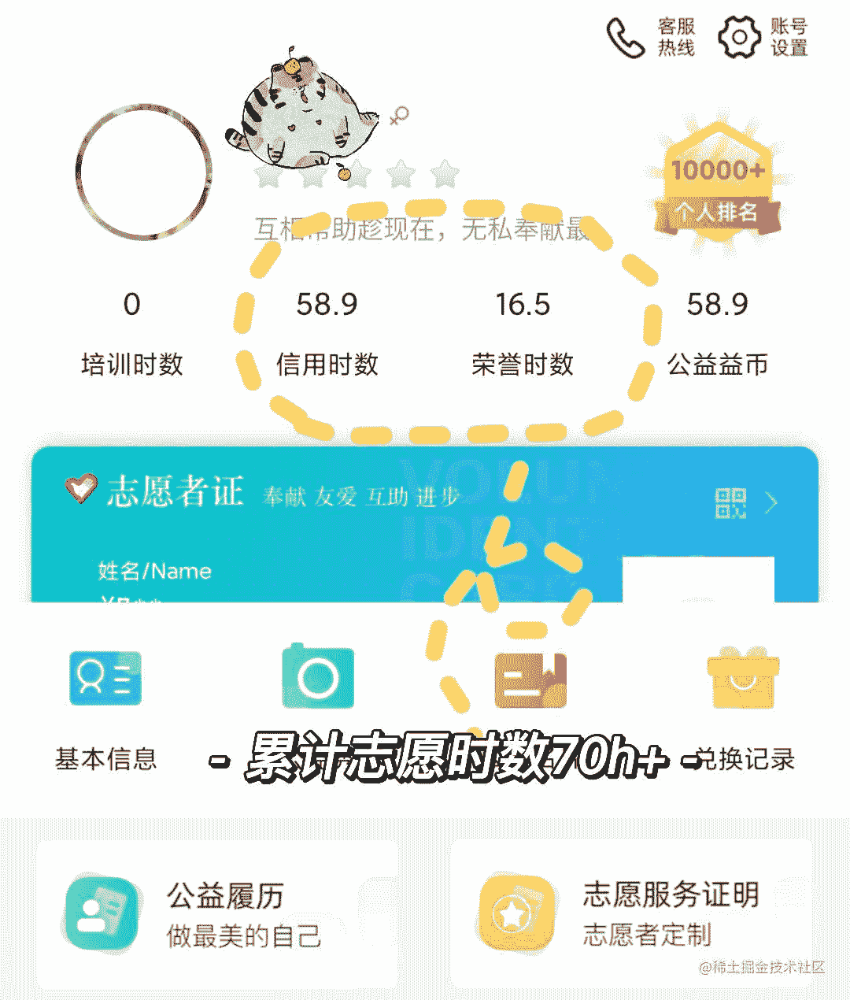

大二的时候，在学生会当了一年的干部。跟其他性质的组织还较为不一样的是，在任职期间我主要负责活动策划部分，于是带领干部干事撰写策划书、运营👸号等多项技能。

策划过大大小小的活动，小到送温暖、孵化区活动；大到营销大赛、招募会活动。对于一场活动来说，需要考虑到众多因素：活动前期、活动中期和活动后期。从策划书的撰写到活动结束嘉宾的离场，整个过程都需要 `owner` 来把握好每一个细节，随时调配各个区域的组织人员。

现在返回去看策划过的活动和修改过的策划书，突然又回忆起了大二时的忙碌和充实。

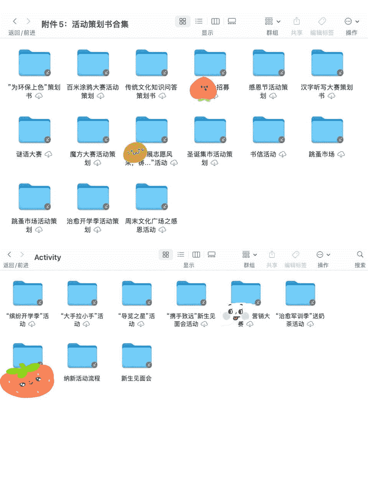

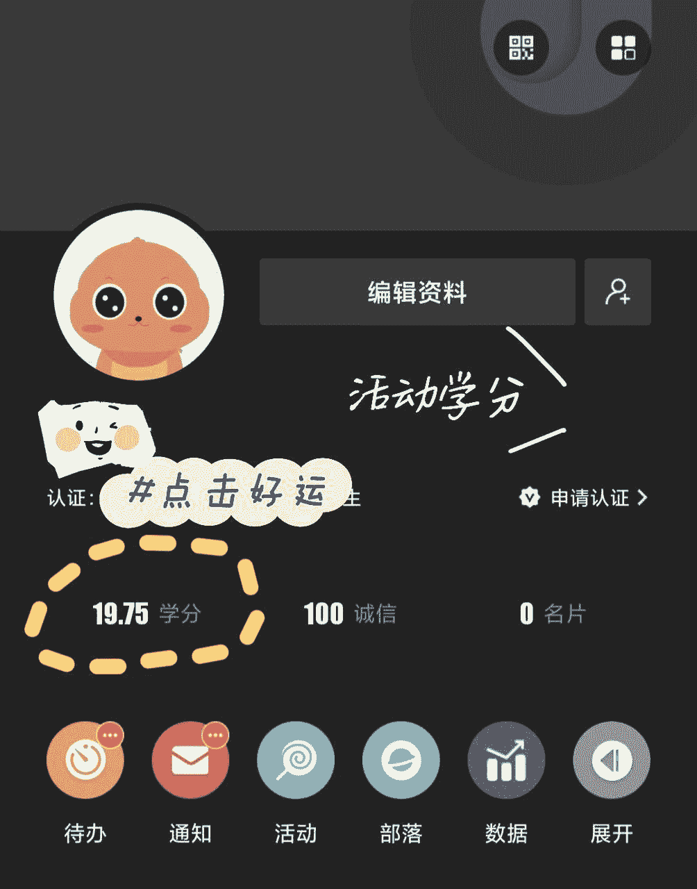

### 研发中心

“把策划能力搬到实际运用上”，这或许是对策划案所学知识的突破收获。在大三的时候，由于实验室业务的不断扩张，随之而来的是宣传和运营。虽说运营群体只针对高校师生，但在这过程中也逐渐发现了，从一个领域到另外一个领域的跨越，也有着很大的区别。在实验室中，举办过开发大赛，写过无数篇宣传推文，随着数量的不断积累，慢慢地策划能力又有了一个很大的提升，宣传方式和活动内容也在往一个更优质的方向走。

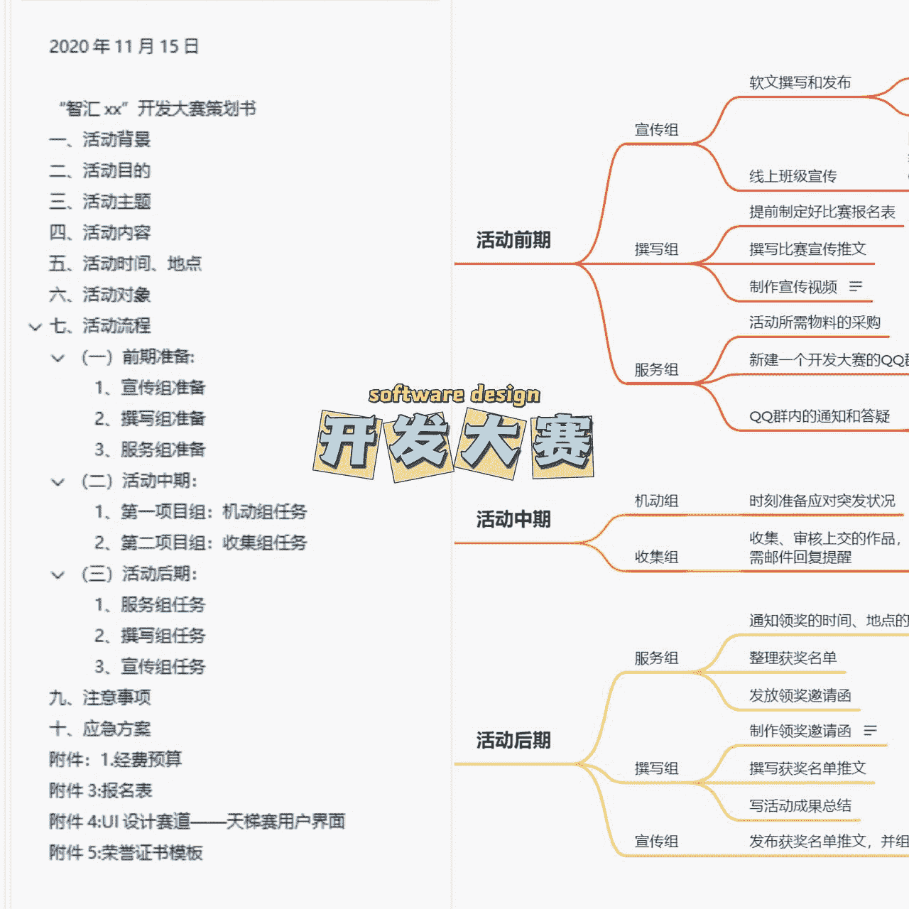

### supriser

谈及惊喜这两个字，只能说我太喜欢给别人制造惊喜辽。从大一开始，就很喜欢给舍友和实验室的小伙伴筹办生日惊喜。比如，把舍友先骗出去校外看电影，然后我们其他几个人在宿舍布置生日宴。等电影结束回来了，就是惊喜时刻了👻 。

或者，跟舍友的BF串通一气，让BF把她带到我们布置的场地中。又或者，先给舍友制造一种忘记生日的假象，然后让学生会中的朋友骗她要开会，于是一场教学楼的惊喜就开始了👏。

当然，除了舍友的生日party外，不可或缺的是给实验室小伙伴制造惊喜啦。还记得有一回实验室老师生日，那应该怎么准备才有惊喜呢？👀

首先，应该先提前联系师娘，maybe……我觉得师娘可能是最了解老师的人。可以从中知道老师喜欢什么不喜欢什么、现场该怎么布置、生日蛋糕应该选择什么样的、怎么样引导老师走进惊喜现场更为合适、后期录像剪辑谁来负责等等问题，在了解了以上问题解决思路后，开始作出活动方案并联系其他小伙伴协同参与👻

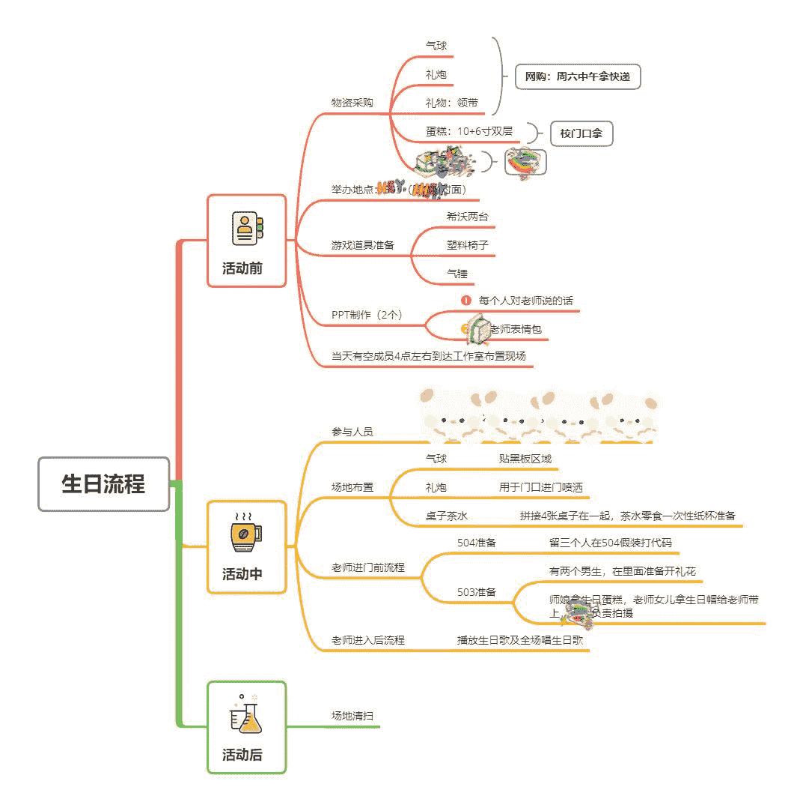

### 与掘金

大三下学期的时候，因为参加了青训营，且在社区活跃，于是有了后来与掘金高校的合作活动。跟这么大的技术社区合作可以说是第一回，角色和模式的转变，让我对活动策划又有了新的认识。

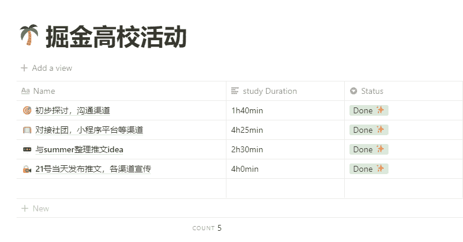

碎碎叨叨讲了很多策划相关的收获，后续也将整理出一些撰写策划书相关的技能，大家可以多留意`SyllableCheng`的干货笔记（📕和👸号同步）

## 👩‍🎨技术提升

回忆完学业上和活动策划上的进步，接下来谈谈技术上的进步。

### 与前端结缘

大一暑假的时候，因为一场不被特定安排的夏令营，与前端结缘。刚接触前端的时候，对这网页中各式各样的代码充满好奇。当时我在想：为什么几行简简单单的代码，就能实现出这么炫酷的效果？

于是带着这份好奇，驱使着我学习前端到现在。前期的学习大部分是网上的一些免费课程，到后来开始过渡到一些学习平台的付费课程。个人觉得视频课的学习会较大的提升学习的广度和实践能力，但是如果要提升自己的学习深度，更多地还是要去找一些比较有影响力的技术书籍，有50%以上解决不了的问题，最终都可以在书籍中寻找到答案。

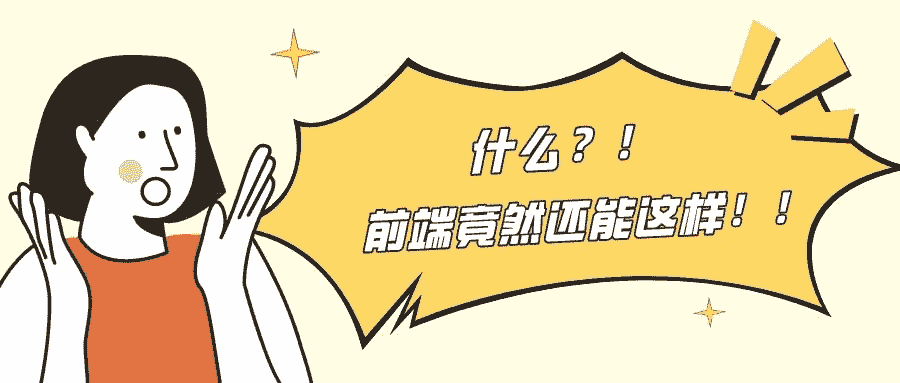

### 人生转折点

大学最大的一个转折点，应该是大三下学期开学的时候。大三下学期应该算是一个很大的分水岭，大家都会想要考研 or 考公。而就在那个时候，善后大二的比赛还有一点余热。这个时候大部分人会选择去继续打比赛，但在比赛过程学到的更多是软技能，而不是技术能力。因此，这个时候就需要权衡，比赛和喜欢的就业方向，哪个更为重要。当时的我还想过：继续打比赛？但发现，简历也写不了很多奖，有些奖也不一定别人会认可，最重要的还是把重心放在能力提升上。于是将比赛至于学业之后，把专注力更多的放在自己的就业规划上。

或许说，找到一份简单平凡的工作是简单的，但是要找到一份较好的工作，可能就还有好长一段路要走。这里在2021年的年中总结和年终总结谈过，具体戳：

+ 2021年中总结 | 过去三个月的1200多个小时里，我收获了什么？

+ 2021年终总结 | 我们终将上岸，晴空万里

在遇到转折点之前，我可能觉得我是一个不爱思考的人，宁愿用更多的苦力工作也不愿意去了解它的底层思想。但其实，在秋招的过程中慢慢地会发现，大脑是越思考越活跃的，只有不断地思考和改变思考问题的思维方式，才能慢慢地让自己各方面的能力得到一个质的提升。

### 写博客Blog

技术的提升可以通过做项目、不断学习新技术等方式来得到一个突破，但因为我们每一天要接受到的信息量是比较庞大的，学过的知识很容易忘记，这个时候就需要通过输出来倒逼自己输入。同样也是在准备秋招的时候， 开始尝试着写博客。一开始写博客的目的可能很纯粹，就是简单地想要给简历加分。但在写博客的过程中，慢慢地挖掘到自己在写作方面、制图方面和排版方面的天赋，随之带来的也就是更多的加分项。写博客相当于能给自己一个定心丸，确定学过的知识都是自己的。过后即使忘记了，也可以随时随地打开博客平台的文章进行翻阅，这其中也会减少自己很多心智负担。

总结写博客带给我的几点益处是：①简历加分；②表达能力提升；③思维方式改变；④认识到更多同行业的技术大佬，遇见更多优秀的人。

也让我能够更快的意识到自己与他人之间的差距，努力向更优秀的前辈靠拢。

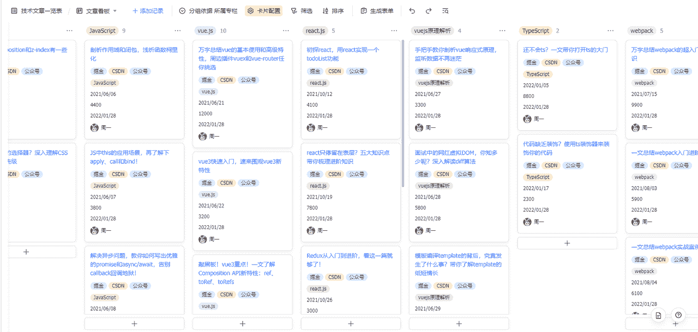

个人博客：[星期一研究室mondaylab](https://jacqueline712.github.io/mondaylab-blog/)

技术文章内容看板：星期一研究室 - 技术文章内容数据管理

### 方向挖掘

单单只学前端，好像并不能满足现代职业发展的需要。因此到后期，在前端的基础上，也会再挖掘一些衍生的技术技能，比如：`nodejs`、数据库、跨端技术和产品思维等等。

## 🕵软技能

### 我的第一份副业

回忆起我的第一份副业，可能是在大一下的时候。那会刚转专业完成，平常除了自学和上课之后，时间相对还比较充裕。课一少，感觉我就很容易陷入焦虑状态。当时身边的同学经常会去奶茶店兼职，或者去商场发传单等等这些，这些对于当时的我来说属实是有一点点羡慕了。但紧接着，当时我觉得如果去做这些兼职工作，那么最终得到的可能只是金钱上的增加，而不是技能上的提升，更潜在的问题也就是导致时间的浪费。

因此，当时就不断地挖掘自己身上的技能，最终我的第一份副业是：PPT设计。在做PPT设计的过程中，挖掘到了原来PPT还可以做海报设计、H5设计和教学手册等等。大概兼职了3个月，累计制作的PPT件数有100余份，写过的PPT类型有述职报告、答辩讲稿和销售策划等等类型。在那之后，慢慢地觉得这个方向并不是我最终想发展的职业方向，于是摒弃了这个方向，转向了其他想发展的方向。

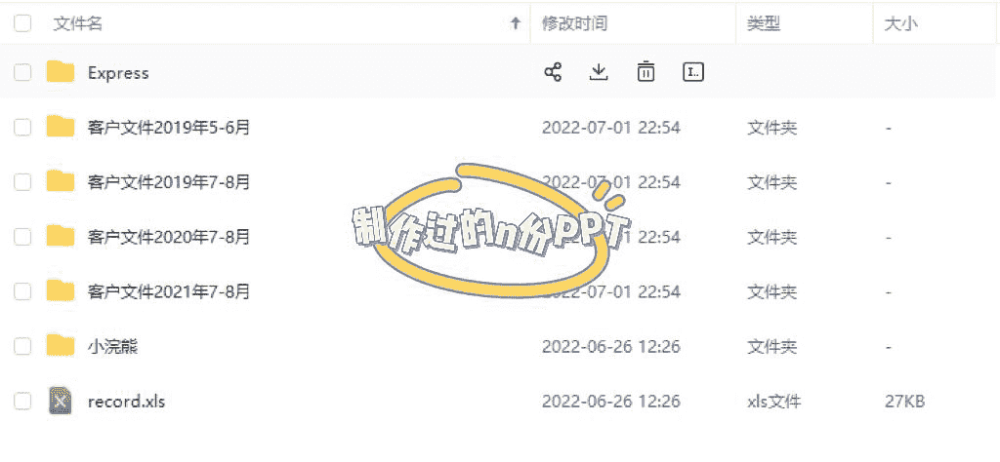

### 设计能力

谈到设计能力，这个时候可能要追溯到高考后的那个暑假。似乎在上大学前，大学生对 PS 这种工具都会非常憧憬。于是就会有各种对未来的美好假设，比如：上大学了一定一起要学会PS/PR等等工具。当然，在我心里也一直有这个憧憬。于是同样也是到了大一下那个学期，因为课程比较少，自己就开始尝试着在网上找各种非付费资源，开启了我自学 PS 的路程。偶然间还整理到那个时候做的笔记：

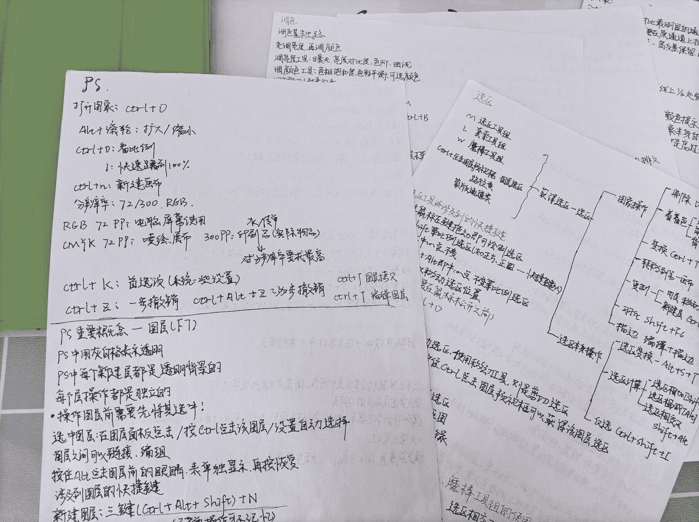

在看课程过程中，接触到 UI 这个领域。对于当时还没有什么就业目标的我来说，这无疑又打开了新的思路。于是我又搜到了很多 UI 相关的资源，并且在大一的暑假，开启了 UI 的自学之路，这里放上用 PS 临摹过的n张网页。

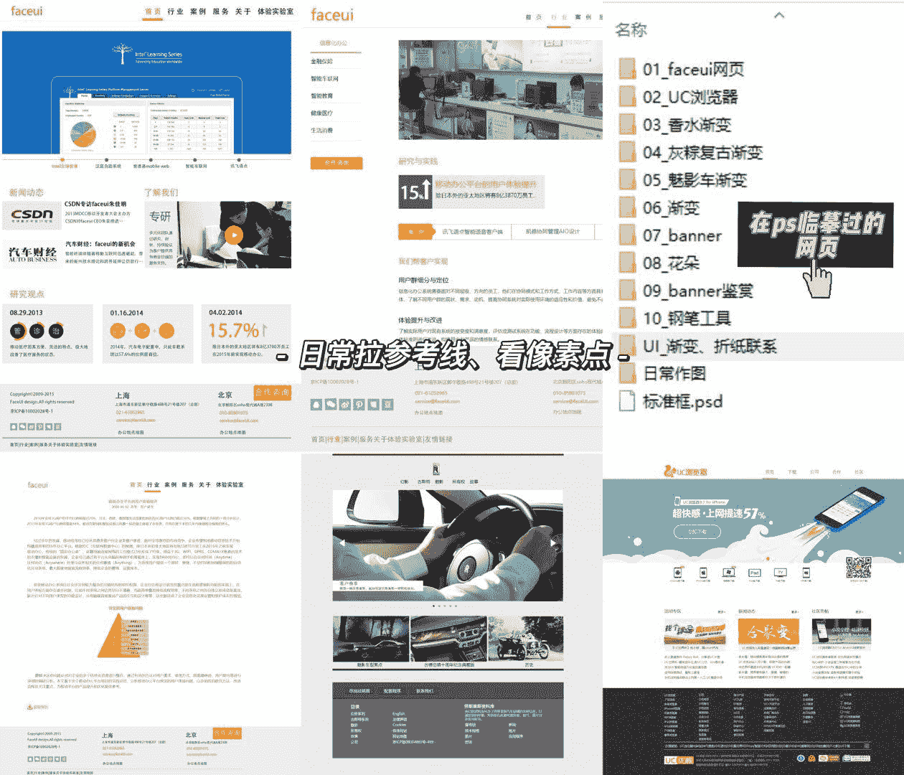

大概学了有接近100个小时PS之后，因为一场夏令营，接触到了前端领域。自此之后，PS 也就变成了我的业余加分项而不是必选选项。

紧接着到大二大三的时候，因为写👸号、写博客等对画图都有一定的要求，于是后来又学过 Axure RP 、visio 、diagram 、exalidraw 和 即时设计 等等工具。

这里也鼓励学弟学妹们在大一大二的时候，如果目标不明确的情况下，可以尝试着把自己已拥有的能力当做一个变现工具，在变现过程中去看自己是否适合这个领域，再从中慢慢挖掘自己的新技能。

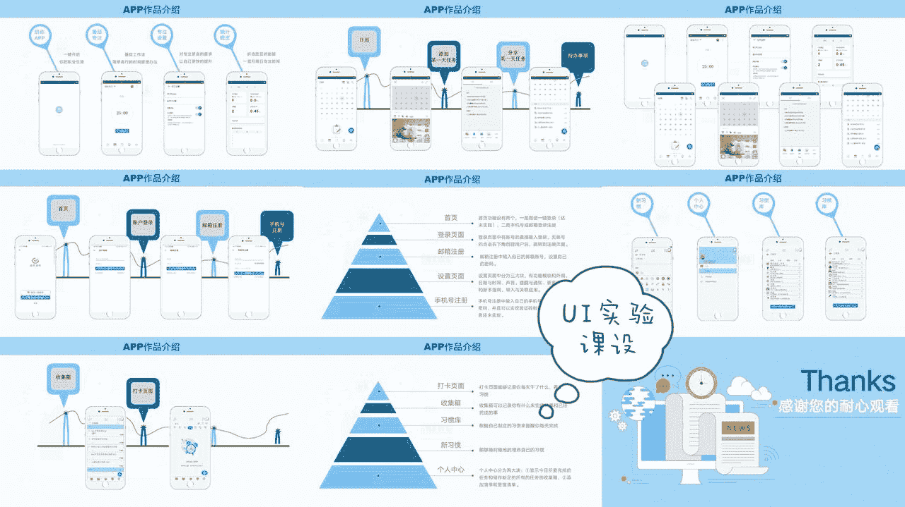

### 资源整合

谈到资源整合能力，这可能是一种潜移默化的技能。从大一开始，我就会对电脑的文件进行整理归纳。一开始还想着说这可能是每个人都会做的事情，但直到我看到身边同学的电脑桌面后……🥶

从文件的整理，到活动的策划，再到后来写博客，愈发地挖掘到这是一种技能。经常性地可以把很多凌乱的知识点通过分类整理的方式，将其从无序到有序去进行过渡。

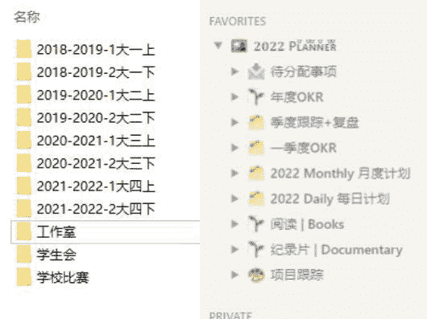

### 语言能力

谈及语言能力，能联想到的莫属于外语的学习。大一上的时候，当时还很想转专业到外语学院。但因为学校能选择的外语专业比较有限，于是把学习外语这项规划，放到了自学的规划上。虽说目前连最基础的英语都还没有学清楚，但也算是完成了一些阶段性的小`flag`。英语上，读过流利说阅读、薄荷阅读、懂你英语、考研英语外刊君，沉迷过在「背词达人」中种树背单词，也很心水于在「不背单词」中打卡。日语上，大一下经常在马原理课程下偷偷学五十音图。回忆起来，当时马原理老师在课中看到我在学，还跟他聊起过日语中难易的内容。日语大概是学完五十音图和基本语法后，后来两本书还在书架上吃灰中🔦

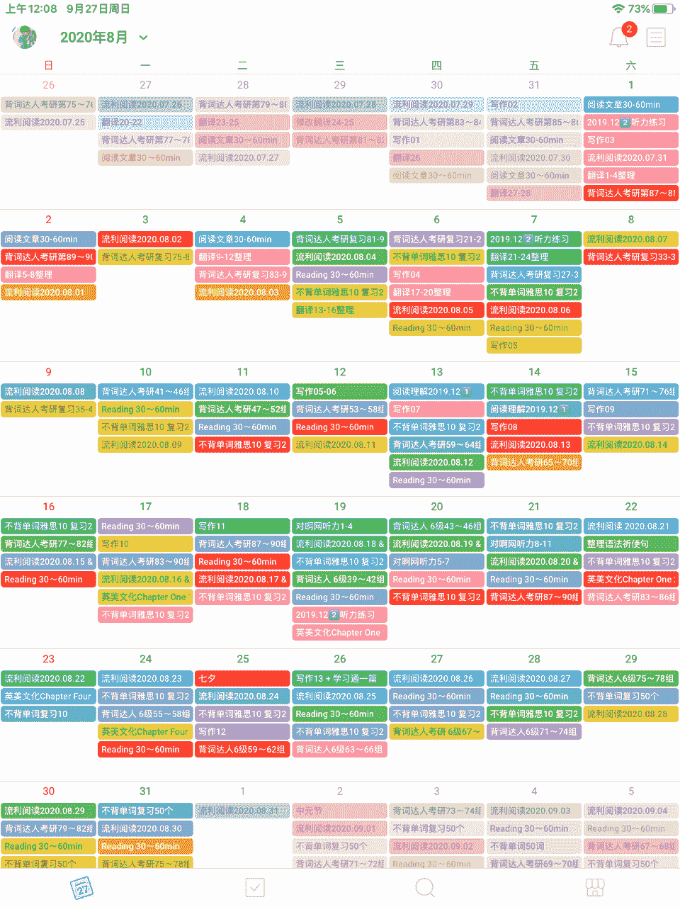

### 剪辑能力

谈及剪辑能力，大概是受到短视频时代的影响。2021年的寒假，因为疫情的原因，不能逗留在学校，只好提前回家。回家后，我就想着在技术之外，是否还能再捣鼓一些东西。当时看某音和某书的一些博主拍摄视频的节奏很清晰，有一些特效也超有代入感。于是在此之前。我就想着，自己能否也尝试着去剪辑一些视频。基于这样的背景，周一也开始捣鼓了起来。视频的呈现形式需要拍和剪这两个步骤，当时适逢春节，家里也开始大扫除了起来。于是我就拿着三脚架，把一天大扫除的时光给先录下来。录完以后，最棘手的事情大概就是剪辑了。因为第一次用剪映，软件里面的很多工具用的都不太熟悉。最终摸索出来的剪辑思路是，先导入视频，把里面想要反映的片段给✂️出来，其他一些无效片段就先删掉。之后在有效片段的基础上，再加特效、字幕和配音等等。最终形成了三个主题的成片：①大扫除的一天；②大扫除之采访篇；③大扫除之xx篇。

第一次剪辑总是有些粗糙的，在此之后，我的剪辑大概又落灰了许久。直到去年11月份的时候，心血来潮想给自己拍一部记录大学四年成长点滴的微电影。刚接触“微电影”这么大的词，好像总是有点无从下手。因为一听到“微电影”这个词时，好像就会联想到跟视频脚本、音效、场景等等挂上钩。虽说万事开头难，但是有需求了，就完成需求。慢慢地，从找与主题相关的视频素材，再到挖掘脚本模板和写视频脚本，最终到场景拍摄和剪辑。在经历了约38h+，最终以此微电影谢幕了周一的大学四年。

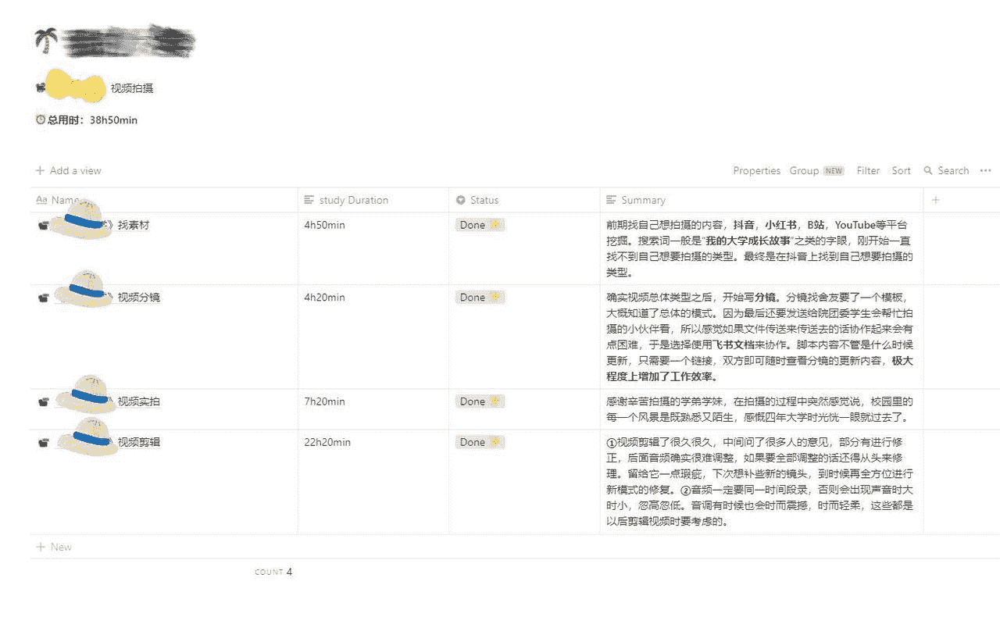

虽说在剪辑方面还是很🥬，但是路漫漫其修远兮，也算挖掘了新的潜力，未来慢慢精进撒~

## 🍥与自己和解

上面聊完了大学四年的一些成就，接下来谈谈在大学时与自己和解的某些时刻~

### 摒弃阴阳怪气的人

似乎上大学以来，阴阳怪气的人总会有很多。学习成绩好一点，别人就会说这个人好像天天跟老师靠近乎，一定是走了后门才有了这样的高分。

又或者如果你天天去图书馆，那么身边就会有人说：你看那个人，天天在学习，也不知道在学什么。

再或者还有人跟我说：我们这种学校，没人看的上的，别假努力了，不如早点出来搬砖吧。

当然，以上确实都是我的亲身经历。但在遇到这些风言风语时，我会先问我三个问题：

+   毕业后，你还有可能跟这个人有交集吗？

+   他/她说这句话给你带来了哪些影响？如果是不好的影响那干嘛还听对吧。

+   如果此刻放弃我当前正在努力的方向，我又将会变成一个什么样的人，我又该何去何从？

那为什么总会有这么些人会有这么奇奇怪怪的言语呢？

这**里引用**徐涛老师马原理说的一段话来回答这个问题：身边之所以总会有那么一两个人对你时不时的冷嘲热讽，是因为你总是比他优秀，但是又优秀的不多，这也就造成了两个人的同一性，有了同一性也就又制造了两个人的斗争性。那怎么解决这种斗争性呢？不要去怪别人，而是消除你跟他之间的同一性。让自己变得更优秀一点，等到比她优秀很多很多的时候，你们之间也就不再具备可比性时，这种斗争性也会消除了。完整视频👇🏻：

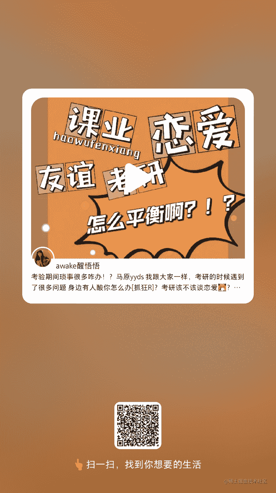

## 学会延迟满足

很多时候，我们都是比较焦躁的那一类，总是急于求成。无外乎，在大二上之前，我也是这一类人。很多东西如果不能看到结果，我总会不断的怀疑自己，或者不会去开始行动。

但其实，很多事物都是一个**循序渐进**的过程，就像学英语这件事，如果你口语不好，却想着两天速成学会口语，那几乎是不太可能的。而如果拉个战线，先定个小目标：学习两个月，能开口说出一些简单的场景。基于这样的进步，之后再慢慢叠加新的目标。通过这样的延迟满足，想象下两个月之后的进步，你就会更有动力地去学习。

到后来，我也慢慢地学会了延迟满足，很多东西都先立个小的flag，一步步达成，心态上和思想上也会更坦然地面对这些问题。

## 不抱怨

日常生活中，一年365天，总会遇到大大小小的困难事。而于周一而言，遇到困难时，第一件事想到的大概就是怎么解决问题最为合适。

身**边遇到过很多小伙伴，在**遇到一点小事时，第一时间想到的总是撇开是自己问题的可能，而是总把事情的起因抱怨给其他人。也就是说，有问题一定是别人的问题，而永远不会是自己的问题。比如说：

+   老师布置了一个很难的课设，别人会开始抱怨这个老师为什么这么烦，就一个课设有必要要求这么苛刻么？

+   又或者，期末成绩考的不好，一定是改卷老师针对我。

+   再或者，把自己的平庸归因于学校不好等等

+   ……

对于这种类型的处理人来说，大概在他们抱怨开始的那一刻，也就意味着后续总有些时刻需要为自己的一些行为买单吧。

因**此，我们要**做的第一件事情不是抱怨，而是不管遇到大大小小的事情，都要及时做好自己的规划。如果遇到事情堆叠在一起的时候，那就把事情做一个优先级排列。

抱怨对于自己来说没有任何好处，还会从心理上，情绪上，给自己增添额外的负担。总结来说就是，遇事说事，遇到问题了，那就解决问题。

# 🌈想感谢的人

谈完与自己和解的征途，接下来想谈谈在大学中遇到的良师益友。

## 我的英语老师

**很幸运，大一的时候遇到了一个超负责任的英语老师——phoebe老师。** 当时刚好报了流利阅读的外刊，但是因为是刚起步，所以在分析长难句的时候总是会遇到各种各样的挫折。也是我的英语老师，她非常的用心，负责任，把我从一开始分析的不清不楚的英语句子，培养到了一看就能马上分析出长难句内容的能力。

当时每周都是一三五的课，一般我都会把前一天的问题先记录好，然后在下课之后直接问她具体的问题，比如说，为什么两个名词可以放在一起，为什么某个词在这里做的是状语的成份而不是宾语的成份等等各种奇奇怪怪的问题。记得有过一次问答最久时长是中午12点下课后，占用了老师半个多小时的时间在教室里分析句子，老师真的太用心辽！！

她每次总是非常非常细心的给我拆解句子，并解答出我的所有疑惑。没有上课时，我就线上直接拍照给她，然后她就发语音给我讲解，真的太幸福了！！正因为老师的负责任，我也从她身上学到了很多可贵的精神品质。

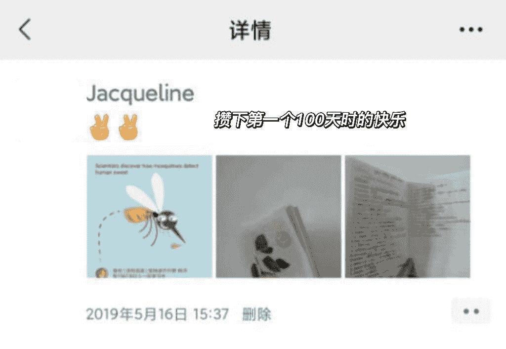

## 我的导师们

在我大学的成长中，还遇到了对我的学业和成长提供了极大帮助的三位老师。

其次是我的**毕设导师lele**，毕设导师可以说是在大学遇到的最为负责任的老师之一。不管是毕设还是论文期间，总会遇到各种各样的疑难问题。导师从开题报告到降重会议，每一步都非常细致地跟我们解读。细心、负责任的工作态度，不断地影响着我们往后成长的方方面面。一朝沐杏雨，一生念师恩。

接着是上选修课时遇到的**老师**，**选修**课老师的行事磊落和以德服人的性格可以说实在是太吸引人了！还记得有过一回在谈到我上她课时她对我的观察，她纠正了我当下存在的错误，就是逃避。这两个字看着很轻巧，但也是我们很多人成长路上的绊脚石。有时候我们就是不愿意去承认自己做错了什么事，害怕失败，畏惧失败。但其实真正能让自己进步的，就是去承认自己的错误，并加以改正。所以在那以后，不管遇到大大小小的事情，如果我不想去解决，我都会先想，我是在逃避问题吗？及时纠正当下不良的态度。

最后想感谢的是我的**就业指导老师Mr. Wang**。**Mr. wang**是我大一时的辅导员，当时有了解到他在帮学生做就业辅导。而其实我在大二的时候就开始会去参加一些简历大赛之类的比赛，所以我的简历基本上每年都是在不断更新的状态。还记得刚把简历发给王导修改时，他当下立马打电话问了我简历的用处，以及需要修改的各个地方和各种补充点和扩充点。所以很幸运，遇到一位很用心的导，及时帮助自己解决一些困难。

## 我的好朋友们

下面就想说我在大学里遇到的一些好朋友啦！

首先是我的好朋友ponyo，大二打挑战杯比赛的时候而结识。似乎是都有着各自的目标并一直坚持不懈的努力着，不谋而合而又志同道合。两个人每天都在踩门禁从实验室回宿舍，在计算着怎么让时间利用价值最大化。当时3月份的时候她也决定了要考研，而我也决定了秋招，各自忙碌着彼此当下最重要的事情。最后我在秋招成功上岸，而她也以高分的初试和复试成绩被心仪的学校录取。

其次是我的舍友们，舍友的理解也让我秋招在备试时得以一份心灵的安宁。大家互相理解，有问题及时提出解决，减少不必要的矛盾和摩擦。

## 我的父母

似乎每次回校爹娘给我最大的一句嘱咐就是回校要多出去走走，要适当放松学业。他们也不会说让我以后一定要成为什么什么样的人，而是说跟着自己的步伐走就好。是他们无条件的包容、支持和理解，使得我在这个拥有良好氛围的家庭中成长，让我可以不受外界干扰地去朝着我的目标不断前行。💕

# 🛴其他

## 一些遗憾

大学四年，经历了很多很多，定格了很多精彩瞬间，但同样也留下了一点小遗憾。总结下来大概有以下几点：

+   虽然拿了很多次一等奖学金，但还没有努力拿到一次国家奖学金。

+   没有更早地规划自己未来的方向，应该尽早地安排去考更多对未来有帮助的证书，或者是参加一些更有国际性的比赛。

或许带着这些小小的遗憾，它也将让我去追寻更为精彩的未来~

## 一些感动瞬间

好像每一年都有学弟学妹来私信说他们遇到了大一教我的英语老师，然后每一年老师都会以周一为例子去鼓励新生要好好学习。每回听到的时候就感觉到小时候听到“榜样”这个词的心情一样，或许从另外一个层面来讲，我很想在某方面去得到突破，而同样也很幸运地，在这方面又遇到了一个良师。

记不清是大二还是什么时候开始，每一年的平安夜都会收到好朋友的贺卡，每次我都会把它存放在我的小盒子里。今年打开的时候，发现每一封祝福，似乎都是对当前年份所处状态的一个特写。

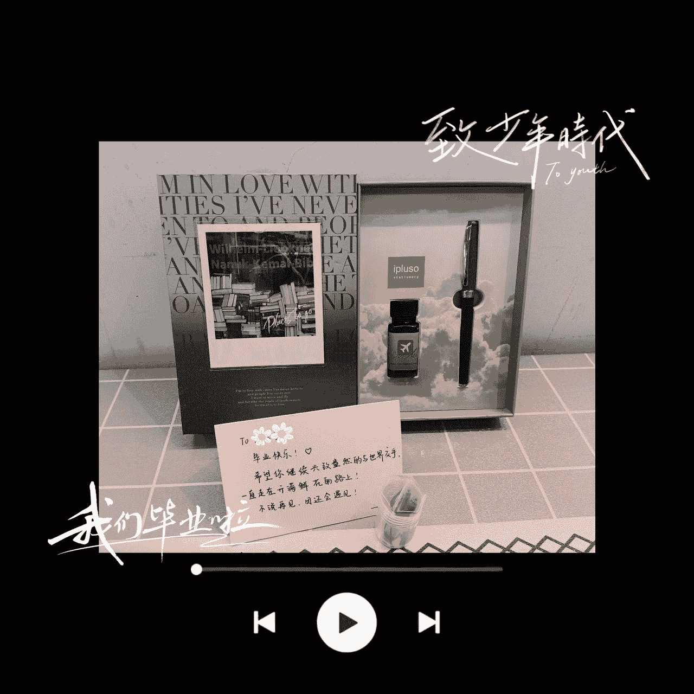

## 致学弟学妹们

叨叨了这么多，最后就是基于大学四年的一些感悟，以及收录到很多学弟学妹询问问题的方向点，积累了一些话题问答。或许看了这些回答以后，能给当下迷茫的你带来一丝方向感👇🏻。

### 1️⃣ 如何寻找到热爱的方向？

如果你一直都在找寻自己的方向，不妨先定下第一个方向。开始行动，行动过后，看看自己合不合适。合适了继续，不合适了当试错。在大学里的每一次小小的尝试，都有可能是人生中一次大的转折点。因为你不尝试，永远不知道自己的无限潜能在哪。

### 2️⃣ 如何应对大学中不喜欢的课程？

大学**里总会遇到很多**不喜欢上又不得不上的课，这种课我称为💧课。对于💧课而言，要做的是：①不要抱怨学校为什么开设这种课程，之所以开设就肯定有它设置的合理之处；②要思考在这种课程上，如何利用最短的时间，让期末产出分值最大化。③提前准备好其他课程的作业，之后就可以利用上shui课的时间，先把课内的事情完成了，之后在课后的其他时间，就可以安排来做更多有意义的事情。

### 3️⃣ 如何平衡心态？

有时候会羡慕别人运气很好，为什么只付出了你10%不到的努力就能得到很好的结果。但世间公平和不公平都是相对的，有可能你就在其他方面就有这样的运气。如果运气不行，那就只有努力可以来补救。所以这个时候是放平心态，只要是自己想做的事情，就拼尽全力去做，尽量不要受到太多外物的干扰。“行动了不一定能看到成果，但是不行动，一定看不到结果”。

### 4️⃣ 题外话

这里周一正在筹划一个面向大学生的话题问答库，涉及主题包含方向抉择、就业分析、摆脱焦虑等等主题，👸号敬请期待ing~

# 📸结语

回顾大学四年的1460里路，每一天都在教学楼、实验室和宿舍穿梭着🏫

学的东西越多，越意识到学无止境的道理，也更明白了其实终身学习的能力才是一个人的必杀技和大招📙

非常庆幸一路上遇到了许多良师益友，化作一盏又一盏明灯照亮我前行的路，让我一直在正确的道路上努力奔跑🌾

大学四年里，每一步我都走的无比认真，格外仔细。终于用大学四年的时间来弥补高考时留下的遗憾，重新递交了一份人生的答卷🗞

未来我还将更努力、变得更好，向更优秀的前辈靠拢💪🏻
