# 2021年中总结 | 过去三个月的1300多个小时里，我都收获成长了些什么

> 来源：[https://docs.feishu.cn/docx/Jg8ndBxPOoShePxPDrsccrjfn3b](https://docs.feishu.cn/docx/Jg8ndBxPOoShePxPDrsccrjfn3b)

> 原文链接：https://mp.weixin.qq.com/s/zrWXclDrTHGzmTYGX3NcmA

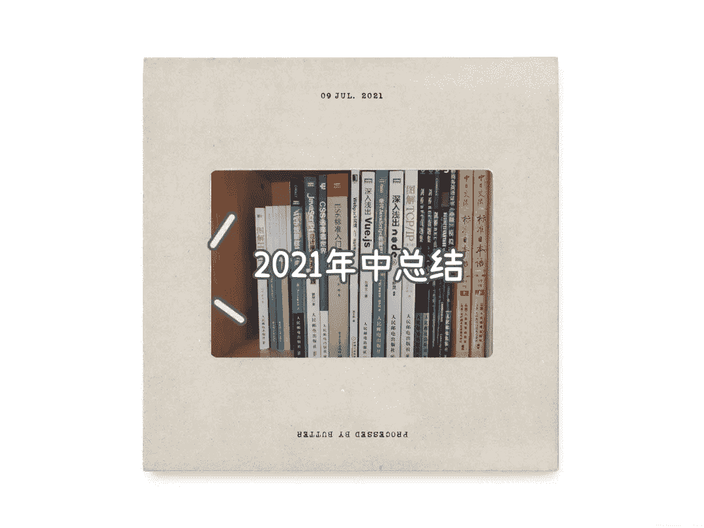

# 🕛序言

今年三月初，善后了上学期事情之后，我开始在想，我的未来规划。

身边的好朋友和同学都在筹划着自己的未来，考研的考研，考公的考公。父母和老师们也在劝我说考研，问我考不考研。

依稀记得回校的那一天我爹还在问我说要不要考研，而这个时候我开始有点动摇了。原来一直不打算考研的我，这个时候在想考研的结果会不会是更好的？

一波了解之后发现，我准备的时间还是太晚了，离我的目标学校可能还有点距离。于是放弃考研想法后的我，开始了我的就业筹划。

这个时候已经到了快3月底，各企业的春招正在紧密张罗着。而对于我来说，我发现自身除了实践以外，理论知识非常差。基于以上各种条件，我开始查漏补缺。

在过去的3个月里，对自己的规划主要有以下突破👋

# 📚日常Daily

## 每日计划

从原来的滴答清单，进阶到用Notion做每日计划，无意间发现自己每天摸鱼的时间变得很长。于是从这个突破点出发，减少自己玩手机的时间，利用碎片化的时间，学习更多的知识。

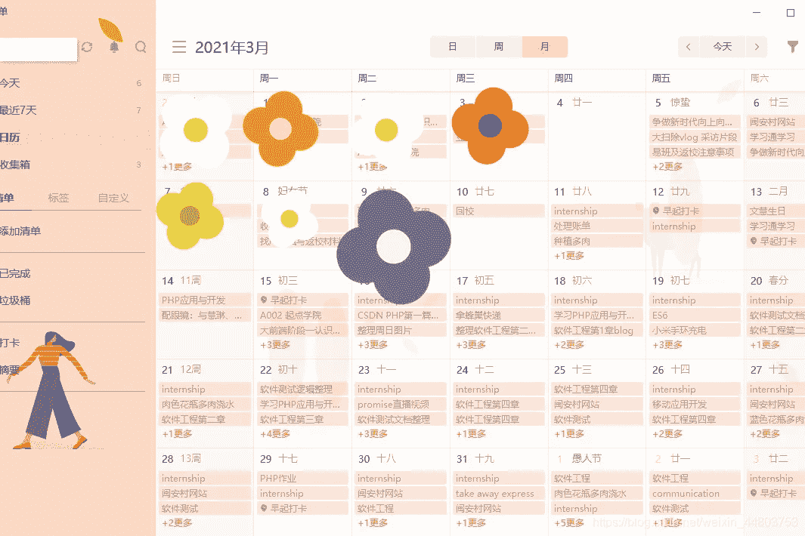

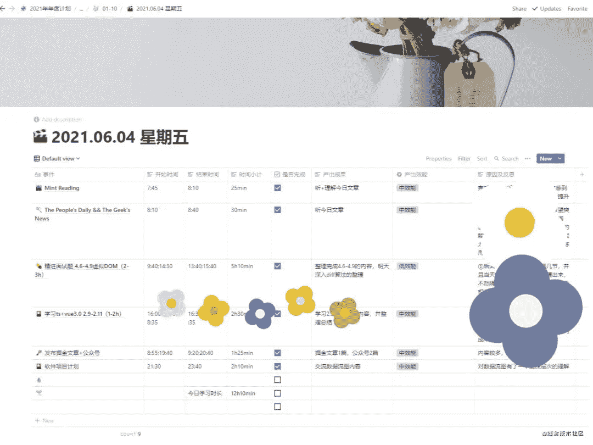

用Notion的好处在于，可以更直观的记录自己每天的学习输入和产出，通过复盘来及时调整学习计划，避免重复性的工作。

## 英语

在坚持了1年的英文外刊精读后，希望打破舒适圈，向英文原版书出发。

直到今年春节快接近开学的时候，我一直在找寻突破我学习英语的边界，最终找寻到了我想要突破的边界，就是向英文文献和文档迈进。

于是从来没有读过原版书籍的我，选择了使用薄荷阅读。我选择了词汇量比我实际词汇量小一档的书本，这样不管是在心里上还是精神上都不会给我带来太大的阅读压力。

经过100天的学习，边听边理解的这个步骤，从一开始的一天 2h ，慢慢地到 1.5h ，再到 50min ，最后在读最后一本书的时候，已经到了可以 20min 内完成阅读。

感受到知识的磅礴，也更加坚定了自己的目标。

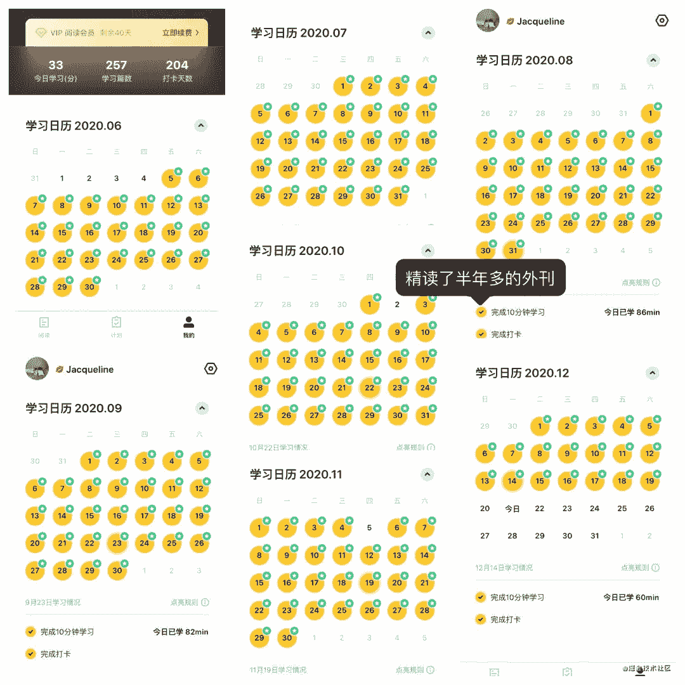

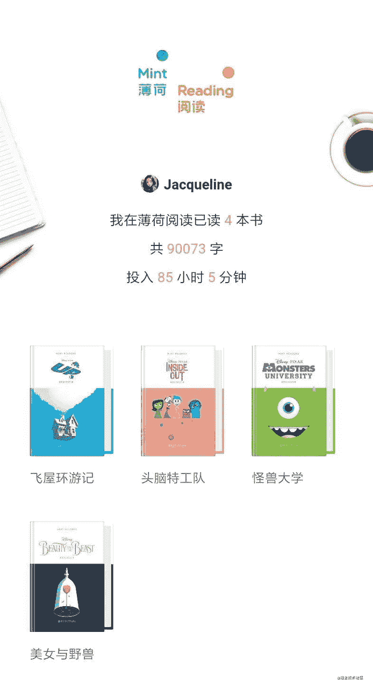

## 坚持早起读新闻

深知熬夜百害无一利，于是做到了早睡早起。将早上的时间利用起来，听新闻和读新闻。

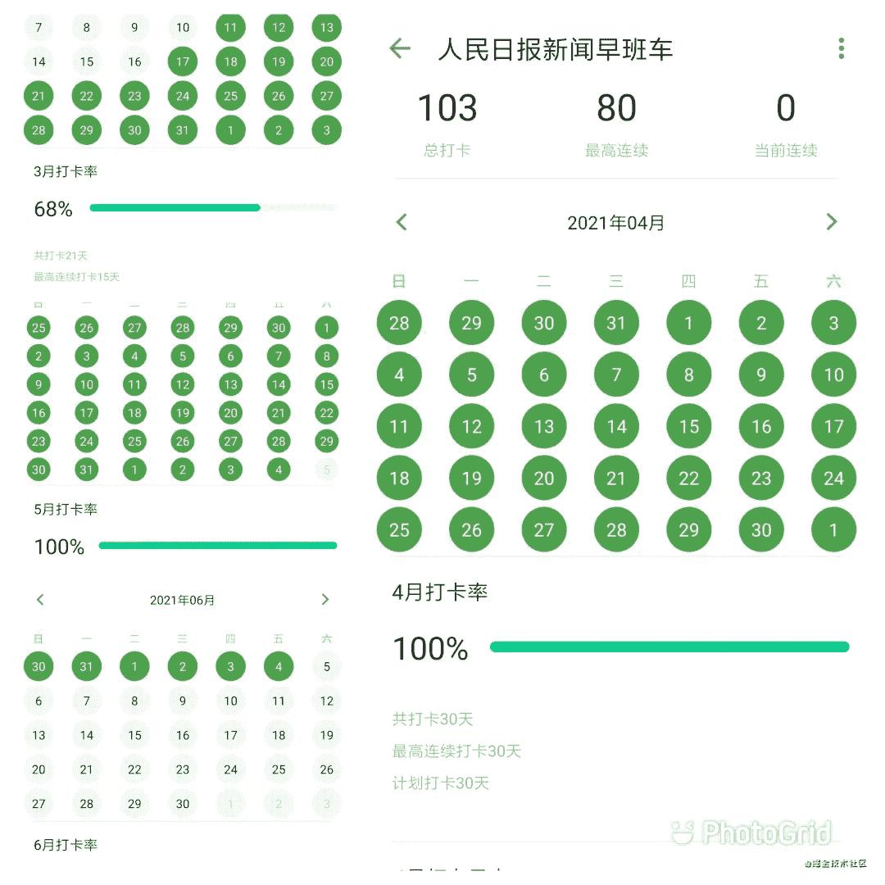

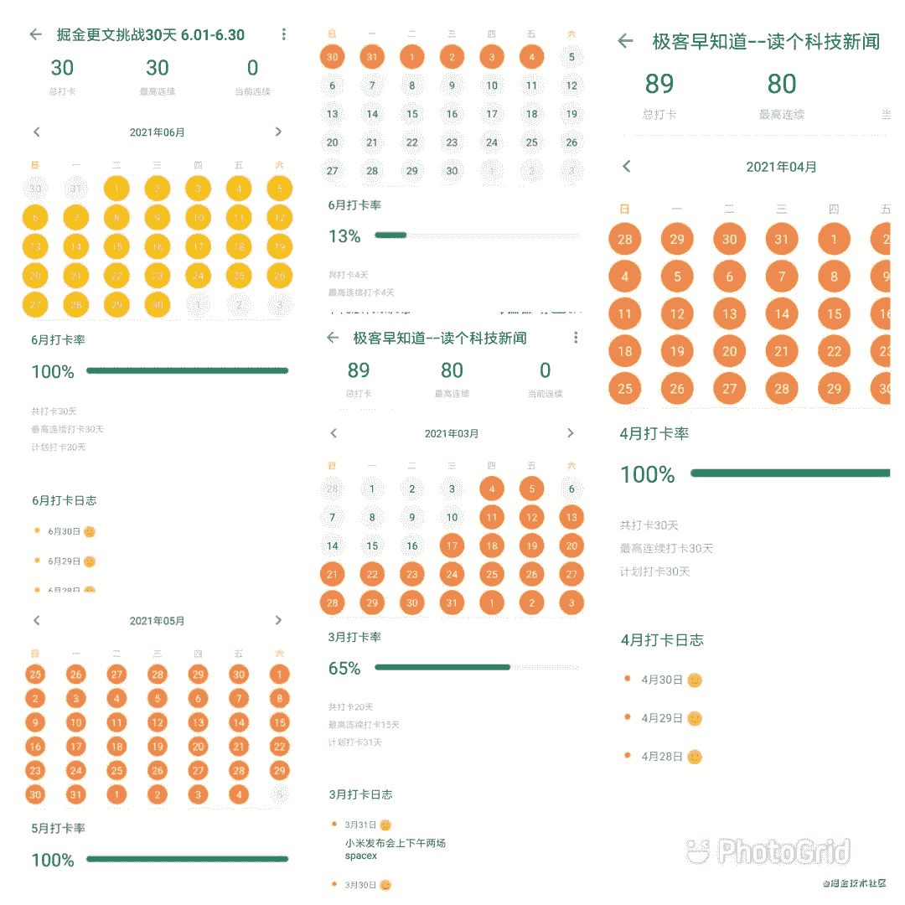

## 坚持用输出倒逼自己输入

从4月初，开始坚持写博客。不想写水文的我坚持原创，坚持优质内容。每一篇文章都认真楷模排版，逻辑和思路，希望对自己负责，也对读者负责。

六月份恰逢更文挑战和新星计划活动的展开，认识了很多垂直领域的大佬，以前从来不爱玩社区的我也开始乐在其中。

在社区中遇到很多业界的号主和大佬，零一、学委、魔王、阿机、三笠……（太多啦不再一一列举），真正感受到了山外有山🚵🏾。在这个过程中，遇到了很多同行的小伙伴，虽说大家都是卷王，但同时也是内卷受害者。每个人都在坚持原创做好每一篇技术干货，认真输出。

我们就像是一张地图上的不同板块，因为偶然的机会而汇集在了一起。

一群人，深耕于技术写博，致力于互联网开发。

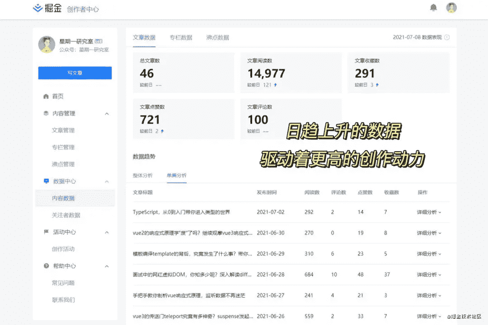

## 瓶颈期

在学习的过程中，大概一段时间内就会遇到一个瓶颈期。后来我梳理了一下，发现让我挫败感下降主要有以下几大原因。第一，阶段性任务完成，没有提前给自己设定新任务，会陷入焦虑状态。第二，看不到自己在进步，感觉自己在停滞不动，会非常的焦虑。第三，长期在同一个环境下学习，会感到在一个密闭的圈子里，永无出头之日。

综上几点原因，及时做出调整，降低不必要的时间成本，做更多有效的事情。

# 🔥技术Technology

## 前端基础

四月初开始补计算机基础，从计网到数构，从浏览器原理到性能优化等等专题。在学习的过程中，深深对自己基础知识的薄弱叹一口气。但是不会就是不会，查漏补缺才是当下应该要做的事情。于是买了很多的基础书，以至于我的书架瞬间填满了。在学习基础知识的过程中，开始写博客总结，归纳整理每个会考的知识点。不断扩充知识的维度，寻找更多的知识点对不饱和的内容进行补充。

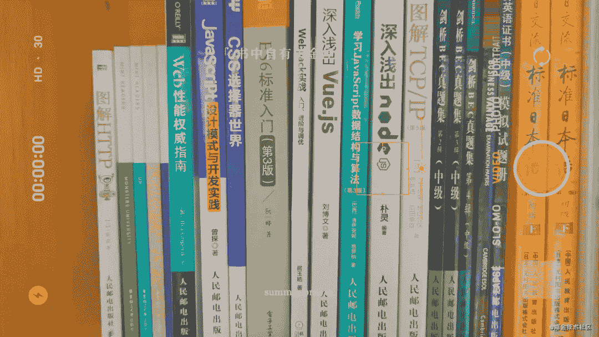

## 新技术

搁置很久的新技术也开始拾了起来，开始学习 vue3 ，开始学习 TS ，开始学习 webpack 。对新技术的感觉就是很容易学过就忘，但好在这回认真的做笔记并缕清逻辑，编写成博客。到后续需要用到这些知识点时，回过头来看博客，很多知识就一目了然了。

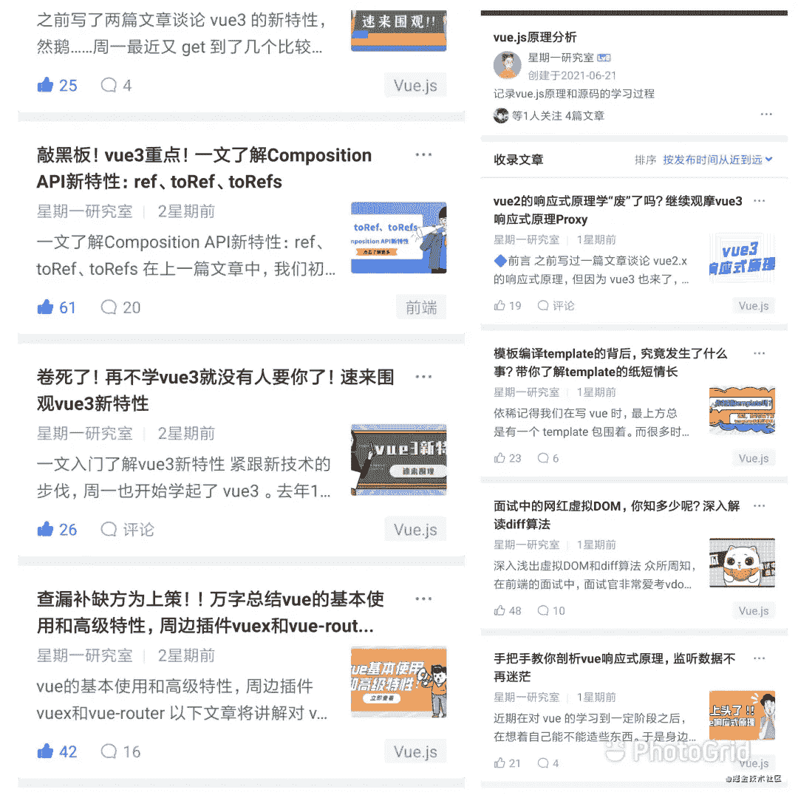

# 🆙期末来了Final

## 期末月&课设周

6月21号，史上最煎熬的期末月来了。正所谓神仙打架，整个专业都在内卷，从理论考试，到 PHP 课设，再到 Android 课设，没有一科是可以短期速成的。

与慧雯姐、金姐、猪猪和杰哥五人，一起完成最难课设。立下为毕业论文做准备的契机，争取做到最好，最后圆满落幕。

整个过程有着各种各样的摩擦，但就因为这样的摩擦，让我们之间的合作越来越默契。从时间效益、作品最大化效益出发，有时候一个非常难解的问题，因为大家的讨论，个人有个人的知识储备，问题都能得到相对快速的解决。

在课程快结束之时，问专业老师说课设心得是否有上限，👩‍🏫老师说：没有上限。

🙎‍♀️我说：那我能写两三千字。

👩‍🏫她一惊，老师说：写些重点进去就好了。

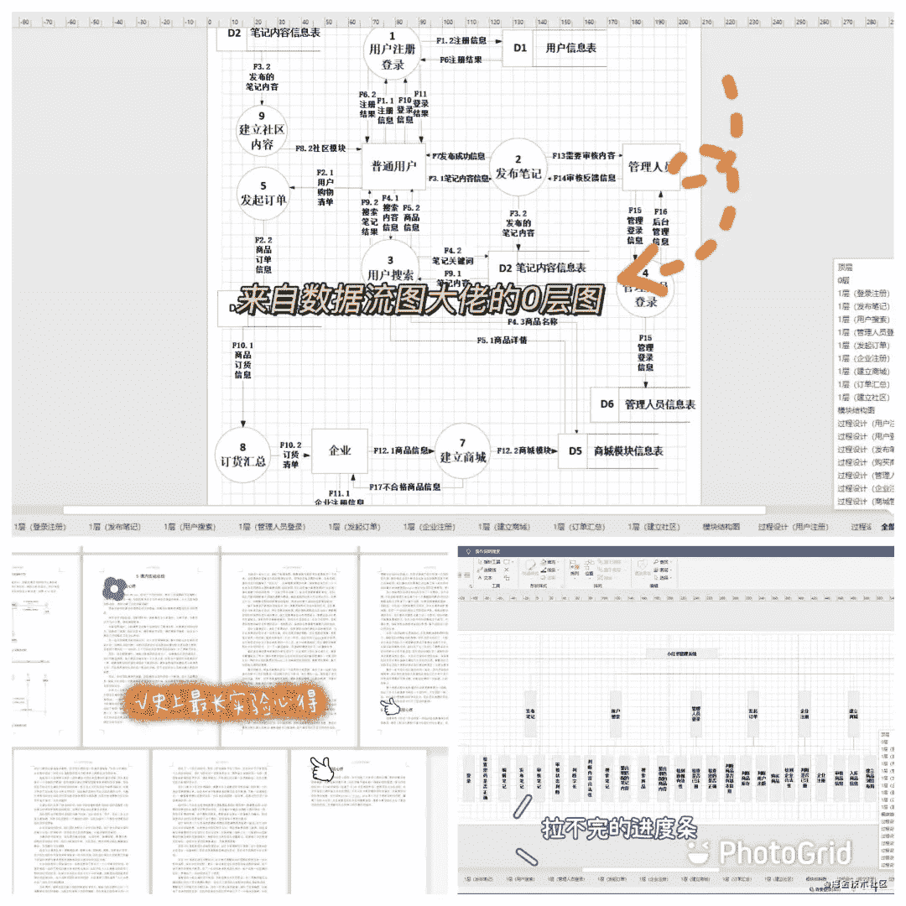

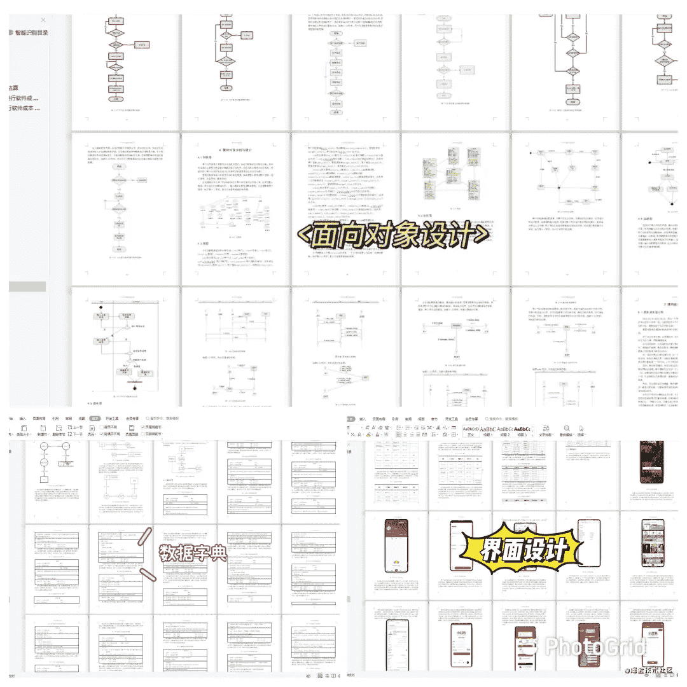

7月7日下午，考完最后科目，为期大半个月的期末终于结束啦~📢

期末的结束也将意味着大三的结束，而大四的钟声也已经打响~

# 🔑下半年目标Goal

✔️秋招顺利

✔️清空书架

✔️通过BEC

✔️👸号粉丝Up

# 📝最后End

当一颗蒸不熟煮不烂炒不爆捶不扁响当当的铜碗豆

面对内卷，不被内卷压倒，保持持续学习，扛住卷回去

📐📐📐

文字的力量

不在于绘声绘色

而在于不动声色

📑📑📑

在互联网的鱼龙混杂圈里

保持清醒 持续学习

📸📸📸

机会与努力并存

海有舟可渡 山有路可循

永不言弃 未来可期

👋👋👋