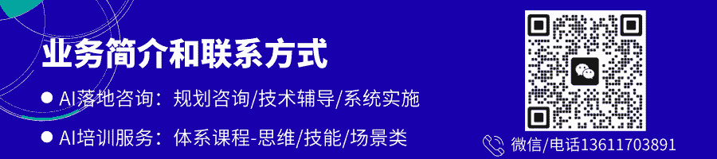
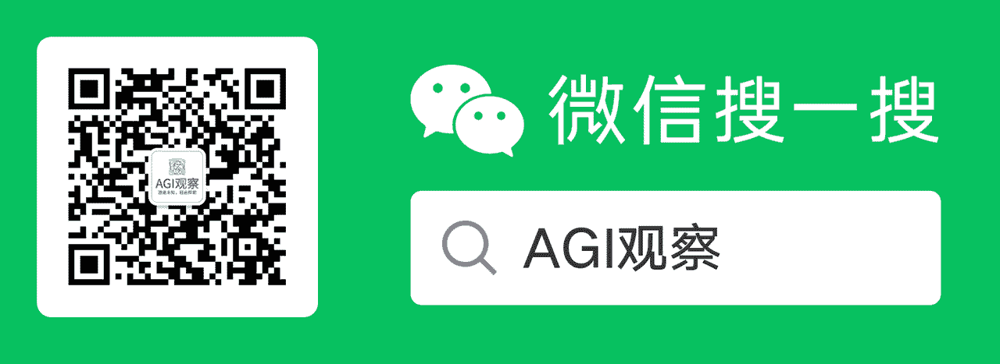

# AI咨询服务和培训内容介绍

> 来源：[https://aithinkup.feishu.cn/docx/HIrwdzMBYoveWPxffD1cJhefnod](https://aithinkup.feishu.cn/docx/HIrwdzMBYoveWPxffD1cJhefnod)

# 欢迎访问网站www.kciagent.com

# 1.企业咨询

<https://www.kciagent.com/professional-services>

如果您的企业希望AI Agent应用落地的咨询服务，请联系我。

# 2.培训业务-智能体核心课程体系

# 3.线上课程：适合AI基础人士/入门级用户

### [《AI基础课》“AI基础+智能体入门”双模块（编号 B1）](https://aithinkup.feishu.cn/wiki/AINXw4D57iOXLdkaYRYcnzpXnCh)

点击以上链接查看详情

报名问卷星链接：https://yuyue.wjx.com/vm/QWCicsc.aspx#

### [《AI技能课》“提示词工程 + 智能体应用”双模块（编号 B2）](https://aithinkup.feishu.cn/wiki/EbcxwyLkFif87qkyUsXcGseJnFc)

点击以上链接查看详情

报名问卷星链接：https://yuyue.wjx.com/vm/QWCicsc.aspx#

> 提示：此类课程全部是线上课，本页面可以直接下单购买。付款后提交联系方式，我们会联系你，开通飞书视频权限。

# 4.线下课程：AI Agent智能体系列-适合一定AI基础/智能体入门用户

> 提示：此类课程全部是线下课+线上视频，本页面提交预报名。

> 12月有线下开班，等待日期通知。或联系老师微信获得最新开班时间表。

### 智能体+知识管理（编号C1）

[《AI Agent智能体赋能企业知识管理与创新》（编号 C1）](https://aithinkup.feishu.cn/wiki/QjG0wrq1hidjqIkfRQWctaUon3c)

点击以上链接查看详情

课程时间：1天

报名问卷星链接：https://yuyue.wjx.com/vm/QWCicsc.aspx#

### 智能体+企业经营创新（编号A1）

[《数字员工与基于 AI 智能体的工作流程再造》（编号A1）](https://aithinkup.feishu.cn/wiki/QiPrwwbMIi6I8fkQfzcc77A4nHh)

点击以上链接查看详情

课程时间：1天

报名问卷星链接：https://yuyue.wjx.com/vm/QWCicsc.aspx#

# 5.线下课程：AI Agent智能体系列-适合AI进阶级/智能体一定基础用户

> 提示：此类课程全部是线下课+线上视频，本页面提交预报名。

> 12月有线下开班，等待日期通知。或联系老师微信获得最新开班时间表。

### 智能体+基于场景构建实战（编号C2）

[《AI 实战锦囊》第二期报名信息和链接（编号 C2）](https://aithinkup.feishu.cn/wiki/IoW4wmPrbikAO0kULigc5jeunFb)

点击以上链接查看详情

课程时间：1.5天

报名问卷星链接：https://yuyue.wjx.com/vm/QWCicsc.aspx#

### 智能体+商业与产品 - 线下课程（编号A2）

[《AI 智能体设计师课程 》简介-成为技术与商业的复合型人才（编号A2）](https://aithinkup.feishu.cn/wiki/XyWUwKavUi8yH4kiLTNcdrgznPb?from=from_copylink)

点击以上链接查看详情

课程时间：2天

报名问卷星链接：https://yuyue.wjx.com/vm/QWCicsc.aspx#

# 6. 企业内训定制课程服务

如有企业需要定制课程，请直接联系我。可以通过课程中心了解基本课程设置。

网站访问链接：

<https://www.kciagent.com/courses>

# 联系方式

# 微信公众号【AGI观察】

