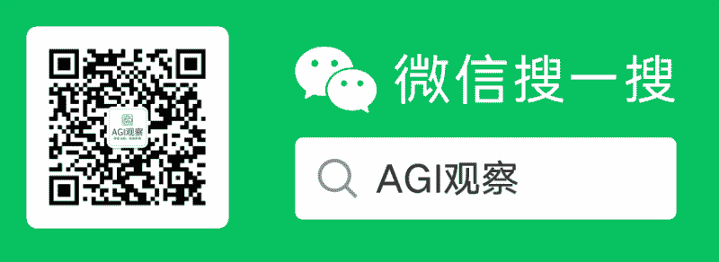

# 《AI Agent智能体赋能企业知识管理与创新》（编号 C1）

> 来源：[https://aithinkup.feishu.cn/docx/Ap6UdCj9io61YVxFpzMc8YqYnHR](https://aithinkup.feishu.cn/docx/Ap6UdCj9io61YVxFpzMc8YqYnHR)

# 极速了解（编号 C1）

1.  **报名链接：****https://yuyue.wjx.****c**om/vm/QWCicsc.aspx#

1.  **课程定位：智能体+知识管理。**

1.  **报名流程：先提交报名 -> 邮件**通知线下课程时间 -> 最后付费确定上课

1.  [**混合课程：**](https://aithinkup.feishu.cn/wiki/EbcxwyLkFif87qkyUsXcGseJnFc)**2**天线下课 + 12节《AI技能课》

1.  **电子资料：**有，配套课程中的提示词模版。

1.  飞书链接：[《AI Agent智能体赋能企业知识管理与创新》（编号 C1）](https://aithinkup.feishu.cn/wiki/QjG0wrq1hidjqIkfRQWctaUon3c)

1.  返回课程中心页面：[AI培训和咨询服务介绍](https://aithinkup.feishu.cn/wiki/OoiWwxxd5iOE6tku9QzcrCDMnVe)

提示：

关于知识管理感兴趣的朋友可以访问我的知乎：KMthought企业知识管理专栏https://www.zhihu.com/column/c_1398606324045754368

以下是我这个课程的部分课件

# 联系培训老师

## 业务和合作联系：www.kciagent.com

## 🛰️👸号【AGI 观察】

