# 《AI 实战锦囊》第一期总结（文末附第二期报名链接） | 工作坊 - 编号 C2

> 来源：[https://aithinkup.feishu.cn/docx/WdxmdmRSqoAa5hx3HuNcLgKZn8g](https://aithinkup.feishu.cn/docx/WdxmdmRSqoAa5hx3HuNcLgKZn8g)

本文是对这个新课程项目（AI Agent 智能体系列类）第一期的总结，也是我对前述课程介绍信息的补充。10 月第一期在上周六结束。

**目前第二期启动报名，开课时间：2025 年** 11 月 15 日/22 日/29 日

可以前往问卷星这个链接提交预报名：https://www.wjx.cn/vm/YTYtpox.aspx#

本文飞书链接：[🚀《AI实战锦囊》第一期总结（文末附第二期报名链接）](https://aithinkup.feishu.cn/wiki/EMqbw8jNvilJeXk7c7BclnmZnLc?from=from_copylink)

# 第一期工作坊回顾速览

> 历史信息《AI 实战锦囊》工作坊报名！（附视频介绍）

> [还有 1 天截止！课前通知：《AI](https://mp.weixin.qq.com/s?__biz=MzkxODcwNzIyMw==&mid=2247486339&idx=1&sn=b0373a99ca919e8a1b23798f949848db&scene=21#wechat_redirect) 实战锦囊》工作坊详细日程和学员准备清单

1.  工作坊介绍：面向个人，希望理解 Agent 应用，能够掌握 Leapility 智能体构建

1.  智能体平台：Leapility 自然语言叙事型智能体。官网：www.Leapility.cn

1.  这里我使用 Leapility 的一个演示视频，主题“信息-知识-生产力”：https://www.bilibili.com/video/BV1y7agzYENo/?spm_id_from=888.80997.embed_other.whitelist&bvid=BV1y7agzYENo

# 第一期工作坊大家学了什么？带走了什么？

#### 如何将、经验与手工操作的知识类工作，转化为可复用、可迭代的 AI 增强流程。

+   可复用：自动化智能体程序，不用每次重开一个对话

+   可迭代：根据自己的使用要求改造智能体和工作流，每次生成的结果文档又可变为知识库。而且，当你学会了某类典型场景的 AI 解决思路，你可以举一反三

+   12 小时高强度实战（3 次下午工作坊）

+   9 个真实智能体（下图有智能体链接）

+   **12 个智能体工作流**

+   **18 个可用提示词**

+   **2 个飞书知识库**

+   **6 个智能体基础视频课**

以上来自我对这个新课程项目（AI Agent 智能体系列类）的制作，包括 80+篇备课文档｜12 万字内容｜313 小时打磨，在第一期课程的过程中，根据学员的反馈和需求，持续优化课件，增加资源以辅助大家学习。

后续，可能会真的“希望成为 Agent 培训老师”人群开设专门独立课程。这些备课资料，我将会系统讲解如何“人工（你） + 你的数字员工团队”一起开发出来！

## 以下是第一期工作坊的 6 个场景总结

### 以业务场景为牵引、以智能体理解和创造为载体

+   帮你把工作变成 AI 驱动的智能程序

+   为“隐性低效”的工作而生

+   帮助你跳过 0-1 的试错期，直接进入 1-100 的优化期

从第一期的学员的提交报名中，选择了以下 6 个场景，我们创建智能体解决痛点

| **场景和典型知识模块** | 可以通过 AI 应用方式，解决以下传统方式痛点 |
| --- | --- |
| 1. 流程管理 &amp; 复盘 | 会议、人工记录、SOP 滞后 |
| 2. 知识萃取 | 依赖专家访谈、观察，效率低、易流失 |
| 3. 商业模式设计 | 白板手写、逻辑跳跃、难以验证 |
| 4. 内容策划 | 凭感觉选题、素材散乱 |
| 5. 教学内容设计 | 同一内容需多次手动改编为 PPT/文章/视频稿 |
| 6. 项目沟通和传播 | 当前的演讲、文章布道，传播效率有限 |

## 在 6 个场景背景下，构建了 9 个智能体（知识库提供工作流源码）

说明：

智能体基于场景信息的基础上构建，适配于一定范围内的任务，这样智能体的表现更加稳定。

所有智能体均可公开访问，点击即用。后缀编号对应工作坊中使用的场景编号

所有智能体均基于 Leapility 平台构建，支持自然语言交互，无需代码，一键复制源码即可导入你的实际工作流。

图片说明：这是忙碌在各种场景下的智能体员工 Ada。

图片制作：豆包 AI

智能体：行业笔记灵感整理专家 Ada（编号 29-1）

智能体：https://leapility.cn/?agent=i-zc8iuuml4gy2

智能体：科技媒体专栏作家 Ada（编号 29-2）

智能体：[https://leapility.cn/?](https://leapility.cn/?agent=i-jbtuwmiih7vw)agent=i-jbtuwmiih7vw

智能体：数字化项目管理专家 Ada（编号 06）

智能体：https://leapility.cn/?agent=i-0x82t66byl73

智能体：多形态学习资源设计专家 Ada（编号 21）

智能体：https://leapility.cn/?agent=i-1uh4f5g11xt9

智能体：活动项目 SOP 专家 Ada（编号 25）

智能体：https://leapility.cn/?agent=i-8uq244ahaf8e

智能体： 战略级商业画布专家 Ada（编号 28）

**智能体：**[https://leapility.cn/?](https://leapility.cn/?agent=i-ljwa04a7popk)agent=i-ljwa04a7popk

智能体 1：专家模型萃取专家 Ada（编号 13-A）

智能体 1：https://leapility.cn/?agent=i-mqgevpdvdwx4

智能体 2：教练式销售场景专家 Ada（编号 13-B1）

智能体 2：https://leapility.cn/?agent=i-ligtqh8vaomf

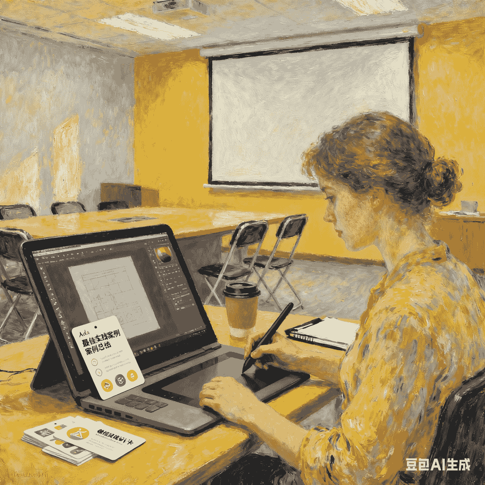

智能体 3：微知识卡片海报专家 Ada（编号 13-C1）

智能体 3：https://leapility.cn/?agent=i-0c9r44z4nkze

## 动手构建了多个智能体工作流

### 以下是三种基本模式

+   “三段式结构”（输入→分析→输出）

+   “角色接力模式”（A 分析 → B 诊断 → C 生成）

+   “反馈闭环模式”（生成→审阅→迭代）

每个工作流模块包含的基础项：

+   输入项

+   智能体角色

+   执行步骤

+   调用工具

+   输出格式

+   是否设置人工确认环节

# 📦 学员带走了什么？除了新技能，还有两个知识库

## 📚 知识库 1：《AI 实战锦囊》01 期课程完整资料。

## 🎥  知识库 2：《AI Agent 智能体基础》视频课 120 分钟，在线观看，1080P 高清视频。

图片说明：这是正式学员可以访问的知识库主页

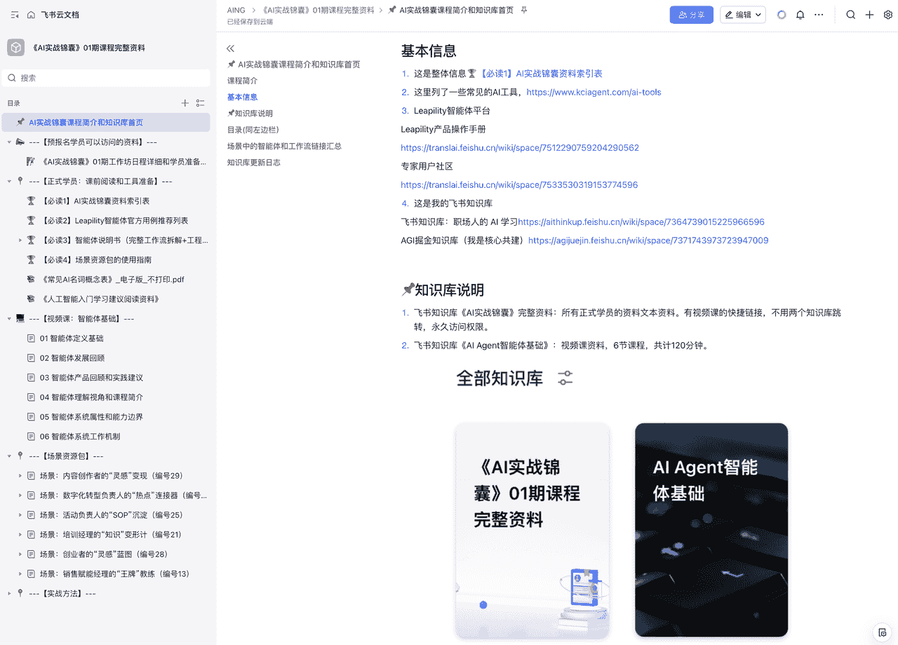

图片说明：这是【必读 1】文件，是所有资料的合集

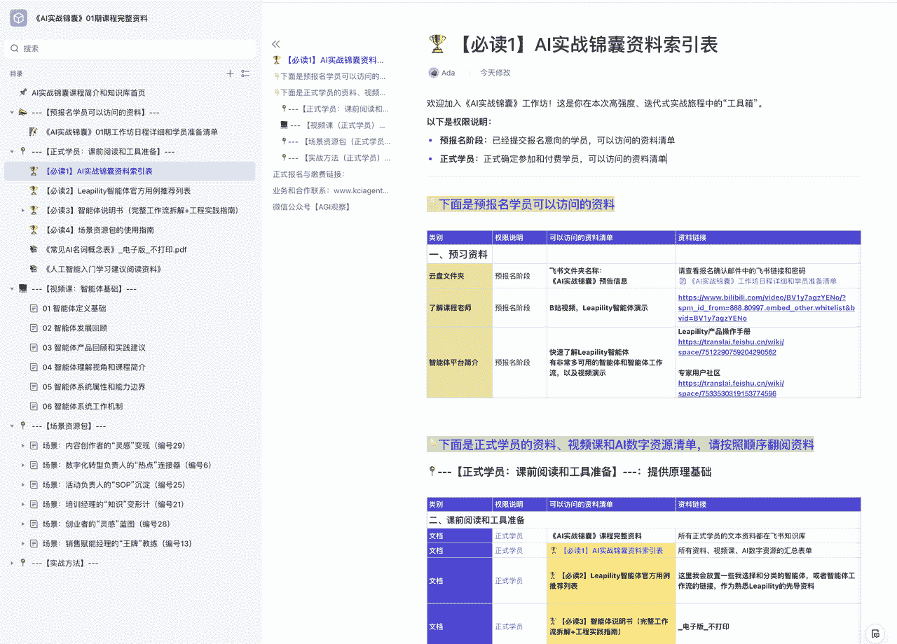

图片说明：这是一个场景和其中智能体，包括配置和工作流源码截图

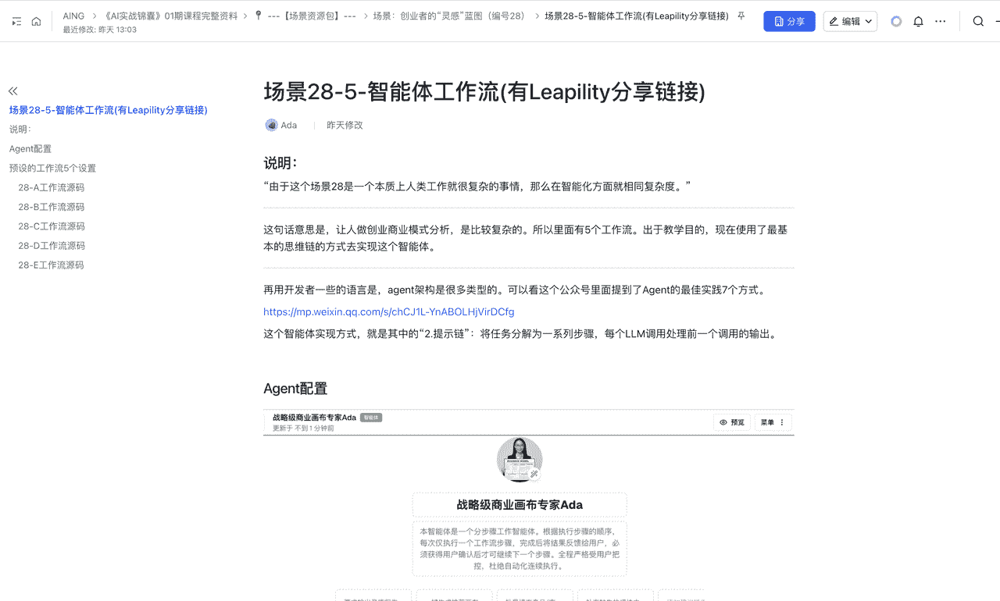

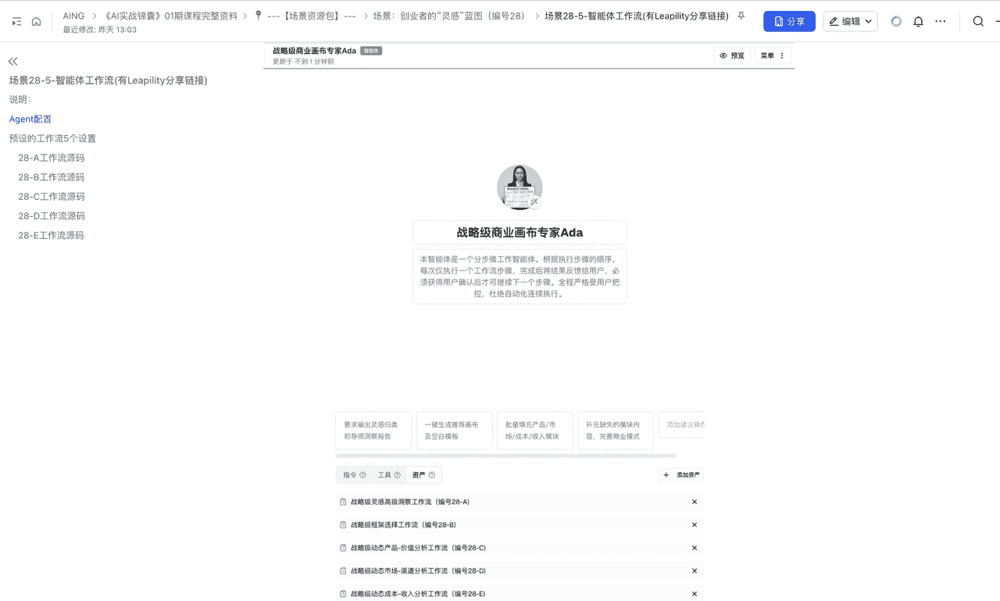

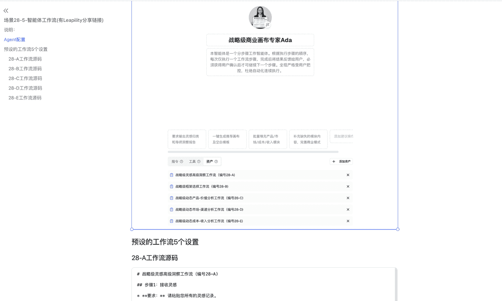

# 为智能体领域新手增加了 3 组新资源，全部“新手优化”

由于大家对智能体的了解不充分、不均衡，我在这次 3 期课程的过程中，增加了 3 组新资源。

## 1.丰富了课前阅读资料

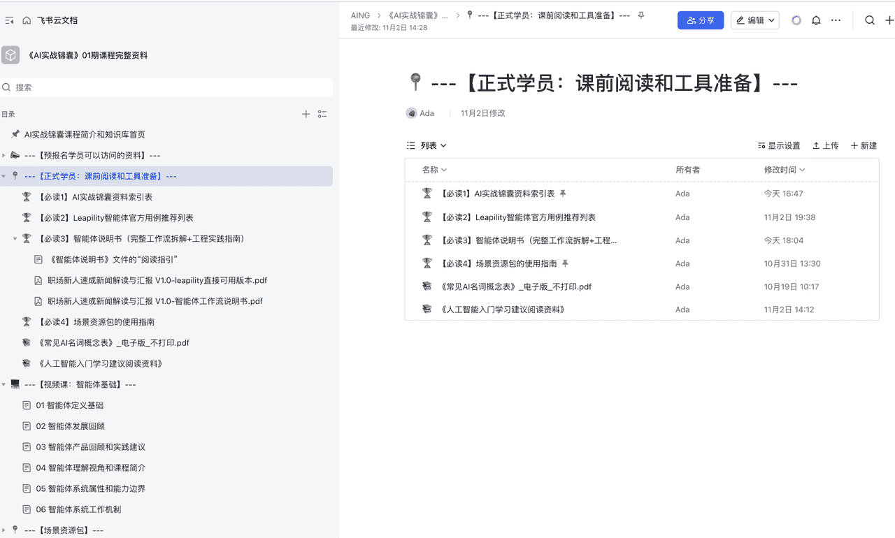

### 这里是【必读 3 智能体的说明书】全部内容

针对这一个智能体工作流，对每一个环节都详细拆解，对 12 个技巧都都详细说明。

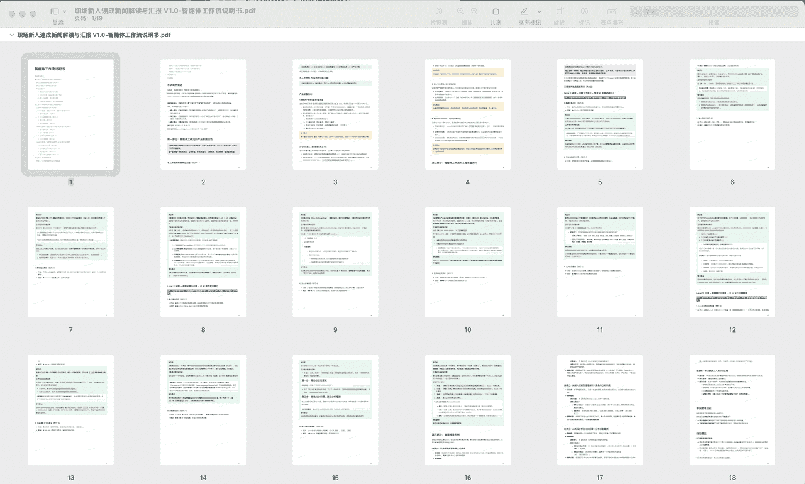

### 说明书有 3 个部分，这里是每个部分的截图

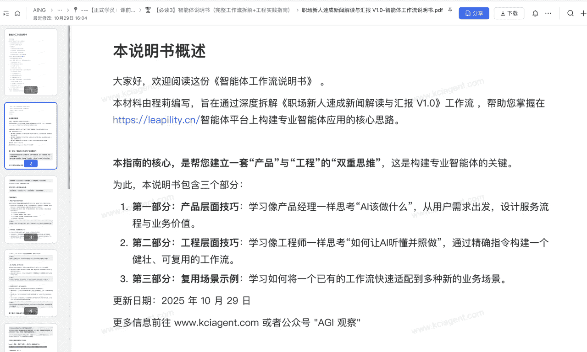

## 2.开通了《AI Agent 智能体基础》视频课

[项目 2：聚焦技术与商业的复合型人才《AI 智能体设计师课程 》简介](https://aithinkup.feishu.cn/wiki/XyWUwKavUi8yH4kiLTNcdrgznPb)是录制的视频课课程（属于智能体设计体系 的课程一部分）。

在正式开课前，或者课程结束后都可以看。

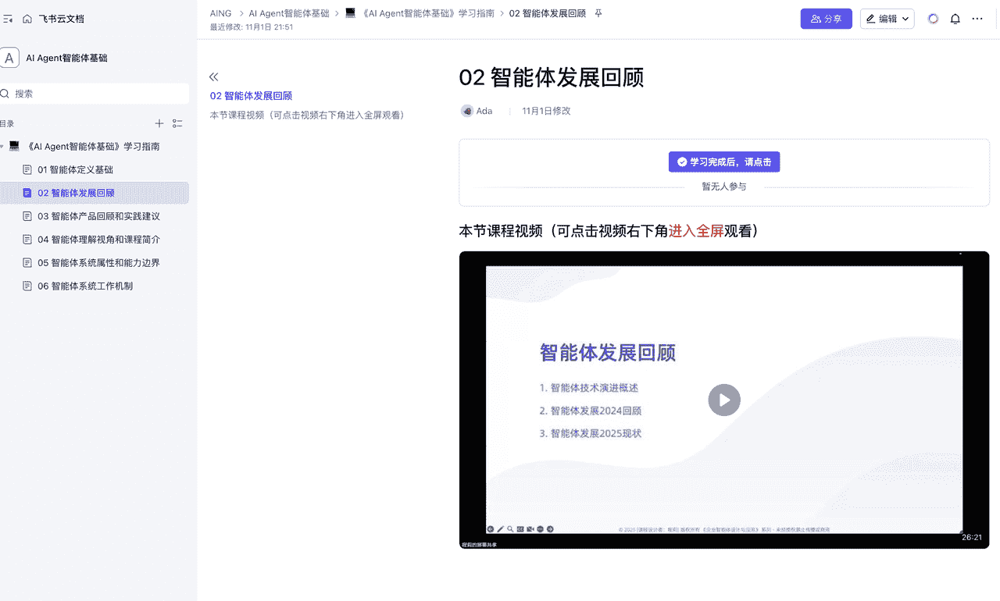

## 增加新手速览资料，例如增加了“智能体卡片”等

目的是可以用于查看这些智能体的特点和作用，帮助你从不熟悉到熟练掌握。

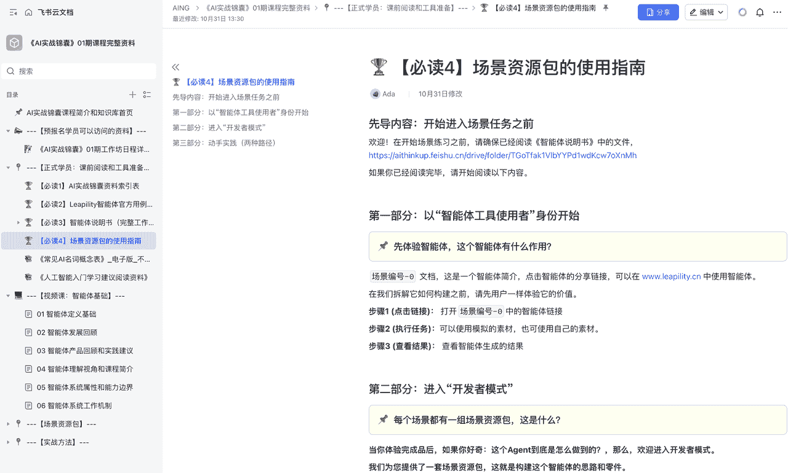

# 🔨 课程制作幕后：80 篇文档、12 万字、313 小时的深度打磨

图片说明：这是我在语雀的上的原稿和数据。

备课资料有 80 篇文档，接近 12 万字内容。实际比这个还多，还有一些资料存在其他知识库里。

仅就这个知识库，可以这个课程系列的制作时间至少 313 小时，接近 40 个工作日，差不多是 2 个月。

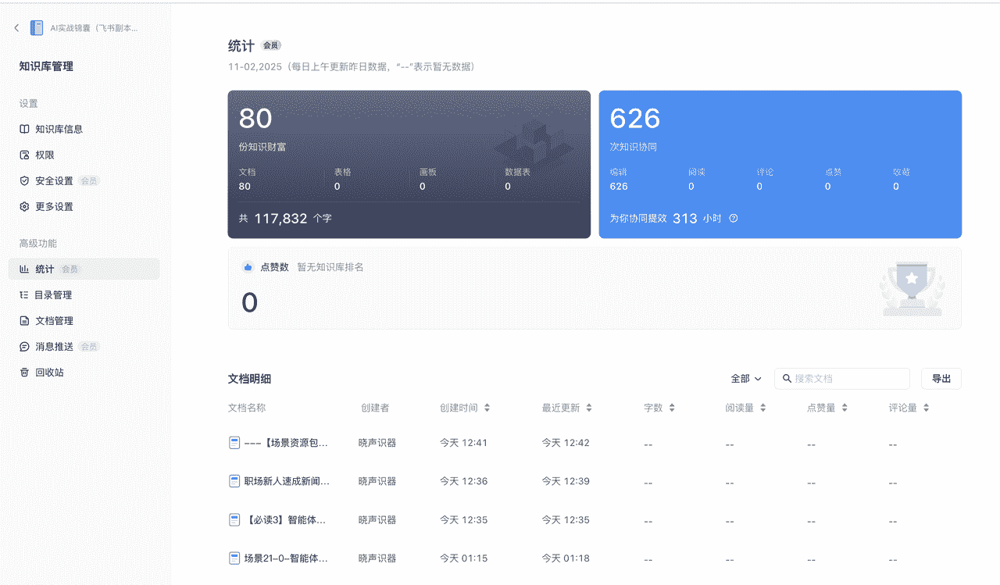

#  📅 第二期报名信息和链接

https://www.wjx.cn/vm/YTYtpox.aspx#

### 课程关键信息

**课程费用：** 999 元/人/期

**包含内容：** 3 次课时学习包

**单课时内容：** 聚焦 2-3 个场景，学习提示工程/AI 工具/Agent 工具

**上课时间：** 每周六下午 13:00-17:00

**班级规模：**每课时仅招 10 人，小班制教学第二期 11 月开课

**时间：**2025 年 11 月 15 日/22 日/29 日

**地点：**上海市西岸

### 课程报名分为两个节点

**节点 1 预报名阶段：**

预报名后，可以获得课程日程安排信息，将会发送邮件通知。

**节点 2 付费成功节点：**

**学员资料**包括课前阅读和工具准备、智能体基础知识视频课、场景资源包、实战方法等。

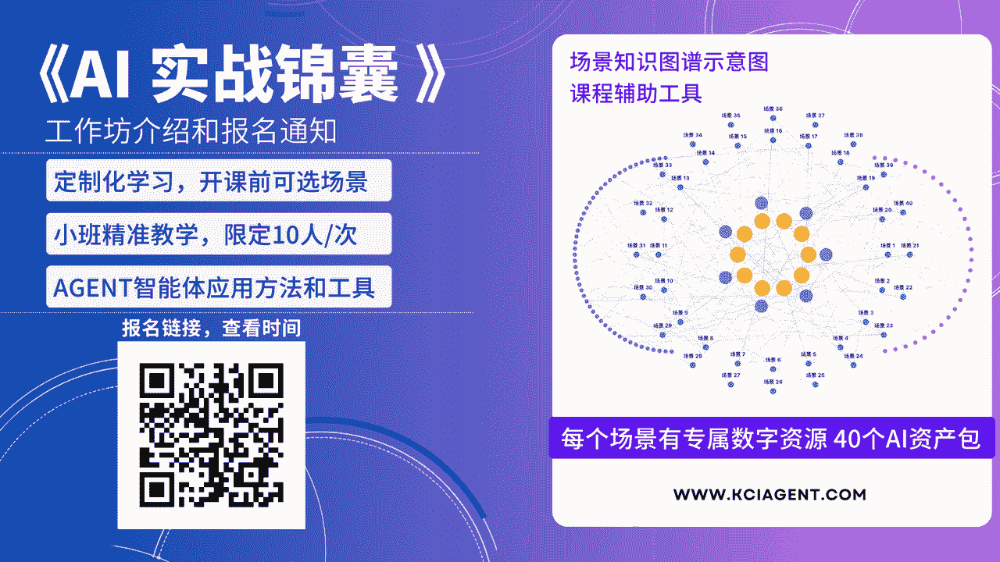

## 业务和合作联系：www.kciagent.com

## 🛰️👸号【AGI 观察】

