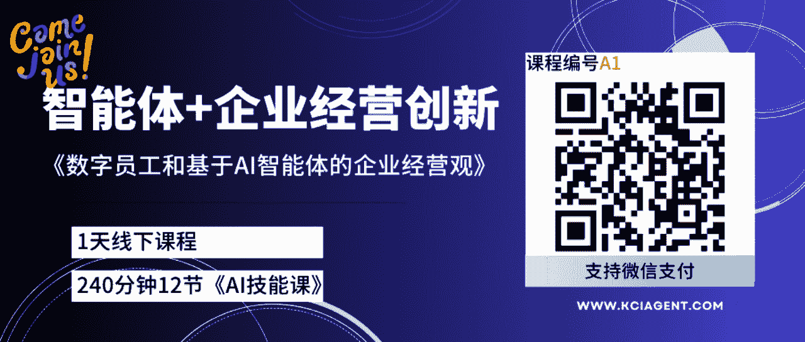
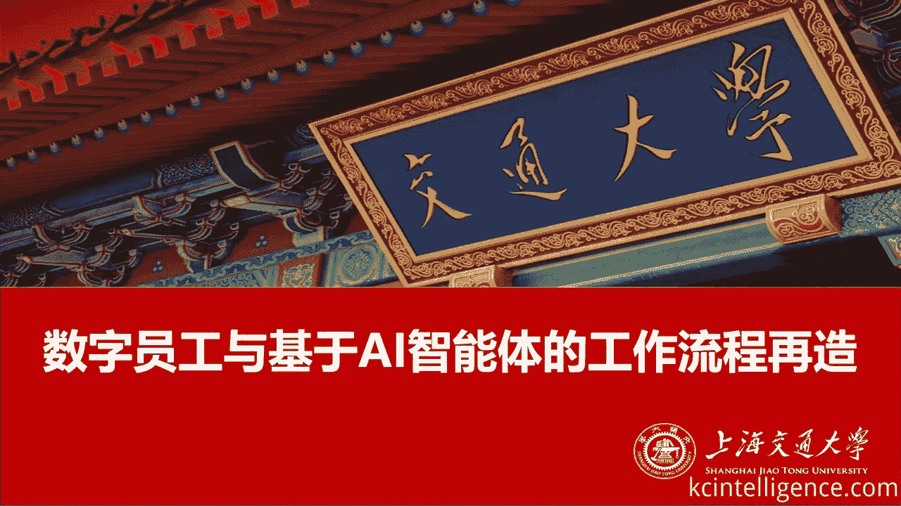
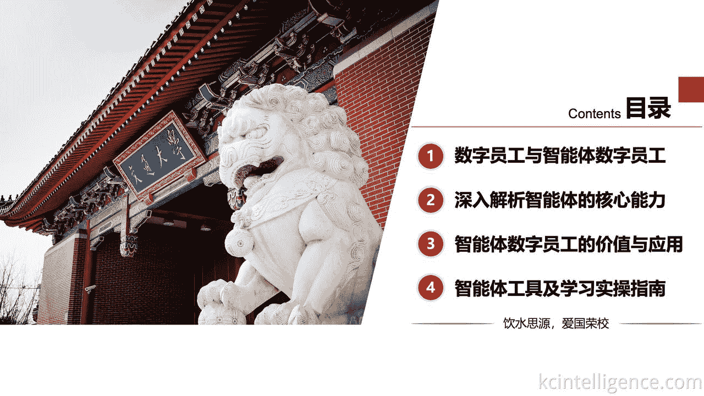
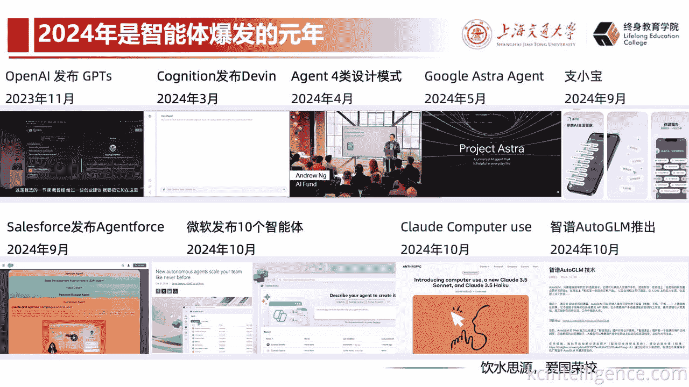
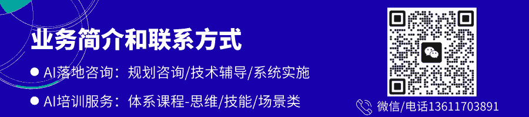

# 《数字员工与基于 AI 智能体的工作流程再造》（编号A1）

> 来源：[https://aithinkup.feishu.cn/docx/YZ5pdBjV6ostZMxKmT4cgTgonJh](https://aithinkup.feishu.cn/docx/YZ5pdBjV6ostZMxKmT4cgTgonJh)

# 极速了解（编号 A1）

1.  **报名链接：****https://yuyue.wjx.****c**om/vm/QWCicsc.aspx#

1.  **课程定位：智能体+企业经营创新**

1.  **报名流程：先提交报名 -> 邮件**通知线下课程时间 -> 最后付费确定上课

1.  [**混合课程：**](https://aithinkup.feishu.cn/wiki/EbcxwyLkFif87qkyUsXcGseJnFc)**2**天线下课 + 12节《AI技能课》

1.  **电子资料：**有，配套课程中的提示词模版。

1.  飞书链接：[《数字员工与基于 AI 智能体的工作流程再造》（编号A1）](https://aithinkup.feishu.cn/wiki/QiPrwwbMIi6I8fkQfzcc77A4nHh)

1.  历史信息：[《数字员工与基于 AI 智能体的工作流程再造》-上海交通大学 AI 经营创新课程（编号A1）](https://aithinkup.feishu.cn/wiki/GDdPw8IGViUz4YkeG6xcGuIdn9f)

以下是我这个课程的部分课件

# 联系培训老师

## 业务和合作联系：www.kciagent.com

## 🛰️👸号【AGI 观察】

