# 《数字员工与基于 AI 智能体的工作流程再造》-上海交通大学 AI 经营创新课程（编号A1）

> 来源：[https://aithinkup.feishu.cn/docx/Veyhd5dWmoE98vxvskjc6RnJn9g](https://aithinkup.feishu.cn/docx/Veyhd5dWmoE98vxvskjc6RnJn9g)

**原**标题：开课报名！AI 学习的黄金组合：经营实战+系统知识+组合路径+交大证书，上海交通大学 AI 经营创新课

今天我想和大家介绍我们一个 AI 课程项目“上海交通大学 AI 经营创新领军人才精训营”，我是这个课程项目里的 AI Agent 智能体板块的课程讲师。

### 【课程名称】上海交通大学 AI 经营创新领军人才精训营

#### 第四期开课时间：2025 年 3 月 14 日 -16 日 （周五-周日）

#### 上课地址：上海交通大学长宁校区，上海市法华镇路535号

### 【课程特色】

+   **经营实战：**本课程项目以"企业经营创新"为核心，主要体现在以下五个维度：人工智能应用、企业战略转型、数字化营销创新、运营流程优化以及数据资产增值。

+   **系统知识：**5 位资深专家共同设计这个课程体系，承担不同维度的教学任务，构建了一个跨领域融合的知识体系。

+   **组合路径：**线上基础预习 + 线下沉浸实战 + 社群陪伴学习 + 课程与时俱进更新，老学员复训不收学费！

+   **交大证书：**完成所有课程学习，颁发上海交通大学非学历教育结业证书

### 【课程安排】

线上基础预习：2 天，录播课程随时可看 + 直播在线答疑企业应用落地，

线下沉浸实战：3 天，课程时间 2025 年 3 月 14 日 -16 日，第二天晚上有 AI 工具实操现场指导，

社群陪伴学习：30 天，课程结束后社群共创，陪伴学习，助力学员从 AI 思维到行动的全面转变。

### 【课程报名】

对课程有疑问，可以直接联系我，文末有我的微信

或者联系杨老师：+86 13671733577

### 【Agent 课程简介】本精训营其中一个课程

#### 我是智能体课程的讲师，课程名称《数字员工与基于 AI 智能体的工作流程再造》，讲解 AI Agent 智能体技术发展、应用方法和工具实践。

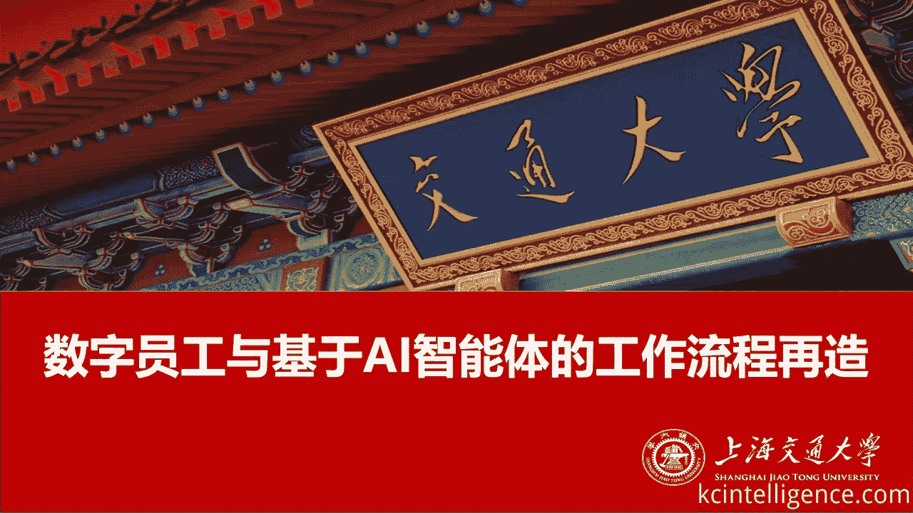

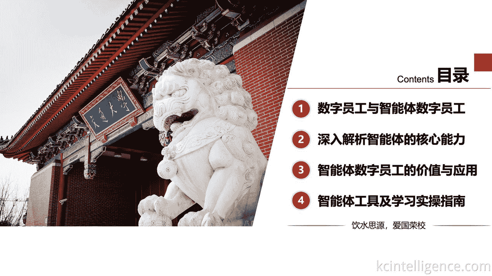

#### 部分课件：对智能体的趋势的洞察来自持续关注人工智能的产业发展，分析国内外的AI产品，以及使用和开发Agent产品。

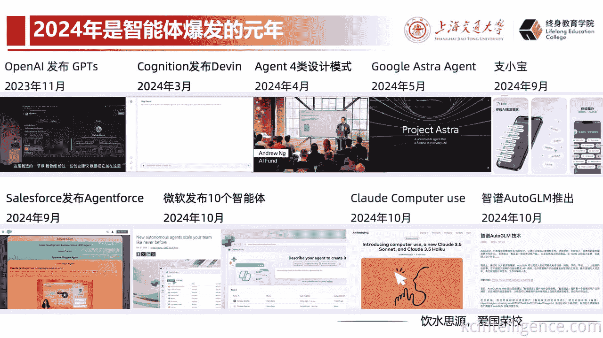

这是我录的两个Agent生成过程的回放视频，每个两分钟左右。

**我在智能体课程里面一直在讲Agent到底**是什么，有什么价值，这一刻重要具象化了!

**访问地址：manus.im**

此处为语雀视频卡片，点击链接查看：Manus-PPT Agent.mov

此处为语雀视频卡片，点击链接查看：manus-财报Agent.mov

[热](https://mp.weixin.qq.com/s?__biz=MzkxODcwNzIyMw==&mid=2247483991&idx=1&sn=54c71f8702d60bc01b0cef457d76759b&scene=21#wechat_redirect)点 | Anthropic团队最新年终总结，分享构建有效智能体(Agent)的7个最佳实践！明年智能体落地商用加速！

[2](https://mp.weixin.qq.com/s?__biz=MzkxODcwNzIyMw==&mid=2247484028&idx=1&sn=81f101b7820eba8afc50af9d18c8f9ec&scene=21#wechat_redirect)024 年微软发布多款 AI Agent，服务销售、客户服务和会计业务，预测 2025 年其将彻底改变工作方式 | 智能体应用

[全](https://mp.weixin.qq.com/s?__biz=MzkxODcwNzIyMw==&mid=2247484644&idx=1&sn=e8c4a12e636063b7f2e17a4093d5c939&scene=21#wechat_redirect)网都在等内测码的国产 Agent 产品-实测 Manus：首个真干活 AI，中国造（附50个用例 + 拆解）

### 【精训营的整体详细信息】

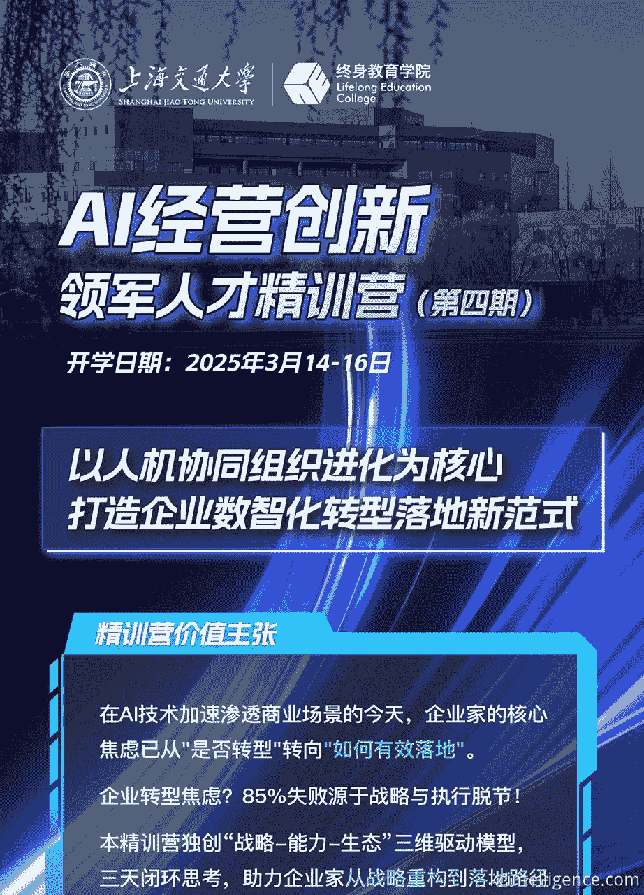

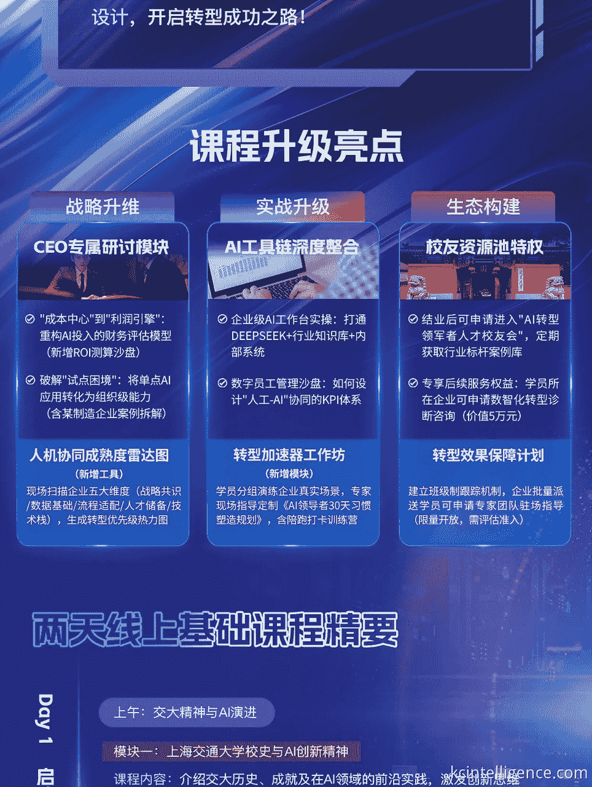

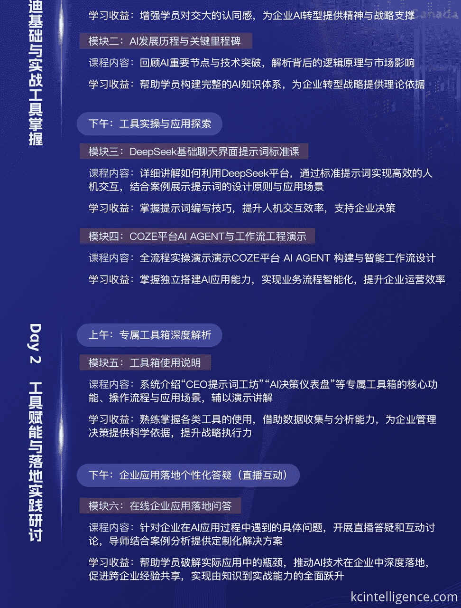

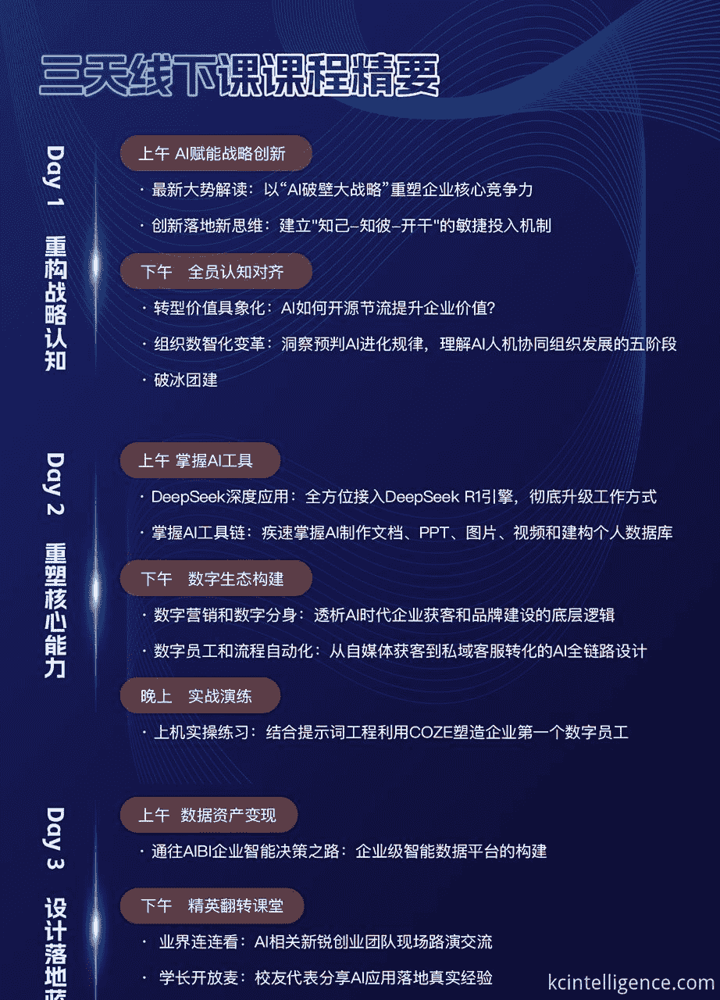

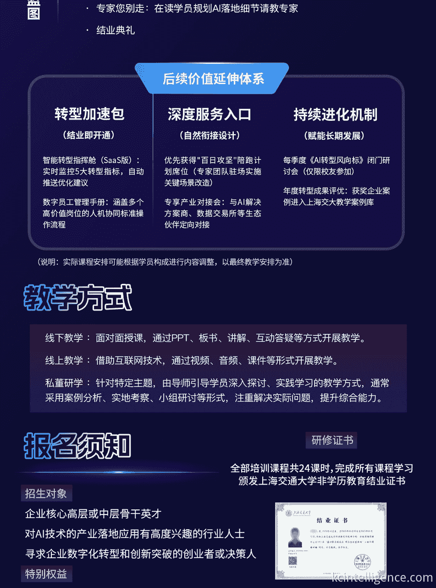

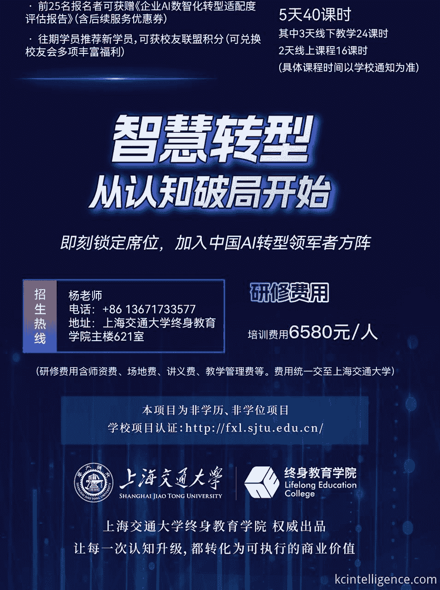

#### 上课地址：上海交通大学长宁校区，上海市法华镇路535号

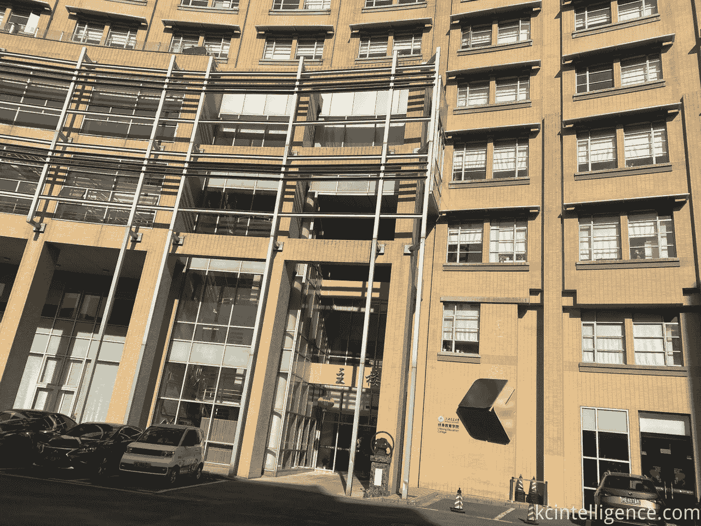

#### 线下沉浸实战：3 天，课程时间 2025 年 3 月 14 日 -16 日，第二天晚上有 AI 工具实操现场指导，

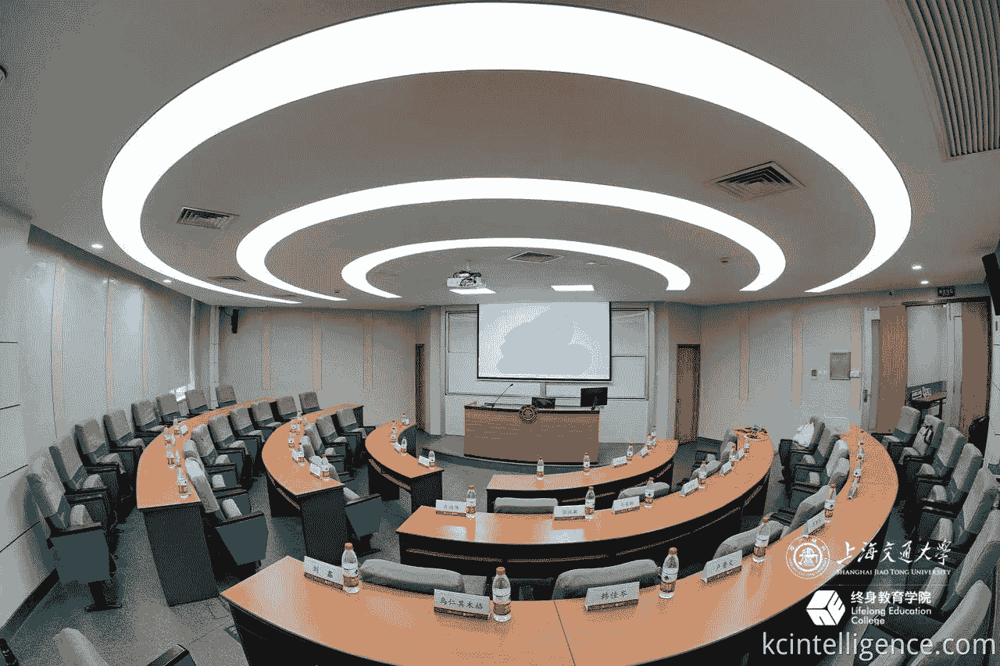

#### 社群陪伴学习：30 天，课程结束后社群共创，陪伴学习，助力学员从 AI 思维到行动的全面转变。

#### 【第三期课程社群陪伴学习】每周直播实录部分

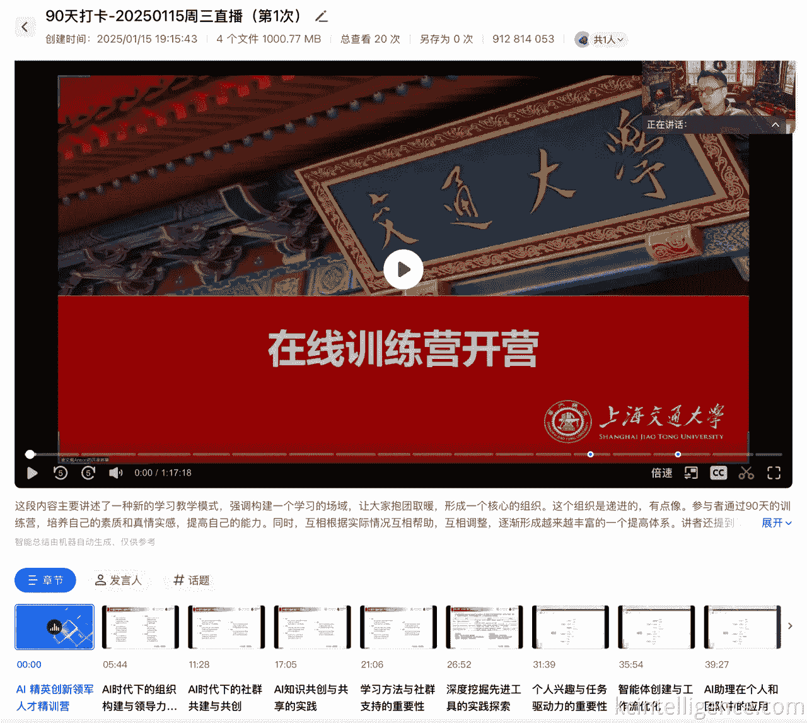

#### 开工第一天晚上的直播，与企业家们带来整个春节爆火的“DeepSeek”信息， 以及如何发挥 DeepSeek 优势的“提示词”方法。

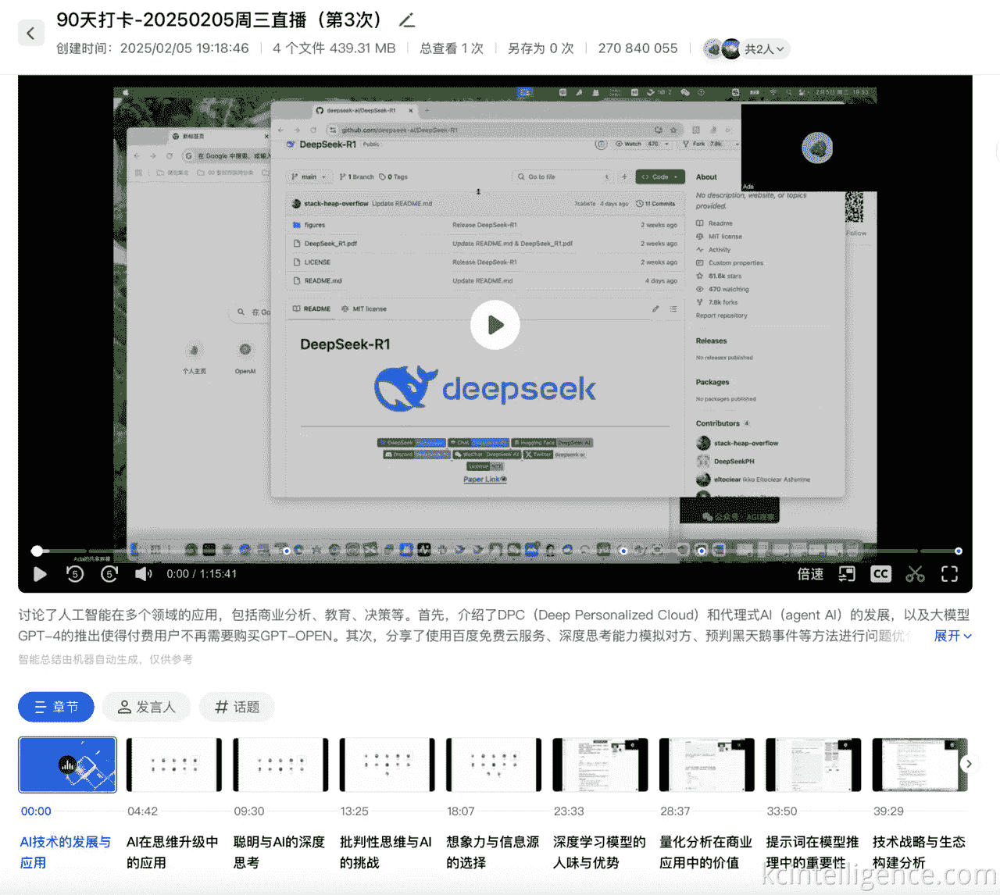

### 【课程报名】

对课程有疑问，可以直接联系我，文末有我的微信

或者联系杨老师：+86 13671733577

----------------------

AI资讯（所有发布文章都收录到合集中，方便查看）

[【AI每日快报】点击进入](https://mp.weixin.qq.com/mp/appmsgalbum?__biz=MzkxODcwNzIyMw==&action=getalbum&album_id=3801337340467937281#wechat_redirect)

[【AI每周盘点】点击进入](https://mp.weixin.qq.com/mp/appmsgalbum?__biz=MzkxODcwNzIyMw==&action=getalbum&album_id=3840540920355094530#wechat_redirect)

[【AGI观察精选】点击进入](https://mp.weixin.qq.com/mp/appmsgalbum?__biz=MzkxODcwNzIyMw==&action=getalbum&album_id=3810925814373842945&scene=126#wechat_redirect)

[围](https://mp.weixin.qq.com/s?__biz=MzkxODcwNzIyMw==&mid=2247484355&idx=1&sn=df4fff824d3de9cd5b0a35b5ee860c26&scene=21#wechat_redirect)观！我在直播里听到的一个 DeepSeek 小故事，可能更理解了他们如何同时“技术创新 + 降本增效”

[看](https://mp.weixin.qq.com/s?__biz=MzkxODcwNzIyMw==&mid=2247484504&idx=1&sn=2baf10ef50f25e69f86d42a25bfba6cd&scene=21#wechat_redirect)DeepSeek生态群有感：今年是看大趋势，是生态加入，也是业务重塑的好机会！附一个AI智能客服示例说明

["借 AI 之⼒，启机会之⻔" （个人分享在 AI 学习之](https://mp.weixin.qq.com/s?__biz=MzkxODcwNzIyMw==&mid=2247484504&idx=1&sn=2baf10ef50f25e69f86d42a25bfba6cd&scene=21#wechat_redirect)路上的点滴体会与收获，文末附PPT链接)

[《AI工具赋能：Douglas Engelb](https://mp.weixin.qq.com/s?__biz=MzkxODcwNzIyMw==&mid=2247483670&idx=1&sn=68cbdb7bf8888541ba141d3e3a0f19ff&scene=21#wechat_redirect)art增强人类智力框架的实践启示》（1）

AI应用 （所有发布文章都收录到合集中，方便查看）

[【AI实用贴】点击进入](https://mp.weixin.qq.com/mp/appmsgalbum?__biz=MzkxODcwNzIyMw==&action=getalbum&album_id=3840325788161146880#wechat_redirect)

[DeepSeek能实现文→图？Mermaid实操步骤 ](https://mp.weixin.qq.com/s?__biz=MzkxODcwNzIyMw==&mid=2247484311&idx=1&sn=c90bcb58eb6c9b9f842f1769a740cdc8&scene=21#wechat_redirect)+ 工具，解锁甘特图、流程图等19种图表

[用](https://mp.weixin.qq.com/s?__biz=MzkxODcwNzIyMw==&mid=2247484486&idx=1&sn=23d5ff25297b462c162ca6c7558192d5&scene=21#wechat_redirect)DeepSeek R1 创建自定义智能体+三种应用：1.浏览器助手，2.划词指令，3.语雀文档写作助手

[【智能体应用】点击进入](https://mp.weixin.qq.com/mp/appmsgalbum?__biz=MzkxODcwNzIyMw==&action=getalbum&album_id=3807148687709503489#wechat_redirect)

[热](https://mp.weixin.qq.com/s?__biz=MzkxODcwNzIyMw==&mid=2247483991&idx=1&sn=54c71f8702d60bc01b0cef457d76759b&scene=21#wechat_redirect)点 | Anthropic团队最新年终总结，分享构建有效智能体(Agent)的7个最佳实践！明年智能体落地商用加速！

[【AI产品洞察】系列推荐](https://mp.weixin.qq.com/mp/appmsgalbum?__biz=MzkxODcwNzIyMw==&action=getalbum&album_id=3572378704149856257#wechat_redirect)

[11x - 数字员工 Alice](https://mp.weixin.qq.com/s?__biz=MzkxODcwNzIyMw==&mid=2247483906&idx=1&sn=67bc442ff1e74534a3436e7637ab26ab&scene=21#wechat_redirect) 为客户们创造了超过 1 亿美元的收入?

[Sierra 打造企业级Agent智能体客服，来](https://mp.weixin.qq.com/s?__biz=MzkxODcwNzIyMw==&mid=2247483901&idx=1&sn=630c693ae9f670b70cf0cc3cf8835a9d&scene=21#wechat_redirect)自Open AI董事长的智能体公司和产品

[Databricks 数据与 AI 融合，自研模型 + 复合 ](https://mp.weixin.qq.com/s?__biz=MzkxODcwNzIyMw==&mid=2247483897&idx=1&sn=e44a226be7c7971ec491f1072266830e&scene=21#wechat_redirect)AI 系统，应用质量和可靠性的最佳方式。

[这么多AI搜索工具，为什么Perplexit](https://mp.weixin.qq.com/s?__biz=MzkxODcwNzIyMw==&mid=2247483895&idx=1&sn=8332f8cd3509dde7314acdfaed26de22&scene=21#wechat_redirect)y AI备受瞩目？一文深度了解其典型功能

[C](https://mp.weixin.qq.com/s?__biz=MzkxODcwNzIyMw==&mid=2247483894&idx=1&sn=b7aa482b786e08b919f121b28eded5d9&scene=21#wechat_redirect)haracter AI的产品特点、用户数据、创始人和其在谷歌的故事，了解这个有1800万个Bot的产品。

“这个领域的天花板很高，有非常多的可能，值得长期投入。” Cursor产品

AlphaSense - 高质量市场情报和AI搜索平台

Glean - 企业级 AI 搜索和知识管理解决方案

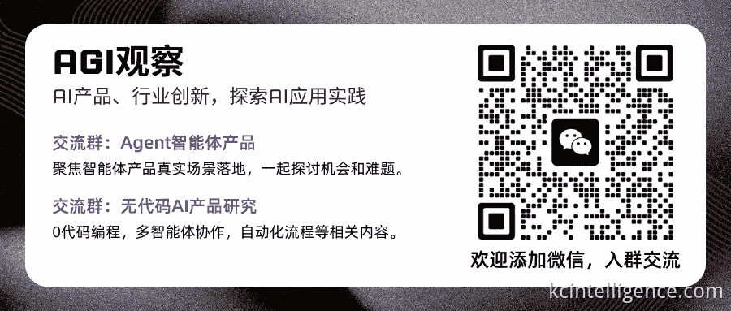

备注：加我微信时，备注希望加入的群名，Agent群，或者无代码群