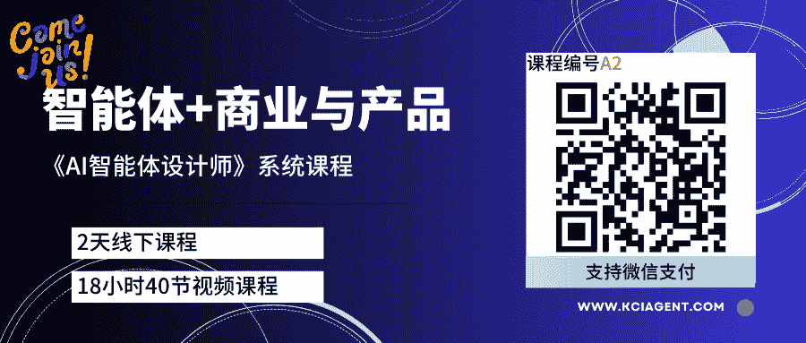
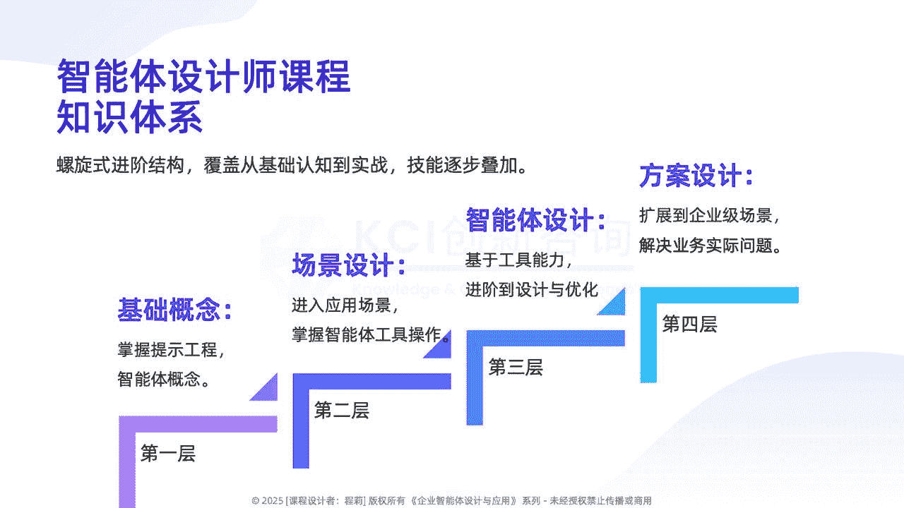
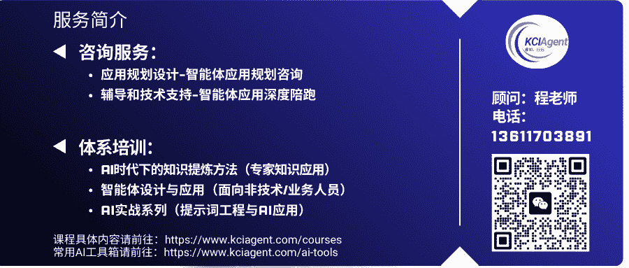
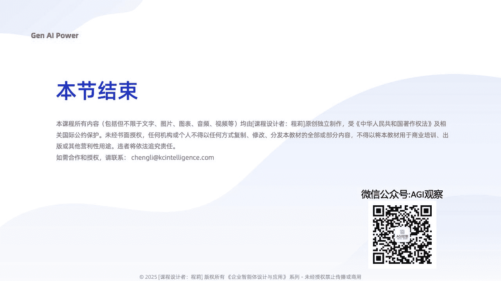

# 《AI 智能体设计师课程 》简介-成为技术与商业的复合型人才（编号A2）

> 来源：[https://aithinkup.feishu.cn/docx/B3Rad9o4EowtHRxISVRcQCp4nof](https://aithinkup.feishu.cn/docx/B3Rad9o4EowtHRxISVRcQCp4nof)

# 极速了解（编号 A2）

1.  **报名链接：****https://yuyue.wjx.****c**om/vm/QWCicsc.aspx#

1.  **课程定位：智能体+知识管理。**

> 关于知识管理感兴趣的朋友可以访问我的知乎：KMthought企业知识管理专栏

> https://www.zhihu.com/column/c_1398606324045754368

1.  报名流程：先提交报名表 -> 邮件通知课程内容 -> 最后付费确定上课

1.  混合课程：2天线下课 + 40节视频课程

1.  **电子资料：**有，配套课程中的提示词模版。

1.  飞书链接：[《AI 智能体设计师课程 》简介-成为技术与商业的复合型人才（编号A2）](https://aithinkup.feishu.cn/wiki/XyWUwKavUi8yH4kiLTNcdrgznPb)

1.  返回课程中心页面：[AI培训和咨询服务介绍](https://aithinkup.feishu.cn/wiki/OoiWwxxd5iOE6tku9QzcrCDMnVe)

### 学习体系说明：2天线下课程 + 【40节视频课程】

**在**本体系的【40节视频课程】中，我精心设计了 7 大核心章节，将引导您完成一次从理论到实践、从技能到思维的系统性学习旅程。

**这**不仅仅是一门课程，是一张通往 AI 时代人机交互新范式的金券。为了帮助您更清晰地掌握学习重点，我将课程内容标注为三大类型：

+   **【概念】**: 理解“是什么”。帮您构建坚实的知识地基，

+   **【方法】**: 掌握“怎么做”。讲解可复用的思维框架与策略

+   **【工具·实操】**: 在实践中“做出来”。带您上手主流 Agent 产品和开发平台。

接下来，让我一起开启这 7 个阶段的学习探索之旅。

## 【40节视频课程】章节名称和课程安排总览

> **第一章：认知焕**新，绘制你的AI知识体系地基（课程数量：6）

> **第二章：驾驭起**点，掌握与AI高效协作的艺术（课程数量：5）

> **第三章：初见主**角，认识和应用智能体Agent产品（课程数量：6）

> **第四章：亲手创**造，你的第一个Agent员工诞生（课程数量：4）

> **第五章：注入灵**魂，让你的Agent员工“能干活”且“懂行”（课程数量：8）

> **第六章：深潜引**擎，洞悉Agent“思考和工作”逻辑（课程数量：9）

> **第七章：群智跃**迁，成为未来Agent团队的领导者（课程数量：2）

# 《AI 智能体设计师课程 》定位和课程体系

### 开篇：欢迎来到 AI 2.0 时代的商业核心区

大家好，**我是课程设计/主讲人程莉。**欢迎来到课程介绍！在全球进入以大语言模型为核心的 AI 2.0 时代，能够规划、设计、构建和管理“智能体（AI Agent）”的人才，正成为连接技术与商业价值的核心枢纽。

### 第一部分 写给身处 AI 浪潮中的你

**面对汹涌而来的 AI 浪潮，您既兴奋**，又难免焦虑。您是否也正面临这样的困惑？

+   AI 浪潮来袭，报告和新闻里充斥着“大模型”、“智能体”，感觉再不学就要被淘汰，却不知从何入手？

+   想用 AI 提升业务，但与技术团队沟通时，总感觉隔着一道墙，无法将业务需求准确地传达？

+   看到竞争对手已经开始应用 AI，心中焦虑，但自己团队既缺懂 AI 的，也缺懂业务的复合型人才？

如果这些场景说中了您的心声，那么这门课程，就是为您量身打造的。这门课程的设计初衷**，就是为了帮**助像您一样的业务专家、管理者和决策者，将这份兴奋和焦虑，转化为真正的能力和机遇。

### 第二部分 你将获得的四重价值跃升阶梯

我们为您提炼了课程的四大核心特点，这也是您将获得的四重关键跃升阶梯：

#### ▶ 阶梯一：扫清“名词障碍”，让你能够“轻松地谈论 AI”

从人工智能概念到 大模型的TOKEN应用概念，从 AI 发展历史到Agent产品，再到当前AI技术发展趋势探讨，将为您扫除海量新技术概念障碍，全面获得人工智能和大模型的知识面，从而建立一个稳固的知识地基。

#### ▶ 阶梯二：以“动手实操练习”促“新 AI 思维练习”，实现思维跃迁

本环节目的，除了让你熟练掌握“大模型对话沟通技能”和基本AI类工具，更是通过“亲手构建智能化Agent软件”这个过程，来催化您思维方式的根本转变。

+   当您亲手为一个智能体配置角色、赋予知识、连接工具时，AI** 的“黑箱”就**在您面前变成了“玻璃箱”，化抽象为具象，让您直观地理解其能力边界和工作逻辑。

+   通过实操，您将**完成思维跃呈，****自然地****从一个** AI** 工具**的被动“应用者”，转变为一个 AI 解决方案的主动规划者”和“构建者”。

#### ▶ 阶梯三：强调需要掌握“可复用的方法论”，而非“一次性的技能”

工具会过时，但思维框架永存。

+   本部分是核心，辅助你建立**关于 AI 应用体系知识。**为您装备一整套工具箱，包括需求分析框架、项目可行分析、工作流程分析、专业知识管理等。

+   在本部分将会学习进阶实操，在“智能体工作流的构建”中提升技能。

+   这些思维框架与您通过实操建立的“构建者技能”相结合，将构成您在 AI 时代不可替代的核心竞争力。

#### ▶ 阶梯四：不再是“用 AI 试试”，而是我可以构想一个“Agent 团队协同”工作

这是您所有学习的融会贯通与最终升华。您对 Agent 应用的理解将发生质变。未来构思业务方案时，您脑海中浮现的：

+   **不再是** → “用 AI 试试看？” 的模糊想法。

+   **升级为→ “**我们可以构建一个拥有 A 知识、能调用 B 工具、遵循 C 流程的智能体来解决这个问题”。

+   **更跃升至→ **“我们可以设计一个“智能体团队”，让它们协同作战、

# 服务简介和联系方式

企业咨询或培训需求，您可填写以下【联系表】，或添加微信/电话13611703891，将安排对接。更多信息，可访问网站：www.kciagent.com。

# 微信公众号

