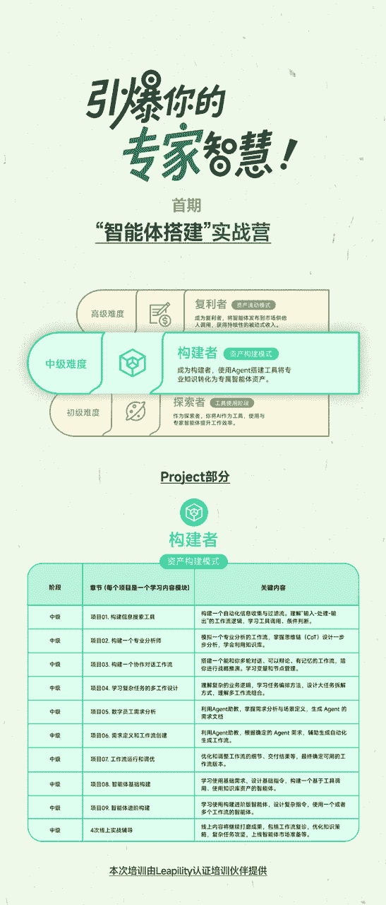

#  【招生启动】构建你的专家智能体 - 进入AI应用深水区，从专家经验到 AI 决策大脑

> 来源：[https://aithinkup.feishu.cn/docx/T7ndd136To1r5fx5JYccfy5An9c](https://aithinkup.feishu.cn/docx/T7ndd136To1r5fx5JYccfy5An9c)

> **最新一期Agent实战营的正课****，开课时间4月12日。欢迎报名，内有****具**体信息和定价，https://yuyue.wjx.com/vm/OQ4hNge.aspx#

---

## 一、课程定位- 构建你的专家智能体 - 进入AI应用深水区

本课程面向希望将专家经验转化为 AI 智能体决策与行动能力的企业管理者、数字化转型负责人及相关领域专业人士。

课程以“专家经验萃取+AI Agent 构建”为核心，融合理论与实操，帮助学员掌握 AI 原生知识管理方法，亲手打造可落地的智能体（Agent）。

本课程全程使用**平台工具 - 跃向**自然语言叙事型智能体，并且课程中使用Agent助教实现自动化教学。

官网：www.Leapility.cn。 国际版：www.Leapility.com

---

## 二、课程收获和适合人群

### **你将获得：**

+   从 0 到 1 构建并发布一个或多个AI 智能体（基于 跃向Leapility 平台）。

+   优秀作品有机会上架 跃向Leapility 专家智能体市场，实现商业价值！

+   更有 跃向 平台个人专业版积分奖励等你来拿。

### **谁适合来参加本课程？**

+   专业领域专家、业务骨干

+   企业数字化转型负责人

+   咨询顾问/培训师

+   希望掌握 AI 智能体开发与应用的创新者

> ✅  适合：**想进阶学习智能体用户**

> 已经能熟练使用 ChatGPT、豆包等工具，希望进一步学习智能体使用和自定义创建方法。

> ✅  适合：**智能体工具初级用户**

> 已试用过 Coze 或 跃向Leapility 等，但尚未系统掌握智能体设计和构建方法的实践者。

> ❌ 不适合：智能体 0 基础，日常较少使用 AI 工具

---

## **三、报名流程说明：**

**1. ****提交本报名表：**https://v.wjx.cn/vm/OQ4hNge.aspx#

（注意：报名[需要提交完成一个AI基础测试，在问题](https://r.wjx.com/redirect.aspx?url=https%3A%2F%2Fkaoshi.wjx.top%2Fvm%2FOtbiSSU.aspx&activity=344495282)**11. AI基础测试（**10题客观题，5分钟完成。问卷星链接：https://kaoshi.wjx.top/vm/OtbiSSU.aspx）完成后提交答题分数。

**2. ****报名信息审核：** 教务团队将在 **48 小时内 ****联系您****。

3. 正式****报名通****知： 助**教将添加你的微信，通知您缴费[通道。

4](https://aithinkup.feishu.cn/wiki/AINXw4D57iOXLdkaYRYcnzpXnCh). 正式入学： 缴费成功后，为您开通线上视频课权限，并进入【专家智能体实战群】，

注：为确保课程效果，本课程最低开班人数为15人。若人数未满，开班日期将顺延至下周日（3月8日）

---

## **四、课程亮点和内容模块速览：**

+   **招生限额：**仅限 **20 人，小班精品课程**

### **线下 1 天****高强度实战：**

**内容模块：**

1.  认知重塑：专家价值的定义，破解“锁在脑中的智慧”痛点。

1.  **场景实操：**

+   快速识别和提取个人经验的 AI 工具实操

+   复杂问题分解：如何让 AI 协助结构化个人工作流

+   从“经验”到“自动化”：Agent 智能体数字员工初探

> 专家经验迁移 – Agent 智能体构建三种模式：

1.  **🔨 经典萃取模式： **自下而上。从萃取个人经验出发，手动打磨 Prompt 和工作流。

1.  **⚙️ 工程师模式：** 自上而下。利用 0 代码平台自动化生成工作流骨架，再定向注入知识。

1.  **👔 管理者模式： **以终为始。先定义需求，让平台自动生成 Agent，专家负责“验收”。

+   组建学习小组（5 组，每组 4 人），线下和线上课程中，持续讨论交流

**内容模块的具体列表：**

### **线上 4 周****学习与答疑：**

场景智能体演练，学员智能体展示与互评，持续精进。

1.  每周解锁 1-2 个智能体应用的新场景练习，导师在线解决实操中疑问。

1.  每周将学员展示的自己的 Agent 设计理念与功能。学员互评 + 导师点评，形成迭代优化意见

1.  第 4 周进行终极评分，优胜者将获得 跃向Leapility 平台积分奖励。

### **赠送权益****：** 1 个月线上视频课

1.  线上视频课程名称：《AI 基础+智能体入门》双模块（[《AI基础课》“AI基础+智能体入门”双模块（编号 B1）](https://aithinkup.feishu.cn/wiki/AINXw4D57iOXLdkaYRYcnzpXnCh)2 节精品课，共 240 分钟，介绍： ）

1.  支持学员提前预习，或课程一个月周期内灵活学习

---

## 五、入学前，请接受我们的“AI 能力挑战”！

本课程难度为 L2+L3，为保证教学质量，请务必如实提交测评结果。

这里有两组 AI 能力测评方式，请在报名前完成测评【必选】测评 A。

【必选测试 A】 : AI 基础测试（10 题客观题，5 分钟完成）。

问卷星链接：https://kaoshi.wjx.top/vm/OtbiSSU.aspx

完成测试后，你将获得分数。请将报名表中提交。

【可选测试 B】 ：AI 能力测评和诊断。

使用 跃向Leapility 平台的专家智能体完成测试。如有时间，可以自行测试，预计需要 15 分钟完成。

智能体地址：[https://跃向Leapility.com/share/](https://r.wjx.com/redirect.aspx?url=https%3A%2F%2Fleapility.com%2Fshare%2Fagent%2Fi-v37paj7m0x0z&activity=344495282)agent/i-v37paj7m0x0z

完成测试后，你可以下载一个文档《AI 能力测试与诊断报告》（来自智能体自动生成）。请在报名表中提交。

---

## 六、详细了解 跃向Leapility：课程中使用的智能体平台

🔑 【跃向智能体平台注册和使用指南】

1.点击链接：https://leapility.cn

2.访问专家智能体市场，可以使用已近发布的智能体：https://leapility.cn/market

3.个人设置：你可以使用AI生成头像，查看当前每个任务的积分消耗情况。

[欢迎来到跃行者社区！](https://translai.feishu.cn/wiki/MiSFwmKM1ivymZkiGDIcPfQonre).用户手册-欢迎来到跃行者社区！飞书文档：

[成为认证专家](https://translai.feishu.cn/wiki/VUx0wHMPAinu18k1zUXc5oDSnch).成为认证专家的细则，飞书文档：

6.这是我的一个往期直播-主题【高效知识精炼工作流】：

https://www.bilibili.com/video/BV1y7agzYENo/?spm_id_from=888.80997.embed_other.whitelist&bvid=BV1y7agzYENo

其他更多专家直播，可访问用户手册和B站

---

## 七、进一步了解本课程，可以参加我的线下公益课，

这里是往期回顾：https://mp.weixin.qq.com/s/8i4FisRjgbMnG9OjjmzOfQ

这是线下公益课的报名链接：https://yuyue.wjx.com/vm/Q0zVY1v.aspx#

---

## 八、报名常见问题和解答

> **说明：**将一些常见问题列在表格中。如有其他问题，可以本飞书文档下留言。

| **大类** | **子类问题** | **答案简要说明** |
| --- | --- | --- |
| **1.报名流程** | 1.1 我完全没有 AI 基础，可以报名吗？ | 建议有一定 AI 工具基础（如用过 ChatGPT、豆包等）。 |
|  | 1.2 报名流程复杂吗？ | 填报名表+做 AI 基础测试，提交分数，审核通过后缴费即可。 |
|  | 1.3 报名成功后的流程是怎样的？ | 报名成功后，48 小时内，有教务老师联系缴费事宜。 |
|  | 1.4 入学前需要做哪些准备？ | 完成 AI 基础测试，提前注册 跃向Leapility 账号，阅读操作手册，观看演示视频。 |
|  | 1.5 如果报名人数不够会怎样？ | 每期线下课至少 15 人开班，否则延期到下一个周日。 |
| **2.课程费用** | 2.1  课程有早鸟价吗？ | 有早鸟价格优惠，限定前 5 人 |
|  | 2.2  有课程团报价格吗？ | 尚未说明。您可咨询教务团队。 |
|  | 2.3 报名后能退费吗？ | 具体退费政策请咨询教务老师，特殊情况可沟通处理。 |
| **3.课程内容** | 3.1 课程是线上还是线下？时间怎么安排？ | 线下 1 天实战+线上 4 周学习答疑，具体时间见课程安排表 |
|  | 3.2 课程主要学什么？能学会做智能体吗？ | 学习“专家经验萃取+AI Agent 构建”，导师手把手实操，能亲手做出智能体。 |
|  | 3.3 课程难度大吗？？适合新手吗？ | 内容由浅入深，导师会手把手指导，适合有一定 AI 工具基础的新手，实操为主，难度适中。 |
|  | 3.4 课程有作业或考试吗？ | 线下课程结束后有实战演练作业。 |
| **4.线上形式** | 4.1 线上课程是什么形式？ | 腾讯会议形式 |
|  | 4.2 线上课是直播还是录播？错过了怎么办？ | 线上课为直播形式。要求全员参加。虽然错过了有回放，但是效果减弱。 |
|  | 4.3 每周都要做作业或展示吗？ | 每周有智能体应用场景练习，学员会展示练习或者完成的 Agent，鼓励积极参与。 |
|  | 4.4 第 4 周的终极评估是什么？ | 导师和学员共同参与评分和点评，优胜者可获得 跃向Leapility 平台积分奖励， |
| **5.赠送权益** | 5.1 赠送的线上视频课是什么内容？ | 包含《AI 基础+智能体入门》两个模块，共 12 节精品课，系统讲解 AI 基础知识和智能体入门方法。 |
|  | 5.2 视频课什么时候可以看？ | 报名付费成功后，教务老师将与您确认姓名和手机，48 小时内加入邀请飞书群组并获得线上视频权限。 |
|  | 5.3 视频课可以看几次？有时间限制吗？ | 在赠送的 1 个月内可不限次数反复观看，帮助巩固知识。 |
|  | 5.4 视频课有配套资料或作业吗？ | AI 基础基础课有配套的知识点思维导图。没有作业 |
| **6.工具平台** | 6.1 跃向Leapility 平台是什么？需要提前下载或注册吗？ | 课程用 跃向Leapility 智能体平台，目前 CN 版本需要邀请码，助教将会联系报名学员开通账号。 |
|  | 6.1 跃向Leapility 平台是什么？需要提前下载或注册吗？ | 课程期间可免费使用，平台订阅收费政策请查询官网。 |
|  | 6.3 需要自带电脑或设备吗？ | 线下课需要自带笔记本电脑，线上课需有稳定网络和电脑。 |
|  | 6.4 课程结束后我的智能体能上架 跃向Leapility 专家智能体市场吗？ | 优秀作品可上架，有机会实现商业价值并获得积分奖励。 |
| **7.持续学习** | 7.1 怎么联系老师或助教？ | 提交报名信息后，教务老师会联系您微信。 |
|  | 7.2 有交流群或社区吗？ | 有专家用户社区，将持续学习和交流。 |

---

席位有限，仅限 20 人。

👉 [**立即报名/咨询详情]**

**报名链接**：https://v.wjx.cn/vm/OQ4hNge.aspx#

---

## 业务和合作联系：www.kciagent.com

## 微信公众号【AGI 观察】

