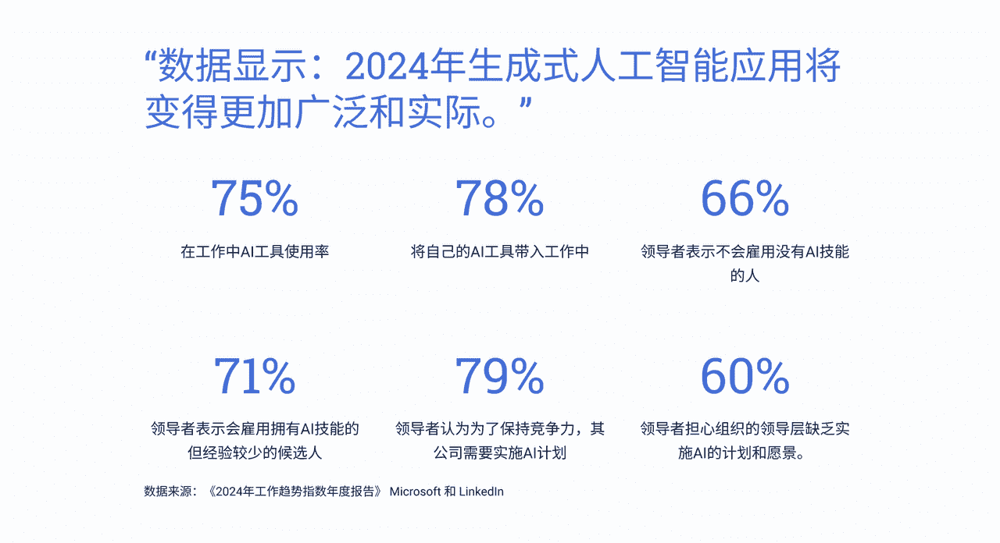
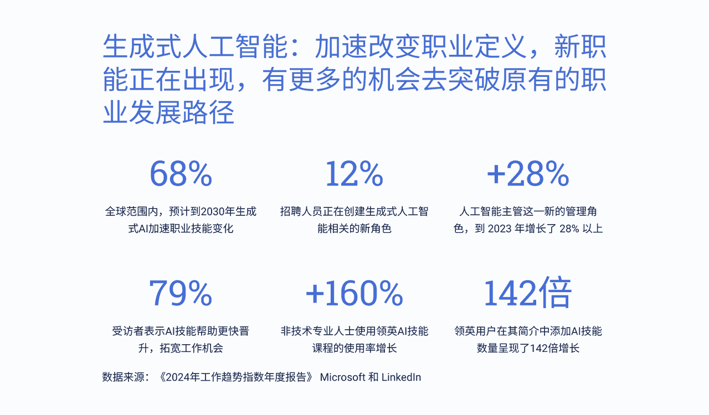
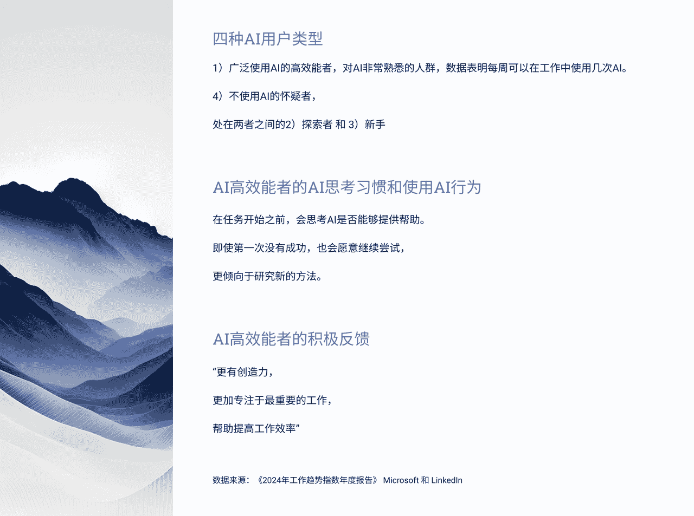
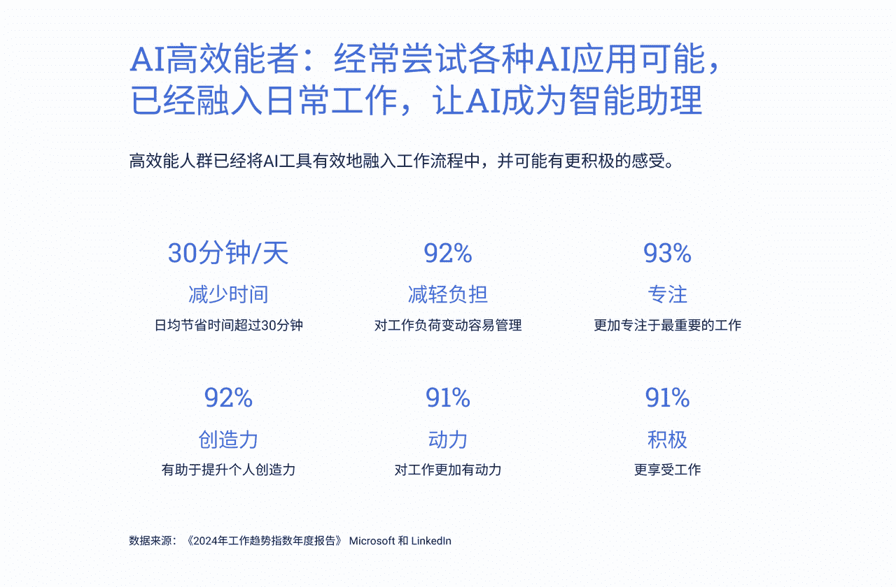
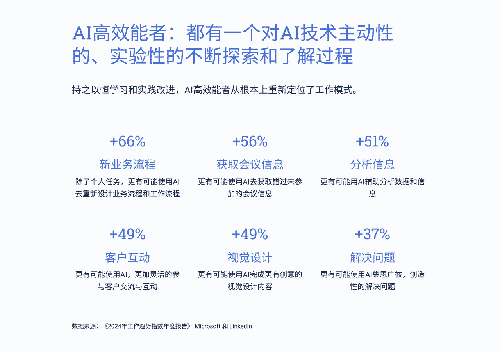

# 2024 Work Trend Index Annual Report from Microsoft and LinkedIn

> 来源：[https://aithinkup.feishu.cn/docx/Ut8jd3eO6oaFosxjFaXcPAUcnfd](https://aithinkup.feishu.cn/docx/Ut8jd3eO6oaFosxjFaXcPAUcnfd)

## **基础文档分析：**

1.  📄 文件名: Microsoft_2024_Work_Trend_Index_Annual_Report_663b79bdc8f91.pdf

1.  📚 主题: 2024年工作趋势指数年度报告 - AI在工作场所的现实应用及其对劳动力市场的影响

1.  💎 关键词: AI应用、工作场所、知识工作者、领导力、业务转型、劳动力市场、AI技能、职业发展

1.  🔍 内容摘要: 报告指出，2024年是AI在工作中得到实质性应用的一年。

全球75%的知识工作者正在使用生成性AI，且许多员工在工作节奏和工作量的重压下，开始自行引入AI工具。尽管领导者认同AI对业务至关重要，但许多人认为他们的组织缺乏一个清晰的计划和愿景来实现AI的全面应用。

报告通过调查、LinkedIn的劳动力和招聘趋势分析以及Microsoft 365的生产力信号，提供了领导者和专业人士在AI对工作影响方面的洞见和行动指南。

1.  🗂️ 文章大纲:

+   引言

+   AI在工作场所的增长和员工需求

+   AI对工作方式和劳动力市场的影响

+   领导者对AI采用的看法和挑战

+   AI技能在招聘和职业发展中的重要性

+   AI对工作日常和流程的潜在改变

+   结论和未来展望

1.  📍 重要段落:

+   "75% of knowledge workers use AI at work today, and 46% of users started using it less than six months ago."

+   "79% of leaders agree their company needs to adopt AI to stay competitive, but 59% worry about quantifying the productivity gains of AI."

+   "66% of leaders say they would not hire someone without AI skills."

+   "AI power users are 68% more likely to frequently experiment with different ways of using AI."

1.  📃 参考文献: 报告中未明确列出具体的参考文献，但提到了对31,000人进行的调查、LinkedIn的劳动力和招聘趋势数据以及对财富500强客户的研究。

1.  📅 文件日期: 报告中没有明确提供文档的创建或发布日期，但根据内容推断，数据截止到2024年3月。

## 数据摘要

## 四种AI用户类型

