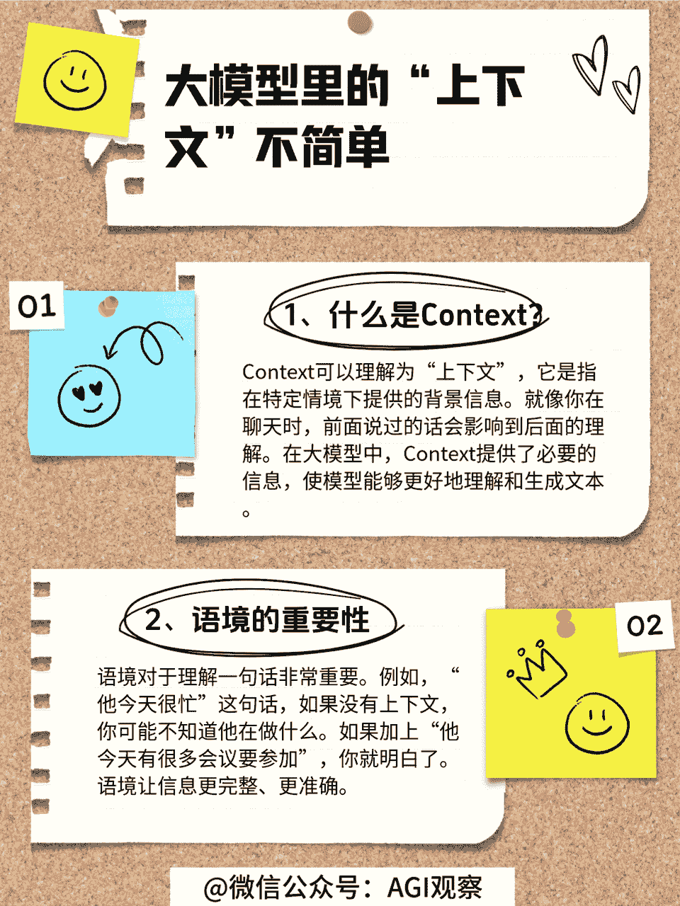

# 大模型的Context上下文是什么？

> 来源：[https://aithinkup.feishu.cn/docx/TrW9dGymxo8ED6xxLMhcPKtynGg](https://aithinkup.feishu.cn/docx/TrW9dGymxo8ED6xxLMhcPKtynGg)

Anthropic 公司于 2024 年 11 月 25 日推出 “模型上下文协议（Model Context Protocol, MCP）。

🎈MCP这到底是什么协议呢？

简单说，这就像是一种新规则，目的是把人工智能助手和各种存放数据的系统（像放资料的仓库、工作用的工具、开发程序用的环境等）连接起来，让人工智能能给出更好、更靠谱的回答。

🎈为啥要有这个协议？

现在人工智能助手挺流行，但有个问题，就算是最厉害的人工智能模型，也因为和数据隔开了（就像被困在信息孤岛和旧系统里）。

每次有新的数据来源，都得专门想办法去连接，太麻烦了，很难大规模地把系统都连好。

MCP 就是为了解决这个难题，用一个通用的、开放的标准，把人工智能系统和数据源连起来，以后就不用一个一个地去搞零散的连接了。

🎈对 AI 发展的有什么意义？

打破数据孤岛：促进数据流通与共享，充分发挥数据价值。

提升模型性能与实用性：模型获取更多上下文信息，能生成更准确、相关和有用的回复。

推动生态系统发展：作为开源项目和生态，吸引开发者、企业和研究人员参与，共同构建更丰富的上下文感知 AI 应用。

