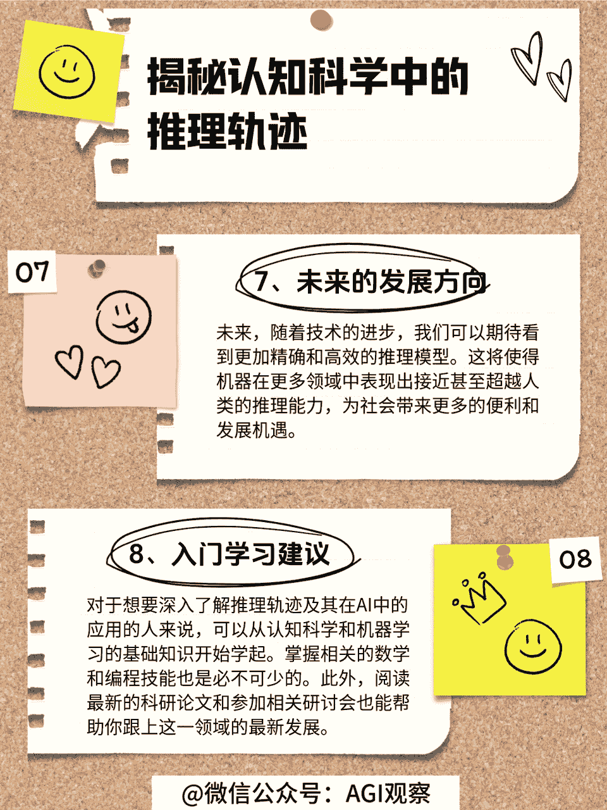

# 认知科学Reasoning traces推理轨迹是什么？

> 来源：[https://aithinkup.feishu.cn/docx/WID7dvkCyoG4zgxLXLWcMJ2vnWh](https://aithinkup.feishu.cn/docx/WID7dvkCyoG4zgxLXLWcMJ2vnWh)

### “Reasoning traces” 可以翻译为 “推理轨迹” 或 “推理脉络”。

> 轨迹就是一整个路径。

> 就好比你在解一道数学题时，把每一步的思考、运用的公式以及得出的中间结果依次罗列出来，这些内容合起来就是这道题解题思路的推理轨迹。

> 又比如律师在分析案件时，推理轨迹就是从收集的证据到最终形成完整诉讼策略的过程记录。

