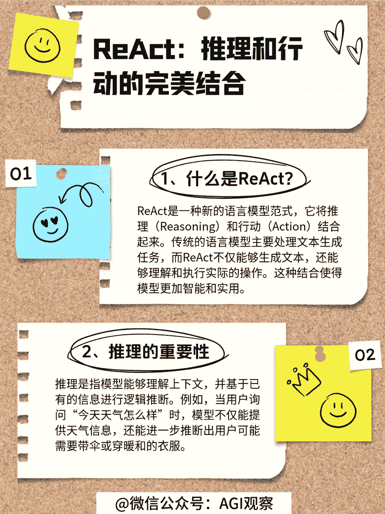
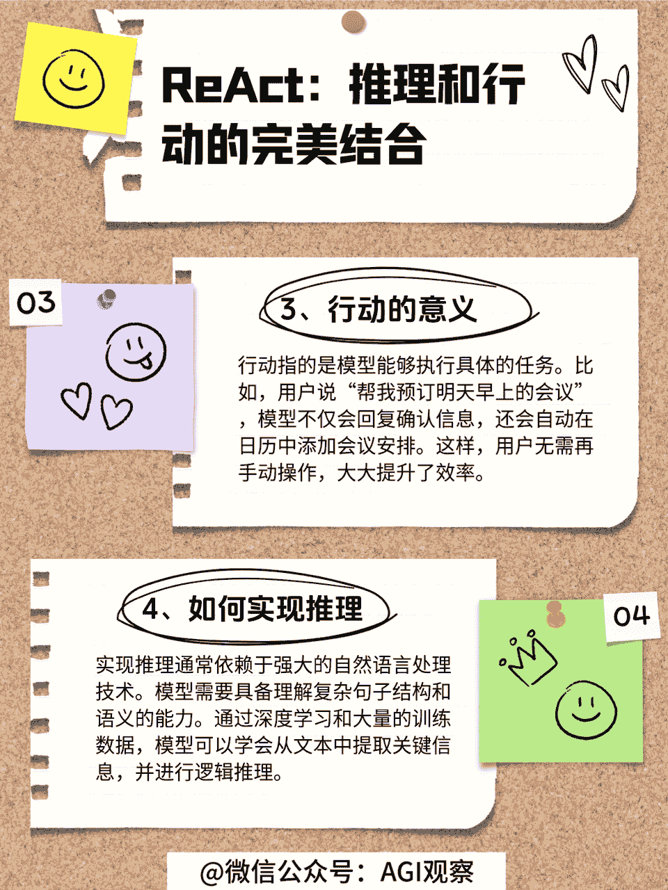
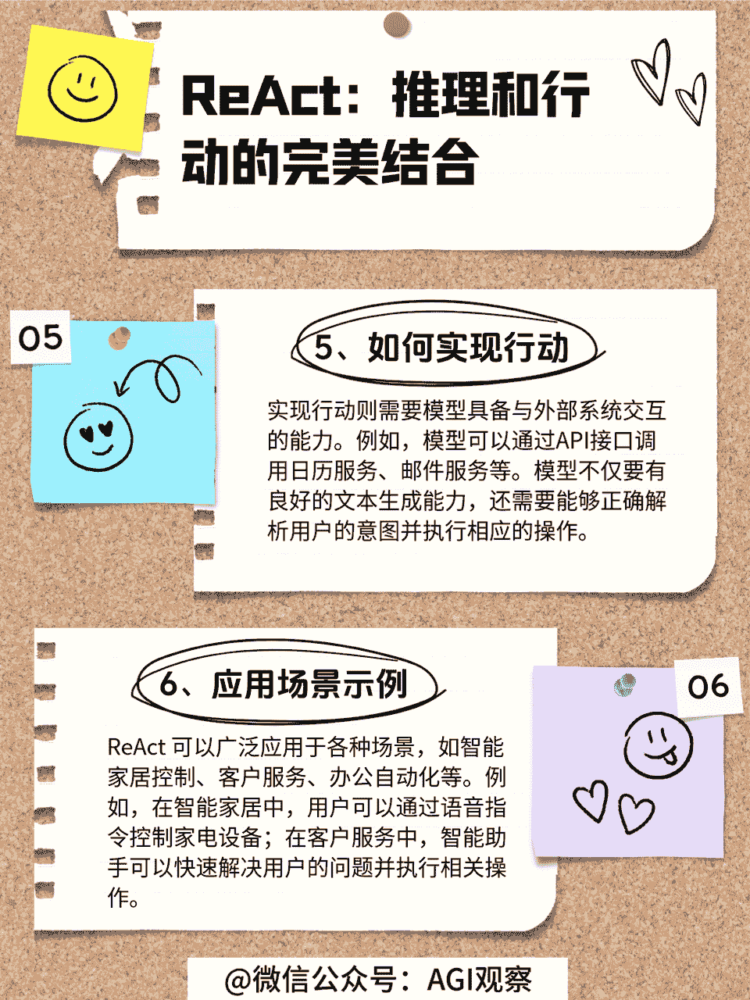

# ReAct是一种重要的技术框架

> 来源：[https://aithinkup.feishu.cn/docx/HOBidzSIto7sJYxxy1hcf79ongf](https://aithinkup.feishu.cn/docx/HOBidzSIto7sJYxxy1hcf79ongf)

> ReAct 代表 “Reasoning - Action”（推理 - 行动）

> 举个例子，在智能体任务场景中，ReAct 可以让机器人先推理出完成任务的步骤，比如在一个布满障碍物的房间中拿到目标物品，机器人先推理出需要绕过哪些障碍物、需要打开哪些门等步骤，然后采取行动，控制机械肢体移动来完成任务。

> ReAct 的推理步骤可以被记录和展示，这使得智能体的行为更加透明。在一些需要解释结果的应用场景中（如医疗诊断辅助系统、金融决策支持系统等），这种可解释性是非常重要的。

