# Character AI - 拟人化 AI 虚拟角色对话平台

> 来源：[https://aithinkup.feishu.cn/docx/VxvadNwxUonC65x3YyTchDBunYg](https://aithinkup.feishu.cn/docx/VxvadNwxUonC65x3YyTchDBunYg)

## 产品：Character AI

Character AI 是一个基于人工智能 LLM 的对话平台，用户可以与各种角色进行自然对话。利用先进的语言模型生成逼真的对话，旨在提供丰富的互动体验。

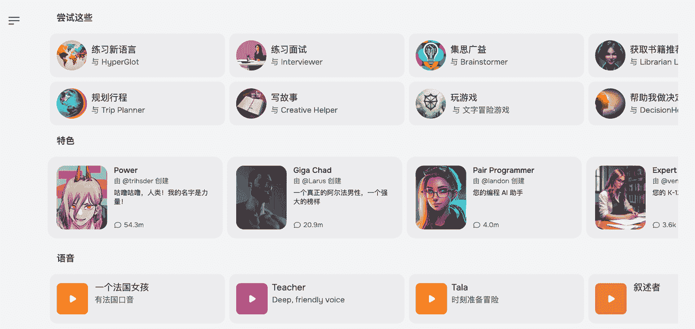

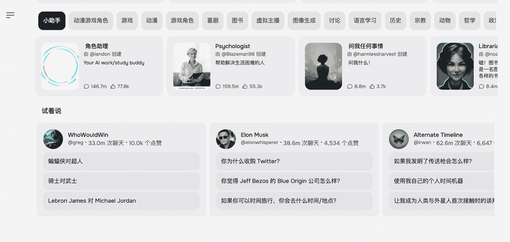

### 产品信息一览

该产品可以看做是“**模型即产品”，**整个产品交互页面的设计非常简单，初始开发团队并没有产品经理这个职能。

#### 产品功能和应用场景

+   **产品形态**：基于网页和移动应用的服务。

+   **主要功能列表**：

+   与历史人物、名人、虚构角色进行对话。

+   用户自创角色，自定义角色的个性和对话风格。

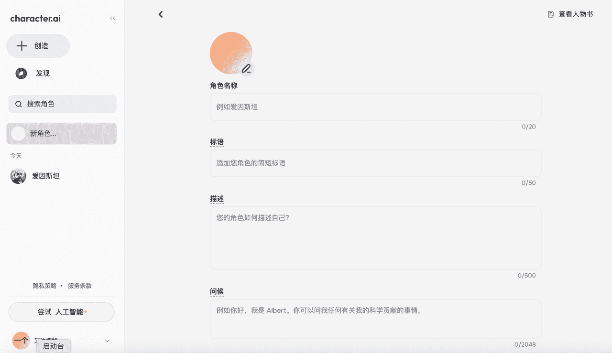

+   **具体应用案例或场景，**根据公开的信息，可能的应用场景包括但不限于：

+   教育用途：与历史人物对话以学习历史。

+   娱乐用途：与虚构角色进行互动，增强娱乐体验。

+   创意写作：使用角色进行故事创作和情节发展。

#### **产品盈利方式**

提供付费订阅服务。使用免费版有对话量限制，会出现排队等待提示。

+   **目标市场和特点**： 面向广泛的用户群体，包括学生、创作者和普通用户，关注用户的参与度和满意度。

### 聊天机器人的用户是谁？

#### 用户数据（仅 2024 年 7 月数据）

+   **访问用户的国家前五**

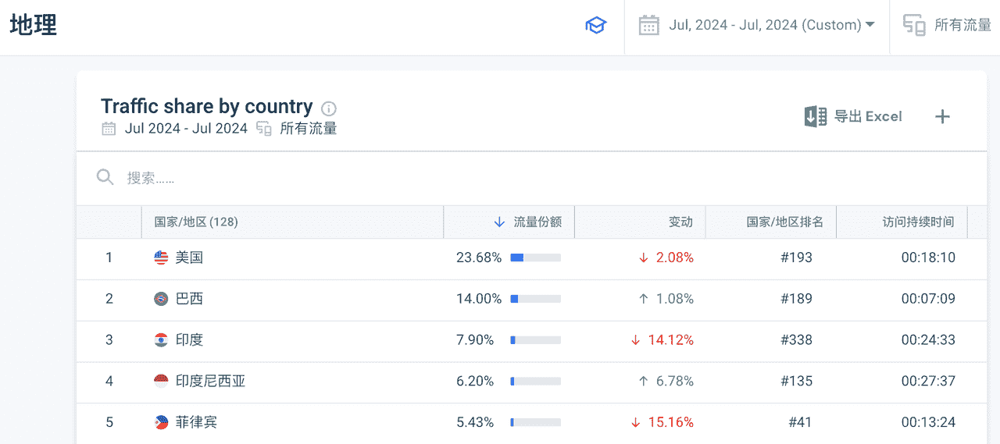

+   **受众人口特征**

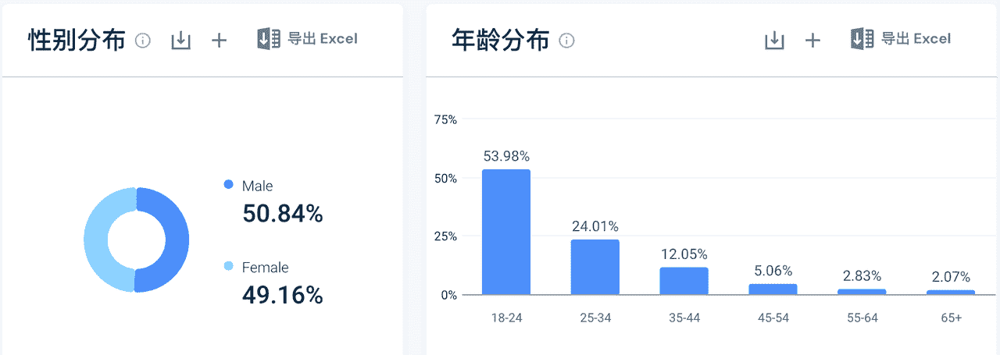

+   **受众兴趣，话题分布**

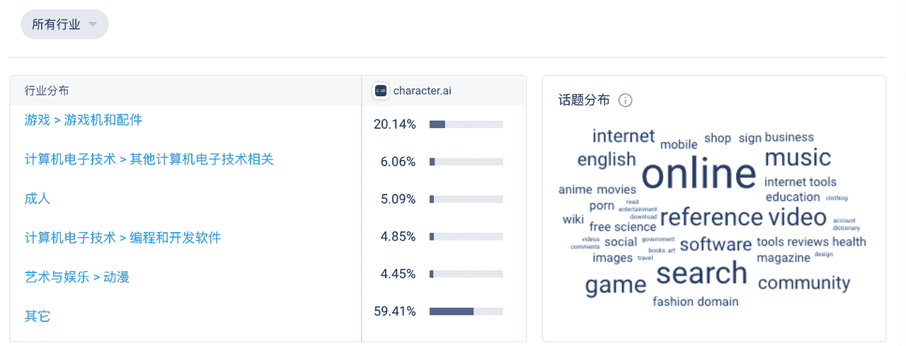

#### Character AI 最受欢迎的对话次数最多的前 10 个角色 BOT

以下是搜索出来的结果，多数都是动漫角色，每个角色都有多个 bot。（排名不分先后）

1.  Raiden Shogun and Ei

1.  Gawr Gura

1.  Yae Miko

1.  SM64 Mario

1.  Monika

1.  Hamlet

1.  Philosophers

1.  Stella

1.  Yandere

1.  Yae Miko

### 公司信息一览

+   **公司名称**： Character AI

+   **公司地址**：总部位于加州

+   **网站地址**： www.character.ai

+   **创始人**：Noam Shazeer 和 Daniel De Freitas

#### 公司画像

以下数据根据公开信息获得。

#### 成立时间：2021 年

> Character AI 于 2022 年 9 月进入公测，2023 年 5 月推出移动应用。

#### 估值：10 亿美元

> （2023 年完成了 A 轮融资，融资金额为 1.5 亿美元，融资时没有收入）

#### 收入：预计 2024 年收入为 1670 万美元

#### 员工：130 人左右

#### 付费订阅用户：不到 10 万

#### 日活用户：600 万，月活 2 亿左右

#### 用户：2000 万

#### Bot 数量：超过 1800 万个机器人

#### 谷歌收购

+   **收购价值：25 亿美元**

> 与谷歌母公司 Alphabet 签署了一项协议，授予非独家使用其大型语言模型的许可。

> 这次收购反映了科技巨头在人工智能领域的竞争加剧，也是对 Character AI 技术实力的认可。

>

+   **团队变化**

> 约 130 名员工中有 30 名将加入谷歌，包括 Noam Shazeer 和 Daniel De Freitas 以及部分研究团队成员。

> 大部分团队成员将继续留在公司，专注于产品的开发和用户服务。

#### Character AI 网站数据（仅 2024 年 7 月数据）

+   **流量与互动**

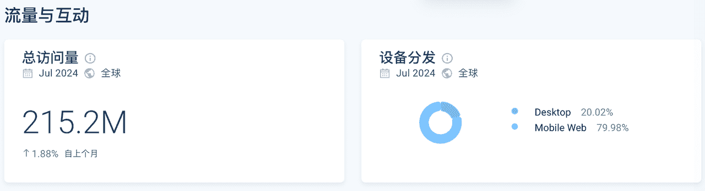

+   **多个网站访问量对比**

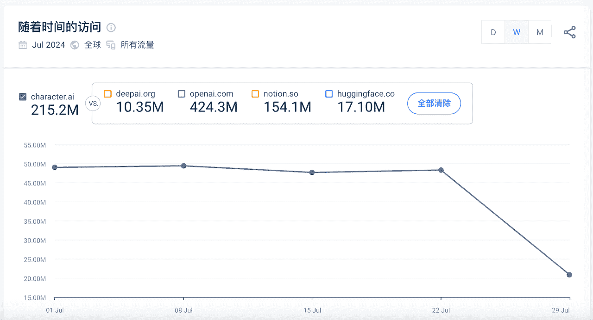

数据来源（similarweb.com）

#### Character AI 和 Open AI 访问数据对比（仅 2024 年 7 月数据）

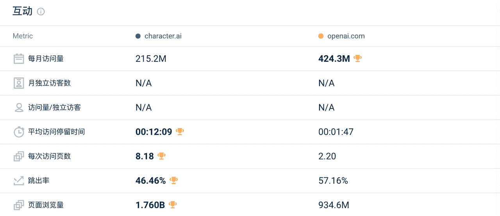

数据来源（similarweb.com）

### Noam 和 Daniel 联合创始人简介

#### **Noam Shazeer **

出生于 1976 年，是人工智能领域的杰出贡献者，是著名论文“Attention is All You Need”的合著者。该论文描述了 Transformer 模型，为自然语言处理领域带来了革命性的进步。

Noam 是 Google 的前 200 号员工。2000 年加入 Google 担任软件工程师，2009 年短暂离开 Google，在 2012 年加入了 Google Brain。据本人采访称，在这个时候才真正开始深度接触深度学习和神经网络。在谷歌工作 17 年，参与了多个重要的 AI 项目。

#### Daniel De Freitas

2015-2016 年， Daniel 参加了 Microsoft 旨在识别和培养最优秀人才的高潜力发展计划。

离开 Microsoft 后，Daniel 于 2018 年加入谷歌。曾启动并领导了  Meena 聊天机器人项目，并负责谷歌的 LaMDA 项目。

Daniel 是一位多才多艺的语言专家。他会说英语和葡萄牙语，能说法语。

#### 曾经的谷歌项目

+   **谷歌的 Meena 聊天机器人**

Meena 是谷歌开发的一种多轮开放域聊天机器人，拥有 26 亿参数，能够在各种主题上进行交流，而不仅仅局限于特定问题或任务。随着数据和计算能力的提高，Meena 后来更名为 LaMDA。

Meena 的开发团队希望以有限的能力向公众发布这个聊天机器人，但谷歌公司高管拒绝了，理由是 Meena 违反了谷歌“关于安全和公平的 AI 原则”。这最终导致 LaMDA 的两位首席研究员 Daniel De Freitas 和 Noam Shazeer 的离开。

+   ** LaMDA ( Language Model for Dia**logue Applications)

LaMDA 后来被认为是现代对话 AI 的重要里程碑。

第一代 LaMDA 最初于 2020 年作为 Meena 开发和推出，在 2021 年 Google I/O 主题演讲中宣布。

2023 年 2 月，谷歌宣布推出由 LaMDA 提供支持的对话式人工智能聊天机器人 Bard（现为 Gemini），以对抗 OpenAI 的 ChatGPT 的崛起。

+   **相关研究 （链接论文地址）：**

[Towards a Human-like](https://arxiv.org/abs/2001.09977) Open-Domain Chatbot

neural conversational model.

[personality](https://arxiv.org/abs/1801.07243)

[factuality](https://arxiv.org/abs/1811.01241)

### 个人观点：“AI 聊天机器人”产品有需求，如何证明价值？

从日活数据来看，600 万日活，2 亿月活，表明用户对 AI 虚拟陪伴的真实需求。这些数据也可以说明 Character AI 具备强大的用户基础和参与度。

> **可以从很多方面来看待价值，我仅从以下三个方**面进行探讨（数据和信息有限，仅供参考）：

+   从产品的用户活跃和用户粘性方面：将传统公司对比 AI 公司

+   从商业价值方面：传统财务指标和运营 KPI

+   **从收入来源多样性方面：Chara**cter AI 类产品如何产生更多收入？

#### 从产品的用户活跃和用户粘性方面：将传统公司对比 AI 公司

传统公司的用户日活/月活中位数是 51%，WhatsApp 是 85%，Character AI 这个数值是 41%，用户活跃度较低。

虽然 Character AI 吸引了大量用户，但在用户的日常使用频率并不高。

**我认为有几种可能是：**

+   用户对 Character AI 的依赖性不足，可能在初次体验后，没有形成持续使用的习惯。

+   用户使用 Character AI 时未能获得足够的满足感，导致他们不频繁回访。

+   用户以尝鲜体验新 AI 产品为主，其实对这类产品并不感兴趣。

**以上这些可能与产品的功能、角色设计或用户互动体验有**关。这对产品的长期发展和商业化构成挑战。

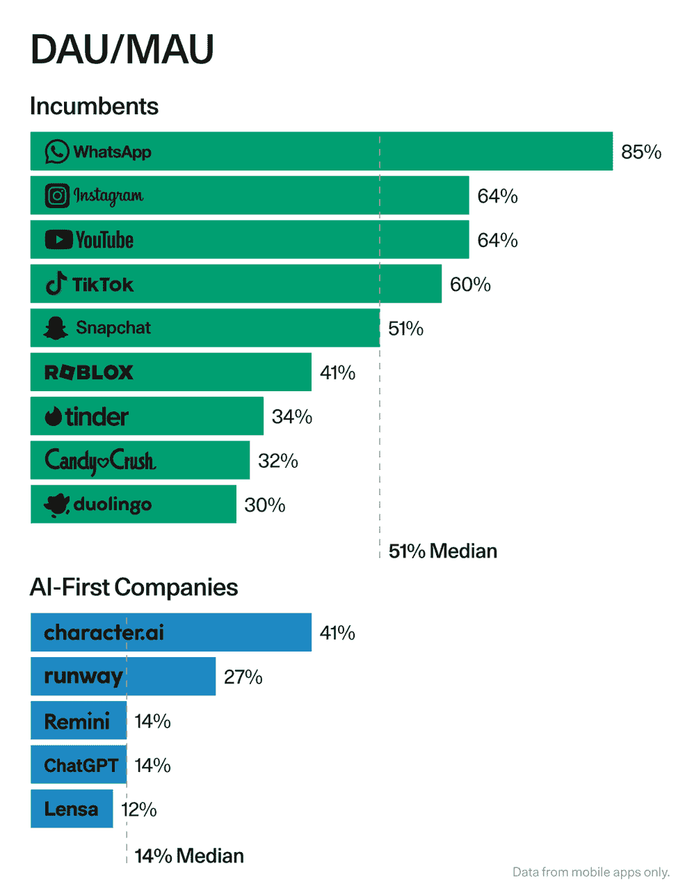

数据来源（https://www.sequoiacap.com/article/generative-ai-act-two/）

#### 从商业价值方面：传统财务指标和运营 KPI

（有限数据源，仅供参考）

#### 财务指标

> **投资回报率（ROI）**：Character AI 高昂的运营成本和有限的订阅收入，ROI 可能很低。

> **净现值（NPV）**：没有数据。

> **收入增长率**：没有数据

#### 运营 KPI

> **用户增长率**：根据 7 月数据，随保持增长，但增速放缓。

> **用户留存率**：没有数据

> **订阅用户数量**：不到 10 万。

#### 从收入来源多样性方面：Character AI 类产品如何产生更多收入？

> 从目前的公开信息来看，Character AI 只有来自订阅用户的收入，似乎没有其他收入来源来增加收益。

> 了解收入来源的比例和变化趋势，有助于评估整体财务健康状况和可持续性。

Character AI 类产品需要探索有效的商业化模式，但是这类产品的商业化之路并不容易，以下是可能产生收入的一些策略。比如：

1.  付费订阅

1.  广告变现，内容赞助和合作伙伴关系

1.  创作者收益分成模式

1.  销售角色的虚拟商品

1.  销售角色周边实物产品

1.  角色人物的艺术和创作延伸

1.  为个人定制虚拟助手

1.  为企业定制虚拟助手

1.  销售 AI 产品研发类的培训课程

1.  与线下业务的协同发展

### 个人观点：AI 人才竞争激烈，人才缺口非常大

> 有观点认为，谷歌收购花了 25 亿美金，“只要人不要公司”，最终如愿以偿得到了 Character AI 的创始团队和核心员工。

> “只要人不要公司”这个观点有可能简单化形容了这笔交易的复杂性。这笔交易是一个复杂的技术整合和人才布局。至少从公开信息可以获知这笔交易包含：

1.  大型语言模型技术许可

1.  团队加入对谷歌的技术整合和应用加速。两位创始人对谷歌非常了解。虽然无法知道谷歌对 Noam 承诺了什么，或者有什么计划，但都认为这是谷歌重大的战略整合，市场普遍关注谷歌如何利用这些新资源来应对 OpenAI 等竞争对手。

1.  避免监管审查的考虑。谷歌可能出于避免反垄断审查的考虑，选择了技术许可而非直接收购的方式。

> 如果说这是谷歌对 Character AI 团队的重视，还不如说更深刻地突显了 AI 行业在技术整合、行业知识、实践经验等方面的知识和经验缺口。

> **在人工智能行业，有很多方面的能力，可能会被技术能力的耀眼光芒所遮挡，比如**“创新”，“管理能力”，“团队建设和领导力”，这些对企业管理以及对创业非常关键。

> Noam Shazeer 和 Daniel De Freitas 这样的行业影响力人物，从大公司内部的大型项目管理，到初创公司的经营运作，从基础理论到产品实现，这所有的能力，都是通过长期实践、经验和直觉形成，其他人或者团队很难通过简单的学习或模仿来获得。

> **拥有这样的人才，其价值可能远超过**模型授权或者某个尚未证明商业价值的产品。

### 这样的团队和人才是有价值的无形资产，是企业竞争的壁垒。

> 人才是企业最难复制的竞争优势，也是企业最难建立的商业壁垒之一。一支优秀的人才团队，凭借其专业技能、管理经验和创新能力，能为企业带来持续的竞争优势。

## **作者：Ada **

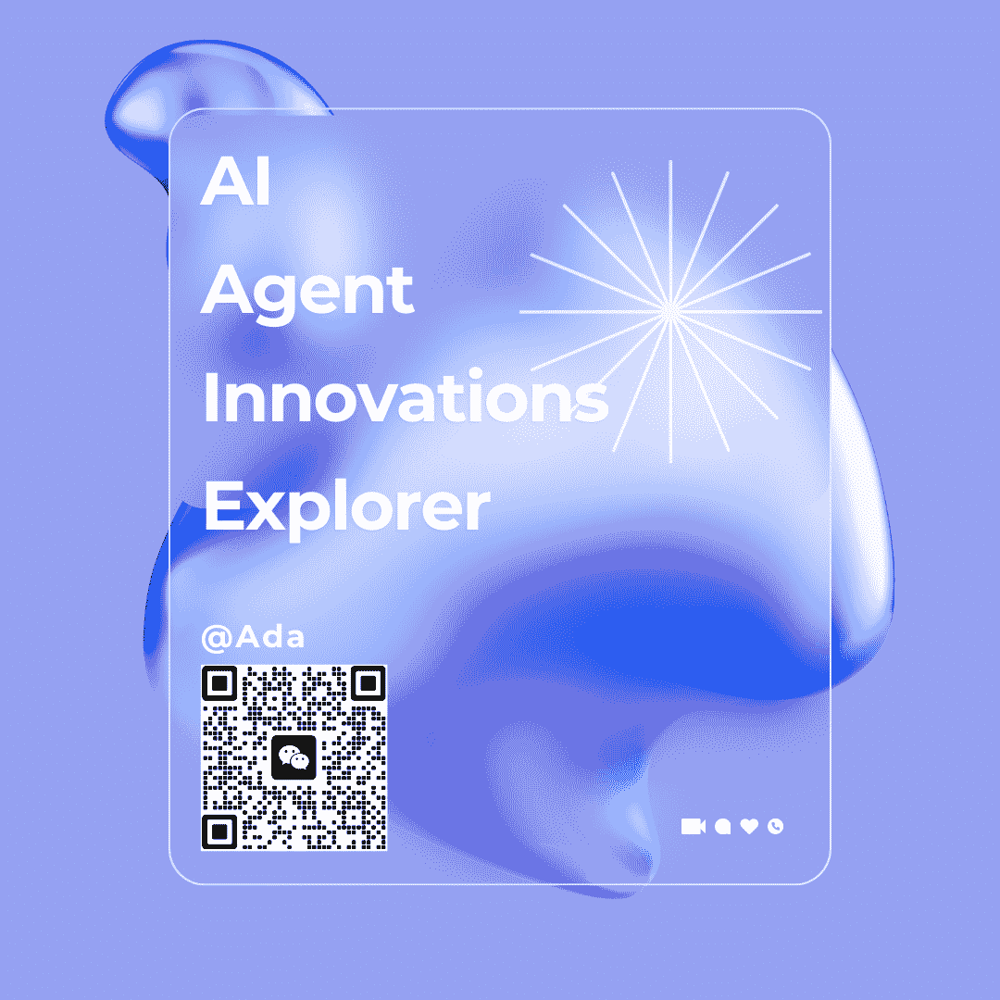