# Perplexity AI - 人工智能搜索领域的“瑞士军刀”

> 来源：[https://aithinkup.feishu.cn/docx/OL6gdW9LRoANMextZRCcxTutn2b](https://aithinkup.feishu.cn/docx/OL6gdW9LRoANMextZRCcxTutn2b)

## 产品：Perplexity AI

Perplexity AI是一款融合了传统搜索引擎和AI驱动回答引擎的多功能搜索工具。它在官网上解释自己类似于全球闻名的瑞士军刀（Swiss Army Knife）：多功能（Versatility）、高适应（Adaptability）解决问题、质量值得信赖（Reliability）的、且整体紧凑（Compactness）并保持创新（Innovation）的产品。

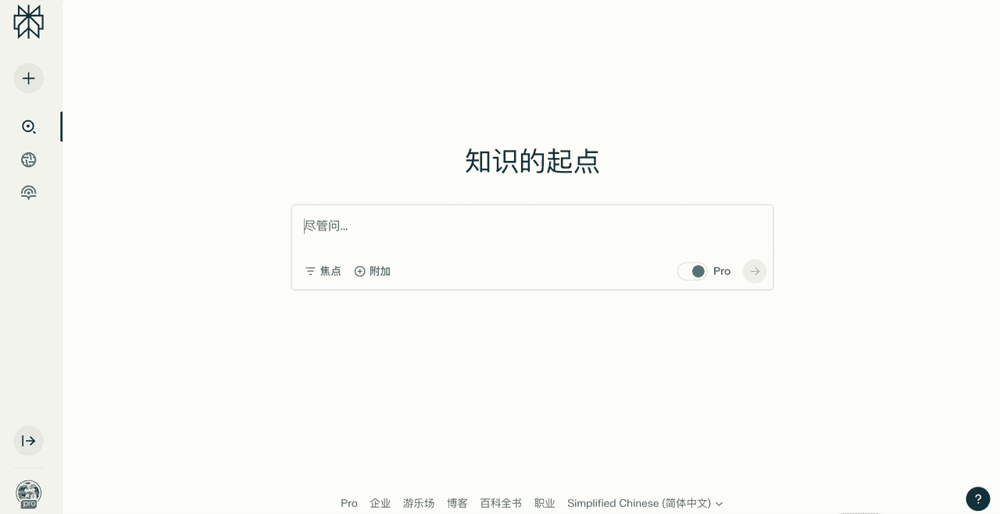

### 产品信息一览

#### **产品价值**

通过自然语言处理技术，提供实时、准确的答案，简化用户的信息获取过程。

#### 产品盈利方式

目前主要通过付费订阅服务和企业解决方案盈利。

#### 定价信息表格

### “短暂的无广告搜索结束了”

#### 计划2024年四季度开始投放广告，很贵

Perplexity 最初由于没有广告而大受欢迎，近期已经不再提＂无广告＂理念了。

据 CNBC 8月22日的最新报道，Perplexity AI 计划从第四季度开始在其搜索应用程序上投放广告。这家公司因被指控抄袭媒体内容而陷入争议。

根据知情人士透露，Perplexity 的CPM（即每千次展示费用）价格将超过 50 美元。桌面广告的CPM通常约为 2.50 美元，而移动视频的CPM费率约为 11.10 美元。

也很显然，“瑞士军刀”价格不便宜。

#### **出版商项目 - 收入共享模式**

推出时间：2024年7月30日

#### 个人观点

> 这就是抓取媒体信息被发现之后，他们给出的解决方案 - “出版商项目”。从官方发布的内容来看，就实际利益达成了此收入共享的协议。

出版商项目（Publishers’ Program）计划支持媒体组织和在线创作者，确保他们在 Perplexity 成长过程中能够繁荣发展。

+   **计划主要内容**：

+   **收入分享**：通过与品牌合作，推出广告功能，允许品牌为相关问题付费，并与引用其内容的出版商共享收入。

+   **API 访问**：合作伙伴将获得 Perplexity 的在线 LLM API 免费访问，允许他们在自己的网站上创建定制的答案引擎，增强与读者的互动。

+   Enterprise Pro 访问：为所有合作出版商的员工提供一年的免费 Enterprise Pro 访问，作为研究和事实核查工具。

+   **未来合作机会**：计划将来与出版商探索其他合作形式，如捆绑订阅。

+   **首批合作伙伴**：包括 TIME, Der Spiegel, Fortune, Entrepreneur, The Texas Tribune, and WordPress.com.

+   **CEO 观点**：Perplexity CEO Aravind Srinivas 强调该计划的可扩展性和可持续性，旨在建立一个所有互联网参与者共赢的系统。

#### AI数据保留问题

目前，个人免费/付费用户无法选择关闭这个AI数据保留设置。根据官网对企业付费版的描述，可能企业付费版可以关闭这个设置。

#### 个人观点

> Perplexity AI 面临争议和质疑，数据保留问题可能会引发法律风险和技术道德争议。

> 对比Open AI GPT免费版，提供了"Model improvement”可以关闭“Improve the model for everyone"。

> Perplexity AI 对用户隐私的保护欠妥。

### 产品功能和应用场景

对于这类搜索类产品，既要关注其搜索和回答能力，也要关注产品细节处理。

#### 个人观点

> 所谓的“大模型”思维的产品正在发生变化，大模型本身好，也得加上产品属性，才能留住用户，这是产品思维。

**产品形态**：基于网页的应用程序，支持多种设备访问。

#### 功能1：回答问题 + 引导深入探索主题

比如，回答这个主题“Perplexity 在哪些方面类似于多功能瑞士军刀？”

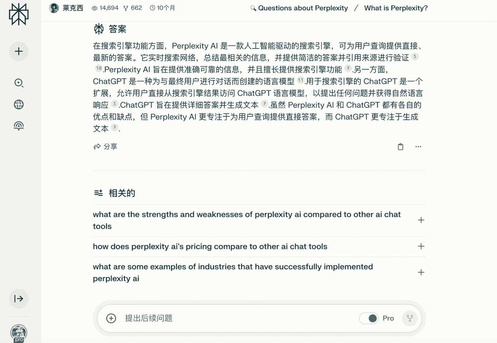

可以跟进回答当前主题，专业搜索下面的思考步骤，每次都会给到我启发。

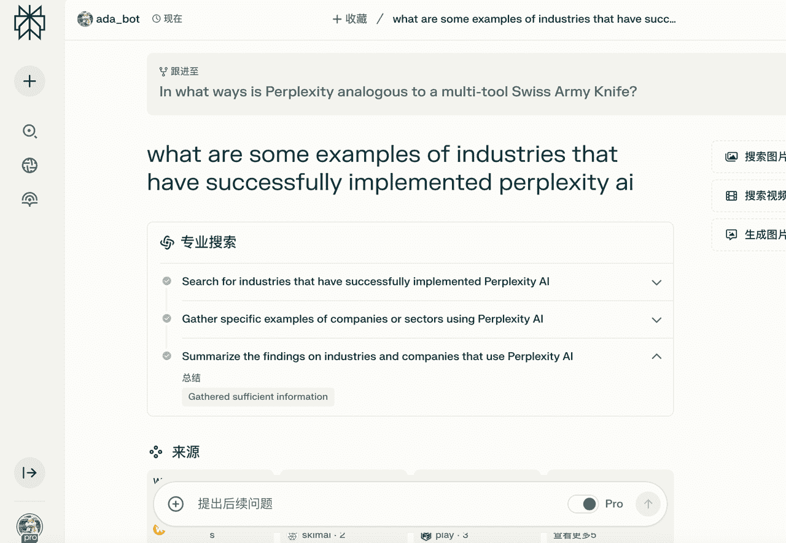

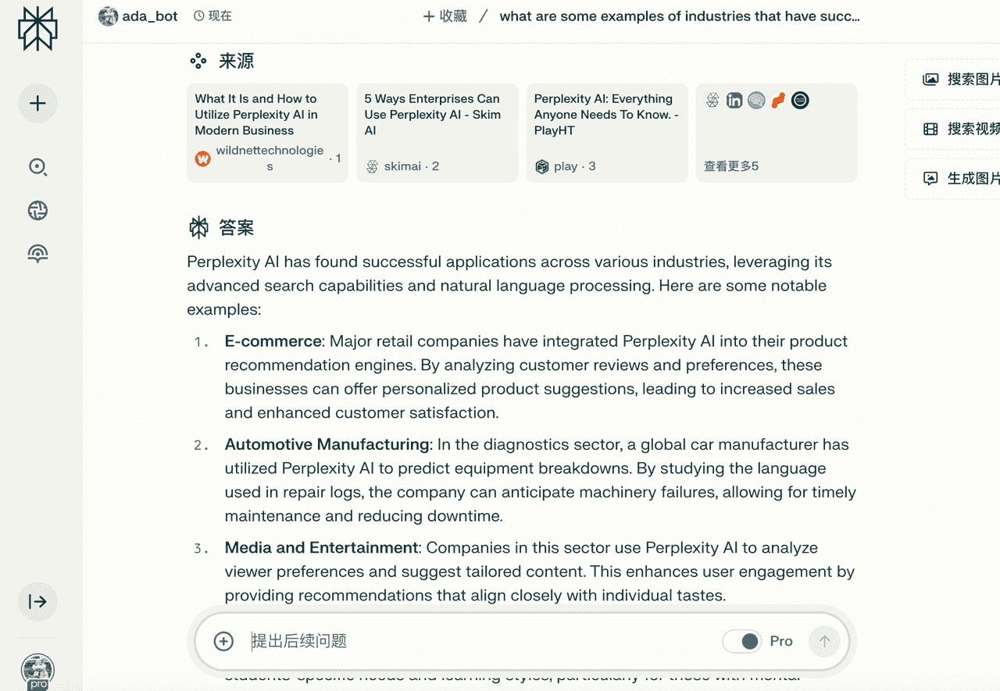

#### 功能2：Page功能 - 知识管理新方式

Page页面能够制作基于一个主题的知识内容，并且能够分享这个页面。

#### 个人观点

> **这个功能非常适合当一个团队开始进行市场调研、专题研究，**集中搜集信息在一起，形成一个结构化页面。

> **改变了以前这样的过程，**比如：一个新产品市场调研，各自搜索一些网络信息，然后发送链接，然后汇总在一起，然后负责这个专题的人再一一了解。

正如官网推荐的，**非常适合知识工作者，比如：**

+   **教育工作者**：为学生制定全面的学习指南，将复杂的主题分解为易于理解的内容。

+   **研究人员**：根据研究主题创建详细的报告，让研究主题更容易被更广泛的受众所理解。

+   **知识爱好者**：根据自己感兴趣主题，创建一个能激发兴趣的页面。

> 类似于飞书知识库页面 + AI一键生成

#### Page功能示例：输入主题即可建立页面，有3类人群可选，相应生成不同的内容

> Page功能里预设了三种受众，我用了这个主题做测试：AI learning program，以下看看如何生成一个主题页面。

> 当一个主题，但是选择用不同的受众，可以相应生成不同的内容，主要不同体现在：主题的词语变化，主图变化，目录变化。

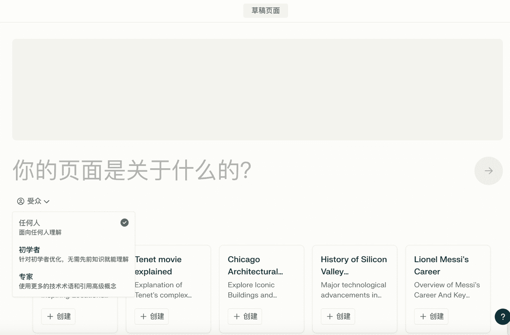

#### 当受众是任何人，生成的页面为：：

#### AI learning program --> AI Education Programs

> 主图是自动生成，一个中规中矩的知识体系。

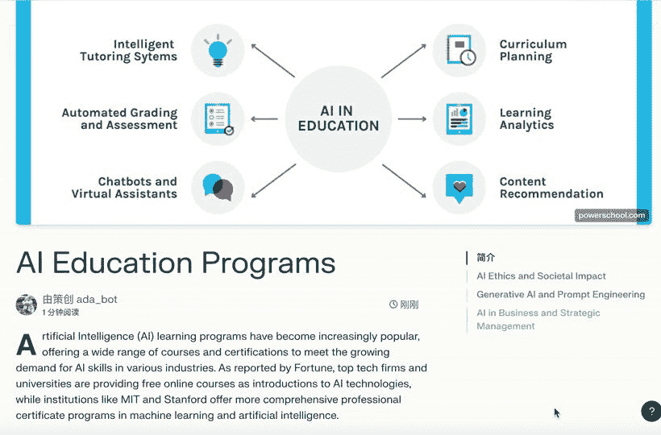

[录屏2024-08-27 20.58.42.mov](https://internal-api-drive-stream.feishu.cn/space/api/box/stream/download/all/PuwmbkAlAoZ59DxwO1Ec64s8nIg)

#### 当受众是初学者，生成的页面为：：

#### AI learning program --> AI Learning Courses

> 项目集变成了课程，course类似是某个课程，短期课程这样的。

> 从主图可以看到对于初学者，用视觉化笔记形式展示这些抽象的概念，重点包括了很多基础概念。比如下面这个金字塔“数据-信息-知识-智慧”。

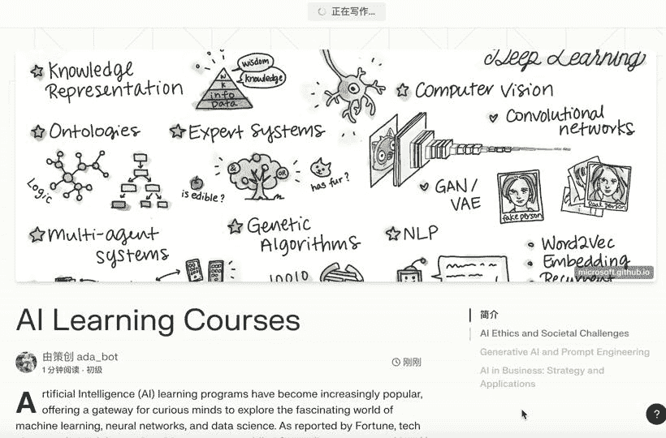

[录屏2024-08-27 21.01.41.mov](https://internal-api-drive-stream.feishu.cn/space/api/box/stream/download/all/BCuIb9cZOoHEIHxfgQAcotlznVg)

#### 当受众是专家，生成的页面为：

#### AI learning program --> AI Curriculum Roadmap

> 用词更加专业，需要学习的内容更加复杂。

> curriculum：an integrated course of academic studies

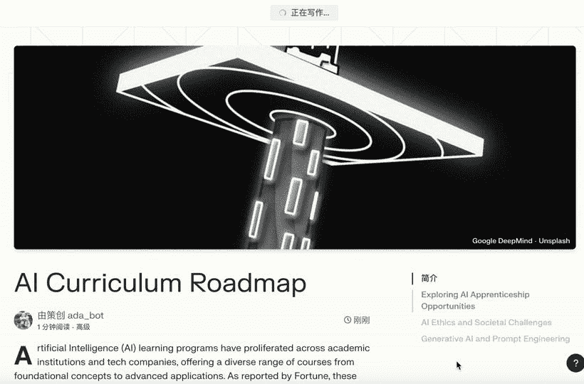

[录屏2024-08-27 21.04.36.mov](https://internal-api-drive-stream.feishu.cn/space/api/box/stream/download/all/ZvLibbA04oZ9xaxbm7IcdGq1n1f)

图片来源：https://www.perplexity.ai

#### AI模型可以多种选择（仅限个人付费Pro版）

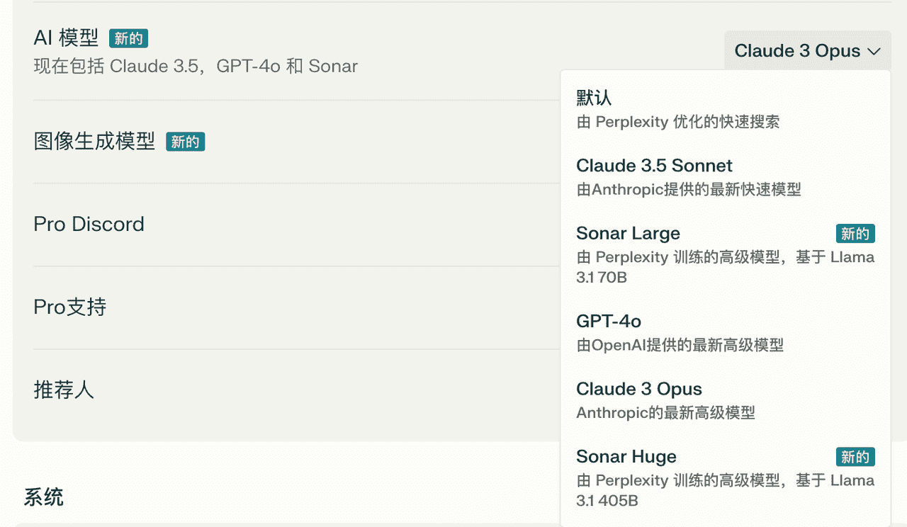

如果AI模型这里默认选择GPT-4O，如果回答时不满意，希望再次生成一个新回答，可以选择Claude 3 Opus，前面的回答就覆盖掉了。

#### 个人观点

> 如果这里能同时留住两个AI模型的回答，而不是直接覆盖原回答。并且，对两个回答加入一些对比，这就非常有价值了。

> 因为，对上一次回答不满意，并不代表完全不会采用上一次回答。不同模型回答，往往都各有可取之处。

> 另外，再次生成回答如果选择Claude 3 Opus，每天是有次数额度的，但具体多少没有找到提示信息，这个就非常不友好了。使用时看不到次数提醒，有一次发现还剩余10次时，会出来提示。

#### 图像生成模型可以多种选择（仅限个人付费Pro版）

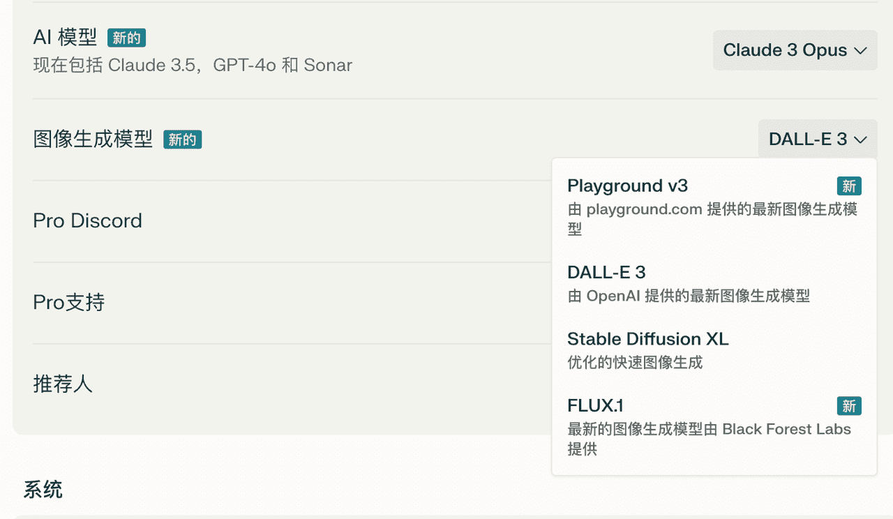

+   自定义生成图片，可以自己定义风格，修改主题内容

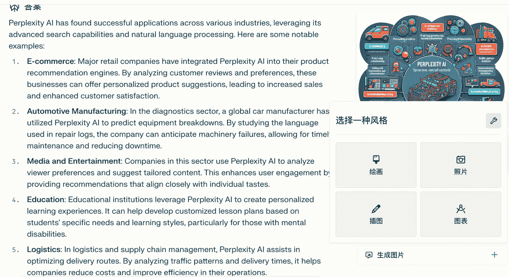

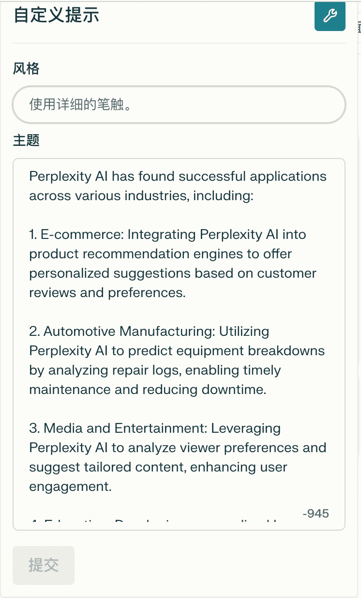

+   自动生成，提供绘画，照片，插图，图表，四种图像。

可以在文章主题旁边，生成图像。这个功能我目前用的不多。目前有四种图像形式，都是在使用DALL-3情况下：

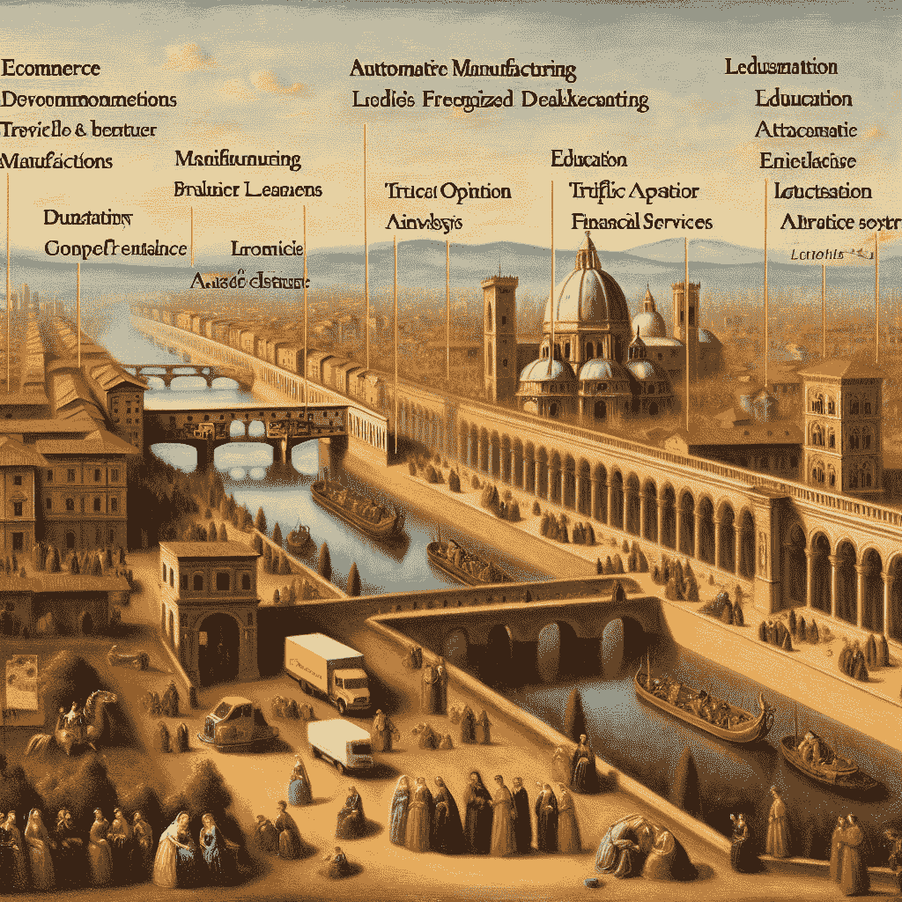

绘画DALL-3

照片DALL-3

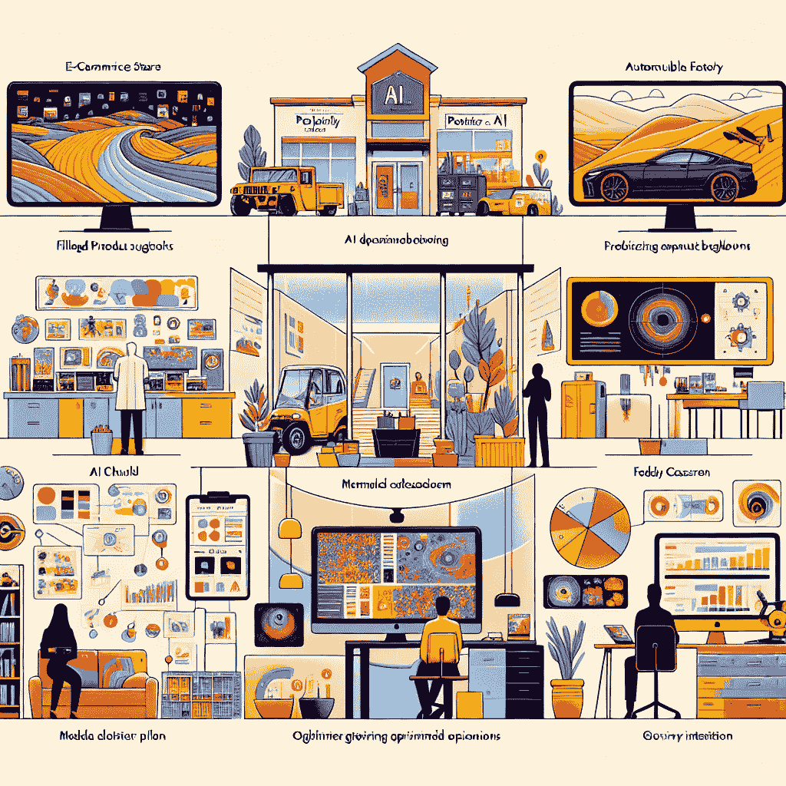

插图DALL-3

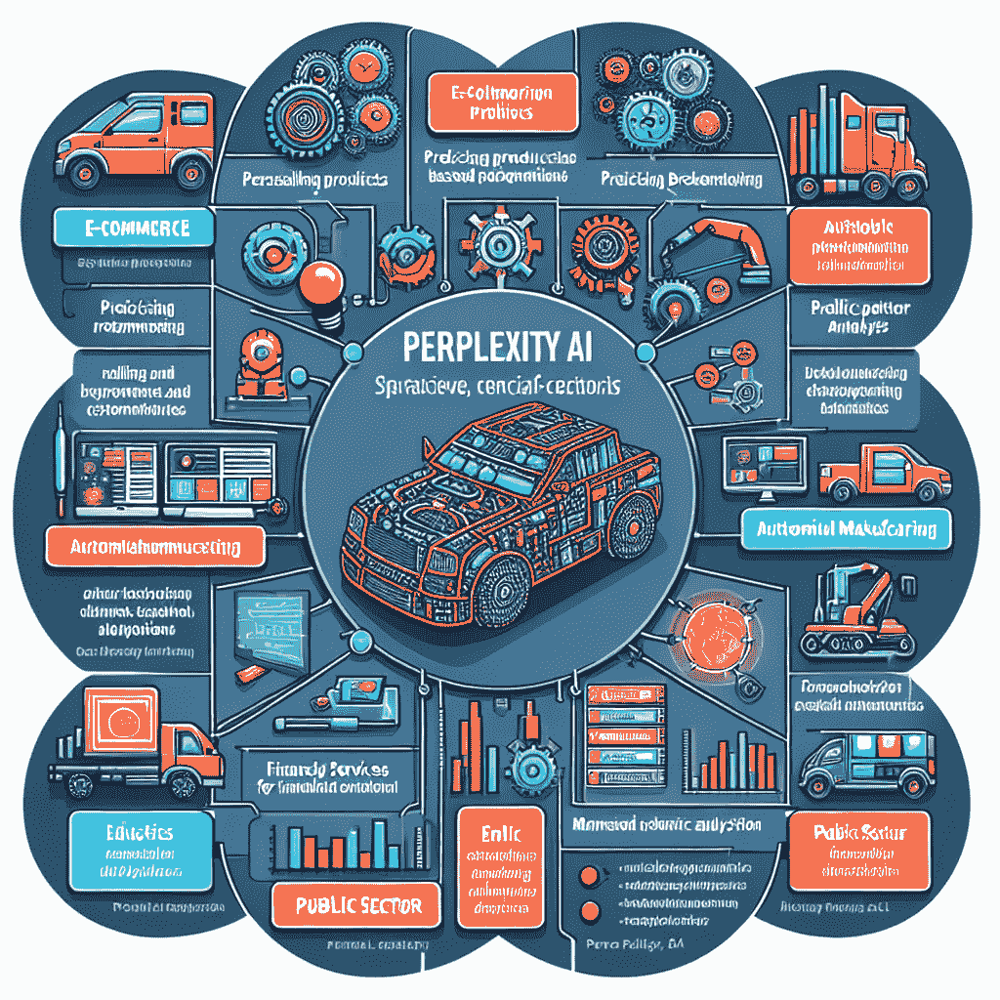

图表DALL-3

#### B2B 产品功能（企业Enterprise Pro版）

推出时间：2024年4月23日

1.  **增强的数据隐私**：提供企业级的数据保护措施，确保用户信息和企业数据的安全性。

1.  **改善的安全性**：具备 SOC2 认证，符合行业标准，增强企业对数据处理的信任。

1.  **用户管理**：支持企业内部用户管理，允许管理员轻松控制用户权限和访问。

1.  **单一登录（SSO）**：提供单一登录功能，简化用户的登录过程，提高安全性和便利性。

1.  **无限文件上传和搜索查询**：用户可以上传大量文件并进行搜索，支持高效的信息检索。

1.  **多种 AI 模型支持**：包含市场上所有尖端基础模型，如 OpenAI 的 GPT-4 和 Anthropic 的 Claude Opus，用户可以根据需求定制体验。

### 一个AI产品页：百科全书

https://www.perplexity.ai/encyclopedia

这里提供了非常多的AI产品信息，大部分都是两两对比形式的文章。比如第三张图片就是Pika和Runway对比。

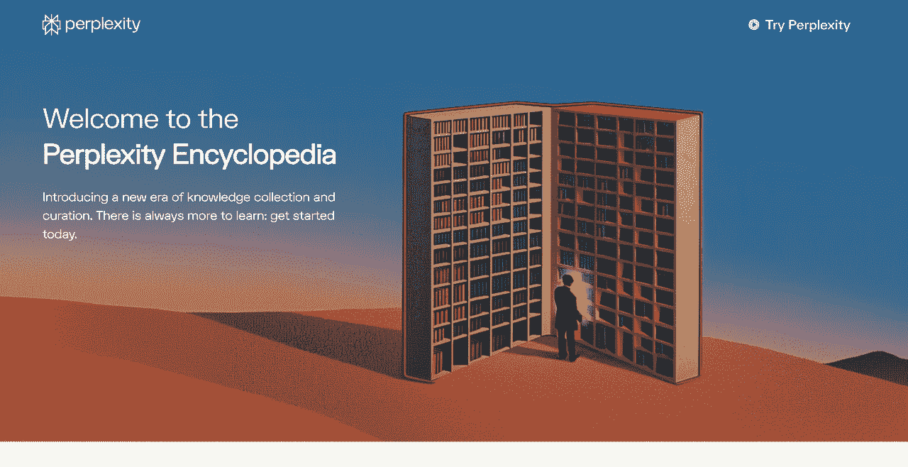

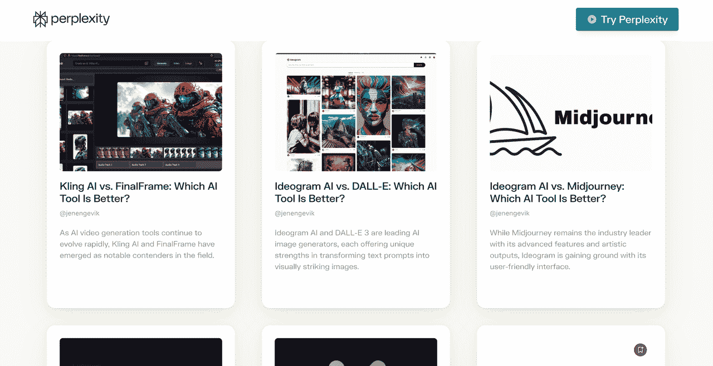

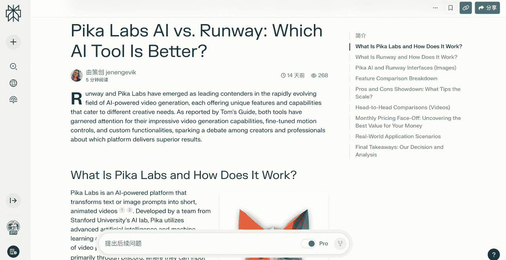

图片来源：https://www.perplexity.ai

### 公司信息一览

+   **公司名称**： Perplexity AI

+   **公司地址**：美国加州

+   **网站地址**： www.perplexity.ai

+   **创始人**：Aravind Srinivas、Denis Yarats、Andy Konwinski、Johnny Ho

+   **团队背景**：创始团队成员曾在 Google、OpenAI、微软等知名科技公司工作，具有丰富的人工智能和搜索引擎开发经验。团队成员包括在 Google AI 工作的 Aravind Srinivas 和 Denis Yarats，以及 DataBricks 的联合创始人 Andy Konwinski。

+   **融资信息：**在 2024 年 4 月，Perplexity AI 完成了一轮融资，融资额为 7360 万美元，估值超过 10 亿美元。这一轮融资由多家风险投资公司参与，包括 IVP。

#### 公司画像

以下数据根据公开信息获得。

#### 成立时间：2022年8月

#### 估值：超过10亿美元

#### 收入：

> 每年的经常性收入为2000万美元（2024年4月信息）

#### 员工：

> 约55名员工（2024年4月信息）

#### 入选榜单摘要：

> 入选《财富》杂志全球人工智能创新者50强

> 入选福布斯发布的AI初创企业50强榜单

## **作者：Ada **

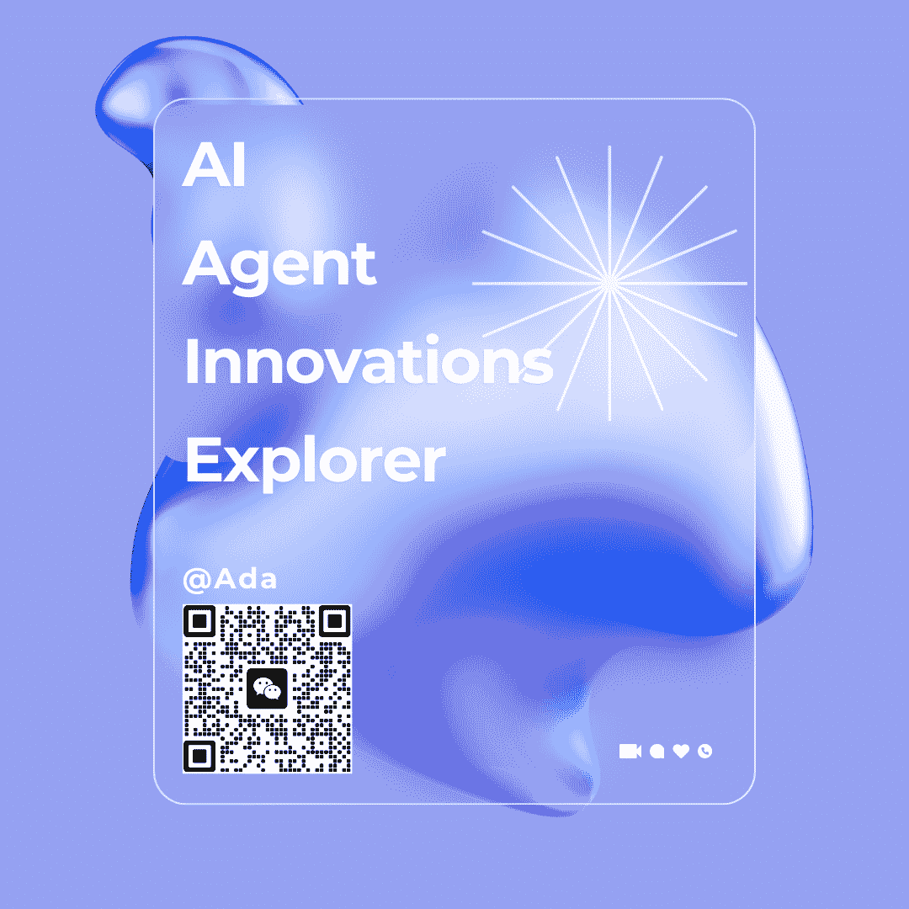