# Clay - 用“100+数据源+AI+自动化”，销售客户线索管理领域10倍速高速成长

> 来源：[https://aithinkup.feishu.cn/docx/U5ZsdDiFZoVkLbx4Dd3cxWNYnAV](https://aithinkup.feishu.cn/docx/U5ZsdDiFZoVkLbx4Dd3cxWNYnAV)

## 目录位置：[4. AI 产品洞察（专栏）](https://aithinkup.feishu.cn/wiki/U1pDwxmHOi0QMmk1G58coiGtnxd)

## 产品：

Clay 平台主要能力是售前客户线索拓展和管理。Clay有广泛的集成功能和 AI 能力，便捷获取外部100+数据源，不需要费力拼凑数据库，或者手动创建电子表格。可构建自动化的工作流程，从查找客户、验证潜在客户、联系客户，最终促进客户获取和留存。

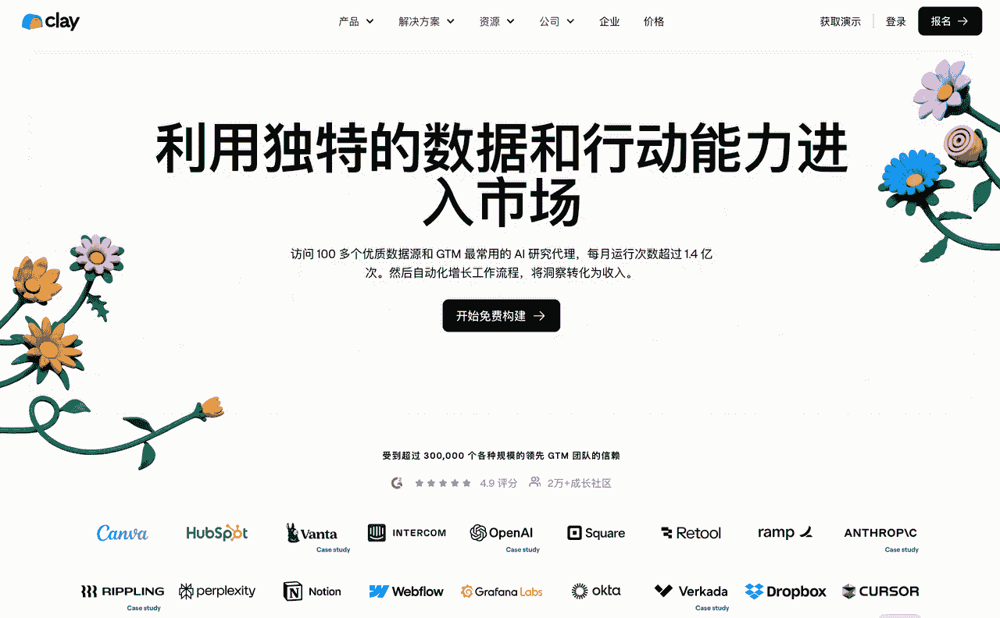

我们先可从下图快速了解Clay平台两大能力是"数据+AI Agent"

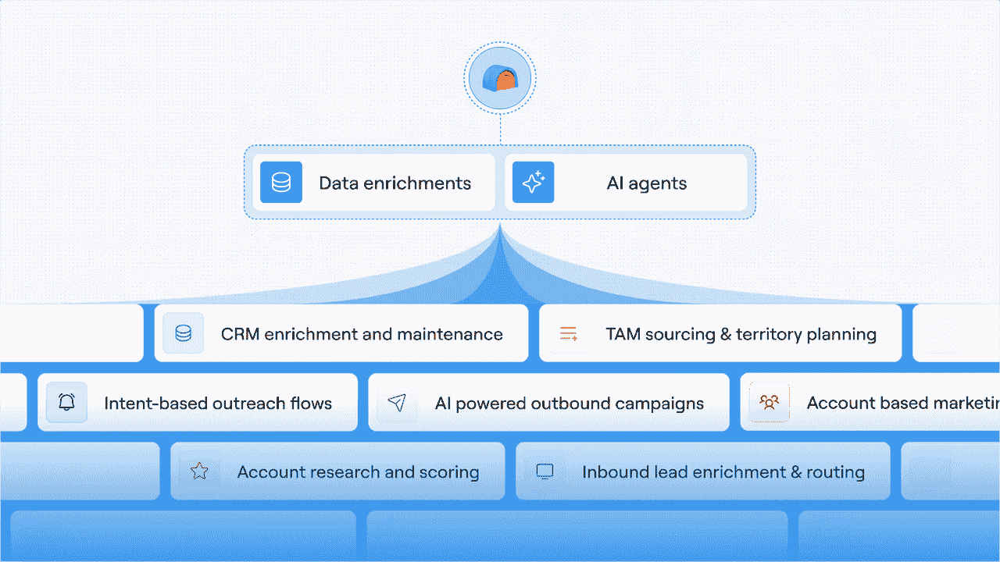

### 产品信息一览

+   **产品功能特征概述：**Clay是数据驱动的销售和营销自动化平台，通过AI技术和多源数据整合，帮助企业优化营销工作流程。

+   **产品形态：**SaaS平台，提供API接口和多种数据工具集成。整个产品的交互是一个表格形式。

+   **主要功能列表：**

+   数据丰富和整合

+   AI驱动的消息撰稿和发送

+   CRM和营销自动化工具集成

+   实时意向信号跟踪

+   **具体应用案例或场景：**常用于CRM数据增强、自动化外联营销、销售线索评分和跟进等场景。

以下是产品的主要功能

#### 产品功能 - 集成：AI、系统、外部数据、开发工具等

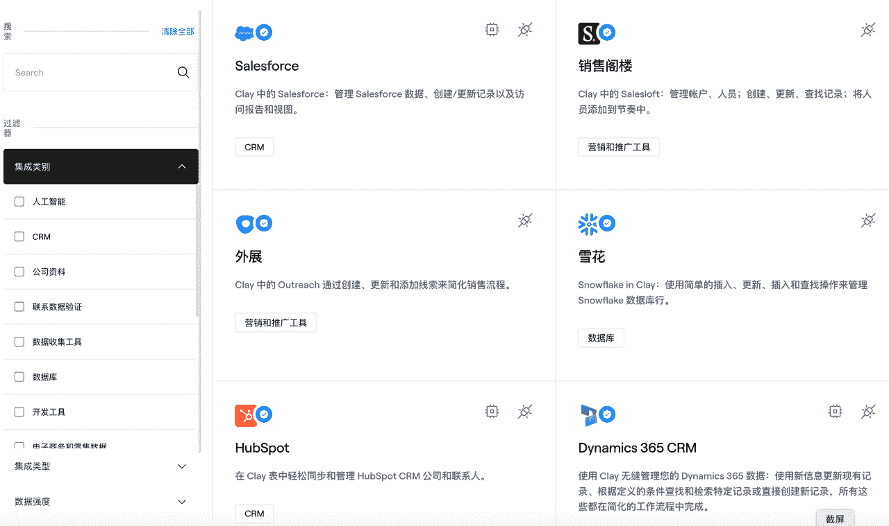

#### 产品功能 - 灵活的表单AI功能

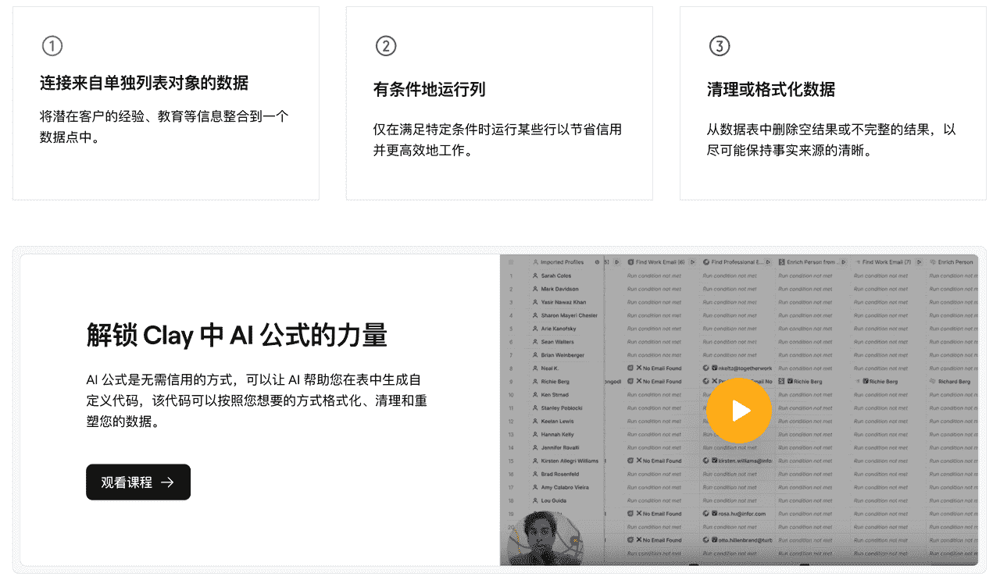

#### **产品功能 - **信息研究智能体

自动化公司信息调研，辅助SDR筛选足够的信息了解潜在客户。

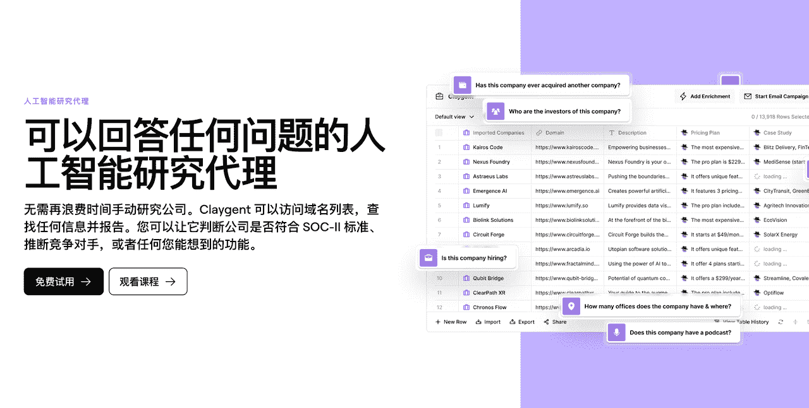

#### **产品功能 - 个性化文案**

使用AI自动化撰写文档

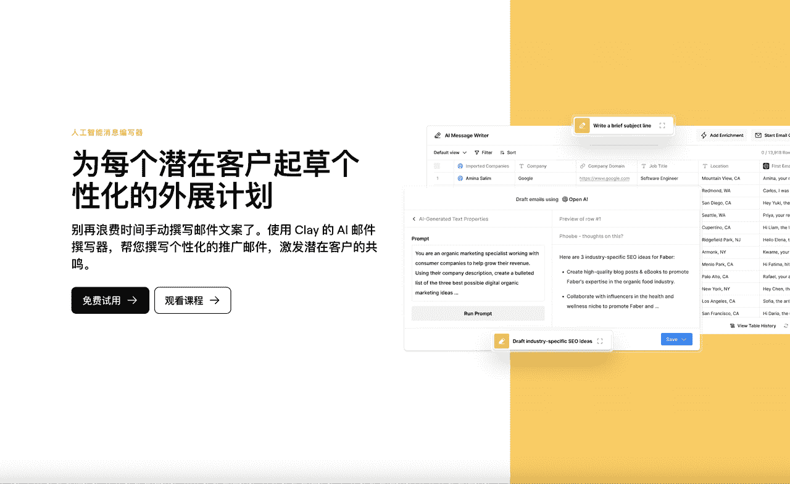

#### 产品盈利方式和定价表

+   产品盈利方式：基于SaaS订阅模式

+   定价策略：提供多个定价层级，从免费到企业级，适应不同规模企业的需求。

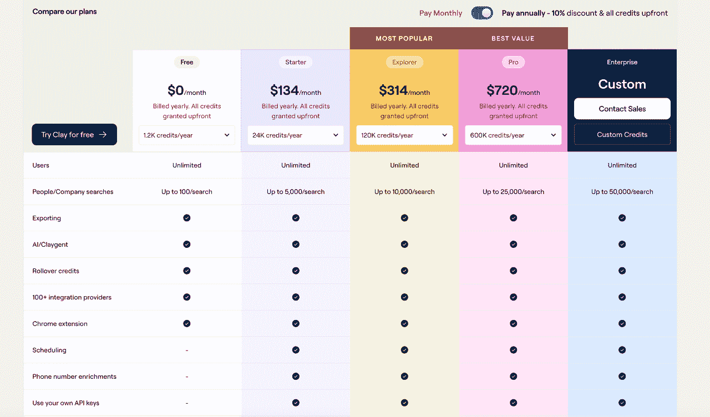

更多关于功能和价格可以前往https://www.clay.com/pricing

### 产品具体使用，优点和缺点

#### 产品使用

这是产品登录页（免费版）。

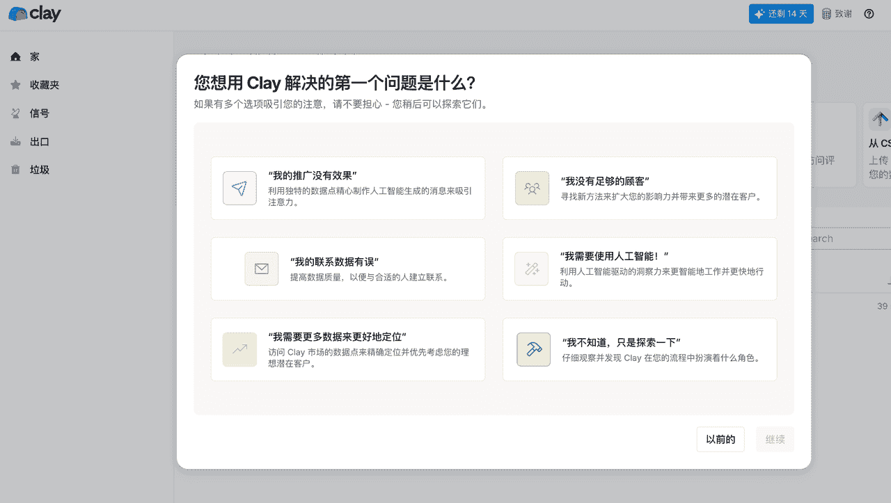

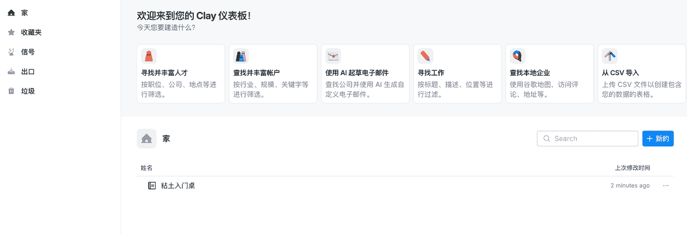

这里我选择了使用AI起草电子邮件，下面是默认的三个公司，和对这个公司的邮件范例。

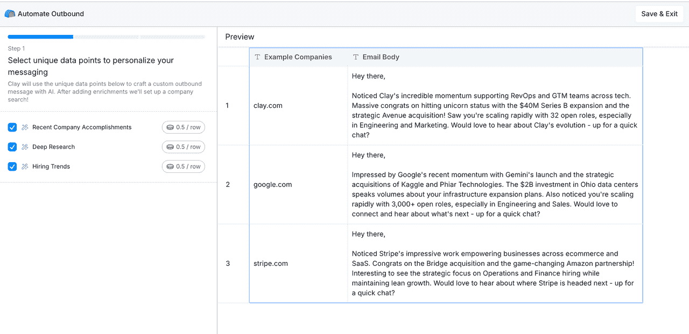

这一步是公司信息增强，选择目的然后前往公司信息分类选择

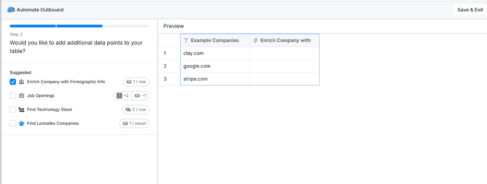

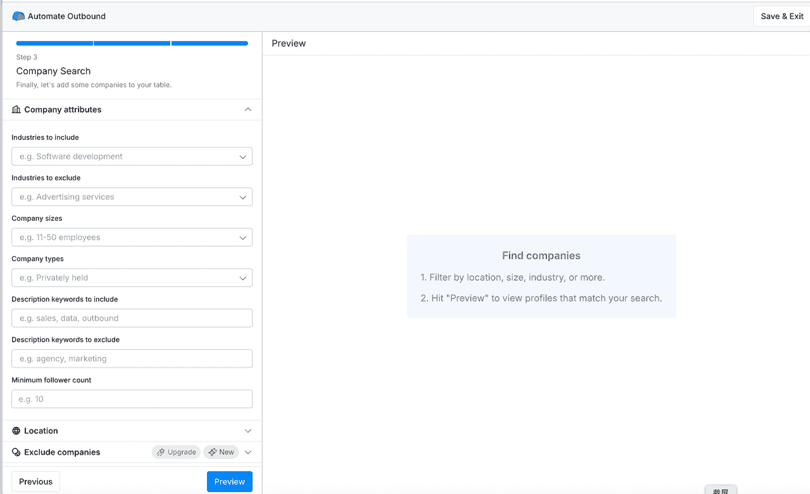

在选择了以上选项后，出现以下表格生成，邮件正在AI生成中，表格能力形式类似飞书多维表格。

#### 模版商店

提供模版，可以点击并且复制到自己的空间。我测试过了一个这个写AI写5个电子邮件没有成功。

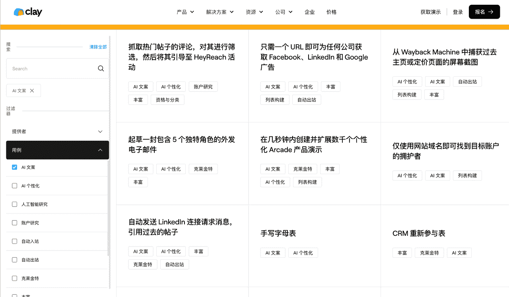

这个复制成功了

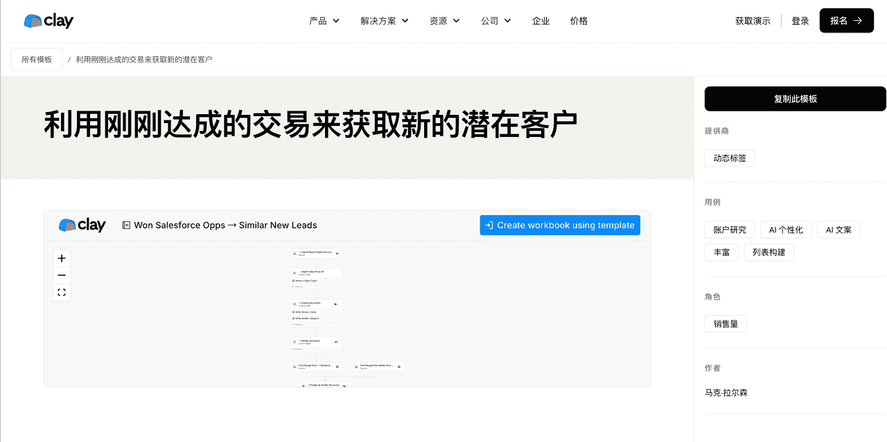

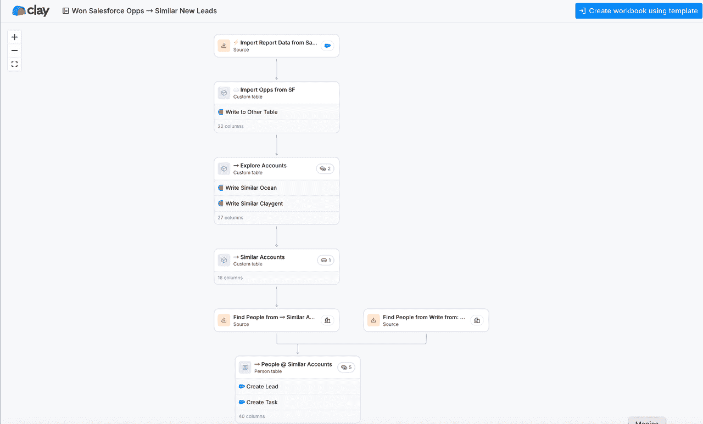

#### 优点：

主要是数据表格形式，入门学习比较容易。

无缝集成，与流行的 CRM 和销售自动化平台集成，实现更顺畅的工作流程。

简化潜在客户研究和验证，销售团队不再陷入繁琐的数据收集工作中。

#### 缺点：

虽然入门学习容易，但是对不熟悉AI，不熟悉工作流设置的人来说，学习有难度。

每个任务的都需要耗费积分点，对不熟悉系统的人来说，价格比较难估算，可能由于应用不善，导致费用过高。

全部依赖外部数据源，数据质量非常重要。也就意味着，如果一个数据源质量不佳或者错误，会导致连锁反应。

#### Clay比较适合哪些用户使用？

比较适合有外部数据有非常高要求的团队，适合数据分析需求的团队。

从定价和功能综合来看，比较适合中大型企业，或者快速成长的科技型企业，挖掘潜在客户需求。

如果公司的预算有限，Agent构建能力有限，或者对数据分析应用的能力不足，并不适合用Clay。

### 产品发展历史

#### 利用Product Hunt进行早期产品发布

首次在Product Hunt发布是2022年2月8日，介绍了其能够“创建自动填充的电子表格，无需编码”的功能。

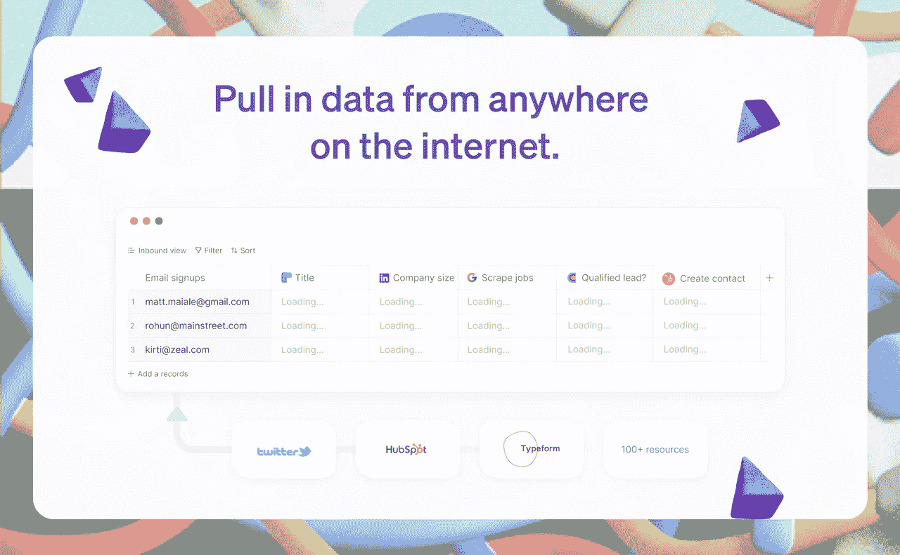

图片：Clay首发版本

#### Clay 2.0发布

2023年8月15日，Clay发布了其2.0版本，重点介绍了“数据驱动的AI寻找、丰富和个性化”功能。

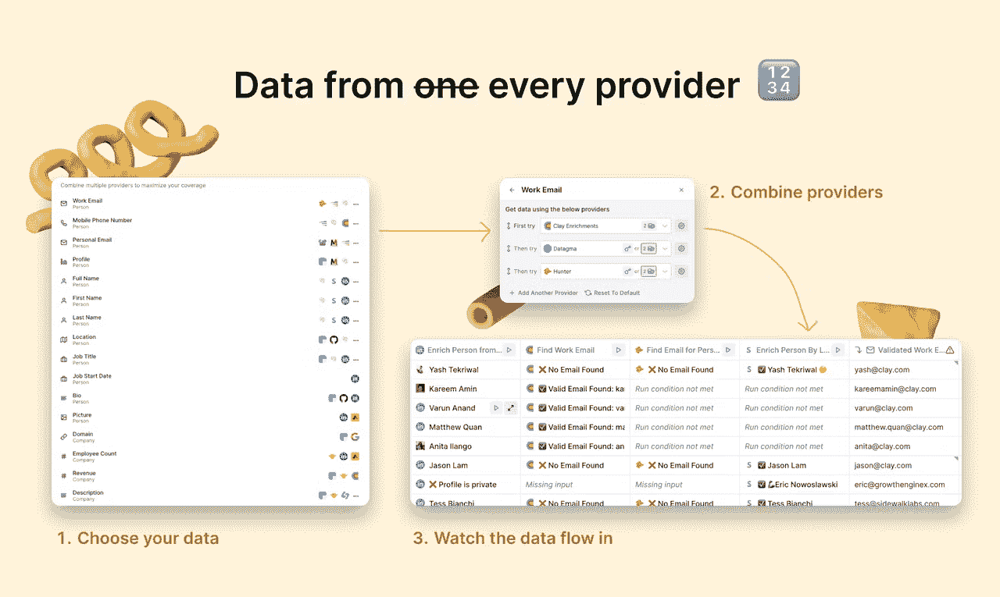

根据信息，当日就获得排名第一，并且也是当周排名第一的新产品。

Product Hunt 帮助 Clay 获得了初步关注和曝光，引发了人们对其产品的关注和兴趣。吸引了大量的早期用户。

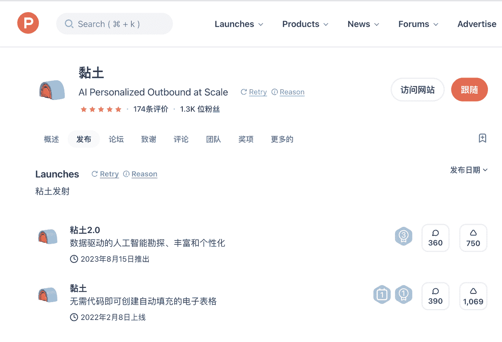

图片来源：https://www.producthunt.com/products/clay-6

### 目标市场：什么是GTM?

GTM英文是go to market ，直译是产品进入市场。指企业将产品或服务推向市场的战略规划。它强调以客户为中心，通过深入了解目标客户群体、制定详细的路线图和实施高效的销售和营销流程，帮助企业成功进入新市场或推出新产品。

GTM工作内容非常广泛，并且要求很高。懂产品和技术，也要懂市场洞察，营销和定价等知识，而且要跟产品经理，研发经理，营销推广等等部门进行合作。

**GTM策略的关键步骤：**

+   市场研究与评估

+   确定目标市场和客户群体

+   制定市场进入策略（包括产品定位、定价、销售渠道和市场推广）

+   制定实施计划和时间表

+   执行、监控和调整策略

#### 现实情况中数据整合痛点

以上这些工作都需要各自数据。现实情况是，各种数据源头多，投入巨资也难以获得完整的信息。有些信息互联网上没有，比如某个AI初创公司没有网站，当你搜索200人以下技术公司时，是搜集不到这家公司的。有些则在非常

即使耗费资金，完成了各种信息源的订阅，也需要花时间把所有的数据源拼凑在一个表格中。

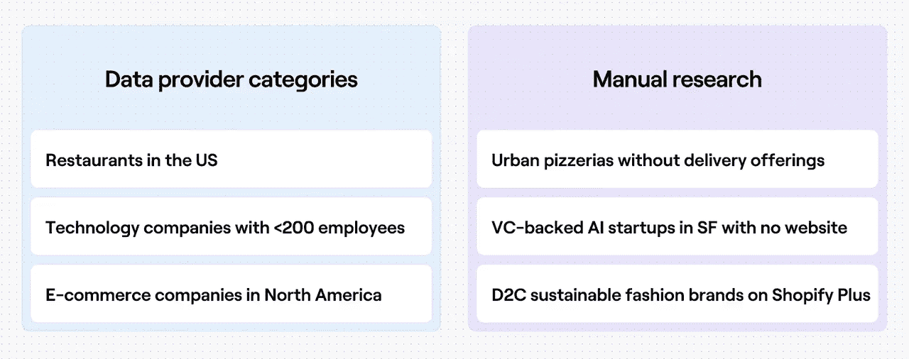

#### Clay主张哪些**产品价值？**

### 数据整合与应用

> 解决数据来源问题，平台整合了 100 多个集成和 AI Agent，帮助团队查找数据，并立即将其应用于整个技术栈。

### 统一的GTM开发环境

> 统一界面，让GTM团队能够开发、执行和演进增长计划，类似于工程团队使用的集成开发环境（IDE）。

### 解决传统痛点

> 传统需要使用多个不同工具，这是一个缓慢且痛苦的过程。Clay通过整合多个功能，简化了这一过程。

#### Clay认为的GTM统一开发环境是什么？

Clay认为，每个核心业务功能都需要自己的创作环境。设计师有 Figma，开发者有 Visual Studio Code 和 AWS，作家有文字处理器。所以，GTM 团队需要自己的地方来构建和运行增长系统。

与传统的数据提供商协商数据采购的过程非常漫长，一般耗时6个月，使用Clay的SaaS平台则能非常迅速的完成数据接入。

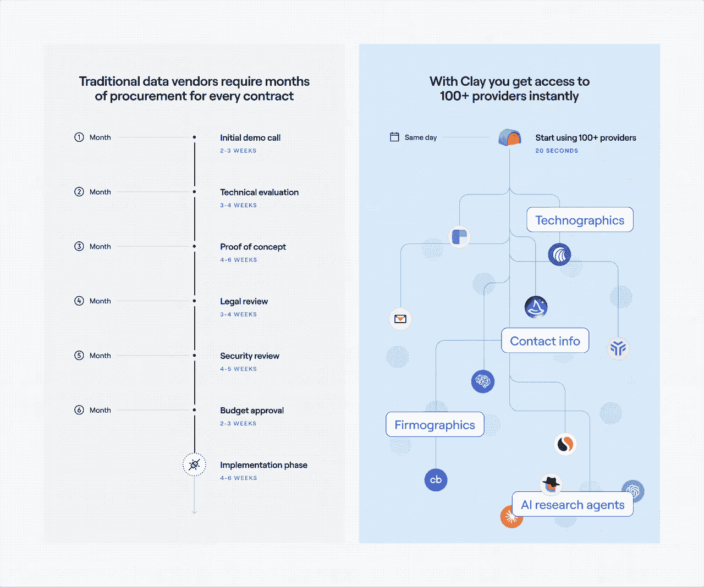

Clay正在构建的生态系统，链接数据集提供到数据应用

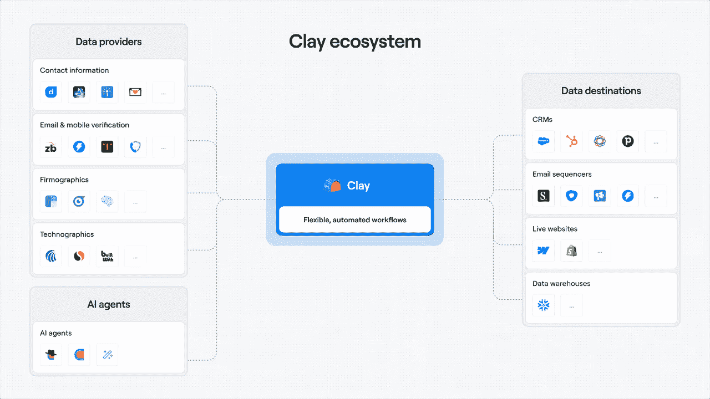

图片来源：https://www.clay.com/blog/series-b-expansion

### 客户Anthropic案例解析：提升数据丰富和销售效率

公司：Anthropic是一家成立于2021年的AI公司，拥有流行的LLM Claude。

#### 需求痛点

+   Anthropic的销售团队人手不足，面对大量过来的销售线索，要么招聘人员花费大量时间处理，要么只能流失掉这些线索。

+   需要手动处理线索，包括将公司信息录入Salesforce，这是一个耗时且容易出错的过程。

+   已知的数据存在信息缺失，数据质量不高，难以用来进行分析以识别出有潜力的客户。

**A**nthropic使用Clay解决了这些问题，主要通过以下方式。（官方一共列了4个用例，我这里主要写了3个）

#### **用例1：自动化丰富增强所有数据**

Clay帮助Anthropic自动化了所有网站访问线索的数据丰富，包括联系信息、公司规模、资金轮次等数据点。这种自动化使得数据丰富覆盖率增加了三倍。

#### **用例2：自动化客户行业细分分类**

建立深度和独特的客户洞察，就需要对客户进行准确的和细致的分类，因为，每家企业都有独特的产品，需要独特的定位和细分。

> **为什么需要自定义行业标签分类？**

> 现成的行业数据筛选器非常的宽泛，比如Anthropic 和 Ulta Beauty（美妆公司）都被归类为“科技公司”，这显然是不能区分目标客户的属性。

> 而且，行业分类术语并不规范，不同的软件产品供应商使用不同的术语，例如“IT”、“软件技术”或“互联网技术”。导致在不同平台的数据最后无法合并一起。

**Clay怎么解决的呢？**

我从公开案例的信息看到只有下面这张图，看上去是在Clay平台的工作流中设置了一个“分类任务节点”。

如下图，就是采用了模型作为任务节点。从图中可以看到，提示词并不复杂，关键是给了分类的样例，不过细节省略了（下图中，some example classification include)。

这样可以实现更精确的客户标签，还有更加灵活的调整。

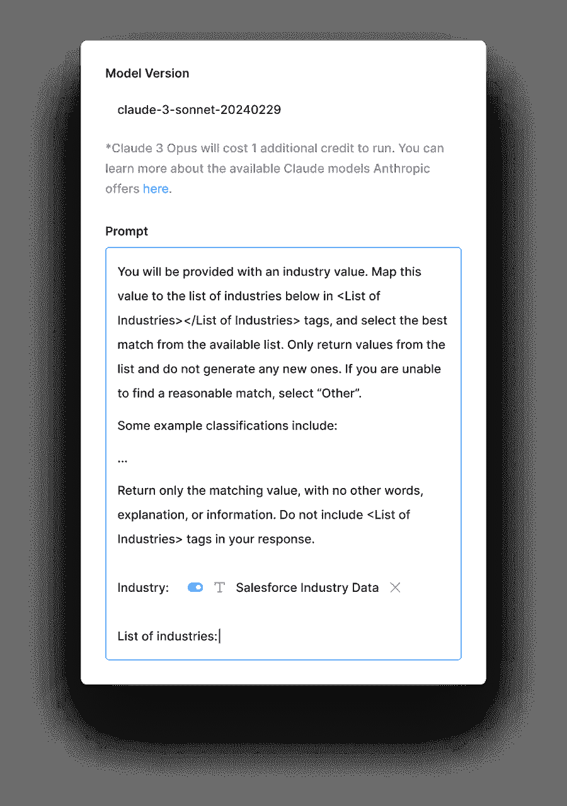

#### 用例3：将个人邮箱转换为工作邮箱

通过搜集领英等公开数据源，对个人邮箱信息进行深度匹配查找，从而指导其公司邮件。这样就能发现公司域名、更多丰富的公司信息。

### 客户Open AI案例解析：扩展GTM运营

OpenAI是一家领先的AI公司，于2022年推出ChatGPT，2023年他们推出了ChatGPT Enterprise，引发了大量的用户兴趣。

#### **用例1：自动化丰富增强所有数据**

ChatGPT Enterprise的推出导致网站销售线索大量增加，团队人手不足。单一数据提供商的数据有限，而与多个数据供应商签订合作非常耗费时间，Open AI没有时间去实现复杂。Clay通过多源数据，将数据丰富覆盖率从40%提高到80%以上。

#### 用例2：自动化AI市场研究报告

Clay的AI研究智能体模拟了最佳销售代表的研究过程，自动执行公司网站、LinkedIn页面和季度收益报告的信息收集和总结。这就就可以规模化整个研究过程。

#### 下一步，从GTM团队扩展到更多部门

除了GTM团队使用， 其他的部门也开始使用

+   数据科学团队应用：

使用Clay来估计每家公司在其用户群中的知识工作者数量，OpenAI能更好地理解其用户群体的构成和需求。

+   招聘团队

探索使用Clay来寻找曾在高速增长公司工作过的人员，尤其是在这些公司的快速扩张期。这有助于OpenAI找到具有成功经验的顶尖人才。

+   市场运营团队：

通过Clay的数据丰富和AI能力，能够更精准地进行营销活动，提高转化率和客户参与度。

### 公司信息一览

+   **公司名称**：Clay

+   **公司简介**：Clay是一家专注于销售和营销自动化的AI技术公司，通过数据丰富和AI驱动的工作流程帮助企业提升营销效率.

+   **核心业务**：提供数据丰富、AI驱动的销售和营销自动化平台，帮助企业优化营销工作流程。

+   **公司地址**：总部位于纽约，但具体地址未公开

+   **网站地址**：https://www.clay.com

+   **创始人**：Kareem Amin和Nicolae Rusan

+   **团队背景**：

Kareem Amin来自AI研究和软件开发背景，他之前创立了一家名为 Frame 的公司，该公司于 2012 年被 Sailthru 收购。

Nicolae Rusan已离开公司。曾担任道琼斯产品副总裁和微软项目经理，目前专注自己的项目Toolkit AI。

2021 年末，Clay 开始专注于企业销售和营销自动化，并聘请Varun Anand 担任联合创始人。Varun Anand 之前曾在Google的Jigsaw团队和Newfront担任过多个角色。

+   **融资信息：**

+   **种子资金 **：2017 年 6 月在种子轮融资中筹集了 250 万美元。

+   **A 轮融资 **：2019 年 6 月的 A 轮融资中获得了 1350 万美元。

+   **B 轮融资 **：2025年1月宣布完成 4000 万美元 B 轮扩张融资，估值 12.5 亿美元。投资者是Meritech Capital，红杉资本、First Round Capital、BoxGroup 和 Boldstart Ventures。

+   **投资信息：**Clay 收购 Avenue，这是首次收购信息。这是一款工作流自动化工具，有望帮助 Clay 客户有效地根据意图信号采取行动。

+   **值得注意：**有分析指出Clay的收入构成可能存在风险，部分收入可能是通过第三方数据提供商实现的，这可能影响公司的长期可持续性

#### 公司画像

以下数据根据公开信息获得。

#### 成立时间：2017年

#### 估值：12.5亿美元（官网2025年1月）

#### 收入：

> 没有公开信息。来自官网融资公告中提到2022 年和 2023 年，收入均增长了 10 倍，在2024 年增长了 6 倍。

#### 员工：

> 约100人

> 来自官网融资公告中的信息。

#### 现有客户信息：

> 超过 5000 名客户，包括 OpenAI、Canva、Anthropic、Ramp 和 Rippling。

#### 入选榜单摘要：

> The Information的“2024年最有前途的50家初创公司”

**我对Cl**ay提出的希望帮助客户有效地根据意图信号采取行动这个非常感兴趣。后续会继续跟进这家公司的发展。

## **作者：Ada **

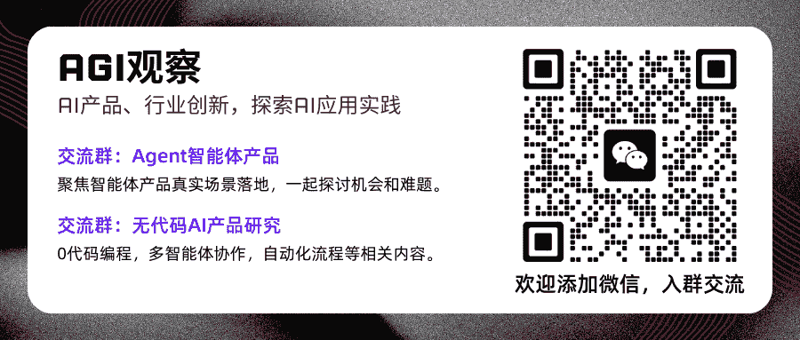