# Google Labs - 谷歌实验室，面向全球用户的 AI 创新实验平台

> 来源：[https://aithinkup.feishu.cn/docx/W5pTdVyOFo7IL8xim9FcU4PHnne](https://aithinkup.feishu.cn/docx/W5pTdVyOFo7IL8xim9FcU4PHnne)

## 产品：Google Labs

Google Labs 是谷歌面向全球用户的 AI 创新实验平台，聚焦于前沿 AI 技术的孵化与应用，推动下一代智能工具的诞生与落地。

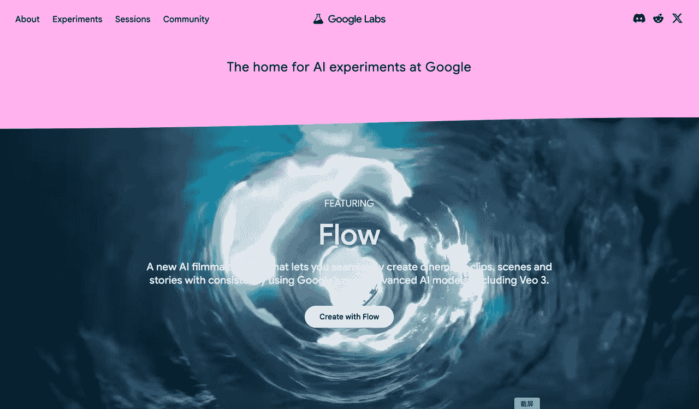

Google Labs 通过开放实验性 AI 产品，赋能用户提前体验和反馈未来技术，推动 AI 创新从 0 到 1，助力内容创作、生产力提升和行业变革。其最大价值在于以极低门槛让全球用户参与 AI 创新生态，形成技术与需求的高效闭环，加速 AI 落地速度和行业渗透。

### 产品信息一览

#### 价值定位

+   创新孵化：AI 技术快速试验与迭代

+   用户参与：全球用户直接体验与反馈

+   生态扩展：推动谷歌 AI 生态持续进化，部分产品集成至 Google Workspace、Android 等生态。

+   Google Labs 包含多种实验性 AI 工具，部分尚未大规模推广，或处于早期测试阶段。

+   两个主要入口，第一个是实验平台 https://labs.google/fx，第二个是工具集合 http://labs.google/experiments。

+   绝大多数实验工具仅提供在线简易介绍，需要花时间自己探索。

+   少量项目如 NotebookLM（https://notebooklm.google）有比较完整的功能和操作指南。

#### 主要应用场景/客户案例

影视创作（Flow）

图片生成与视觉创意（ImageFX、Whisk）

语言学习与教育创新（Little Language Lessons）

AI 助手与企业创新（Gemini）

#### 产品盈利方式和未来形式预测

+   目前 Labs 产品多为免费试用，有部分产品有次数限制，或者需要申请。

+   产品付费形式预测（参考 Notebook LLM 当前定价和通常情况）：

#### 目标行业/市场/用户

+   目标行业和特点：内容创作、教育、办公自动化、娱乐、软件开发

+   目标市场和特点：全球市场，覆盖 C 端、B 端、开发者

+   目标用户群体：普通消费者、内容创作者、企业用户、开发者

### 实验平台简介：labs.google/fx

https://labs.google/fx

这是一个让大家体验 Google 最新 AI 技术并提供反馈的地方。

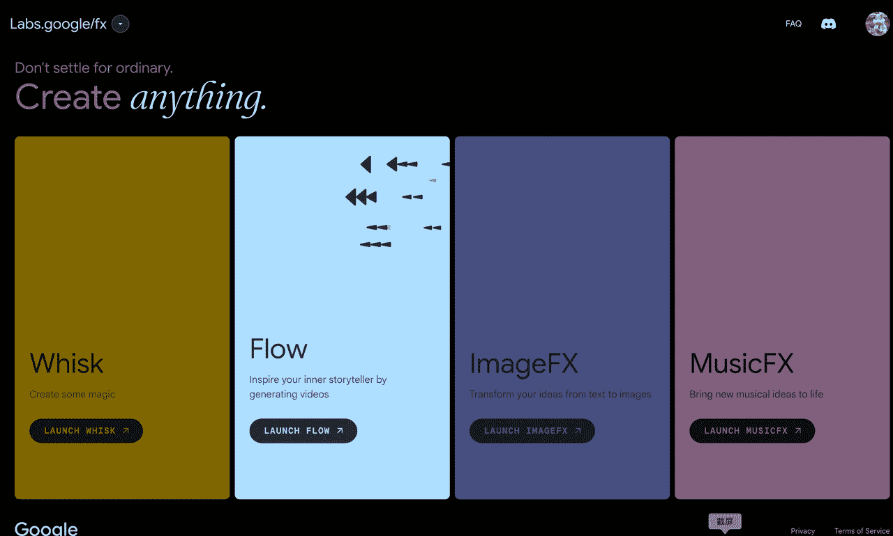

所有信息均来自 Google 官方

#### Flow：视频创作，基于 VEO2/3 模型（视频生成模型）

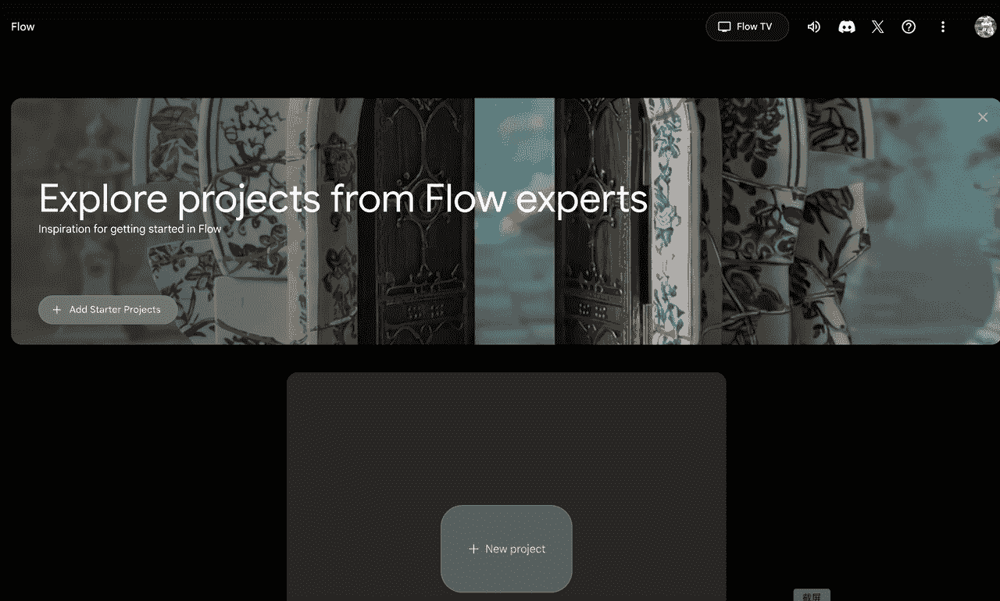

#### Flow TV：这里有已经创建完成的视频和提示词（text to video）

用了 TV 这个词，一时间感觉未来可能大量这样的生成电视剧、电影。。。我看了好几个，最后截图了这个小熊猫视频，质感更像是玩具熊猫动画片。

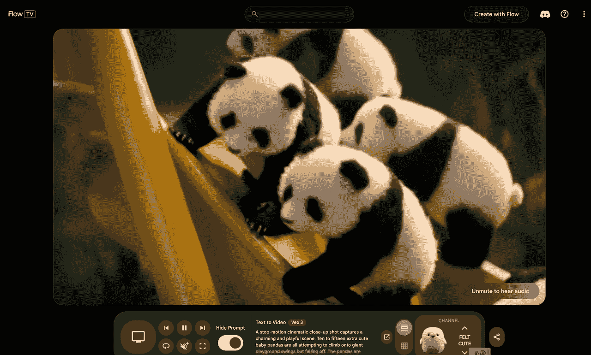

#### Whisk 图像

右边可以提供三类参考图（图片数量可以增加），对生成效果进行控制

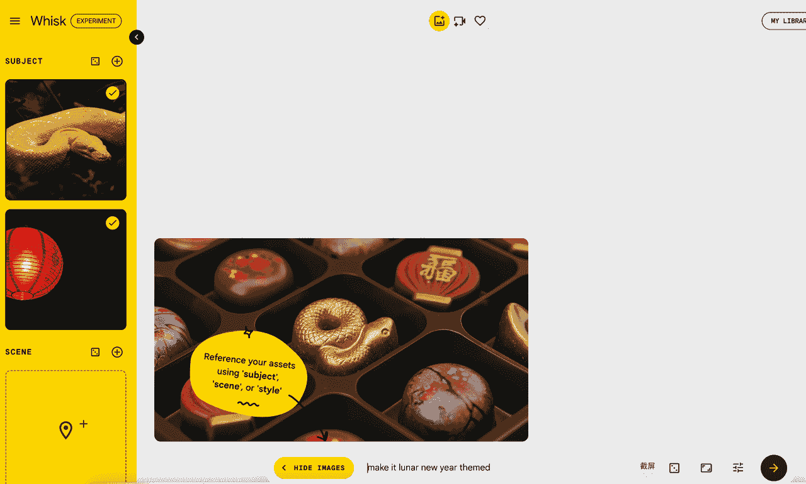

#### ImageFX 图像

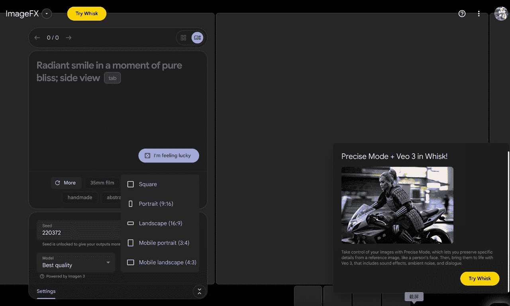

用上面同样的提示测试结果。

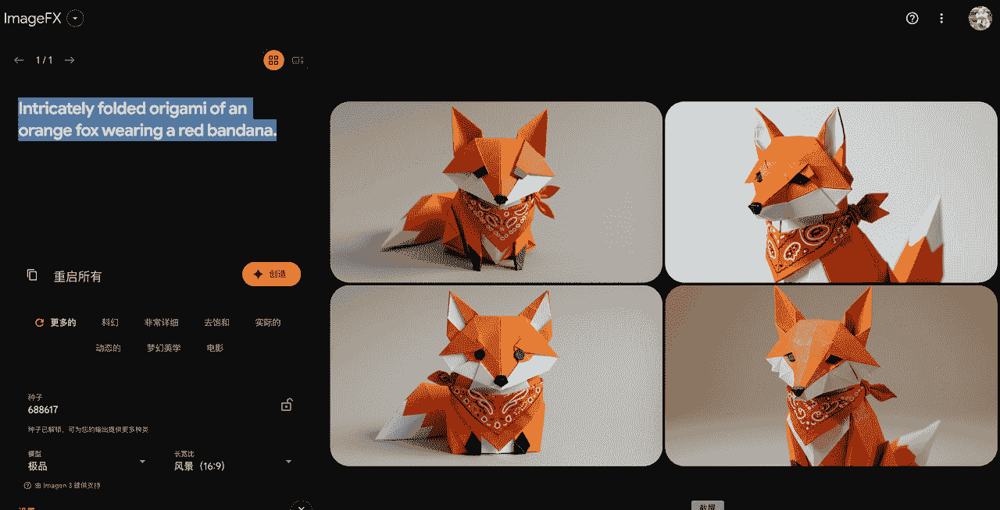

#### MusicFX 音乐

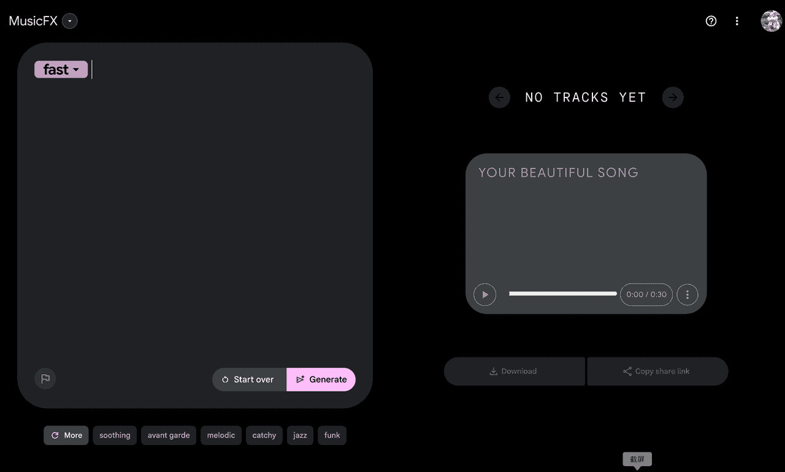

### 工具集合：5 个类别 40 个 AI 工具

http://labs.google/experiments

Google 实验室的最新 AI 工具，用户可探索并找到适合自身需求的 AI 产品。其中有些产品点击是申请页面，有的是独立页面，可以登录试用。部分产品由于地区限制无法登录。

这些是我浏览过的部分产品链接和摘要：

### 谷歌搜索 AI 模式

之前一直知道 google 搜索有 AI 模式，但是没试过。方法很简单，就是可以进入上面的 AI Overviews in Search 的链接，点击申请，就进入下面这个界面了。

首次使用，发现当前不支持中文搜索指令，但是回答可要求中文。生成搜索结果没有达到我预期。。。实验产品更多一些吧。

除了产品外，如何平衡传统搜索和 AI 模式搜索的关系，既要保护核心业务，也要适应市场变化。后续会持续关注其发展。

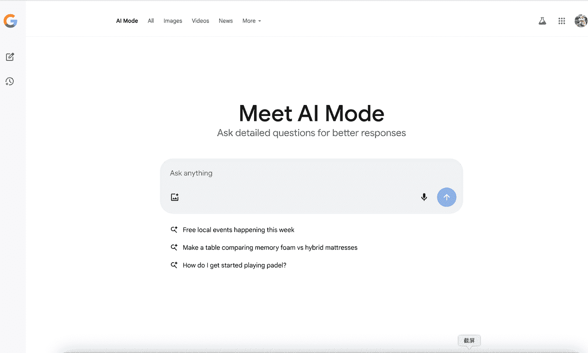

### 公司信息一览

+   公司名称：Google

+   成立时间：1998 年

+   最新估值：Alphabet 市值首次超过 3 万亿美元（2025 年 9 月 15 日股价）

+   员工规模：超 18 万人

+   现有客户信息：全球用户超 43 亿，企业客户遍布财富 500 强

#### Google Labs 画像

+   Google Labs 官网：https://labs.google/

+   Google Labs 团队：包含谷歌内部资深 AI 科学家、产品经理、设计师，以及外部初创企业创始人。鼓励跨领域合作，部分实验项目与学术机构、行业专家联合开发。

+   Google Labs 创新孵化模式：聚焦多模态 AI、生成式 AI、自动化工具等领域。产品矩阵涵盖文本、图像、音频、代码等多种 AI 能力，持续推动 AI 技术边界。

+   竞争格局：主要竞争对手包括 OpenAI（GPT-4o）、Meta AI、微软 Copilot 等。Google Labs 以产品多样性和技术深度形成差异化优势，强调用户参与和实验性创新。

+   成功关键：AI 创新需要开放生态和用户参与，实验平台是技术落地的加速器。持续的创新获得了技术积累、全球生态、用户参与和快速迭代。Google Labs 是谷歌 AI 战略的创新引擎，通过开放实验平台，极大提升了 AI 技术的落地速度和行业渗透力。

+   最大挑战：如何将实验产品高效转化为商业化服务。实现技术与需求的高效闭环，是 AI 产品快速成长的关键

#### 初代版本的谷歌实验室（Labs）2002 -2011

这是谷歌实验室的初始版本。运行时间从 2002 年直至 2011 年 7 月，谷歌宣布停止谷歌实验室。

所有谷歌实验室的产品都有一个如下图所示的统一标志，测试版产品使用邀请模式，包括 Gmail， 谷歌日历。（我的 GMAIL 目前还在使用，历史悠久就像这个实验室的岁数一样。)

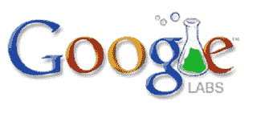

#### 初代 Lab 关闭，同时“20%创新时间机制”终结

当年关闭谷歌实验室，引发了大量争议，因为这代表了谷歌的创新，很多企业都纷纷效仿其创新文化。“谷歌 20%时间制，允许工程师拿出 20%的时间来研究自己喜欢的项目”。

埃里克·施密特（Eric Schmidt）2001 年到 2011 年担任谷歌的首席执行官，认为在充分授权和充分自由的环境下，可以最大程度发挥谷歌人的创新。在 2011 年 1 月就任的 CEO 拉里·佩奇（Larry Page）对战略进行了调整，采取“有的放矢（more wood behind fewer arrows） ”战略。

所有工程师参与创新的机会不再存在。这是当时争议的焦点。创新文化是否消退？还是说将“发散式创新”转变为更具战略目标的创新形式，更加符合当时谷歌的发展阶段。

后续，诞生了一个高度保密的 Google X 实验室，它始于谷歌自动驾驶汽车的开发，后续诞生了谷歌隐形眼镜，谷歌大脑（Google Brain）等。收购了很多公司，其中涉及多家机器人公司，比如比较知名的波士顿动力公司，谷歌在 2017 年将其出售给了软银集团。

#### 2021 年 11 月重启谷歌实验室（Labs）

+   Google Labs 重启者：Clay Bavor

Clay Bavor 自 2005 年起加入谷歌。Clay Bavor 在谷歌长期负责 VR/AR 这种高风险、长周期的前沿项目，这段经历可能让他理解如何管理和孵化那些短期内难以衡量商业价值、但可能定义未来的技术。

2021 年 11 月，他被任命为谷歌实验室部门的副总裁，负责重启 Google Labs，专注于推断技术趋势和孵化一系列高潜力的长期项目，并直接向谷歌 CEO 桑达尔・皮查伊（Sundar Pichai）汇报工作。他在谷歌工作了 18 年，于 2023 年 3 月离职。

离开谷[Sierra - 打造企业级Agent智能体客服](https://aithinkup.feishu.cn/wiki/SdudwbTStiZARGkRBLgcNEpxnec)后，Clay Bavor 与 OpenAI 董事会主席、前 Salesforce 联席 CEO Bret Taylor 共同创立了一家以 Agent 为核心的 AI 公司 Sierra。关于这个公司，我去年也花了一些时间做了调研，这是历史文章

+   **2022 年 Google Labs** 平台重启，成为谷歌 AI 创新核心阵地

持续发布 NotebookLM、Imagen（AI 图像生成）、MusicLM 等实验产品

Gemini 多模态模型发布，推动 AI 能力升级，

部分实验产品已集成至 Workspace、Google Cloud 等主流服务。

2023-2025 年间，Google Labs 不断迭代核心 AI 模型，发布 Gemini 2.5 Pro、Nano Banana、Veo 3 等新产品，实现技术突破和产品创新，市场影响力持续提升。

### 谷歌 AI 产品 2025 年高歌猛进，4 个产品位列 50 强

下图是 A16Z 2025 年 8 月 27 日的文章，总结了一个生成式 AI 产品前 50 强，谷歌的四个产品位列其中，非常亮眼。文章用了“Google make big move”来形容突破。

Gemini 目前排名仅次 ChatGPT， 的确它目前是我常用的模型之一。

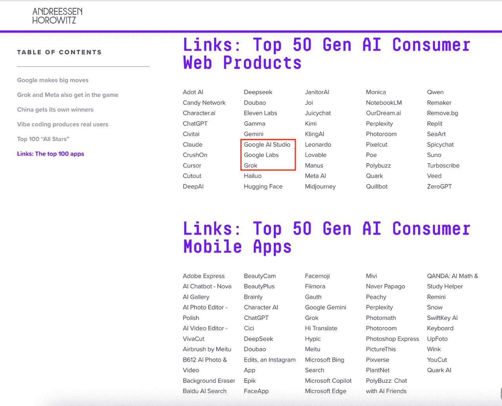

这是 7 月份网站的访问数据量

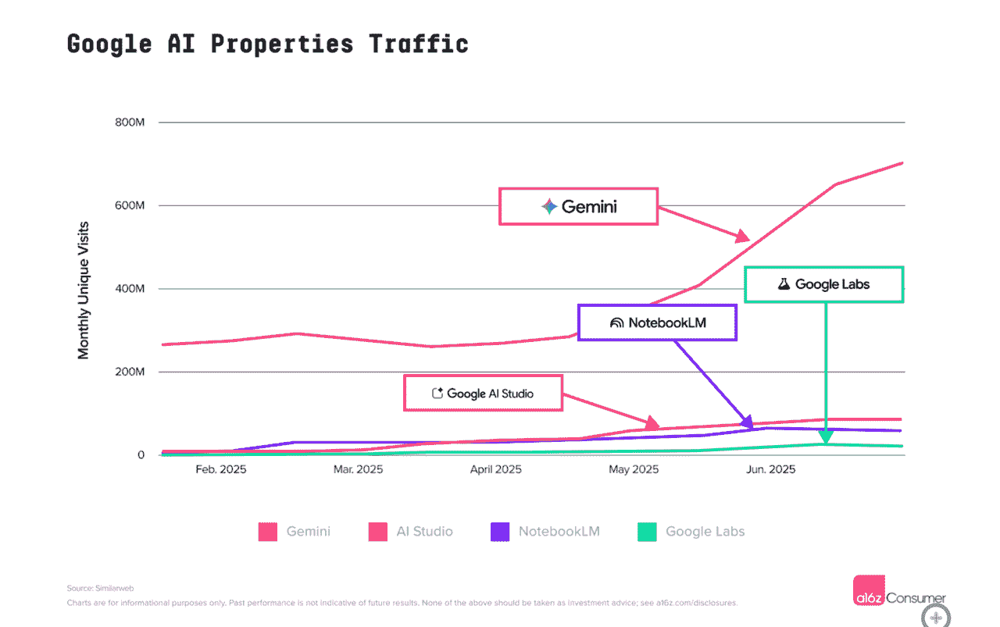

+   这是 Google AI Studio，下次会来研究下它。

+   这是 NotebookLM，AI 驱动的知识管理

去年上线我就试用过，今年其实还没怎么用。在一段对 Google Labs 副总裁的采访中，我才首次了解到这个产品背后的故事。下次专门来研究这个产品时，一起写进去。

+   这是 Gemini，Nano-banana 图像生成近期热度很高

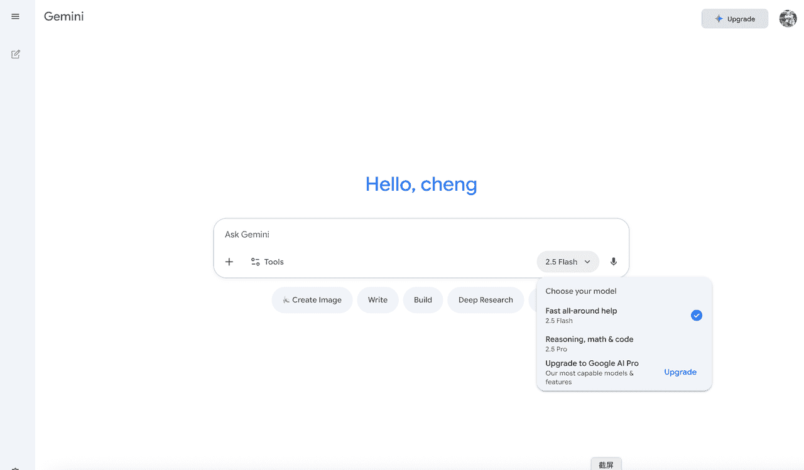

更多谷歌官方信息：https://blog.google/technology/

### 谷歌实验室加速 AI 产品创新从 0-1 特别关注

这是来自红杉资本对** VP of Google La**b，Josh Woodward 一段采访

**标题**《Josh Woodward: Google Labs is Rapidly Building AI Products from 0-to-1》

地址：https://www.youtube.com/watch?v=3-wVLpHGstQ

时间：2025 年 4 月

其中一段关于翻译：

我这些年做产品的心得之一是，每个人都讨论“产品与市场匹配（PMF）”，你一看就知道是什么。

不过至少对我来说，在产品开发的第一阶段，我总是对产品进行大量的迭代，有时你会忘记在市场上迭代。

找到合适的市场和合适的产品同样重要，你必须让两者结合起来。

所以，在 Mariner 的早期阶段，它能让 AI 模型“驱动”你的电脑，它是一个巨大而全新的能力；

它是否足够精准？有时可以，但并不总是；速度够快吗？

还远远不够。

这就是我们当前所在的位置。我们还在寻找合适的市场切入点。

回答你刚才的问题，眼下我们就是在早期阶段，会做大量快速实验。

我对团队的产品经理、工程师和用户体验研究员们的指导是：

别太在意仪表盘上的数据，因为那数字现在都很小；

真正要关注的是客户在看到你演示时，眼睛里有没有光。

你能看到他们是否真的被触动。

这是非常依赖艺术感、而非科学量化指标的一步。

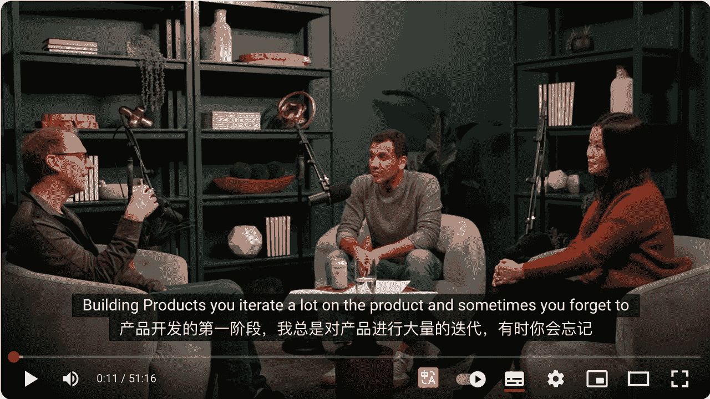

### 附-图像模型对比

正好就把近期的热点模型更新和谷歌实验室的图像生成做了对比。

两组提示词，六张图，用了四个模型测试。

#### A. 戴围巾的折纸狐狸，

考验模型的想象力和对多种元素的融合能力。折纸、动物、配饰组合。

顺序分别是：

##### A-1 豆包生图 4.0

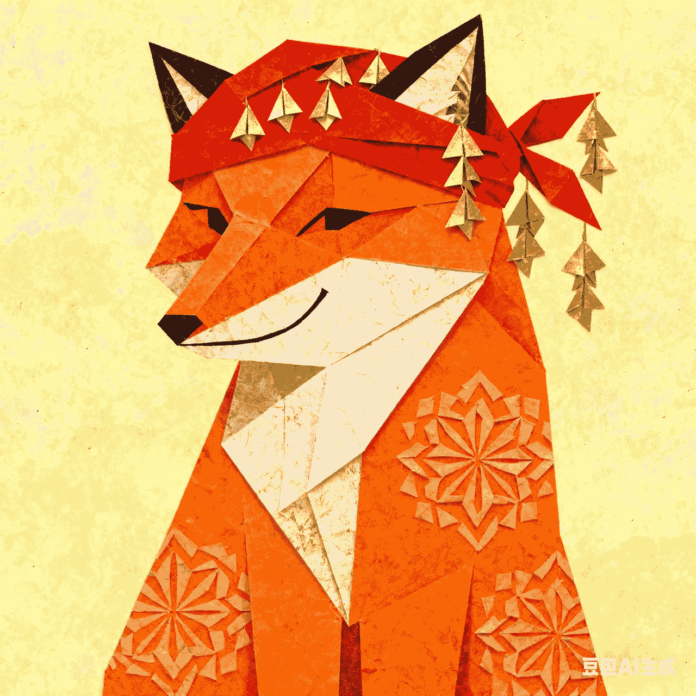

##### A-2 Whisk（google labs）提供了狐狸图片和折纸图片

##### A-3 ImageFX( google labs)

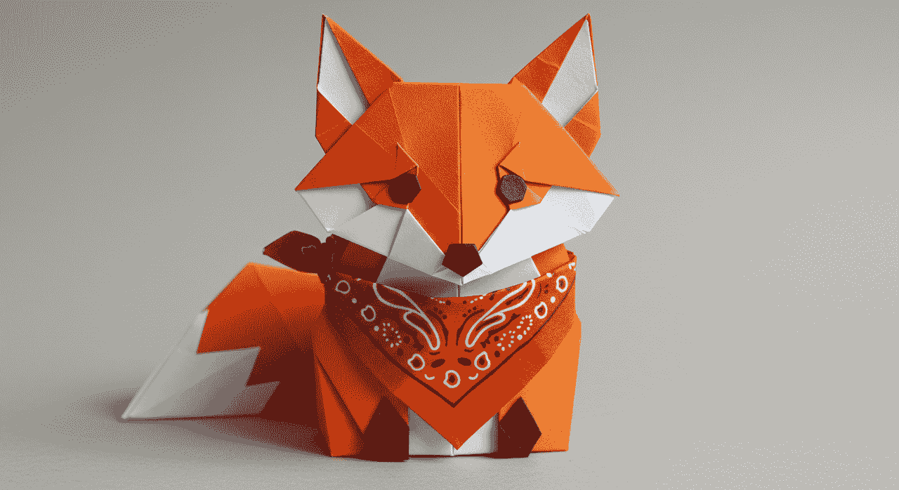

折纸狐狸提示词，以上都是用下面这个提示词：

Intricately folded origami of an orange fox wearing a red bandana.

#### B. 茶餐厅里吃水饺的女孩（插画风格），

侧重于场景、人物、物品和特定画风的表达。

顺序分别是：

##### B-1 豆包生图 4.0

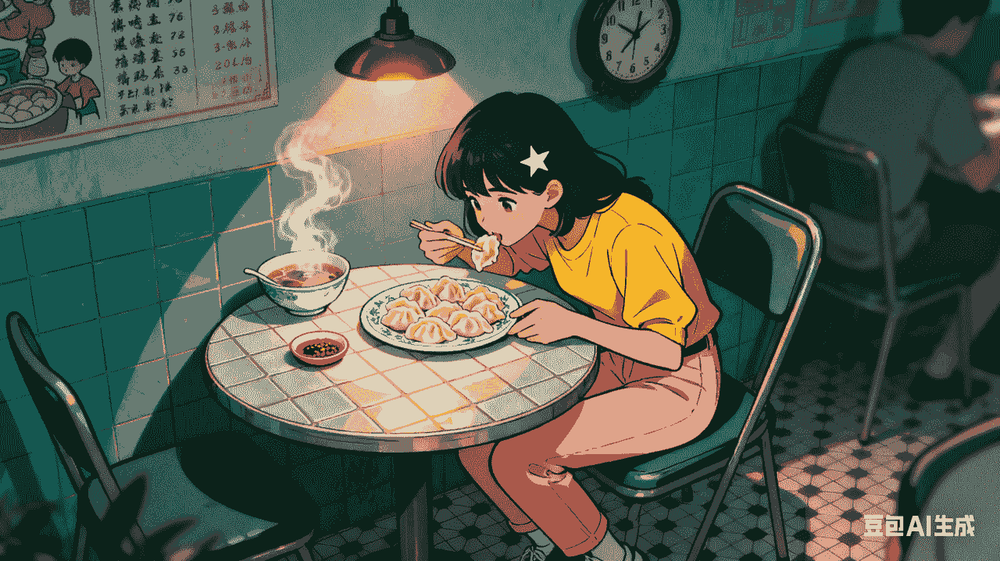

##### B-2 Nano-banana

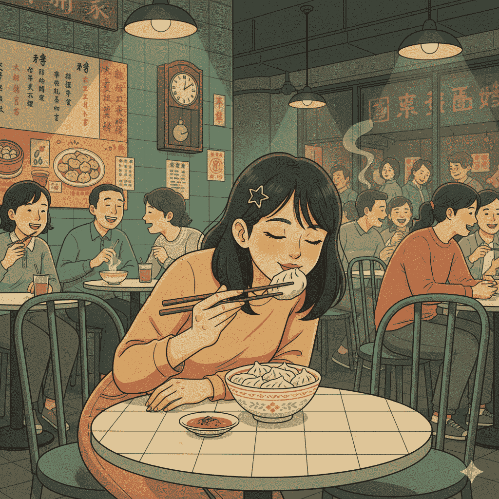

##### B-3 Whisk（google lab）直接用提示词，没有使用参考图

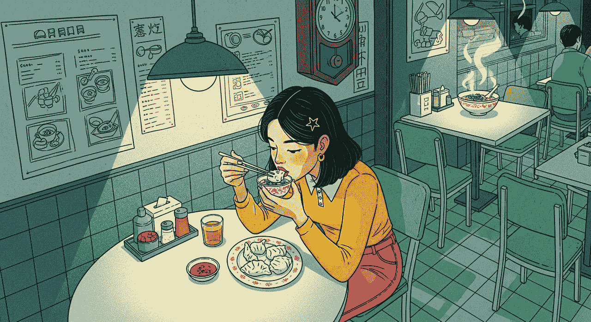

茶餐厅里吃水饺的女孩（插画风格），以上都是用下面这个提示词：

Atmospheric narrative illustration depicting a young woman with dark hair styled with a single star clip, eating dumplings at a small round table in a bustling, late-night eatery reminiscent of a vintage Hong Kong diner. The style blends clean linework with textured color fields, evoking a sense of place and story. The mood is intimate contentment amidst vibrant surroundings. Soft, warm overhead lighting from unseen hanging lamps casts gentle highlights on her face and the porcelain plate of dumplings, creating soft-edged shadows on the tiled tabletop and floor. The background features detailed elements like wall menus with stylized illustrations, a retro wall clock, steam rising from a soup bowl, and glimpses of other patrons blurred slightly for depth. The woman, viewed from a slightly high angle, crouches slightly on her chair, intensely focused on her food, rendered with expressive linework defining her pose and features. The color palette mixes muted teal wall tiles and green chairs with pops of warm yellow in her top, pink trousers, red chili oil dish, and ambient light, creating a cozy yet lively feel. Subtle paper texture or digital grain is visible throughout. Focus is sharp on the character and her immediate table setting.

就单图来看，豆包 4.0 效果很不错，表现的是符合语境的，尤其只有豆包画出了“从汤碗里升起的蒸汽”，果然是中国模型，懂这种喝热汤吃饺子的感觉～～

## 总结

我对 Google 产品产生了浓厚的兴趣，始于近期对 Gemini 的高频使用，也源于 20 年前对谷歌产品的深刻印象，尤其是 google earth，让我第一次有全景“看世界的震撼”，我到现在还记得我用鼠标拖拽地球的画面～。可能在你们的“科技记忆”中，也有某个难以忘记的时刻。

如今，在这场关乎未来的 AI 竞争中，我从谷歌实验室的实践中看到的，依然是持续创新、敏锐响应市场、与用户共创的开放生态，这些正是保持企业进化活力的核心引擎。

## 联系方式

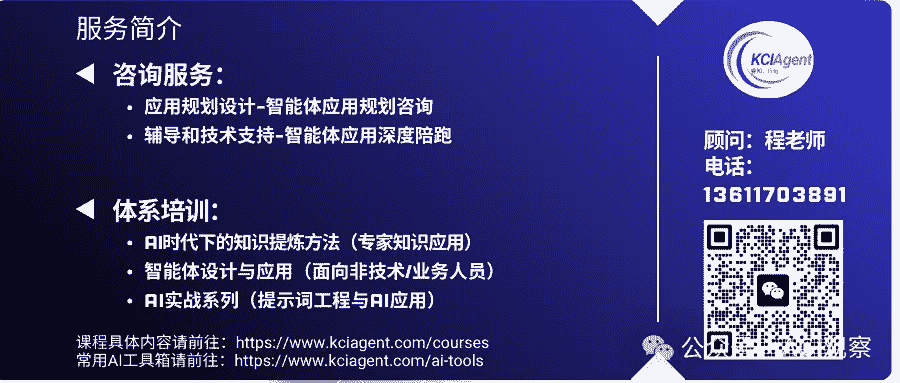