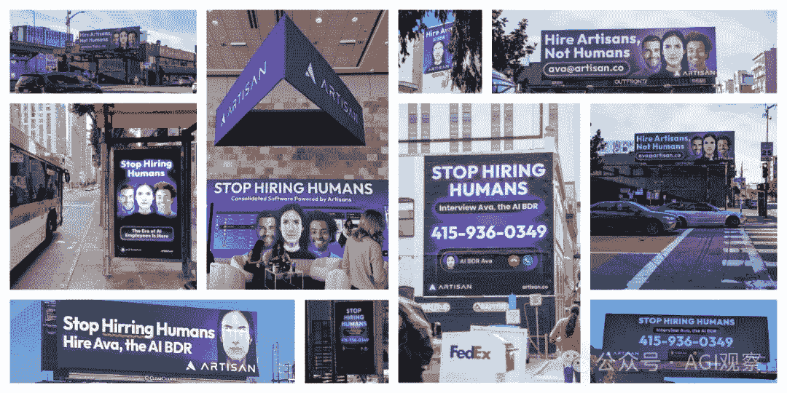

# 今日热点 | AI 初创公司 Artisan 博眼球口号“停止雇用人类”，这种“愤怒诱饵”的营销策略值得借鉴吗？

> 来源：[https://aithinkup.feishu.cn/docx/JsM4dmrynokzACxeKDRcs0EVnCg](https://aithinkup.feishu.cn/docx/JsM4dmrynokzACxeKDRcs0EVnCg)

Artisan 是一家专注于人工智能的初创公司，其首款产品 Ava 是一款 AI 销售开发代表（SDR），旨在通过自动化处理繁琐的工作来提升人类员工的效率。

为了在竞争激烈的市场中脱颖而出，Artisan 推出了一组户外广告口号：“停止雇用人类”（Stop Hiring Humans）。他们故意选择了一个挑衅性的口号，为的是在信息泛滥的科技市场中获得关注。在他们自己的企业博客中，直接表明了他们的真实意图“我们想吸引眼球并激发兴趣，给出挑衅且简单的信息”。

这种“愤怒诱饵”广告是一个典型的“双刃剑”营销策略。

一方面，成功地吸引了大量媒体关注和公众讨论，Artisan 在短时间内从几乎无人知晓到成为行业内的热门话题。在广告活动之前，Artisan 的品牌认知度仅为 5%，而活动后这一数字飙升至 70%。这种激增的品牌曝光率使得 Artisan 在竞争激烈的 AI 市场中脱颖而出，并且直接导致了数千个销售会议的预约和超过 200 万美元的新经常性收入。

然而，这种营销策略也伴随着风险。这种“愤怒挑衅”的方式可能会导致误解和反感。很多人对 AI 持有怀疑态度，担心技术会威胁到他们的就业机会。广告口号引发了不少人的愤怒和负面反应，可能被解读为对人类员工的不尊重，进而引发广泛的道德争议，甚至出现了死亡威胁。

理性思考：这种营销信息既不清晰又不准确，没什么值得借鉴的

想推广新 AI 产品，完全没看到产品的特征信息。在广告投放之后，这种策略确实有效地吸引了他们的目标受众—科技公司。他们表现出兴趣，并且许多人对此表示支持。Artisan 公司似乎非常开心，这家公司在博客里明确表明，“幸运的是，生气的人不是他们的目标受众”，这字里行间显得有些傲慢了吧。

依赖于挑衅性的语言来吸引眼球，故意引发公众误解，短期曝光率大涨。我认为这种策略并不合适，也不是所有企业都能效仿的模板。挑衅性的营销策略可能在短期内带来流量和销售，但从长远来看，初创企业需要建立稳固的品牌形象。

**最**后，Artisan 这家公司原本是“AI 产品洞察”系列中的待选企业之一，但是目前看到这则博客信息后，目前暂时移出待选企业了。