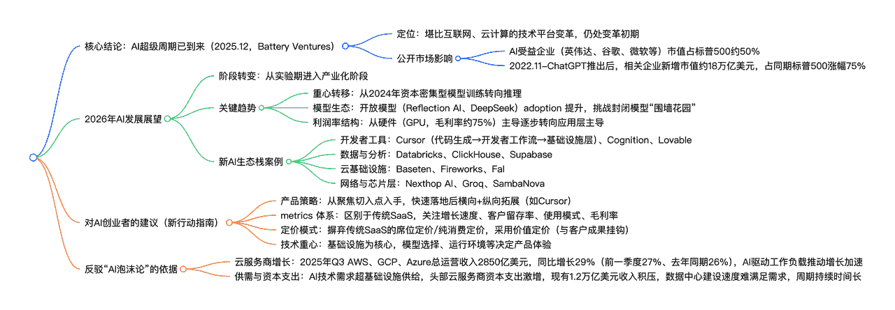
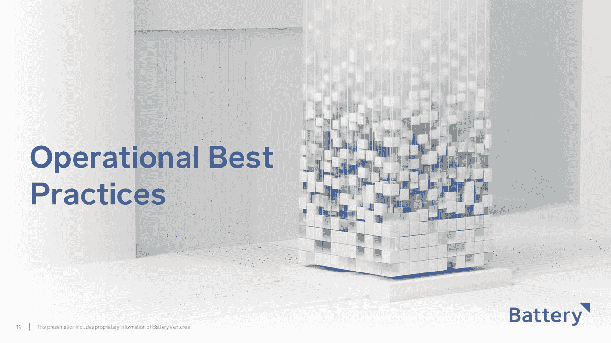
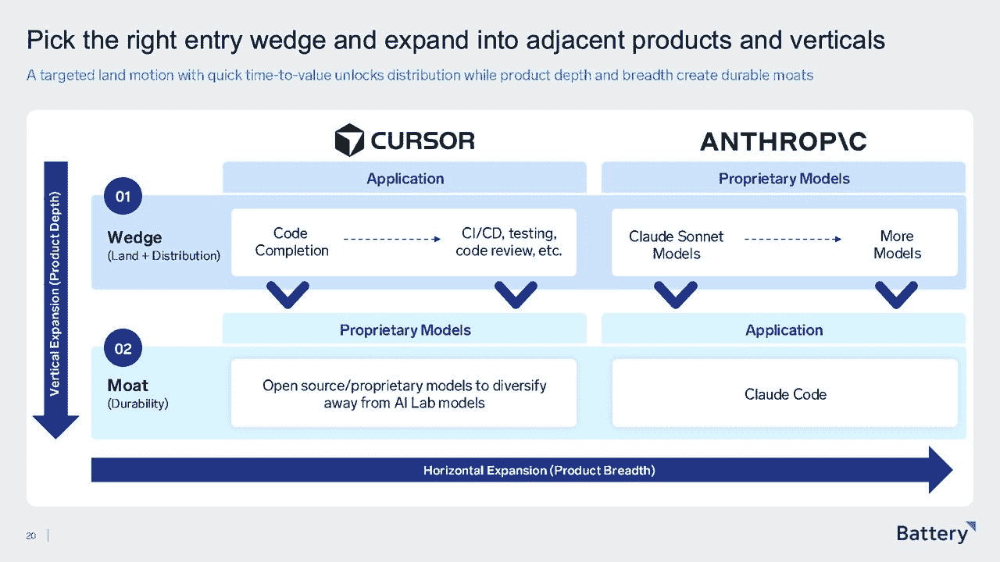
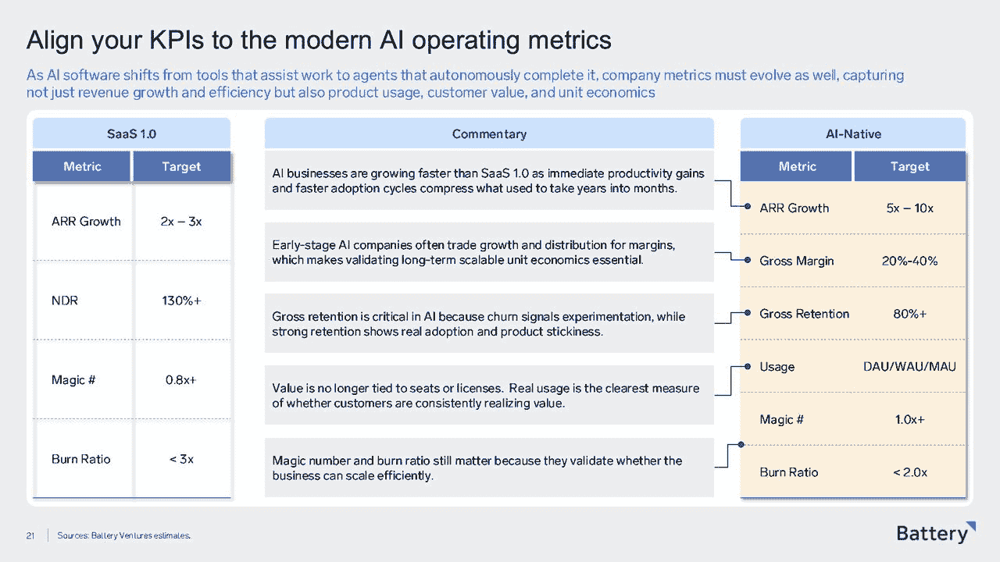
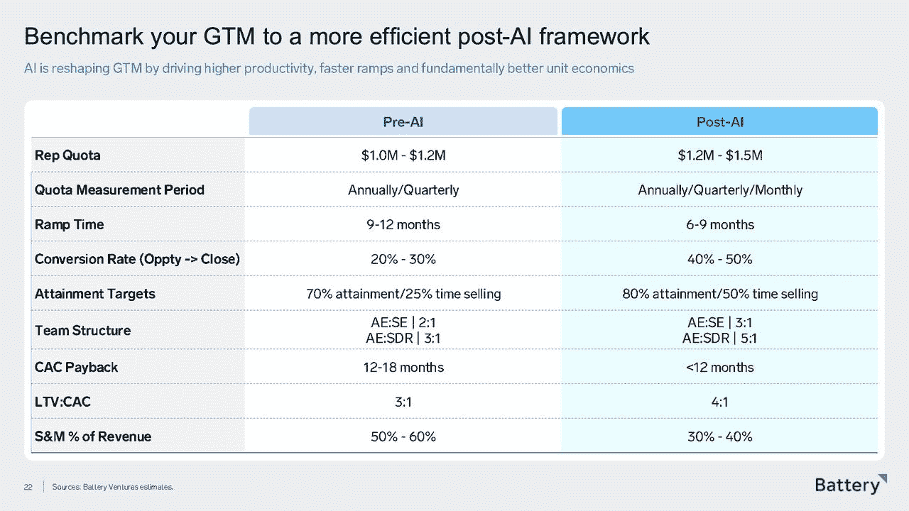
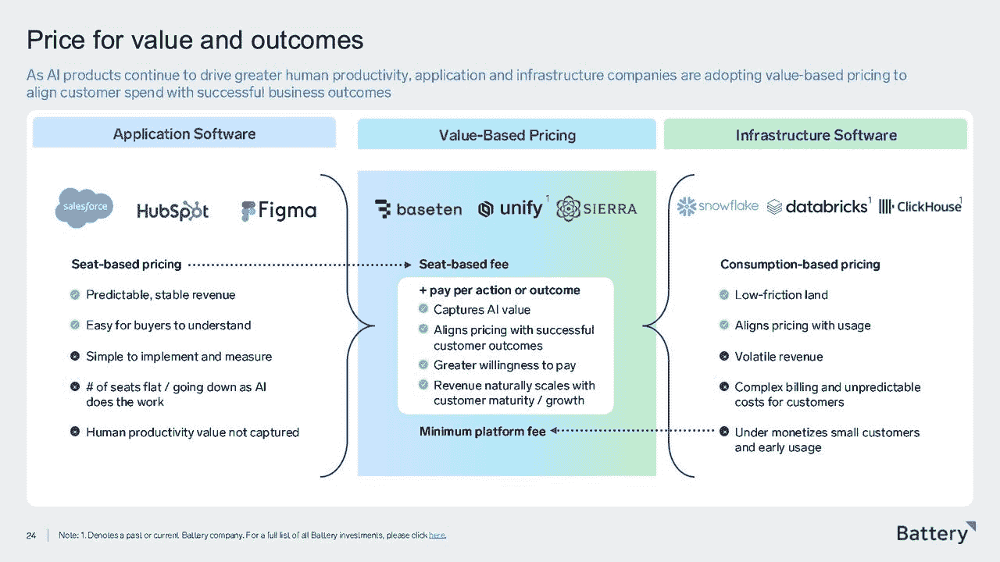

# AI超级周期已正式到来The AI Supercycle Has Arrived

> 来源：[https://aithinkup.feishu.cn/docx/ZQzsdurEMoSgjZx2SLPcJdDMnxh](https://aithinkup.feishu.cn/docx/ZQzsdurEMoSgjZx2SLPcJdDMnxh)

本文撰稿：观察者Ada审核。AI辅助初稿

原文日期： 2025年12月18日

原文标题：It’s Here: The AI Supercycle Has Arrived, With Profound Market Impacts and Important New Lessons for AI Founders – and We Are Just Getting Started

中文标题：AI超级周期已正式到来，对市场产生深远影响，并为AI创业者带来重要新启示—而我们才刚刚起步。

原文链接：https://www.battery.com/blog/state-of-ai-2025/

---

## 1. 一段话总结

**2025年12月，Ba**ttery Ventures团队指出AI超级周期已正式到来，这一技术平台变革堪比互联网与云计算革命，当前AI已成为公开市场主导力量、资本投资核心驱动力及新企业增长基础，且仍处变革初期；

2026年AI将进入产业化阶段，重心向推理转移，同时团队还为AI创业者提供了聚焦切入点、关注创业公司运营的新的一套衡量标准等针对性建议。

---

## 2. 思维导图

---

## 3. 详细总结

### 一、核心论断：AI超级周期正式降临（2025年末）

1.  **周期定位**：Battery Ventures在2024年《开放云现状报告》中预测的AI“超级周期”已成为现实，这一技术平台变革的影响力堪比互联网与云计算革命，不仅可能颠覆大型科技巨头的市场地位，还有望释放数万亿美元的市场价值。

1.  **当前阶段**：2025年末回顾可见，AI已不再是短期趋势，而是具备三大核心角色的关键力量：

+   公开市场的**主导力量**

+   资本投资的**核心驱动力**

+   新兴企业高速增长的**基础设施与基础**

1.  **未来潜力**：尽管发展迅速，但2026年将至，AI仍处于变革初期，支撑其持续增长的关键因素包括：

+   预训练与后训练阶段的AI扩展定律依然有效

+   AI智能体（AI agents）已能在软件开发、医疗、法律等行业完成人类级任务与工作流

+   大规模计算资源正逐步投入使用，为AI发展提供持续动力

### 二、AI对公开市场的具体影响（数据支撑）

| 关键指标 | 具体数据 |
| --- | --- |
| AI受益企业市值占比 | 英伟达、谷歌、微软等企业市值约占标普500指数总价值的50% |
| 市值新增规模（特定周期） | 自2022年11月ChatGPT公开推出以来，相关创新企业累计新增约18万亿美元市值 |
| 市值新增贡献度 | 上述新增市值占同期标普500指数所有涨幅的比例约为75% |

### 三、“AI并非泡沫”的核心依据（反驳质疑）

1.  **推动云服务商增长复苏**：2023年受宏观环境影响，云服务商增长陷入放缓，但AI成功扭转这一趋势，成为云服务商增长的关键指标：

+   2025年第三季度，AWS、GCP**、Azure三**大云服务商的总运营收入达到2850亿美元

+   同比增长率为**29%**，高于上一季度的27%和去年同期的26%，AI驱动的工作负载规模化是增长加速的核心原因。

1.  **供需失衡与长期周期支撑**：

+   需求端：AI技术需求持续超过现有基础设施供给能力，直接推动头部云服务商资本支出（capex）激增。

+   **订单储备：根据**最新财报，头部云服务商因AI应用与基础设施需求，已积累1.2万亿美元的收入积压（revenue backlog）。

+   **周期潜力：对“智能”的需求增速远超数据中心的建设速**度，表明AI超级周期具备长期延续的基础。

### 四、2026年AI发展展望（产业化阶段特征）

1.  **核心转变：从实验期到产业化**：AI应用不再局限于试验场景，而是进入规模化落地的产业化阶段，具体表现为：

+   **重心转移**：2024年AI行业聚焦资本密集型的模型训练，2026年将转向“推理”（inference）；随着能自主规划、执行复杂工作流的智能体应用（agentic applications）落地，运行时（runtime）对计算能力的消耗将大幅增加，新智能体应用的推出将持续拉动收入增长。

+   **模型生态变革**：封闭模型的“围墙花园”模式受到挑战，开放模型（如Reflection AI、DeepSeek的模型）的采用率将提升，推动AI生态向更多元化方向发展。

1.  **利润率结构重塑**：

+   **当前格局：****价值集**中于硬件（以GPU为代表），硬件毛利率约为75%；而AI应用因推理成本较高，利润率普遍承压。

+   **未来趋势：****随**着“智能”成本下降、基础设施供给逐步跟上，价值将向应用层转移，尤其聚焦于能通过“基于成果的定价”（outcome-based pricing）捕获所替代劳动力价值的企业。

1.  **新AI生态栈崛起（案例分布）**：

| 领域 | 代表性企业 | 核心作用 |
| --- | --- | --- |
| 开发者工具 | Cursor、Cognition、Lovable | 重新定义工程师开发与协作模式（如Cursor从代码生成拓展至基础设施层） |
| 数据与分析 | Databricks、ClickHouse、Supabase | 成为智能应用的数据支撑核心 |
| 云基础设施 | Baseten、Fireworks、Fal | 以新抽象技术服务AI工作负载 |
| 网络与芯片层 | Nexthop AI、Groq、SambaNova | 突破性能边界，挑战传统科技巨头地位 |

### 五、AI创业者的新行动指南（替代传统SaaS 1.0策略）

1.  **产品拓展策略**：从“聚焦切入点”入手，快速落地后再横向+纵向拓展，构建持久竞争壁垒。例如Cursor先以代码生成与编辑切入市场，再横向覆盖开发者全工作流，纵向延伸至基础设施层（如推出自有模型Composer）。

1.  创业公司运营的新的一套衡量标准metrics 体系革新：需采用区别于传统SaaS的新指标：

核心关注维度：

+   增长速度（AI企业因生产力提升快， 采用周期更短，增长更快）、

+   客户留存率、

+   使用模式（判断应用是否提供持久价值，而非仅处于实验阶段）、

+   毛利率（确保在算力密集型模式下，定价与单位经济能够保持可持续性）。

1.  **定价模式升级**：

+   摒弃传统SaaS的“席位定价”（seat-based pricing）和“纯消费定价”（pure consumption-based pricing），转向“价值定价”（value-based pricing）。

+   原因在于AI软件已从“辅助人类生产力”转向“自主完成工作”，价值定价可精准捕获AI产生的价值，与客户成功成果对齐，并随客户成熟度自然实现收入增长。

1.  **技术重心调整**：SaaS 1.0时代“基础设施处于幕后，应用逻辑决定用户体验”，而AI原生时代相反——基础设施成为核心，模型选择、运行环境、评估、路由、数据访问等决策直接决定系统准确性、响应速度及整体产品与用户体验。

---

## 4. 未来趋势预测（原文精选）

1.  **中文**：人工智能超级周期已然到来，它是一场深刻的技术平台变革，堪比互联网和云计算革命，有望颠覆大型科技巨头的地位，并释放数万亿美元的市场价值。

**英文**：The AI supercycle has arrived, which is a profound technology platform shift akin to the Internet and cloud-computing revolutions that could unseat large tech incumbents and unlock trillions in market value.

1.  **中文**：人工智能已不再仅是一种趋势，它是公开市场中的主导力量、资本投资的巨大驱动力，也是新一代高速增长企业的核心基础设施与根基，而我们仍处于这场变革的初期阶段。

**英文**：AI is no longer just a trend. It is the dominant force in the public markets, a massive driver of capital investments and the core infrastructure and foundation of a new class of companies growing at unprecedented rates, and we are still in the early innings of this transformation.

1.  **中文**：人工智能的缩放定律在预训练和后训练阶段均有效；人工智能代理正跨软件开发、医疗、法律等行业完成人类级别的任务与工作流；大规模计算浪潮刚刚兴起，将持续为这些发展趋势提供支撑。

**英文**：AI scaling laws across pre-training and post-training are holding; AI agents are completing human-level tasks and workflows across industries like software development, healthcare and legal; and a massive wave of computing is just now coming online that will continue to support these tailwinds.

1.  **中文**：我们正从人工智能应用的实验阶段迈向工业化阶段，人工智能原生企业的独特架构模式正在形成，且正从辅助人类的工具向自主完成工作的智能代理转变。

**英文**：We are moving past the experimental phase and into the industrialization phase of AI adoption. Distinct architectural patterns for AI-native companies are forming, and we are witnessing a shift from tools that assist humans to autonomous agents that complete work.

1.  **中文**：随着自主规划并执行复杂工作流的智能代理应用上线，它们在运行时将消耗远超以往的计算能力，而这一发展将随着各类新型智能代理应用的推出，持续推动收入增长。

**英文**：As agentic applications—which autonomously plan and execute complex workflows—come online, they will consume vastly more compute power at runtime. This development will continue to drive revenue as a myriad of new agentic applications hit the market.

1.  **中文**：当前人工智能领域的价值捕获集中在毛利率约75%的硬件（如GPU），但随着智能成本下降、供应逐步跟上，未来价值将向应用层转移，尤其是那些能借助基于成果的定价模式，捕获其替代劳动力所创造价值的企业。

**英文**：Today, value capture is concentrated in hardware (GPUs) with ~75% gross margins, while AI applications often see compressed margins due to inference costs. However, as the cost of intelligence falls and supply catches up, future value will accrue to the application layer, specifically to those companies that can leverage outcome-based pricing to capture the value of the labor they replace.

1.  **中文**：人工智能应用正迎来“寒武纪大爆发”，这一现象由支撑它们的基础模型推动，同时催生了全新的技术栈，且这一技术栈所开启的人工智能应用市场机遇，远超SaaS 1.0时代。

**英文**：A Cambrian explosion of AI applications is emerging, many made possible by the foundation models that power them. This is giving rise to a new stack, which is unlocking AI applications that do the work, creating a much bigger market opportunity than the SaaS 1.0 ever did.

1.  **中文**：人工智能原生企业需围绕新指标运营——其增长速度更快（即时生产力提升缩短了采用周期），但仅靠增长不够，客户留存率、使用模式是判断应用场景是否创造持久价值的关键，且随着企业规模扩大，监控毛利率对确保定价和单位经济效益的可持续性至关重要。

**英文**：AI companies should be run against a new set of metrics compared to those of traditional SaaS companies. AI businesses are growing faster as immediate productivity gains compress adoption cycles, but growth alone is not enough. Gross retention and usage patterns are the clearest indicators of whether a use case is delivering durable value. As companies scale, monitoring gross margin also becomes essential to ensure pricing and unit economics remain sustainable.

1.  **中文**：传统SaaS的席位定价模式甚至纯消耗型定价模式，应让位于基于价值的定价模式——当软件从辅助人类生产力转向自主完成工作时，基于价值的定价能捕获人工智能的影响，使定价与客户成功成果对齐，并随客户成熟度自然实现收入增长。

**英文**：The old SaaS model of seat-based pricing, and even pure consumption-based pricing, should give way to value-based pricing models. As software shifts from aiding human productivity to autonomously completing work, value-based pricing captures the impact of AI, aligns pricing with successful customer outcomes and allows revenue to naturally scale as customers mature.

1.  **中文**：在人工智能原生时代，基础设施处于核心位置，模型选择、运行时环境、评估、路由和数据访问等方面的决策，决定了系统的准确性、响应速度以及整体产品和用户体验。

**英文**：In an AI-native world, infrastructure is now front and center, and choices around model selection, runtime environments, evals, routing and data access determine system accuracy, responsiveness and the overall product and user experience.

---

## 五. AI时代的企业运营最佳实践（报告摘要）

注：图片来自原报告。报告下载在原文链接：https://www.battery.com/blog/state-of-ai-2025/

---

## Battery Ventures 公司简介

Battery Ventures 是一家聚焦全球科技领域的投资公司，自1983年成立以来，已在行业深耕40余年，致力于为不同发展阶段的科技企业提供支持，从初创公司到成熟的市场领导者均涵盖其中。

+   **截至 2025** 年，公司累计募**集资金超过 1**30 亿美元，管理资产约为 178 亿美元。

+   Battery Ventures 专注于发现并投资具有行业定义潜力的技术驱动型公司。

#### 投资领域与策略

+   **核心领域：** 应用软件、基础设施软件（含网络安全）、人工智能（AI）、消费者互联网/移动服务以及工业技术与生命科学工具。

+   **投资阶段：** 覆盖全周期，包括**种子期、早期、成长阶段**以及**私募并购（Buyout）**。

+   **2025 年动态：** 进入 2025 年，该公司高度关注 AI 引发的“超级周期”，投资重点正从 2024 年的资本密集型模型训练转向推理（Inference）和代理应用（Agentic Applications）。

#### 投资组合与成就

+   **活跃组合：**** 截至 202**5 年 12 月，其投资组合中包含约 692 家公司。

+   **知名项目：** 历史上投资过 Glassdoor、Databricks 等知名企业。已有超过 74 家被投企业完成 IPO，200 多家通过并购（M&A）退出。

+   **近期动向：** 2025 年 12 月 10 日，领投了量子艺术技术公司 Quantum Art 的 1 亿美元 A 轮融资。

#### 行业声誉

+   **荣誉：**** 连续多年被《Inc**.》杂志评为“对创始人友好型投资者”（Founder-Friendly Investors）。

+   **特色服务：** 除了提供资金，该公司还通过专业的服务团队为被投企业提供业务发展、人才招募和运营指导等全方位支持。