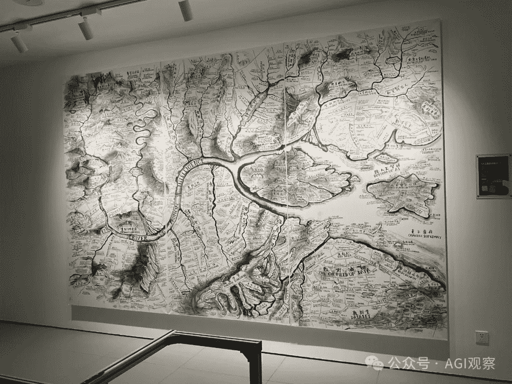

# 《人工智能地图2019》通过梳理历史脉络，将人工智能的发展置于一个长时间尺度内。技术并非凭空产生，而是建立在长期积累之上。

> 来源：[https://aithinkup.feishu.cn/docx/Nnztd2B6OofgOux48s5cf3mvnmb](https://aithinkup.feishu.cn/docx/Nnztd2B6OofgOux48s5cf3mvnmb)

发布日期：2025年1月12日

微信链接https://mp.weixin.qq.com/s/_kSRrZ_5iSr79KkzEEIuSg

正文如下：

昨天在上海商汤科技大厦的 AI 未来世界体验馆中，看到了一件特别的展品《人工智能地图 2019》。我从左上角的“周易八卦”一直仔仔细细看到了右下角的量子霸权，被这幅作品的视觉冲击力所吸引，更是因为其展现了人工智能发展的复杂性与深度。

这幅作品的作者是中国著名艺术家与策展人、中央美术学院实验艺术学院院长邱志杰教授，是一幅 5m×2.48m 的超大尺寸画作，历时一年多才完成。

在《人工智能地图 2019》中，邱教授通**过二维化的方式呈现了人工智能的发展历程**。这幅作品以一条“人工智能大河”为主线，将历史、技术、伦理等多个维度交织在一起。左侧展示了人工智能的历史源头，包括数学史和信息论等理论；中间部分则涵盖了知识图谱、自然语言处理、算法等技术领域；右侧则描绘了从早期科幻概念到现代智能机器人的演变。

整个画面以左、中、右三联画的形式铺开，中间以一条“人工智能大河”（River of Artificial Intelligence）贯穿。

一些重大里程碑事件和概念则呈现为一座座山脉，密布的道路和桥梁让各个节点相互联系，形成不同的解读。

这张图左上角有一个词语“艾达 Augusta Ada Byron”，这是一个人名，通称艾达·洛芙莱斯（1815年12月10日－1852年11月27日），她是著名英国诗人拜伦之女，数学家，计算机程序创始人，建立了循环和子程序概念。英国计算机公会每年都颁发以艾达命名的软件工程创新大奖。

1980 年美国国防部制作了一个新的高级计算机编程语言—Ada 以纪念她。Ada 不仅体现了许多现代软件的开发原理，而且将这些原理付诸实现。Ada 的出现，标志着软件工程成功地进入了国家和国际的规模。

**是的，我用Ada这个名字，就是来自Ada的精彩故事，而且这**是一个极简且对称的英文单词，容易记忆。

左联内容追溯了人工智能的历史源头，画面中三条支流分别囊括了数学史、汇编语言和信息论等相关理论主线，支流交汇处即达特茅斯会议。

中间联以河为界，上部描绘了人工智能的技术领域，包括知识图谱、专家系统、自然语言处理、计算机视觉等分支。

下半部分则是各种算法，由巨大的机器学习山脉发端，分出监督学习、半监督学习、无监督学习和强化学习四条河流，一条“人工神经网络”的公路主干道横跨四河之上，打通他们之间的联系。

右侧联上部只有一条智能机器人的大支流，描绘了从1920年代最早的智能机器科幻概念“罗苏姆通用机器人”到现代的“变形金刚”，以及各类人形机器人、工业机器人、服务机器人，甚至虚拟生命、数字生命。

中间部分，则是人工智能大河在出海口形成的两个巨大冲击岛，分别讲述人工智能算力的发展，强人工智能，人工智能伦理相关问题。

下半部分主要描绘的是大数据和数据集相关内容，邱教授使用了一个形象的名字，叫“数据油田”。

**通过梳理历史脉络，将人工智能的发展置于一个长时间尺度内。技**术并非凭空产生，而是建立在长期积累之上。

邱教授指出，人工智能最早起源于艺术和想象，艺术与科技在历史上相互引领和促进。许多现代科技的灵感来源于艺术创作。

人工智能的定义随着时间不断变化，邱教授用“忒修斯之船”的比喻说明，尽管组成部分可能不同，但其本质依然存在。从早期的计算器到现代的深度学习模型，人们对“智能”的理解在不断演化。

忒修斯之船（The Ship of Theseus），历史背景源于古希腊哲学家普鲁塔克的记载，是一个经典的哲学悖论，探讨事物的同一性问题。忒修斯是雅典的英雄，他在击败米诺陶后，乘坐一艘三十桨船返回雅典。这艘船被雅典人保留下来作为纪念。随着时间推移，这艘船上的木板逐渐腐朽。雅典人为了保存它，不断更换腐烂的木板，直到最终所有木板都被替换。

哲学家们开始思考：这艘被完全替换木板的船，还是原来的那艘忒修斯之船吗？如果用替换下来的旧木板重新组装一艘船，那么哪一艘才是真正的忒修斯之船？

**忒修斯之船提出了一个开放性的问题：事物的同一性是由其组成部分**决定的，还是由其功能、形式或连续性决定？

比如，人体的细胞会不断更新，大约每 7-10 年，身体中的绝大多数细胞都会被新细胞取代。那么，你还是“原来的你”吗？如果是，是什么让你保持“你”的身份？又比如，假设你有一辆汽车，随着时间推移，你逐渐更换了发动机、轮胎、车门等所有零件。当所有零件都被替换后，这辆车还是原来的那辆车吗？如果用原来的零件重新组装出一辆车，哪辆才是“真正的车”？

**最后，还有我的一些思考：　**

如何平衡人类创造性与人工智能的工具性？

人工智能作为工具，是否会限制艺术家的创造性？换句话说，当 AI 生成的作品越来越接近人类艺术时，艺术的“人性”特质是否会被削弱？

技术进步并不总是意味着更好的未来？

例如，AI 可能加剧社会不平等，因为技术资源往往集中于少数国家或企业。此外，文化差异的消弭是否会导致文化多样性的丧失？

人工智能与人类智慧的关系如何演变？

当 AI 不仅仅是工具，而是能够自主学习和决策时，人类与 AI 之间的关系会如何演变？例如，AI 在艺术创作中的参与可能从辅助角色转变为独立创作者，这是否会引发关于原创性和版权的新争议？此外，人类是否会因过度依赖 AI 而失去某些核心能力，例如批判性思维或直觉判断？