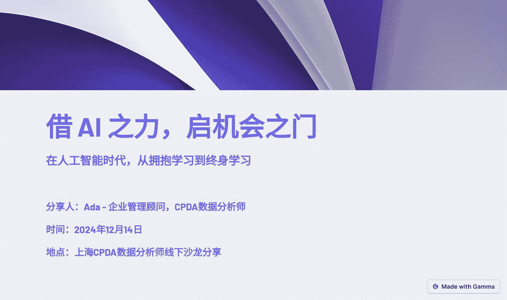
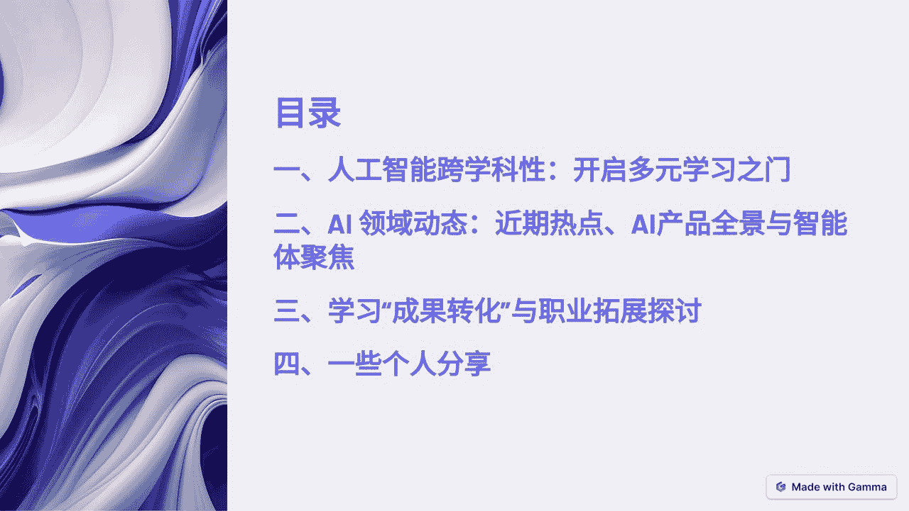
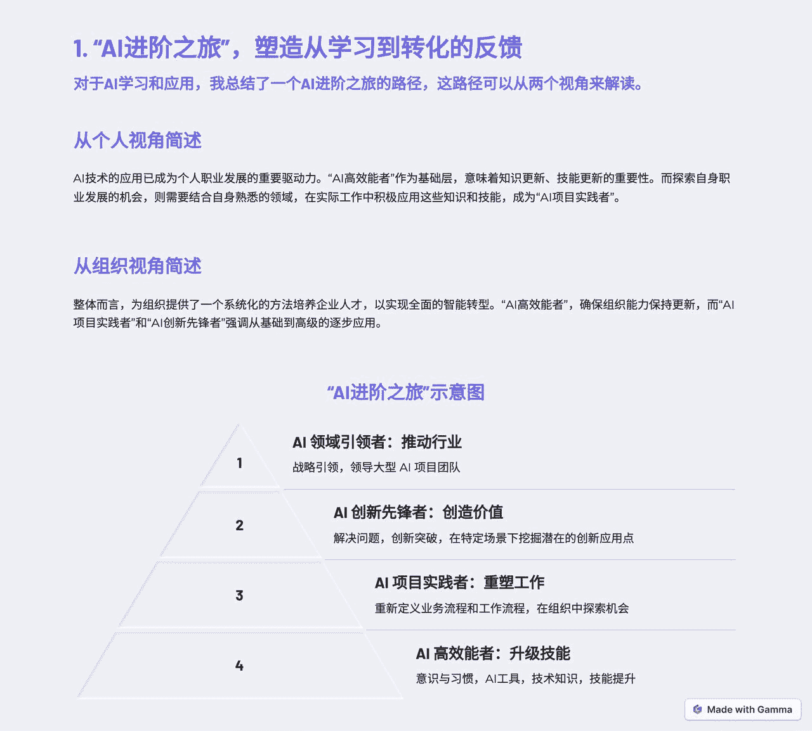
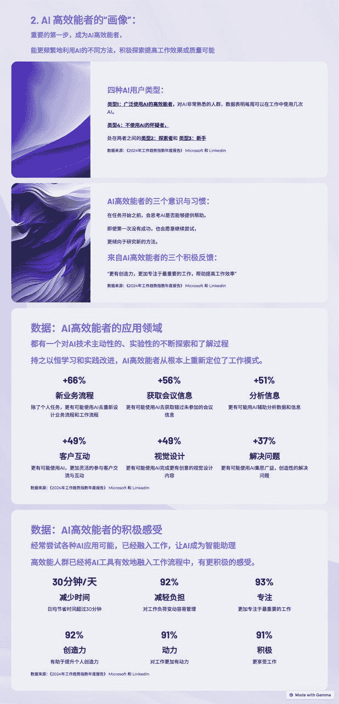
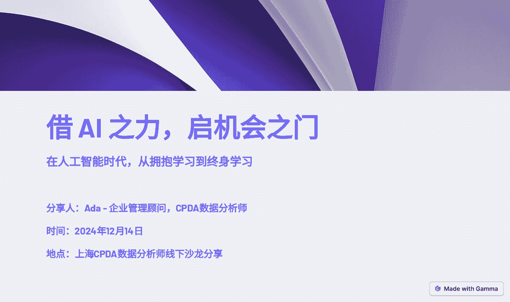

# "借 AI 之⼒，启机会之⻔"（附线下分享PPT)

> 来源：[https://aithinkup.feishu.cn/docx/FM5fdDSFUoG8NDxfw3Jcthuhnqd](https://aithinkup.feishu.cn/docx/FM5fdDSFUoG8NDxfw3Jcthuhnqd)

更新日期：12月21日

作者：[@晓声识器](https://www.yuque.com/clnote)

🛰️链接：https://mp.weixin.qq.com/s/8AFhoHaXC6PgWv8rezwrnw

上个周六，我有幸参加了在上海 CPDA 数据分析师线下沙龙活动，分享了我这一年来在 AI 学习之路上的点滴体会与收获。　时逢年终岁尾，宛如一次年度总结回顾，我把此前散落在 gamma 中的资料整理了一遍，分享了其中一些个人观点。

进行知识提炼和输出的最大好处是，我总结了一个“AI进阶之旅”框架，并近期再度完善了这个框架，使其能够更加完备的呈现关于学习和应用的思考轨迹。

这一周也参加了字节跳动的火山引擎 Force 大会。2024 年学习和使用 Coze 智能体，对我来说是非常重要的收获。OPEN AI 12 天新品发布是近期热点，尽管我已经浏览过相关解读，但直到这个周六，我才第一次完整地看完发布会的视频。我还在一个讨论群里问了个冒昧的问题，“O2 去哪里了”，群里有人幽默的回复“去英国了”。

回顾这一年，感觉技术发展速度加快，几乎无法跟上。

对比我自己职业早期和现在，由于技术的进步，很显然一些岗位消失了，一些岗位是全新的。我理性思考的结果是，这次 AI 浪潮会发生同样的事情。我是千禧一代（也称为 Y 世代，出生于 1981 - 1995 年），我认为在这次生成式 AI 浪潮中，需要跟上潮流。

这意味需要学习新的知识和技能。比如学习 AI 技术原理和应用。学习新技术是为了理解技术，利用技术，不一定成为编程专家、产品专家。也不要被“思想紧身衣”束缚，只要有兴趣，现在学习编程更加容易。

总之，在信息爆炸时代容易获得学习资源，也要根据自己的特点选择学习方向。比如，我是一个视觉倾向的人类，“忍受”不了满屏的代码，虽然 python 课程没有坚持下来，但我理解了基本原理，够用了。

自动化这个概念，并不是今天才开始谈论，已经存在很长时间了。过去 100 年，经历了多次工业革命。我们一直努力在给机器人设定聪明的程序，让机器人更加聪明，能够思考、合成、反应和适应。时间推移，一定会有越来越多的自动化。

**两年前，谁知道 Chatgpt 是什么呢？也不知道什么是 LLM **大模型、智能体这些是什么。现在，我们已经在讨论基于智能体自动化技术的数字员工了。昨天我在看的视频是，波士顿机器人公司过去 40 年发展史，他们今年的机器人已经非常灵活了，能力也很强。根据趋势预测，2027 年机器人可以开始规模化应用。

一个重要事实是，虽然是我们人类在**编写程序，利用机器的计算能力和认知能力。但是，假设公司能把工作外**包给机器人、外包员工，那关于工作还剩下什么给自己呢？这是每个人都要考虑的事情，哪些是明年即将发生的变化，还有哪些机会呢？

过去半年，一直在研究企业智能体应用和工作流程，结合个人视角和组织视角，未来的工作将更加注重人机协作，需要具备跨学科知识和沟通能力的这些背景，我总结了自己的几个观点。

**首先，成为业务领域的专业人士，能**提出正确的问题，并寻找答案，这至关重要。

因为，无论技术如何进步，所有人都会在同一个问题上试图达成共识，那就是“我们要解决的问题是什么？我们要找到哪些新机会？”利用人工智能的力量，了解客户、行业价值链、商业模式和现金流。

其次，是熟悉数据知识和数据应用。

这并不说每个人都成为数据方面的专家，而是，只有利用数据创造价值，才能在数字化世界中的获得竞争力。

最后，要学习 AI 知识和技能，并将其应用于实际场景中。

一种简单而有效的方法，是学习新的 AI 工具，努力成为“AI 高效能者”。非技术人**员**可以成为“技术与业务”的翻译者，为自己准备潜力参与到未来的 AI 创新项目中。有人擅长机器语言，有人精通商业语言，而有的人则可以在两者之间架起桥梁。翻译者的重要性在于，理解两种语言，是一个不可或缺的角色。

如何为未来做准备？的确有太多方式了。虽然环境变化很快，但是主动学习、拥有自己的学习策略是一种必不可少的软技能，以及将分析思维、复杂问题解决能力、创造力等与技术知识结合。

部分PPT内容截图：

> **写在最后，分享的这个 **PPT 中有一个“AI进阶之旅”⽰意图，是我在制作这个 PPT 时总结的四层阶梯。自上周六分享结束后，我又再次思考了四层阶梯中的四个角色：

+   **AI领域引领者：推动行业**

+   **AI创新先锋者：创造价值**

+   **AI项目实践者：重塑工作**

+   **AI高效能者：升级技能**

> 对每个角色的定义、构成维度和衡量方式，进一步优化了整个框架的实用性和功能性。

> 近期，我将会更新一组文章，用来解释这个框架，也许可以给你设计自己的 AI 学习策略提供一些启发。

[20241214PPT.pdf](https://internal-api-drive-stream.feishu.cn/space/api/box/stream/download/all/Bypab9rJSouZq4xqhu7ca0Y2n5g)

