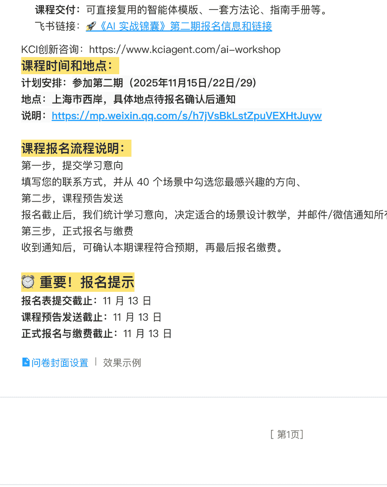
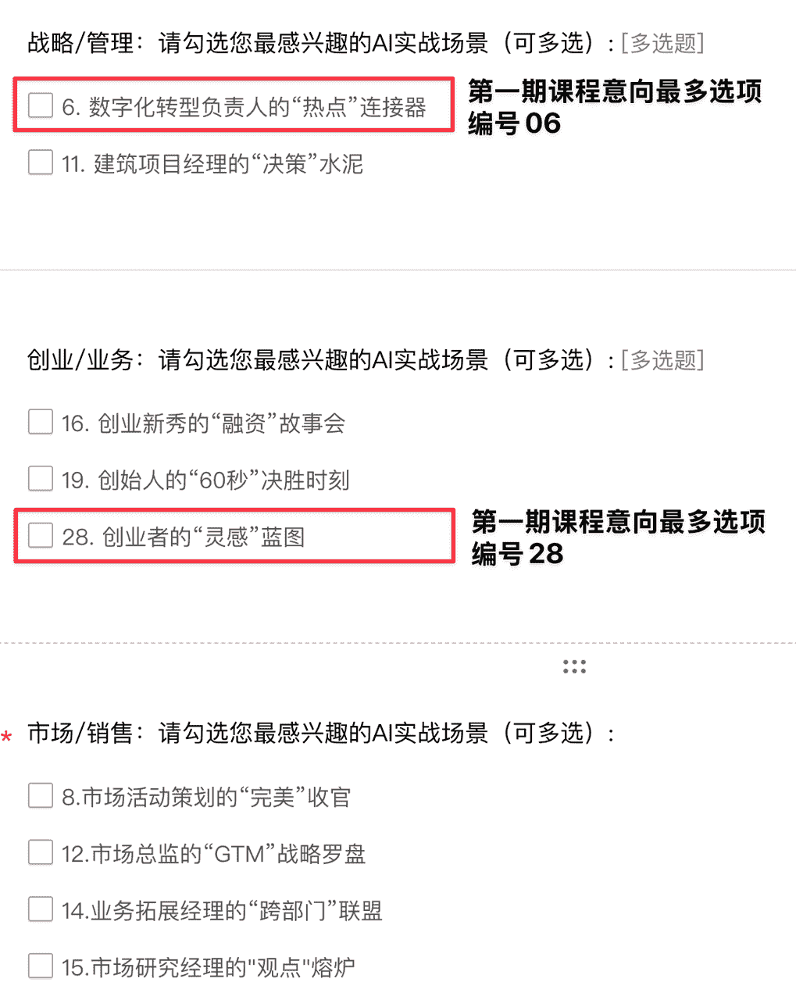
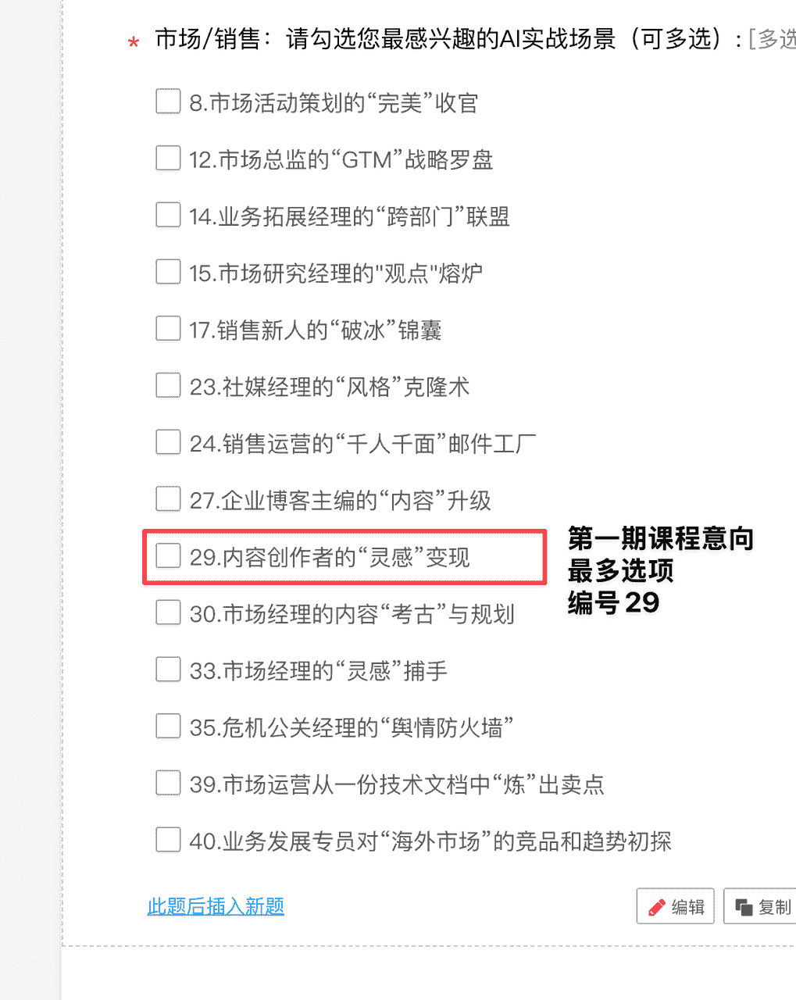
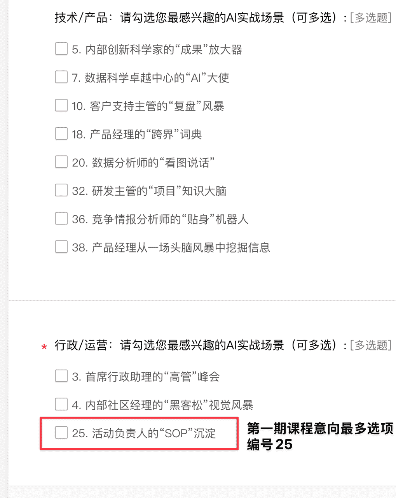
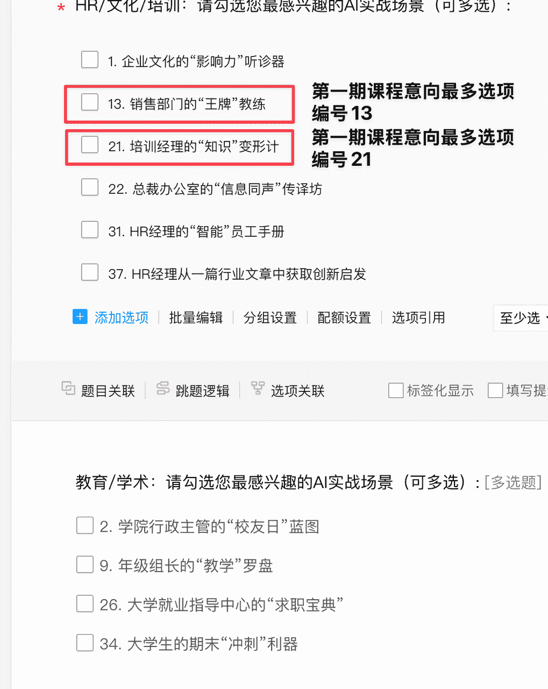
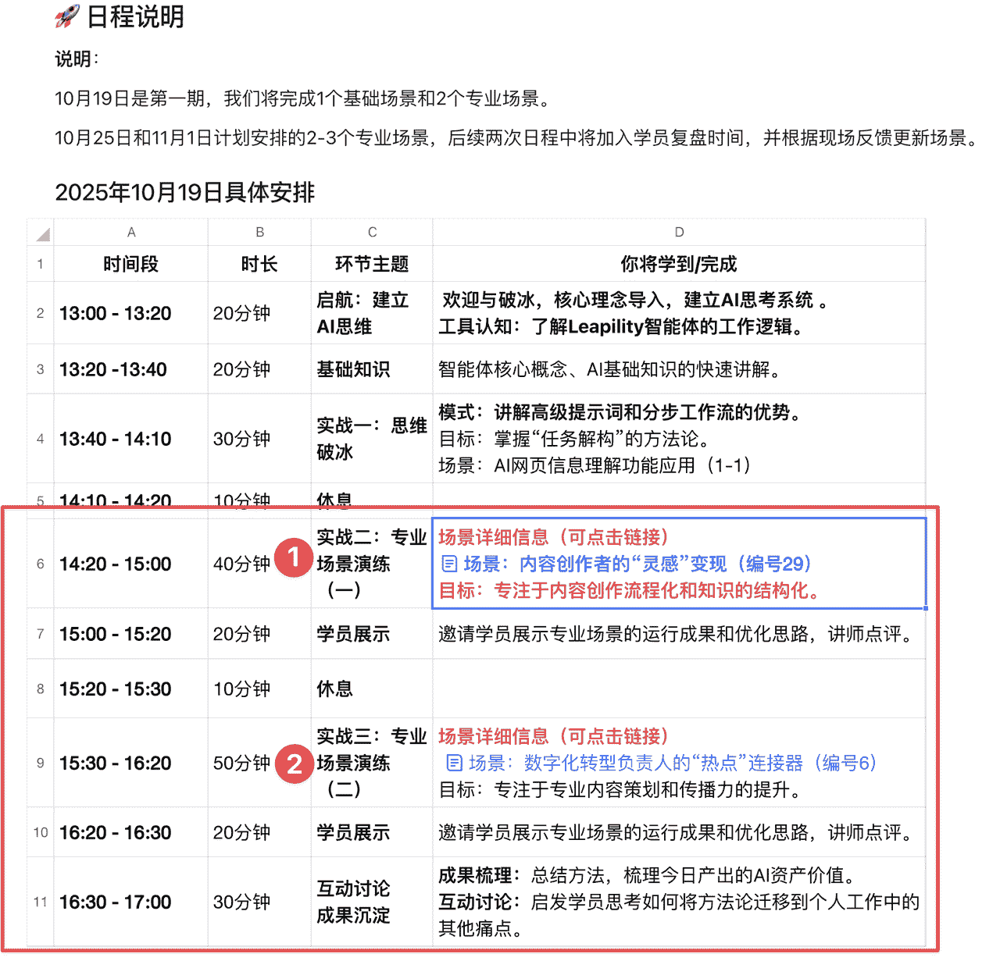
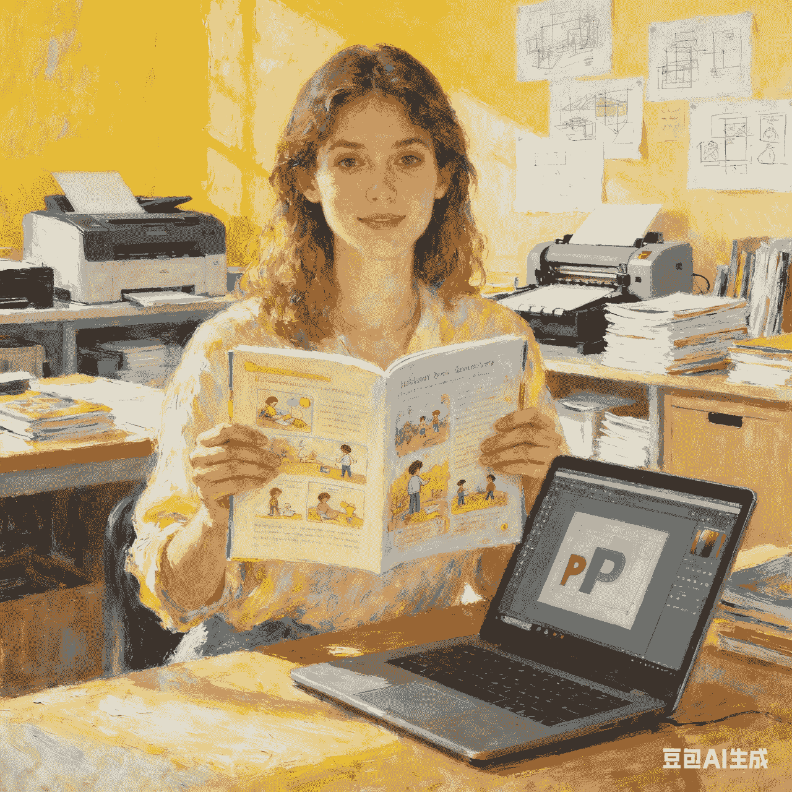
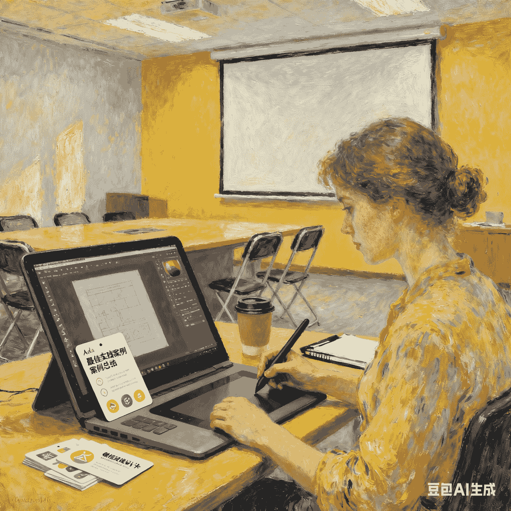

#

> 来源：[https://aithinkup.feishu.cn/docx/UPsbddpgIolr4wxwmjgcEu9rn3e](https://aithinkup.feishu.cn/docx/UPsbddpgIolr4wxwmjgcEu9rn3e)

# 以下是40个场景选项

## 以下是第一期工作坊的 6 个场景总结

### 以业务场景为牵引、以智能体理解和创造为载体

+   帮你把工作变成 AI 驱动的智能程序

+   为“隐性低效”的工作而生

+   帮助你跳过 0-1 的试错期，直接进入 1-100 的优化期

从第一期的学员的提交报名中，选择了以下 6 个场景，我们创建智能体解决痛点

| **场景和典型知识模块** | 可以通过 AI 应用方式，解决以下传统方式痛点 |
| --- | --- |
| 1. 流程管理 &amp; 复盘 | 会议、人工记录、SOP 滞后 |
| 2. 知识萃取 | 依赖专家访谈、观察，效率低、易流失 |
| 3. 商业模式设计 | 白板手写、逻辑跳跃、难以验证 |
| 4. 内容策划 | 凭感觉选题、素材散乱 |
| 5. 教学内容设计 | 同一内容需多次手动改编为 PPT/文章/视频稿 |
| 6. 项目沟通和传播 | 当前的演讲、文章布道，传播效率有限 |

## 画板这里

# 01期第一课：实战场景

## **场景：**内容策划

| **场景和典型知识模块** | 可以通过 AI 应用方式，解决以下传统方式痛点 |
| --- | --- |
| 4. 内容策划 | 凭感觉选题、素材散乱 |

智能体：行业笔记灵感整理专家 Ada（编号 29-1）

智能体：https://leapility.cn/?agent=i-zc8iuuml4gy2

智能体：科技媒体专栏作家 Ada（编号 29-2）

智能体：[https://leapility.cn/?](https://leapility.cn/?agent=i-jbtuwmiih7vw)agent=i-jbtuwmiih7vw

## 场景：项目沟通和传播

| **场景和典型知识模块** | 可以通过 AI 应用方式，解决以下传统方式痛点 |
| --- | --- |
| 6. 项目沟通和传播 | 当前的演讲、文章布道，传播效率有限 |

智能体：数字化项目管理专家 Ada（编号 06）

智能体：https://leapility.cn/?agent=i-0x82t66byl73

虚位以待

# 01期第二课：实战场景

## 场景：教学内容设计

| **场景和典型知识模块** | 可以通过 AI 应用方式，解决以下传统方式痛点 |
| --- | --- |
| 5. 教学内容设计 | 同一内容需多次手动改编为 PPT/文章/视频稿 |

智能体：多形态学习资源设计专家 Ada（编号 21）

智能体：https://leapility.cn/?agent=i-1uh4f5g11xt9

**虚位以待**

## 场景：流程管理 & 复盘

| **场景和典型知识模块** | 可以通过 AI 应用方式，解决以下传统方式痛点 |
| --- | --- |
| 1. 流程管理 &amp; 复盘 | 会议、人工记录、SOP 滞后 |

智能体：活动项目 SOP 专家 Ada（编号 25）

智能体：https://leapility.cn/?agent=i-8uq244ahaf8e

**虚位以待**

# 01期第三课：实战场景

## 场景：商业模式设计

| **场景和典型知识模块** | 可以通过 AI 应用方式，解决以下传统方式痛点 |
| --- | --- |
| 3. 商业模式设计 | 白板手写、逻辑跳跃、难以验证 |

智能体： 战略级商业画布专家 Ada（编号 28）

**智能体：**[https://leapility.cn/?](https://leapility.cn/?agent=i-ljwa04a7popk)agent=i-ljwa04a7popk

## 场景：知识萃取

| **场景和典型知识模块** | 可以通过 AI 应用方式，解决以下传统方式痛点 |
| --- | --- |
| 2. 知识萃取 | 依赖专家访谈、观察，效率低、易流失 |

智能体 1：专家模型萃取专家 Ada（编号 13-A）

智能体 1：https://leapility.cn/?agent=i-mqgevpdvdwx4

智能体 2：教练式销售场景专家 Ada（编号 13-B1）

智能体 2：https://leapility.cn/?agent=i-ligtqh8vaomf

智能体 3：微知识卡片海报专家 Ada（编号 13-C1）

智能体 3：https://leapility.cn/?agent=i-0c9r44z4nkze

## 在9个智能体中动手构建了12个智能体工作流

### 以下是三种基本模式

+   “三段式结构”（输入→分析→输出）

+   “角色接力模式”（A 分析 → B 诊断 → C 生成）

+   “反馈闭环模式”（生成→审阅→迭代）

每个工作流模块包含的基础项：

+   输入项

+   智能体角色

+   执行步骤

+   调用工具

+   输出格式

+   是否设置人工确认环节