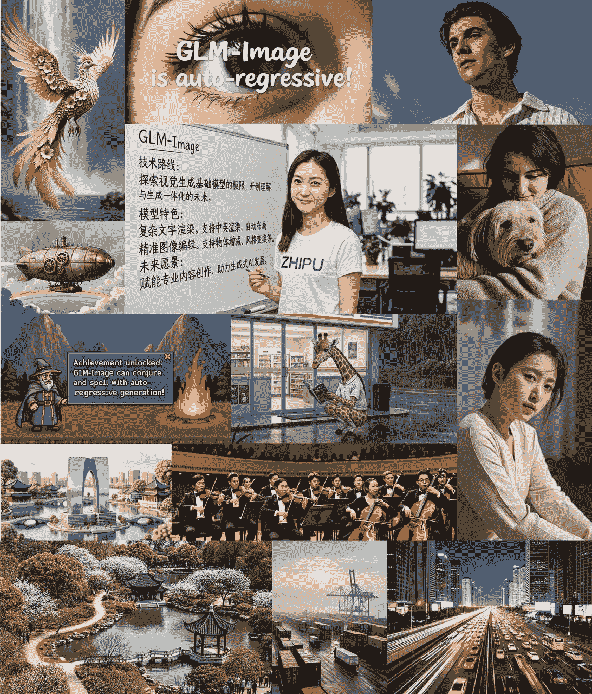
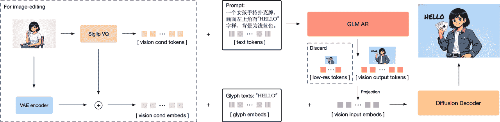
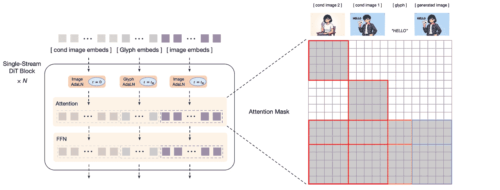
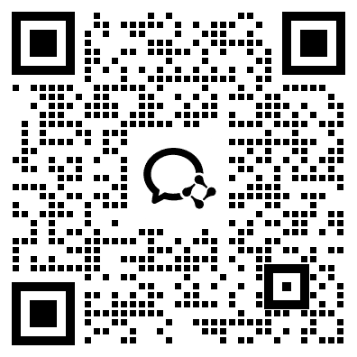

# GLM-Image 技术文档

> 来源：[https://ai.feishu.cn/docx/PcN1d3MxuoiCR2xfpHKcR1Rcnve](https://ai.feishu.cn/docx/PcN1d3MxuoiCR2xfpHKcR1Rcnve)

> **背景介绍:** 在过去几年中，扩散模型凭借训练稳定性和良好的泛化能力成为图像生成领域的主流方案。然而，即使在扩散建模、隐空间编码器等环节得到显著优化进展的背景下，端到端的扩散模型依然在复杂指令遵循和知识密集型场景上存在短板，在信息表达与语义对齐上相对不足。与此同时，近期发布的一些高质量闭源图像生成模型广泛具备较强的知识密集场景生成能力与生成图像细节质感，并展现出自回归建模的特性。参考于此，GLM-Image 在设计之初便将复杂信息理解能力与高质量细节作为解耦的双重目标，通过自回归生成器提供语义对齐的低频信息，再通过扩散解码器进行高频细节落实，以生成图像。这种混合架构不仅在通用生成任务中表现稳定，更在面对复杂知识需要的创作要求时展现出领先优势，推动图像生成迈向兼顾美感与信息精度的新阶段。

## 模型介绍

GLM-Image 是一款采用**自回归 + 扩散混合解码架构**的图像生成模型[——自回归模块部分结构采用](https://huggingface.co/zai-org/GLM-4-9B-0414)并初始化自**GL**M-4-9B-0414，[参数量为9B；扩](https://huggingface.co/zai-org/CogView4-6B)散解码器模块则沿用了Cog**Vi**ew4的单流DiT结构，参数量为7B。GL**M-Im**a**ge在通用图像**生成质量上能够对齐业界主流隐空间扩散模型方案，同时在文字渲染与知识密集型图像生成场景中展现出显著优势。

+   **创新架构让模型读懂写对**：面对传统模型在“理解复杂指令”与“精准绘制文字”上难以兼顾的问题，GLM-Image 引入了「自回归+扩散解码器」混合架构。前者利用其语言模型的底座优势，专注于提升对指令的语义理解和画面的全局构图；后者配合Glyph Encoder的文本编码器，专注于还原图像的高频细节和文字笔画，以此改善模型“提笔忘字”的现象。

+   **多种图像任务上表现优秀**：它在需要精确语义理解与复杂信息表达的任务中表现尤其突出，同时能够在高保真度和细粒度细节方面展现较强的能力。在文生图之外，GLM-Image也同步支持丰富的图生图各类任务，包括图像编辑、风格迁移、身份保持生成及多主体一致性等。

+   **多分辨率自适应**：通过改进Tokenizer策略，GLM-Image能够自适应处理多种分辨率，原生支持从1024x1024到2048×2048尺寸的任意比例图像的生成任务，无需重新训练。

+   **基于国产芯片的自研方案**：GLM-Image的自回归基座研发构建全流程基于昇腾Atlas 800T A2设备和昇思MindSpore AI框架完成。为此，我们基于Mindspeed-LLM框架自研完成了预训练及后训练的视觉自回归生成训练方案的开发，并实现了包括数据预处理、模型推理等的全流程适配。

## 模型架构详解

+   **视觉Token选型**

在以往的视觉自回归生成模型工作中，所使用的视觉token类型可分为三类：

+   通过离散化重构训练获得的视觉编码（VQVAE）

+   通过离散化语义训练获得的视觉编码（semantic‑VQ）

+   从一维向量中提取的统计语义特征（如 DALLE2）

从信息完备程度来看，这三类方法依次递减；而从语义相关性的角度来看，它们则恰好相反，依次增长。对于视觉生成模型来说，token（或图像 patch）之间的相关性是影响模型收敛速度和最终生成质量的重要因素。在latent diffusion model架构中，如VAVAE、SSVAE等工作通过提升VAE latents的patch间相关性的尝试有效证明了这一点。而对于自回归生成来说，在相似的codebook大小下，VQVAE与semantic‑VQ所编码token的训练损失量级存在明显差异（~7 vs. ~3），这表明语义 token 在视觉生成训练中具有更优越的收敛性。另一方面，一维向量在信息完备性以及与特定图像的对应性方面存在不足，在后续的工作中更常用于主体一致性生成等任务（如 Redux）。

基于上述结论与观察，GLM‑Image选择semantic‑VQ作为基本的token选型。具体而言，我们采用了XOmni的tokenizer方案，以在token建模过程中获得更好的语义相关性，并进一步构建diffusion decoder在token的基础上解码获得最终的生成图像结果。

+   **自回归模块训练**

GLM‑Image 的自回归生成部分初始化自 GLM‑4‑9B‑0414，并实现了文本生成图像（text‑to‑image）与图像生成图像（image‑to‑image）的组合式训练。在训练过程中，我们冻结了模型的文本词嵌入（text word embedding）层，同时开放其他部分进行训练，并额外添加视觉词嵌入层（vision word embedding）用于视觉 token 的投影。此外，我们将原有的语言模型输出层（LM head）替换为视觉输出层（vision LM head），以适配新的任务场景。针对文本生成图像和图像生成图像两类任务中图像与文本交错的情况，我们应用了 MRoPE作为模型的位置编码方案，如图所示。

我们将模型训练划分为多个分辨率阶段，包括 256px、512px 以及一个跨 512px 至 1024px 的混合分辨率（mixed‑resolution）训练阶段。我们采用来自XOmni的tokenizer对图像进行 16× 压缩比的 patch 切分（patchify）及编码，这意味着在三个训练阶段中，每条样本的token数分别为256、1024和1024‑4096。鉴于我们将diffusion decoder的最终输出放大倍数设定为32x，最终生成的图像分辨率范围为1024px至2048px。

在初始的 256‑token 阶段，我们使用了直接的 栅格扫描顺序（raster scan order） 来生成 token。然而，在继续进行更高分辨率阶段的训练时，我们发现采用相同策略会导致模型输出可控性下降的问题。为此，我们引入了渐进式生成策略（progressive generation strategy）：在生成高分辨率图像 token 之前，模型会先生成约 256 个与目标图像等长宽比的 token，这些 token 来自于目标图像经过降分辨率处理后再进行 编码的结果。考虑到这些前置 token在很大程度上决定了最终的图像布局，但由于数量较少容易“被轻视”，我们在后续训练中适当提升了这一部分token的训练权重，从而有效提升了整体生成质量。

+   解码器（Decoder）模块构建

GLM‑Image 的diffusion decoder接受由自回归模型生成的semantic-VQ tokens作为条件输入，用于重构目标图像。虽然semantic-VQ tokens携带了丰富的语义信息，但它们的信息存在高频的图像细节损失，主要保留的是相对低频的图像布局信息。因此，diffusion decoder必须保留一定的生成能力，以合成并恢复这些缺失的精细细节。

在骨干网络设计上，我们遵循CogView4的方案，采用single‑stream DiT架构。解码器的扩散调度策略使用flow matching，以实现稳定训练与高效收敛。作为输入条件，semantic-VQ tokens首先经过投影层，然后与VAE 的隐变量在通道维度上进行拼接。这一设计保持了输入序列长度不变，并且几乎不增加额外的计算开销。由于semantic-VQ tokens已经提供了足够的语义信息，我们去除了输入条件中的prompt信息，从而无需使用大参数量的文本编码器，有效降低了显存占用与计算成本。最后，为了增强decoder在渲染复杂文本，尤其是中文字符的能力，我们引入了轻量级的 Glyph‑byT5 模型，对已渲染的文本区域进行字符级编码，其得到的字形表示信息与视觉信息在序列维度上进行拼接并输入模型。

在图像编辑任务中，往往需要保留参考图像中的高频细节以确保编辑前后的一致性。单纯依靠semantic-VQ tokens所提供的语义信息，无法充分完成这种细节保持的要求。因此，在GLM‑Image的decoder中，我们同时使用参考图像的semantic-VQ tokens和VAE隐变量作为diffusion decoder的额外条件输入，可见Figure2。不同于Qwen‑Image‑Edit、Zimage‑Edit等开源图像编辑模型在参考图像和生成图像之间采用全注意力机制的做法，我们采用的块因果注意力机制来连接参考图像与生成图像。这一模式来自于ControlNet‑Reference‑Only、Anymate‑Anyone和Instruct‑Imagen等工作。块因果注意力能够通过kvcache 技术实现显著降低参考图像token在推理过程中的计算开销，同时在细节保持方面仍保持具有竞争力的表现。

+   AR+Diffusion架构后训练：解耦奖励机制

在后训练阶段，GLM‑Image采用解耦式强化学习策略，分别优化自回归模块和diffusion decoder，从而同时提升语义对齐能力与视觉细节质量。模型的强化学习基于GRPO算法实现，每个模块都会接收针对性的反馈信号。针对扩散解码器，GLM‑Image采用了flow‑GRPO —— 这是对标准LLM GRPO的一种变体，专门适配于diffusion模型的强化学习训练需要。

自回归模块侧重于低频奖励信号，用于引导语义一致性与美学质量，从而提升模型的指令遵循能力以及艺术表现力。在奖励信号设计方面，该模块融合了多种来源：HPSv3用于美学评分，OCR用于提升文字渲染准确率，VLM用于评估生成内容的整体语义正确性。扩散解码器模块则聚焦于高频奖励信号，用于优化精细细节的保真度以及文字的精准渲染。它使用LPIPS提升感知纹理与细节相似度，结合OCR信号进一步提高文字准确性，并引入专用的手部评分模型来增强生成手部的结构正确性。

### 模型下载

> **在线体验**

+   开放平台：https://bigmodel.cn/trialcenter/modeltrial/image

+   即将上线Z.ai、智谱清言

> **API接入**

+   开放平台：https://docs.bigmodel.cn/cn/guide/models/image-generation/glm-image

+   GLM Coding Plan后续将接入GLM-Image MCP，现有订阅用户可直接使用。

> **开源****仓库**

+   GitHub：https://github.com/zai-org/GLM-Image

+   Hugging Face：https://huggingface.co/zai-org/GLM-Image

+   魔搭社区：https://modelscope.cn/models/ZhipuAI/GLM-Image

> **GLM-Image技术报告**：https://z.ai/blog/glm-image

> **官方示例prompt：**https://github.com/zai-org/GLM-Image/blob/main/examples/prompt_utils.py

## 模型表现

### 文字渲染

### 文字到图像

## 🏠 公众号

## ❤️ 交流群

