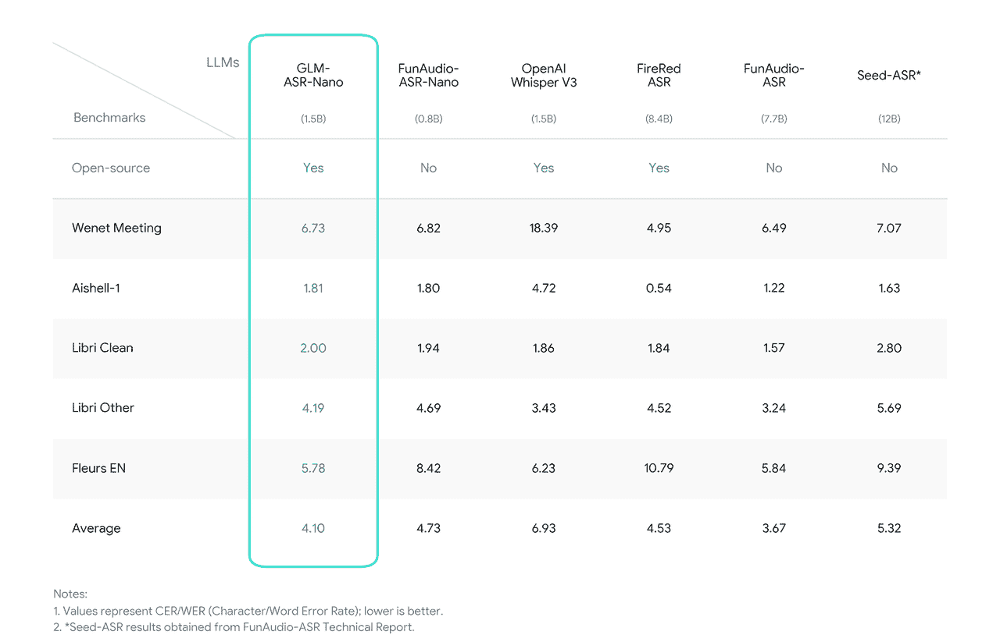
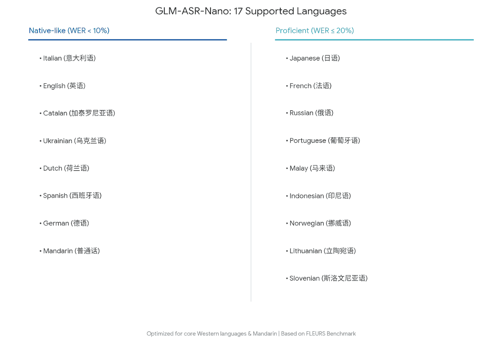

# GLM-ASR技术文档

> 来源：[https://ai.feishu.cn/docx/LmprdbihMoRC7Jxf3cLcjlkGnnf](https://ai.feishu.cn/docx/LmprdbihMoRC7Jxf3cLcjlkGnnf)

## 模型介绍

**GLM-**ASR-Nano-2512 是一款鲁棒的开源语音识别模型，参数量为 1.5B。 该模型专为应对真实世界的复杂场景而设计，在多项基准测试中超越 OpenAI Whisper V3，同时保持紧凑的模型规模。

核心能力包括：

+   **卓越的方言支持**** 除**标准普通话和英语外，模型针对粤语及其他方言进行了深度优化，有效填补了方言语音识别领域的空白。

+   **低音量语音鲁棒性** 专门针对**"低语/轻声"**场景进行训练，能够捕捉并准确转录传统模型难以识别的极低音量音频。

+   **SOTA 性能** 在同类开源模型中实现**最低平均错误率 (4.10)**，在中文基准测试（Wenet Meeting、Aishell-1 等）中展现出显著优势。

## 基准测试

我们将 GLM-ASR-Nano 与主流开源和闭源模型进行了对比评测。结果表明，GLM-ASR-Nano (1.5B) 表现优异，尤其在复杂声学环境下优势明显。



说明：

+   Wenet Meeting 反映了包含噪声和语音重叠的真实会议场景。

+   Aishell-1 是标准普通话基准测试集。

## 支持语言

**GLM-AS**R-Nano 支持 17 种语言，具有高可用性（WER ≤ 20%），特别针对以下地区进行了优化：



## 模型下载

+   请注意，适配transformers和SGLang后，模型权重格式发生变化，如果你的模型下载于2025年12月27日之前，请重新拉取本版本最新模型。

## 推理

我们提供了两段测试音频，分别是中文和英语版本。

### 环境依赖

```
pip install -r requirements.txt
sudo apt install ffmpeg
```

### 示例代码

+   transformers 5.0.0，需源代码安装，参考 requirements.txt

```
from transformers import AutoModel, AutoProcessorimport torchdevice = &quot;cuda&quot; if torch.cuda.is_available() else &quot;cpu&quot;repo_id = &quot;zai-org/GLM-ASR-Nano-2512&quot;processor = AutoProcessor.from_pretrained(repo_id)
model = AutoModel.from_pretrained(repo_id, dtype=torch.bfloat16, device_map=device)

messages = [
    {
        &quot;role&quot;: &quot;user&quot;,
        &quot;content&quot;: [
            {
                &quot;type&quot;: &quot;audio&quot;,
                &quot;url&quot;: &quot;example_zh.wav&quot;,
            },
            {&quot;type&quot;: &quot;text&quot;, &quot;text&quot;: &quot;Please transcribe this audio into text&quot;},
        ],
    }
]

inputs = processor.apply_chat_template(
    messages, tokenize=True, add_generation_prompt=True, return_dict=True, return_tensors=&quot;pt&quot;
)
inputs = inputs.to(device, dtype=torch.bfloat16)
outputs = model.generate(**inputs, max_new_tokens=128, do_sample=False)
print(processor.batch_decode(outputs[:, inputs.input_ids.shape[1]:], skip_special_tokens=True))
```

+   SGLang

目前，暂未提供发行版，请使用最新版本docker

```
docker pull lmsysorg/sglang:dev
```

进入docker，运行

```
pip install git+https://github.com/huggingface/transformers # 覆盖transformers版本
python3 -m sglang.launch_server --model-path zai-org/GLM-ASR-Nano-2512 --served-model-name glm-asr --host 0.0.0.0 --port 8000
```

发起请求:

```
from openai import OpenAIopenai_api_key = &quot;EMPTY&quot;openai_api_base = &quot;http://127.0.0.1:8000/v1&quot;client = OpenAI(api_key=openai_api_key, base_url=openai_api_base)
response = client.chat.completions.create(
    model=&quot;glm-asr&quot;,
    messages=[
        {
            &quot;role&quot;: &quot;user&quot;,
            &quot;content&quot;: [
                {
                    &quot;type&quot;: &quot;audio_url&quot;,
                    &quot;audio_url&quot;: {&quot;url&quot;: &quot;example_zh.wav&quot;}
                },
                {
                    &quot;type&quot;: &quot;text&quot;,
                    &quot;text&quot;: &quot;Please transcribe this audio into text&quot;
                },
            ]
        }
    ],
    max_tokens=1024,
)
print(response.choices[0].message.content.strip())
```

+   transformers 4.51.3 (使用未更新之前的模型)

```
python inference.py --checkpoint_dir zai-org/GLM-ASR-Nano-2512 --audio examples/example_en.wav # 英文
python inference.py --checkpoint_dir zai-org/GLM-ASR-Nano-2512 --audio examples/example_zh.wav # 中文
```

对于上述两段示例音频，模型能够生成准确的转录结果：

```
be careful not to allow fabric to become too hot which can cause shrinkage or in extreme cases scorch
我还能再搞一个，就算是非常小的声音也能识别准确
```

# 🏠 公众号


# ❤️ 交流群

