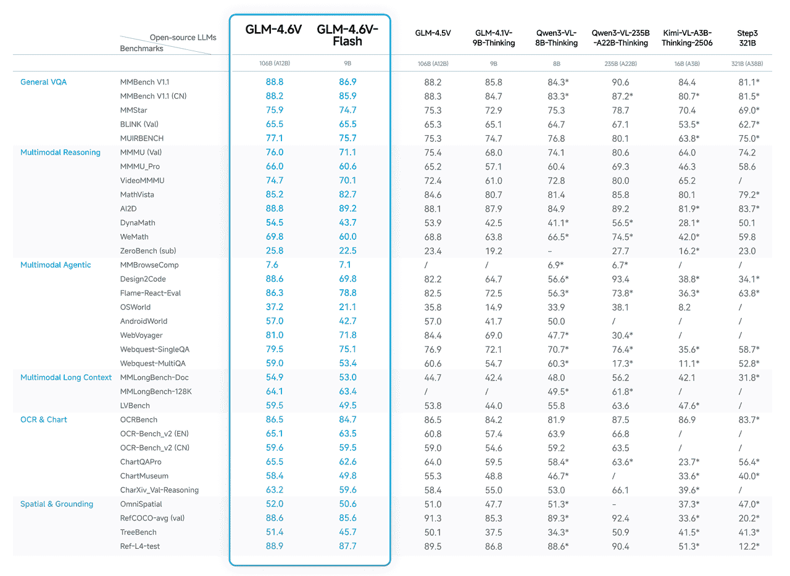

# GLM-V 技术文档

> 来源：[https://ai.feishu.cn/docx/NJf4dscRMoVlH1xnRwVcGWeDn8e](https://ai.feishu.cn/docx/NJf4dscRMoVlH1xnRwVcGWeDn8e)

## 模型介绍

视觉语言大模型（VLM）已经成为智能系统的关键基石。随着真实世界的智能任务越来越复杂，VLM模型也亟需在基本的多模态感知之外，逐渐增强复杂任务中的推理能力，提升自身的准确性、全面性和智能化程度，使得复杂问题解决、长上下文理解、多模态智能体等智能任务成为可能。 我们希望通过我们的开源工作，与社区一起探索技术前沿，同时赋能更多开发者发挥创意做出更多好玩的应用。

**本开源仓库包含了我们开发的****GLM-4.6V****,****GLM-4.5V**** 和 ****GLM-4.1V**** 系列模型**。请根据子页面列表查看对应模型的具体信息。

## GLM-4.6V

GLM-4.6V 系列包含两个版本：GLM-4.6V（106B），面向云端与高性能集群场景；GLM-4.6V-Flash（9B），面向本地部署与低延迟应用的轻量版。GLM-4.6V 在训练中将上下文窗口扩展至 128k tokens，并在相同参数规模下实现视觉理解的 SOTA 性能。

更重要的是，我们首次在模型架构中原生集成了 Function Calling 能力，有效打通了从“视觉感知”到“可执行行动”的桥梁，为真实业务场景中的多模态智能体提供统一的技术底座。

在主要多模态基准测试中取得同规模下的 SOTA 性能之外，GLM-4.6V 还带来了一系列重要特性：

+   **原生多模态工具调用（Native Multimod**al Function Calling）
支持基于视觉的原生工具调用。图片、截图和文档页面可直接作为工具输入，无需文本转换；图表、检索图像和渲染页面等视觉输出，也能被模型理解并融入推理链，实现从“感知→理解→执行”的完整闭环。

+   **图文交织内容生成（Interleaved Image-Text** Content Generation）
支持基于复杂多模态输入生成高质量混合内容。GLM-4.6V 能理解文档、用户输入以及工具检索图像构成的多模态上下文，并生成连贯的图文交织内容。模型在生成过程中可主动调用搜索与检索工具，以补充文本与视觉内容，生成丰富且视觉支撑强的结果。

+   **多模态文档理解（Multimodal Doc**ument Understanding）
支持最长 128K tokens 的多文档/长文档输入，直接以图像方式解析排版丰富的页面。模型可联合理解文本、布局、图表、表格与插图，实现无需转换为纯文本即可高质量解析复杂文档。

+   **前端还原与视觉编辑（Frontend Replicati**on & Visual Editing）
能从 UI 截图中重建像素级逼真的 HTML/CSS，并支持自然语言驱动的可视化修改。模型可识别页面布局、组件与样式，生成干净代码，并根据用户指令迭代进行视觉编辑。

## 模型下载地址

| 模型 | 下载地址 | 模型类型 |
| --- | --- | --- |
| **GLM-4.6V** | [**🤗 Hugging Face**](https://huggingface.co/zai-org/GLM-4.6V) | **混合推理模型** |
| **GLM-4.6V-FP8** | [**🤗 Hugging Face**](https://huggingface.co/zai-org/GLM-4.6V-FP8) | **混合推理模型** |
| **GLM-4.6V-Flash** | [**🤗 Hugging Face**](https://huggingface.co/zai-org/GLM-4.6V-Flash) | **混合推理模型** |

# 子页面列表

# 🏠 👸号

# ❤️ 交流群

