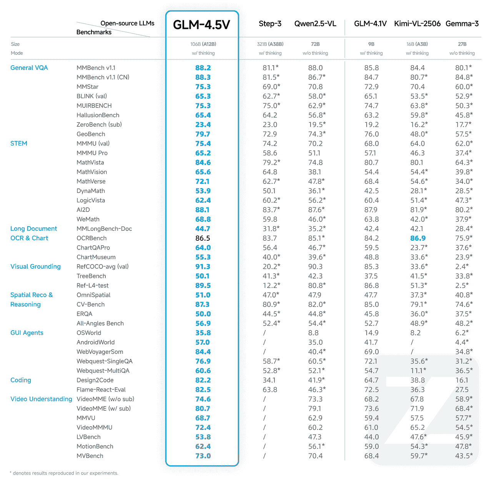
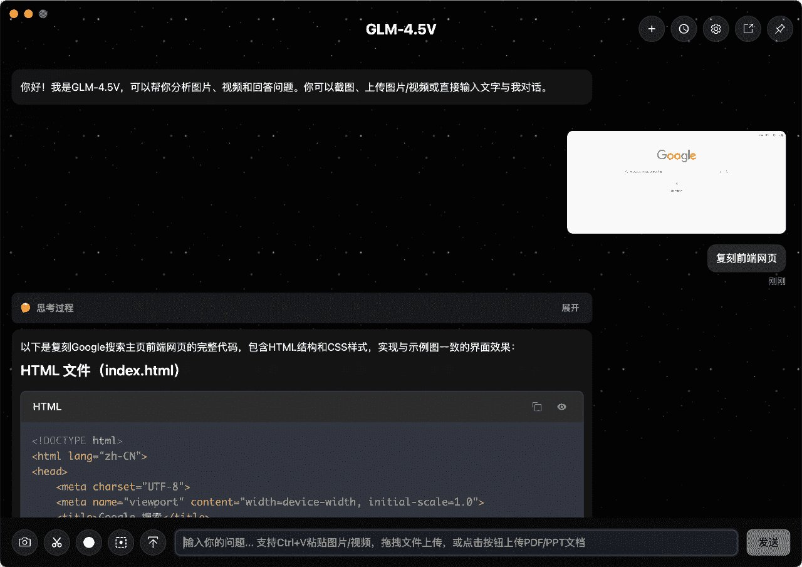

# GLM-4.5V 技术文档

> 来源：[https://ai.feishu.cn/docx/OLx6dD63hoFUYyx7vs8casTRnlb](https://ai.feishu.cn/docx/OLx6dD63hoFUYyx7vs8casTRnlb)


**在线体验：**

欢迎前往 [**z.ai**](http://z.ai)**，选择 GLM-4.5**V 模型，上传图片或视频，即刻体验；或前往智谱清言APP/网页版，上传图片，开启“推理模式”进行体验。

## 模型介绍

GLM-4.5V 基于智谱新一代旗舰文本基座模型 GLM-4.5-Air（106B参数，12B激活），延续 GLM-4.1V-Thinking 技术路线，在 42 个公开视觉多模态榜单中综合效果达到同级别开源模型 SOTA 性能，涵盖图像、视频、文档理解以及 GUI Agent 等常见任务。



在多模态榜单之外，我们更重视模型在真实场景下的表现与可用性。GLM-4.5V 通过高效混合训练，具备覆盖不同种视觉内容的处理能力，实现全场景视觉推理，包括：

+   图像推理（场景理解、复杂多图分析、位置识别）

+   视频理解（长视频分镜分析、事件识别）

+   GUI 任务（屏幕读取、图标识别、桌面操作辅助）

+   复杂图表与长文档解析（研报分析、信息提取）

+   Grounding 能力（精准定位视觉元素）

同时，模型新增 “思考模式” 开关，用户可灵活选择快速响应或深度推理，平衡效率与效果，该开关的使用方式与GLM-4.5 语言模型相同。

为帮助开发者直观体验 GLM-4.5V 的模型能力，打造专**属于自己的多**模态应用，我们同步开源了一款桌面助手应用。



开源链接：https://huggingface.co/spaces/zai-org/GLM-4.5V-Demo-App

该桌面应用可实时截屏、录屏获取屏幕**信息，并**依托 GLM-4.5V 处理多种视觉推理任务，日常处理如代码辅助、视频内容分析、游戏解答、文档解读等多类视觉任务，成为一个能看着屏幕和你一起工作娱乐的伙伴。我们也希望通过模型开源和API服务，赋能更多有想法的开发者，基于多模态基座模型发挥创意和想象，把过去科幻电影中的场景变为现实。

## 环境安装

以下步骤适用于英伟达GPU，如果你使用[ A](https://zhipu-ai.feishu.cn/wiki/YNcLwtUwNibP1ekeXGWcmABfnlb)scend NPU 进行推理，请查看这里。

对于SGLang，请使用以下命令安装：

```
pip3 install &quot;sglang[all]&gt;=0.5.0rc1&quot;
pip install git+https://github.com/huggingface/transformers.git
```

对于vLLM，请使用以下命令安装：

```
pip install -U vllm --pre --extra-index-url https://wheels.vllm.ai/nightly
pip install transformers-v4.55.0-GLM-4.5V-preview
```

+   如果您喜欢从本地编译vLLM，我们推荐使用免编译安装：

```
git clone https://github.com/vllm-project/vllm.git
cd vllm
VLLM_USE_PRECOMPILED=1 pip install --editable . -v
pip install transformers-v4.55.0-GLM-4.5V-preview
```

### transformers 推理

+   trans_infer_cli.py: 使用transformers库作为推理后端的命令行交互脚本。你可以使用它进行连续对话。

+   trans_infer_gradio.py: 使用transformers库作为推理后段的 Gradio 界面脚本，搭建一个可以直接使用的 Web 界面，支持图片，视频，PDF，PPT等多模态输入。

+   trans_infer_bench：用于学术复现的推理脚本，仅适用于 GLM-4.1V-9B-Thinking 模型。其核心在于指定了中断思考的长度，当思考长度超过8192时，强制中断思考并补上</think><answer>再次发起请求，让模型直接输出答案。该例子中使用的一个视频作为输入的测试的例子。其他情况需自行修改。

### vLLM 推理

```
vllm serve zai-org/GLM-4.5V \
     --tensor-parallel-size 4   \
     --tool-call-parser glm45   \
     --reasoning-parser glm45   \
     --enable-auto-tool-choice  \
     --served-model-name glm-4.5v \
     --allowed-local-media-path / \
     --media-io-kwargs &#x27;{&quot;video&quot;: {&quot;num_frames&quot;: -1}}&#x27;
```

+   以H100为例，我们需要显示**至少**4张H100来完成最低推理要求:EXPORT_CUDA_VISIBLE_DEVICES=0,1,2,3（前四张卡，GPU-Util达到80%以上）。

+   经过测试，我们建议使用H和B系列卡，目前A系列可能会遇到vLLM推理问题。

+   若您遇到CUDA问题：可显示指定 TORCH_CUDA_ARC[H_](https://en.wikipedia.org/wiki/CUDA#GPUs_supported)LIST='9.0+PTX' （对应cuda version：12.6， CUDA 和合适版本的 PyTorch需配套，详情请在 官网 查询）。

+   若您遇到ATTENTION问题：可显示指定VLLM_ATTENTION_BACKEND=FLASH_ATTN （请保证环境安装了FLASH_ATTN）。

### SGLang 推理

```
python3 -m sglang.launch_server --model-path zai-org/GLM-4.5V \
     --tp-size 4  \
     --tool-call-parser glm45 \
     --reasoning-parser glm45 \
     --served-model-name glm-4.5v \
     --port 8000 
     --host 0.0.0.0 
```

注意事项:

+   与VLLM类似，我们需要显示指定>=4张H100来启动满血服务:EXPORT_CUDA_VISIBLE_DEVICES=0,1,2,3（前四张卡，满血指GPU-Util达到80%以上）。

+   SGLang 框架建议使用 FA3 注意力后端，支持更高的推理性能和更低的显存占用，可添加 --attention-backend fa3 --mm-attention-backend fa3 --enable-torch-compile开启。在部分较大的视频推理时，不启用FA3 注意力后端会导致显存溢出。同时，我们建议设置更大的SGLANG_VLM_CACHE_SIZE_MB，以提供足够的缓存空间用于视频理解。例如1024。

+   使用vLLM和SGLang时，发送请求时默认启用思考模式。如果要禁用思考开关，需要添加
extra_body={"chat_template_kwargs": {"enable_thinking": False}}参数。

## 模型实现

+   [GLM-4.5V 模型算](https://github.com/huggingface/transformers/tree/main/src/transformers/models/glm4v_moe)法代码请参考 transformers 的完整实现。

## 模型下载地址

## 案例与主要功能

### 定位（Grounding)：

[GL](https://zhipu-ai.feishu.cn/wiki/NrZFwjA11irR4gkbzXPcrPi0nKc)M-4.5V 具备精确的定位能力，详情请参考这里。

### GUI Agent：

examples/gui-agent: 该脚本展现了用于 GUI Agent时对于模型返回的处理和构建提示词方案, 包含手机，电脑和网页端的策略，可集成到您的应用框架。

请注意，GLM-4.1V 和 GLM-4.5V 的提示[词不](https://zhipu-ai.feishu.cn/wiki/NpjCw1zwZitezJkewnncyP4Nndd)同。有关GUI Agent详情请参考这里。

### APP实例：

examples/vlm-chat-helper: 一个面向 GLM 系列多模态模型（以GLM-4.5V 为主，[兼容 ](https://huggingface.co/spaces/zai-org/GLM-4.5V-Demo-App)GLM-[4.](https://github.com/zai-org/GLM-V/blob/main/examples/vlm-helper/README.md)1V）的桌面助手，支持文字、图片、视频、PDF、PPT 等多种格式的对话交互。通过与 GLM 多模态 API 对接，实现从多场景智能服务。可直接下载 安装包，或者从源头构建，请查看 介绍。

## 模型微调

[LLaMA-Factory](https://github.com/hiyouga/LLaMA-Factory) 已经支持 GLM-4.5V & GLM-4.1V-9B-Thinking 模型的微调。以下是构建数据集的说明，这是一个使用了两张图片的数据集。你需要将数据集整理为 finetune.json, 格式如下:

```
[{&quot;messages&quot;: [{&quot;content&quot;: &quot;&lt;image&gt;Who are they?&quot;,&quot;role&quot;: &quot;user&quot;},{&quot;content&quot;: &quot;&lt;think&gt;\nUser ask me to observe the image and get the answer. I Know they are Kane and Gretzka from Bayern Munich.&lt;/think&gt;\n&lt;answer&gt;They&#x27;re Kane and Gretzka from Bayern Munich.&lt;/answer&gt;&quot;,&quot;role&quot;: &quot;assistant&quot;},{&quot;content&quot;: &quot;&lt;image&gt;What are they doing?&quot;,&quot;role&quot;: &quot;user&quot;},{&quot;content&quot;: &quot;&lt;think&gt;\nI need to observe what this people are doing. Oh, They are celebrating on the soccer field.&lt;/think&gt;\n&lt;answer&gt;They are celebrating on the soccer field.&lt;/answer&gt;&quot;,&quot;role&quot;: &quot;assistant&quot;}],&quot;images&quot;: [&quot;mllm_demo_data/1.jpg&quot;,&quot;mllm_demo_data/2.jpg&quot;]}]
```

1.  <think> XXX </think> 中的部分不会被存放为历史记录和微调。

1.  <image> 标签会被替换成图片信息。

接着，即可按照 LLaMA-Factory 的微调方式进行微调。

## 已修复及仍存在的问题

自GLM-4.1V开源以来，我们也收到了许多社区反馈，深知模型仍有许多不足。在这一版GLM-4.5V中，我们尝试修复了一些常见问题，例如thinking复读、输出格式错误等，在新版本中有所缓解。

模型仍存在一些局限性及问题，我们将尽快修复

1.  在前端代码复刻案例中，模型会倾向于直接输出HTML代码，而没有正确包裹在markdown格式中，另外存在部分字符转义问题，导致直接进行前端渲染时可能遇到问题，非常抱歉。我们提供了一个简单的修复脚本，能够在大部分情况下添加markdown标识及处理转义。TODO: @昱轩：添加脚本。

1.  GLM-4.5V的纯文本问答能力仍有较大提升空间，在这次模型研发中我们主要关注视觉多模态场景，后续将同步提升纯文本能力。

1.  一些情况下仍然存在过度思考甚至复读的问题，尤其是复杂prompt场景。

1.  一些情况下模型会在最后复述一遍答案。

1.  存在一些感知问题，在数数、识别具体人物等方面有提升空间。

感谢大家的耐心和包容，也非常欢迎在issue区给我们提意见和建议，我们会尽可能回复并修正！

## 可参考API 调用脚本

#### 文本+单图

```
from openai import OpenAI

openai_api_key = &quot;EMPTY&quot;
openai_api_base = &quot;http://127.0.0.1:8000/v1&quot;
client = OpenAI(
    api_key=openai_api_key,
    base_url=openai_api_base,
)

response = client.chat.completions.create(
    model=&quot;glm-4.5v&quot;,
    messages=[
        {
            &quot;role&quot;: &quot;user&quot;,
            &quot;content&quot;: [
                {&quot;type&quot;: &quot;text&quot;, &quot;text&quot;: &quot;请描述这张图片的主要内容&quot;},
                {&quot;type&quot;: &quot;image_url&quot;, &quot;image_url&quot;: {&quot;url&quot;: &quot;file:///your_img&quot;}}
            ]
        }
    ],
    max_tokens=512,
    temperature=0.0,
)
print(response.choices[0].message.content.strip())
reasoning_content = getattr(response.choices[0].message, &quot;reasoning_content&quot;, None)
print(&quot;======&quot;)
print(reasoning_content.strip() if reasoning_content else &quot;No reasoning_content field in response.&quot;)
```

#### 文本+多图

```
from openai import OpenAI

openai_api_key = &quot;EMPTY&quot;
openai_api_base = &quot;http://127.0.0.1:8000/v1&quot;
client = OpenAI(
    api_key=openai_api_key,
    base_url=openai_api_base,
)

response = client.chat.completions.create(
    model=&quot;glm-4.5v&quot;,
    messages=[
        {
            &quot;role&quot;: &quot;user&quot;,
            &quot;content&quot;: [
                {&quot;type&quot;: &quot;text&quot;, &quot;text&quot;: &quot;请比较这两张图片的主要不同点&quot;},
                {&quot;type&quot;: &quot;image_url&quot;, &quot;image_url&quot;: {&quot;url&quot;: &quot;file:///your_img1&quot;}},
                {&quot;type&quot;: &quot;image_url&quot;, &quot;image_url&quot;: {&quot;url&quot;: &quot;file:///your_img2&quot;}}
            ]
        }
    ],
    max_tokens=512,
    temperature=0.0,
)
print(response.choices[0].message.content.strip())
reasoning_content = getattr(response.choices[0].message, &quot;reasoning_content&quot;, None)
print(&quot;======&quot;)
print(reasoning_content.strip() if reasoning_content else &quot;No reasoning_content field in response.&quot;)
```

#### 文本+视频

```
from openai import OpenAI

openai_api_key = &quot;EMPTY&quot;
openai_api_base = &quot;http://127.0.0.1:8000/v1&quot;
client = OpenAI(
    api_key=openai_api_key,
    base_url=openai_api_base,
)

response = client.chat.completions.create(
    model=&quot;glm-4.5v&quot;,
    messages=[
        {
            &quot;role&quot;: &quot;user&quot;,
            &quot;content&quot;: [
                {&quot;type&quot;: &quot;text&quot;, &quot;text&quot;: &quot;请根据这个视频总结其主题&quot;},
                {&quot;type&quot;: &quot;video_url&quot;, &quot;video_url&quot;: {&quot;url&quot;: &quot;file:///your_video&quot;}}
            ]
        }
    ],
    max_tokens=1024,
    temperature=0.0,
)
print(response.choices[0].message.content.strip())
reasoning_content = getattr(response.choices[0].message, &quot;reasoning_content&quot;, None)
print(&quot;======&quot;)
print(reasoning_content.strip() if reasoning_content else &quot;No reasoning_content field in response.&quot;)
```

## 引用论文

如果您使用了本模型，请引用以下论文：

```
@misc{glmvteam2025glm41vthinkingversatilemultimodalreasoning,
      title={GLM-4.1V-Thinking: Towards Versatile Multimodal Reasoning with Scalable Reinforcement Learning}, 
      author={GLM-V Team and Wenyi Hong and Wenmeng Yu and Xiaotao Gu and Guo Wang and Guobing Gan and Haomiao Tang and Jiale Cheng and Ji Qi and Junhui Ji and Lihang Pan and Shuaiqi Duan and Weihan Wang and Yan Wang and Yean Cheng and Zehai He and Zhe Su and Zhen Yang and Ziyang Pan and Aohan Zeng and Baoxu Wang and Boyan Shi and Changyu Pang and Chenhui Zhang and Da Yin and Fan Yang and Guoqing Chen and Jiazheng Xu and Jiali Chen and Jing Chen and Jinhao Chen and Jinghao Lin and Jinjiang Wang and Junjie Chen and Leqi Lei and Letian Gong and Leyi Pan and Mingzhi Zhang and Qinkai Zheng and Sheng Yang and Shi Zhong and Shiyu Huang and Shuyuan Zhao and Siyan Xue and Shangqin Tu and Shengbiao Meng and Tianshu Zhang and Tianwei Luo and Tianxiang Hao and Wenkai Li and Wei Jia and Xin Lyu and Xuancheng Huang and Yanling Wang and Yadong Xue and Yanfeng Wang and Yifan An and Yifan Du and Yiming Shi and Yiheng Huang and Yilin Niu and Yuan Wang and Yuanchang Yue and Yuchen Li and Yutao Zhang and Yuxuan Zhang and Zhanxiao Du and Zhenyu Hou and Zhao Xue and Zhengxiao Du and Zihan Wang and Peng Zhang and Debing Liu and Bin Xu and Juanzi Li and Minlie Huang and Yuxiao Dong and Jie Tang},
      year={2025},
      eprint={2507.01006},
      archivePrefix={arXiv},
      primaryClass={cs.CV},
      url={https://arxiv.org/abs/2507.01006}, 
}
```

## 🏠🛰️交流群

