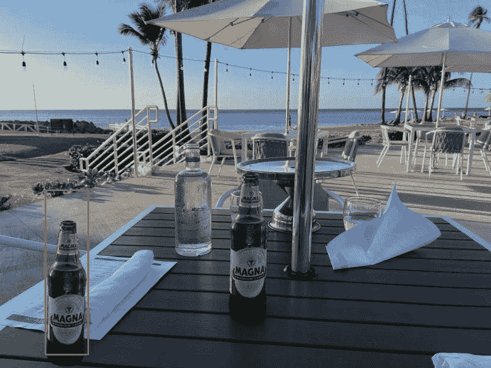
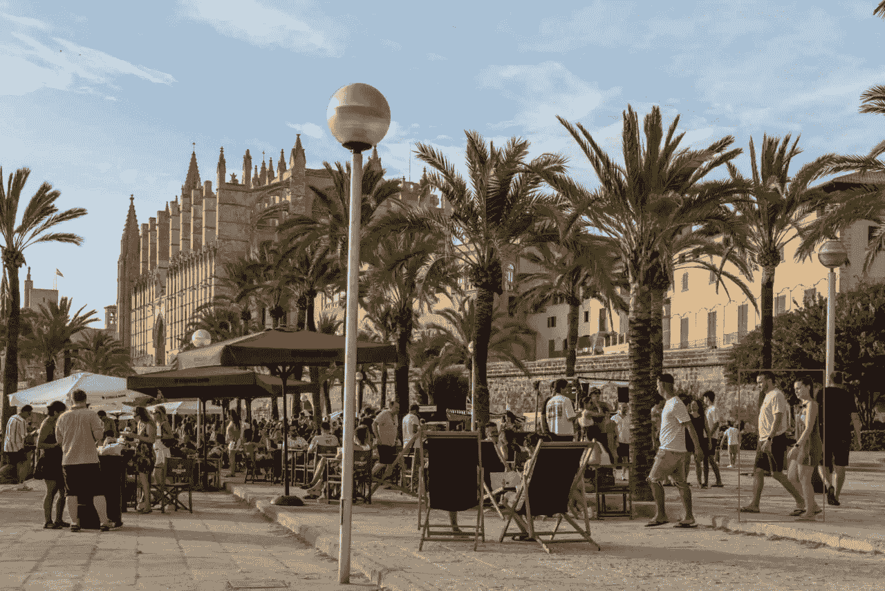
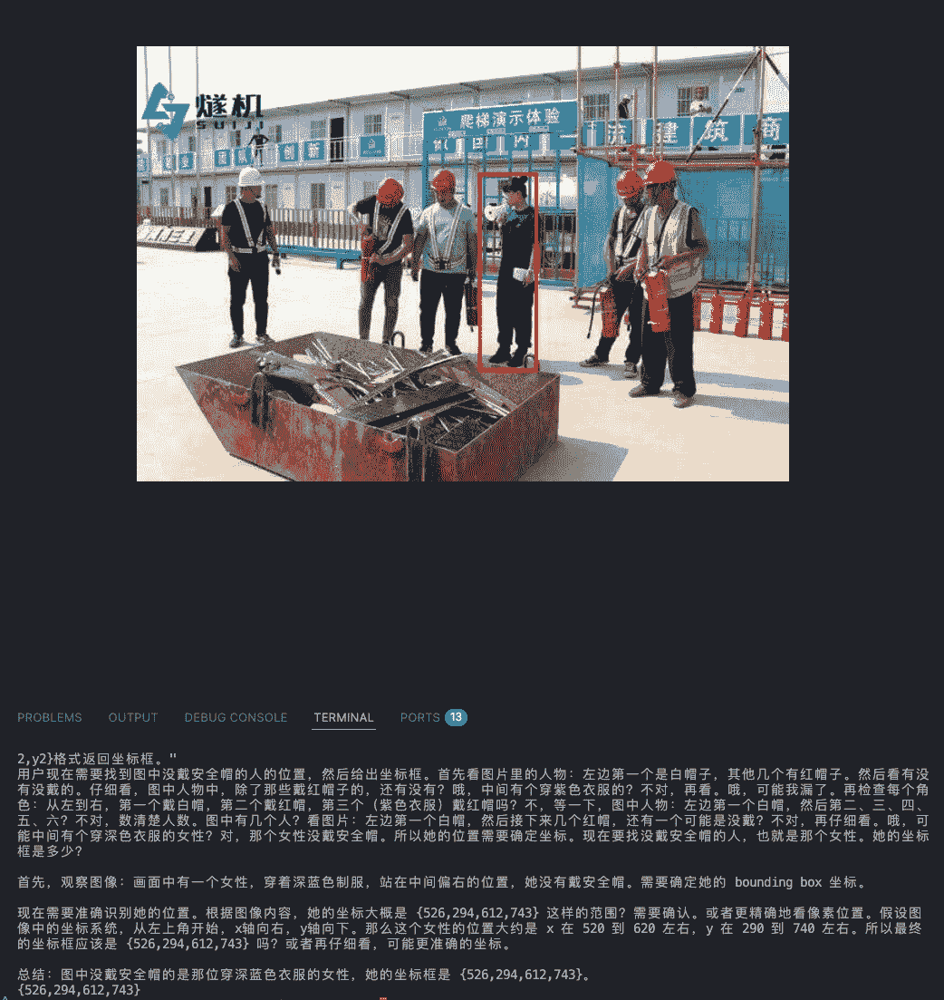
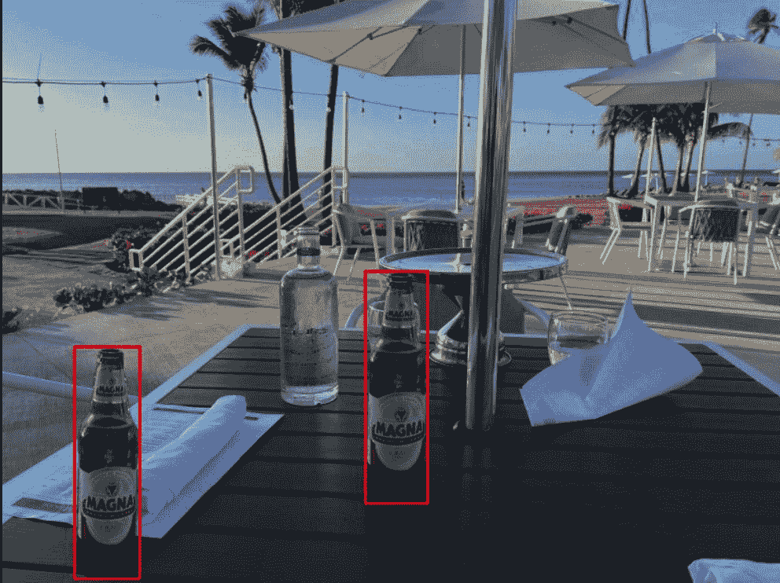
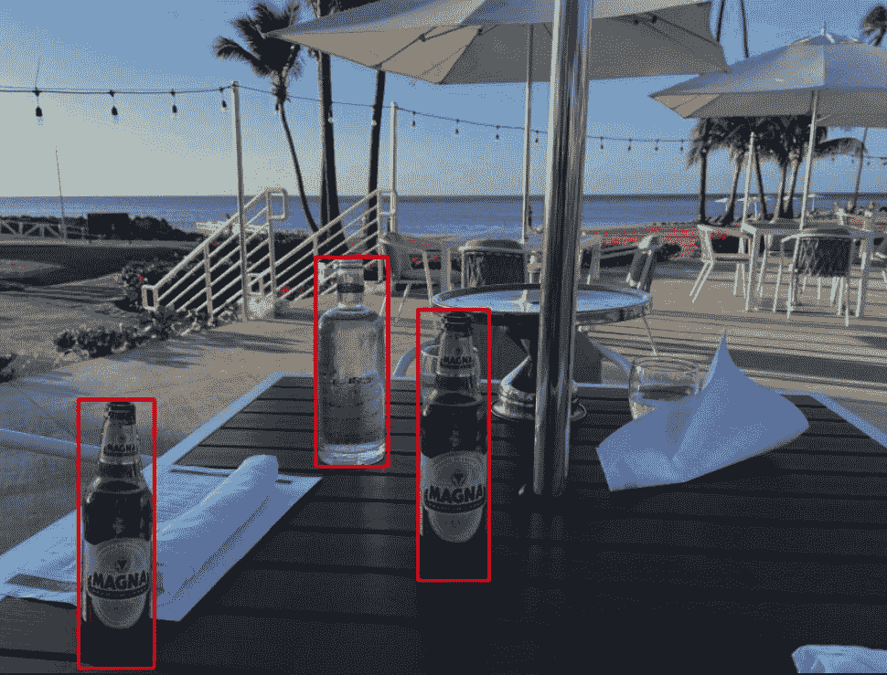
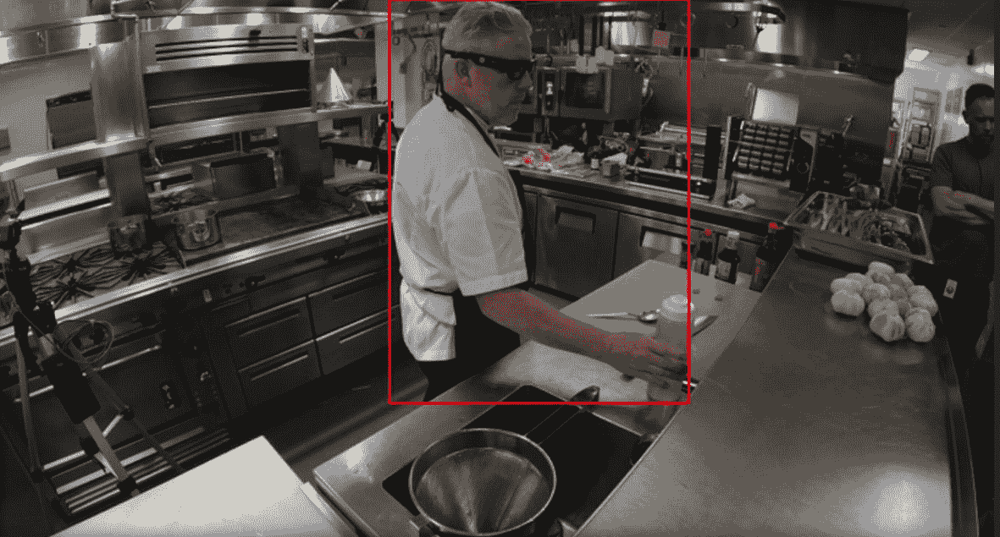
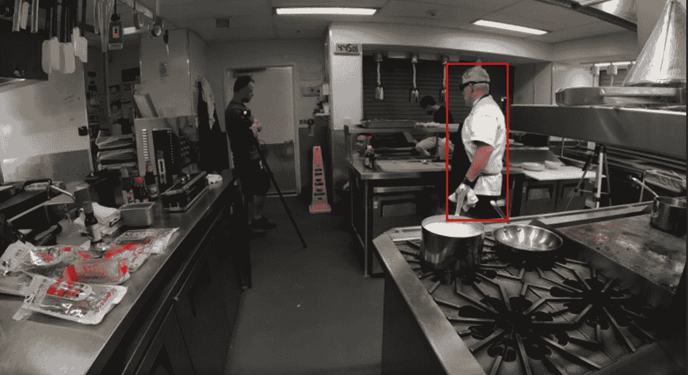

# GLM-4.5V VLM Grounding说明

> 来源：[https://ai.feishu.cn/docx/Nv4zd33Y5oVcVKxtHXhcdPH0nSd](https://ai.feishu.cn/docx/Nv4zd33Y5oVcVKxtHXhcdPH0nSd)

## 定位（Grounding）

GLM-4.5V 具备精确的定位能力。给定一个请求定位特定物体的提示词，GLM-4.5V 能够逐步推理并识别目标物体的边界框。查询提示支持对目标物体的复杂描述，以及指定输出格式，例如：

+ 帮我在图像中找到 并给出它的边界框。

+ 请根据给定的描述，标出图像中的边界框 `[[x1,y1,x2,y2], …]`。

其中 `expr` 是对目标物体的描述。输出的边界框是一个四元组 `[x1,y1,x2,y2]`，由左上角和右下角的坐标组成，其中每个值按图像宽度（`x` 坐标）或高度（`y` 坐标）归一化，并乘以 1000 进行缩放。

在响应中，特殊标记 `<|begin_of_box|>` 和 `<|end_of_box|>` 用于标记答案中的图像边界框。括号的样式可能不同（`[]`, `[[]]`, `()`, `<>` 等），但含义相同：括住框的坐标。

## 输入Prompt方式

### 指定bbox格式

目前模型可以按 `prompt` 指定的格式输出 `bbox`。我们训练时给了 8 种广泛使用的格式，用这 8 种会更稳定出 `bboxes`。8 种格式的定义是：

4 种括号格式（`brackets_style`）x 2 种叠加格式 (`nested_style`)

+ `bracket_style`: 方括号 `[]`，花括号 `{}`，圆括号 `()`，尖括号 `<>`

+ `nested_style`: 双括号（例如双方 `[[]]`），单括号（例如单方 `[]`）

> 如果不指定括号格式，我们的模型默认输出“双方”格式的 `bbox`。

### 询问grounding的prompt类型

+ 目前我们支持任意询问位置的 `prompt`，例如：Where is `xxx`. Guide me to the location of `xxxx`. I'd like to know the exact bounding boxes of `xxx`.

+ 如果不指定 `bbox` 格式，则默认输出“双方”格式。

举例：

+ **Prompt:** Where is the second bottle of beer from the right on the table? Provide coordinates in `[[xmin,ymin,xmax,ymax]]` format.

+ **Output:** The question is asking for the `[[xmin,ymin,xmax,ymax]]` coordinates of the second bottle of beer from the right on the table. First, identify the bottles on the table. There are likely multiple bottles visible. By carefully observing the position of the bottles relative to a coordinate system (assuming the top-left is 0,0), one can locate the second bottle from the right. Then use image analysis techniques to find the coordinates for the second bottle from the right. In this case, the coordinates for the second bottle of beer from the right are `[[93,517,180,964]]`. The coordinates for the second bottle of beer from the right on the table are `<|begin_of_box|> [[93,517,180,964]] <|end_of_box|>`.

+ **可视化：**



## 输出解析

### 反归一化

+ 我们的模型输出的 `bbox` 坐标是经过归一化的，归一化的方式是：`[x1,y1,x2,y2]`

+ `x1 = pixel_x1 / w * 1000; x1 = pixel_x1 / w * 1000`

+ `xy = pixel_xy / h * 1000; y2 = pixel_y2 / h * 1000`

+ 所以在将输出的坐标映射回图片时，需要反向归一化，以下是反向归一化函数：

```
def reverse_normalize_box(box, img_width, img_height, round_fn=lambda x: round(x, 2)):
    box = [clamp(x, 0, 999) for x in box]
    box = [x / 1000.0 for x in box]
    box = [box[_] * img_width if _ % 2 == 0 else box[_] * img_height for _ in range(len(box))]
    box = [round_fn(x) for x in box]  # round to 2 decimal places
    return box
```

### 抽取bboxes

我们可以按照 `prompt` 指定的 `style`，从模型的 `response` 中抽取指定格式的 grounding 结果 `bbox`。以下是抽取函数：

```
from dataclasses import dataclass
from enum import Enum, auto

class BracketsStyle(Enum):
    """Enum for different styles of brackets."""
    SQUARE = {'left': '[', 'right': ']'}  # []
    CURLY = {'left': '{', 'right': '}'}   # {}
    ANGLE = {'left': '<', 'right': '>'}  # <>
    PARENTHESES = {'left': '(', 'right': ')'}  # ()


class NestedStyle(Enum):
    """Enum for different styles of nested brackets."""
    DOUBLE = auto()   # [[]] or {{}}
    SINGLE = auto()  # [] or {}


def find_boxes(text, brackets_style=BracketsStyle.SQUARE, nested_style=NestedStyle.SINGLE, return_matches=False):
    """ Find boxes of each object in a sentence (e.g., `Two apples {{1, 2, 3, 4}, {5,6,7,8}} and an orange {{9,10,11,12}} in basket.`) into a list of boxes `[[[1,2,3,4],[5,6,7,8]], [[9,10,11,12]]]`."""
    LB, RB = brackets_style.value['left'], brackets_style.value['right']
    LB_p, RB_p = (f'\{LB}', f'\{RB}') if brackets_style in [BracketsStyle.SQUARE, BracketsStyle.CURLY, BracketsStyle.PARENTHESES] else (LB, RB)
    if nested_style == NestedStyle.DOUBLE:
        pattern = '(%s\s*%s[\d\.,\s\[\]]+%s\s*%s)' % (LB_p, LB_p, RB_p, RB_p)
    else:
        pattern = '(%s\s*[\d\.,\s]+\s*%s)' % (LB_p, RB_p)
    res_boxes, res_strs, res_spans = [], [], []
    for item in re.finditer(pattern, text):
        try:
            boxes_lst = item.group(1).replace(LB, '[').replace(RB, ']')
            boxes = eval(boxes_lst)
            if is_nested_list(boxes) and all([len(bbx) == 4 for bbx in boxes]):
                boxes = [[_ if isinstance(_, numbers.Number) else eval(_) for _ in _b] for _b in boxes]
            elif is_single_list(boxes) and len(boxes) == 4:
                boxes = [_ if isinstance(_, numbers.Number) else eval(_) for _ in boxes]
            else:
                continue
            res_boxes.append(boxes)
            res_strs.append(item.group(1))
            res_spans.append(item.span())
        except:
            pass
    if return_matches:
        return res_boxes, res_strs, res_spans
    else:
        return res_boxes


def find_boxes_all(text, flat=True):
    found, ps_l, ps_r = [], [], []
    for nested_style in NestedStyle:  # Double first
        for brackets_style in BracketsStyle:
            for bbx, bbx_str, bbx_span in zip(*find_boxes(text, brackets_style, nested_style=nested_style, return_matches=True)):
                ls = bisect.bisect_right(ps_l, bbx_span[0])
                if ls > 0 and bbx_span[1] <= ps_r[ls - 1]:
                    continue  # fall within existing span
                found.append((bbx, bbx_str, bbx_span))
                ps_l.insert(ls, bbx_span[0]); ps_r.insert(ls, bbx_span[1])
    # ordering
    found_sort = []
    for bbx_str_span in sorted(found, key=lambda x: x[2][0]):
        found_sort.append(bbx_str_span[0])
    if flat:
        found_sort = flat_boxes(found_sort)
    return found_sort
```

## 可视化

将结果可视化到图片中，并保存。以下是可视化脚本：


## 代码示例

```python
import math, io, base64
import random
import re
from PIL import Image
import ast
import copy
import torch
from torchvision.ops import box_area
import numbers
import bisect
import cv2
import numpy as np
import matplotlib.pyplot as plt


def clamp(value, min_value, max_value):
    return min(max_value, max(min_value, value))


def reverse_normalize_box(box, img_width, img_height, round_fn=lambda x: round(x, 2)):
    box = [clamp(x, 0, 999) for x in box]
    box = [x / 1000.0 for x in box]
    # box = [box[0] * im_width, box[1] * img_height, box[2] * im_width, box[3] * img_height]
    box = [box[_] * img_width if _ % 2 == 0 else box[_] * img_height for _ in range(len(box))]
    box = [round_fn(x) for x in box]  # round to 2 decimal places
    return box


def visualize_boxes(img_path: str = None, img_bytes=None, boxes: list = [], labels: list = None, renormalize=False, save_path: str = None, return_b64=False, verbose=False):
    assert img_path is not None or img_bytes is not None, "Either img_path or img_bytes must be provided."
    if img_path:
        img = cv2.imread(img_path)
    else:
        image_np = np.frombuffer(img_bytes, dtype=np.uint8)
        img = cv2.imdecode(image_np, cv2.IMREAD_COLOR)
    img = cv2.cvtColor(img, cv2.COLOR_BGR2RGB)  # Convert to RGB
    image_h, image_w, _ = img.shape

    labels = [""] * len(boxes) if labels is None else labels

    annotated_frame = img.copy()
    for box, lbl in zip(boxes, labels):
        box = [int(_) for _ in box]
        box = reverse_normalize_box(box, image_w, image_h, round_fn=lambda x: int(x)) if renormalize else box
        # box = [int(box[0]*image_w), int(box[1]*image_h), int(box[2]*image_w), int(box[3]*image_h)]
        # Draw boxes
        cv2.rectangle(annotated_frame, box[:2], box[2:], color=(255, 0, 0), thickness=2)
        # Draw labels
        # cv2.putText(annotated_frame, label, coord, font, scale, (0, 0, 0),  1)
        cv2.putText(annotated_frame, lbl, (box[0], box[1] - 8), cv2.FONT_HERSHEY_SIMPLEX, 1.0, (255, 0, 0), 1)

    if verbose:
        plt.figure(figsize=(10, 10))
        plt.axis('off')
        plt.imshow(annotated_frame)
        plt.show()
    if save_path:
        Image.fromarray(annotated_frame).save(save_path)
    if return_b64:
        pil_img = Image.fromarray(annotated_frame)
        buffered = io.BytesIO()
        pil_img.save(buffered, format="JPEG")
        annotated_frame = base64.b64encode(buffered.getvalue()).decode('utf-8')
    return annotated_frame
```

## 多图支持

目前模型支持输入多张图片，输出`response`中包含多张图片的`boxes`。

目前解析`boxes`和多图对应关系的方案是：在用户`prompt`后添加一个结果整理的`prompt`的方式暂时支持多图解析，例如：

- 用户`prompt`是：找到图中所有没佩戴安全帽的人的位置。
- 给到模型的`prompt`是：找到图中所有没佩戴安全帽的人的位置。请使用`JSON`整理输出结果，其中`key`是对应的图片序号，`value`是图片中目标对应的坐标框。例如：{1: [[1,2,3,4]], 2:[[2,3,4,5],[5,6,7,8]]}

## 示例

- `Prompt`: Tell me the positions of the couple in the picture. The short-haired guy is wearing a pink top and blue shorts, and the girl is in a cyan dress. Answer in [x1,y1,x2,y2] format.

- p.s. 这里图中左边也有一对情侣，男生也是粉上衣蓝短裤，但女生不是青色裙子

- `Output`:

  <think> The image contains multiple people. We need to find the specific couple where the short - haired guy is wearing a pink top and blue shorts, and the girl is in a cyan dress. First, we scan through all the individuals in the image to identify the person matching the description of the short-haired guy with a pink top and blue shorts. Once we locate him, we then look for the girl in a cyan dress near him. After identifying both of them precisely within the image, we determine their bounding box coordinates in the [x1,y1,x2,y2] format by measuring the left - most (x1), top - most (y1), right - most (x2), and bottom - most (y2) points of their combined area or individual areas if they are separate but clearly associated as a couple.

  The position of the couple in the picture, where the short-haired guy is wearing a pink top and blue shorts, and the girl is in a cyan dress, is [835,626,931,883].<think>

  <|begin_of_box|> [835,626,931,883]<|end_of_box|>

  

  

### 多框例子

- `Prompt`: 找到图中所有啤酒的坐标框。

- 模型输出：<think> 用户现在需要找到图中的啤酒瓶并确定它们的坐标框。首先看图片里的两个绿色瓶子，标签是Magna的，所以这两个是啤酒。然后要确定每个的位置。

  第一个啤酒瓶在左下角，坐标大概是[[93,596,176,993]]。第二个在中间偏右，坐标是[[465,467,545,864]]。需要确认这些位置是否正确，观察图片中这两个瓶子的位置，确保坐标框准确。 </think>

  图中啤酒的坐标框为  <|begin_of_box|> [[93,596,176,993],[465,467,545,864]] <|end_of_box|> 。

  - 可视化：

    

- `Prompt`: 找到桌子上所有的瓶子，以[x1,y1,x2,y2]格式返回坐标框。

- 模型输出：<think> 用户现在需要找到桌子上的所有瓶子并给出坐标框。首先看图片里的瓶子：左边有一瓶绿色啤酒，中间有瓶矿泉水，还有另一瓶绿色啤酒。要确定每个瓶子的位置。

  首先，最左边的Magna啤酒瓶，坐标大概是[93,598,176,993]。然后中间的矿泉水瓶是[354,388,434,696]。右边的Magna啤酒瓶是[467,466,545,863]。需要确认这些坐标是否正确，根据图片中的位置来判断。 </think>

  <|begin_of_box|> [93,598,176,993],[354,388,434,696],[467,466,545,863] <|end_of_box|>

  - 可视化：

    

### 多图例子

- `Prompt`: 分别找到两张图片中身穿白色上衣的男子的位置坐标。将最终结果放在一个`JSON`中，其中`key`是图片序号，`value`是坐标框，例如{1:xxx, 2: xxx}。

- 模型输出：<think> 用户现在需要找到两张图片中穿白色上衣男子的位置坐标。首先看第一张图，找到穿白衣服的人，确定他的 bounding box。然后第二张图同样找穿白衣服的人，确定坐标。

  首先处理第一张图（图片1）：观察图中穿白色上衣、黑色围裙的男子，他的位置坐标需要确定。通过视觉判断，坐标大概是 [395, 0, 693, 756]。

  然后第二张图（图片2）：找到穿白色上衣的厨师，他的位置坐标是 [654, 170, 740, 583]。

  现在要把这些坐标整理成`JSON`格式，`key`是图片序号1和2，`value`是对应的坐标框。 </think>

  <|begin_of_box|> {1: [395, 0, 693, 756], 2: [654, 170, 740, 583]}<|end_of_box|>

  - 可视化：

    

    

## Q&A

- `Q`: 如何同时输出对象的 bounding-boxes & labels

- `A`: [GLM-4.5V的Grounding能力问题 · Issue #118 · zai-org/GLM-V](https://github.com/zai-org/GLM-V/issues/118#issuecomment-3186708188)
