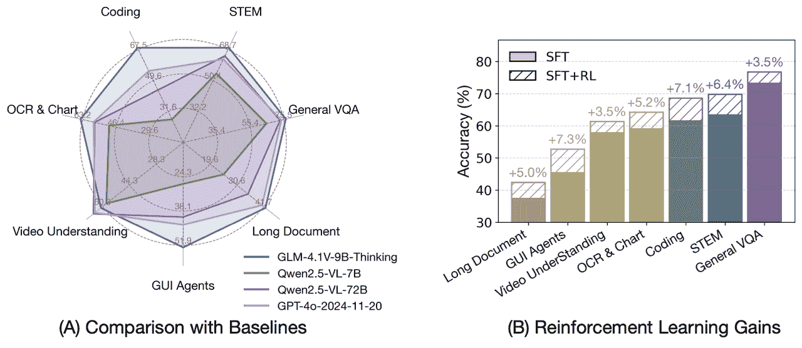
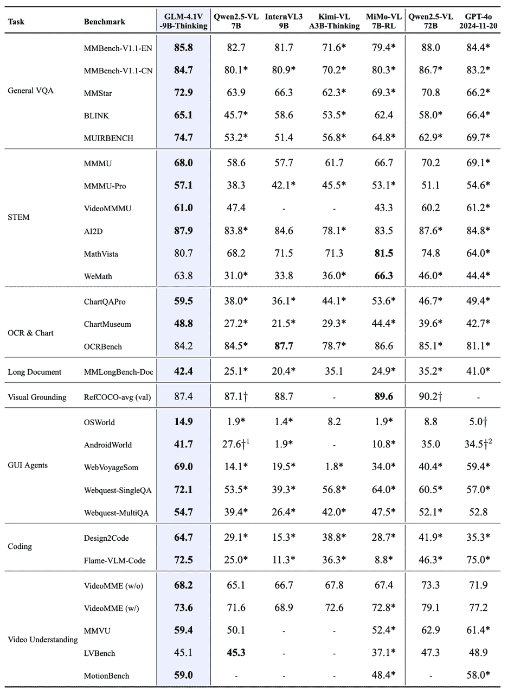

# GLM-4.1V-9B-Thinking 技术文档

> 来源：[https://ai.feishu.cn/docx/IGTLd7VU0oGGqpxfyrZcX1M4nhc](https://ai.feishu.cn/docx/IGTLd7VU0oGGqpxfyrZcX1M4nhc)

+   作者：智谱 GLM-V 团队

+   Github 官方仓库：https://github.com/zai-org/GLM-V

## 模型介绍

视觉语言大模型（VLM）已经成为智能系统的关键基石。随着真实世界的智能任务越来越复杂，VLM模型也亟需在基本的多模态感知之外， 逐渐增强复杂任务中的推理能力，提升自身的准确性、全面性和智能化程度，使得复杂问题解决、长上下文理解、多模态智能体等智能任务成为可能。



基于 [GLM-4-9B-0414](https://github.com/THUDM/GLM-4) 基座模型，我们推出新版VLM开源模型 GLM-4.1V-9B-Thinking ，引入思考范式，通过课程采样强化学习 RLCS（Reinforcement Learning with Curriculum Sampling）全面提升模型能力， 达到 10B 参数级别的视觉语言模型的最强性能，在18个榜单任务中持平甚至超过8倍参数量的 Qwen-2.5-VL-72B。 我们同步开源基座模型 GLM-4.1V-9B-Base，希望能够帮助更多研究者探索视觉语言模型的能力边界。

与上一代的 CogVLM2 及 GLM-4V 系列模型相比，GLM-4.1V-Thinking 有如下改进：

1.  系列中首个推理模型，不仅仅停留在数学领域，在多个子领域均达到世界前列的水平。

1.  支持 64k 上下长度。

1.  支持任意长宽比和高达 4k 的图像分辨率。

1.  提供支持中英文双语的开源模型版本。

## 模型信息

### 模型下载地址

### 运行要求

#### 推理

#### 微调

该部分数据使用 [LLaMA-Factory](https://github.com/hiyouga/LLaMA-Factory) 提供的图片微调方案进行测试。

> 使用 Zero2 微调可能出现 Loss 为 0 的情况，建议使用 Zero3 进行微调。

## 榜单信息

GLM-4.1V-9B-Thinking 通过引入「思维链」（Chain-of-Thought）推理机制，在回答准确性、内容丰富度与可解释性方面， 全面超越传统的非推理式视觉模型。在28项评测任务中有23项达到10B级别模型最佳，甚至有18项任务超过8倍参数量的Qwen-2.5-VL-72B。



## 模型推理

模型推理代码均在 inference 文件夹中，包含了:

+   trans_infer_cli.py: 使用transformers库作为推理后端的命令行交互脚本。你可以使用它进行连续对话。

+   trans_infer_gradio.py: 使用transformers库作为推理后段的 Gradio 界面脚本，搭建一个可以直接使用的 Web 界面，支持图片，视频，PDF，PPT等多模态输入。

+   使用vllm直接拉起OpenAI格式的API服务。并在vllm_api_request.py中提供了一个简单的请求示例。

+   vllm serve THUDM/GLM-4.1V-9B-Thinking --limit-mm-per-prompt '{"image":32}'   --allowed-local-media-path /

+   limit-mm-per-prompt若不指定，只支持1张图片。模型支持最多1个视频或300张图片输入，不支持图片和视频同时输入。

+   allowed-local-media-path 需要指定允许访问多模态图片的路径。

+   trans_infer_bench：用于学术复现的推理脚本，支持GLM-4.1V-9B-Thinking模型。其核心在于

+   指定了中断思考的长度，当思考长度超过8192时，强制中断思考并补上</think><answer> 再次发起请求，让模型直接输出答案。该例子中使用的一个视频作为输入的测试的例子。其他情况需自行修改。

+   该方案仅提供 transformers 版本，vLLM版本需要自行根据该逻辑修改方案。

+   vllm_request_gui_agent.py: 该脚本展现了用于 GUI Ag[en](https://github.com/THUDM/GLM-4.1V-Thinking/blob/main/resources/agent_zh.md)t时对于模型返回的处理和构建提示词方案, 包含手机，电脑和网页端的策略，可集成到您的应用框架。GUI Agent详细文档请查看这里

+   [使用](https://gitee.com/ascend/MindSpeed-MM/tree/master/examples/glm4.1v/README.md) Ascend NPU 设备推理，可查看 这里

## 模型微调

[LLaMA-Factory](https://github.com/hiyouga/LLaMA-Factory) 已经支持本模型的微调。以下是构建数据集的说明，这是一个使用了两张图片的数据集。你需要将数据集整理为 finetune.json，具体格式如下：

```
[
  {
    &quot;messages&quot;: [
      {
        &quot;content&quot;: &quot;&lt;image&gt;Who are they?&quot;,
        &quot;role&quot;: &quot;user&quot;
      },
      {
        &quot;content&quot;: &quot;&lt;think&gt;\nUser ask me to observe the image and get the answer. I Know they are Kane and Gretzka from Bayern Munich.&lt;/think&gt;\n&lt;answer&gt;They&#x27;re Kane and Gretzka from Bayern Munich.&lt;/answer&gt;&quot;,
        &quot;role&quot;: &quot;assistant&quot;
      },
      {
        &quot;content&quot;: &quot;&lt;image&gt;What are they doing?&quot;,
        &quot;role&quot;: &quot;user&quot;
      },
      {
        &quot;content&quot;: &quot;&lt;think&gt;\nI need to observe what this people are doing. Oh, They are celebrating on the soccer field.&lt;/think&gt;\n&lt;answer&gt;They are celebrating on the soccer field.&lt;/answer&gt;&quot;,
        &quot;role&quot;: &quot;assistant&quot;
      }
    ],
    &quot;images&quot;: [
      &quot;mllm_demo_data/1.jpg&quot;,
      &quot;mllm_demo_data/2.jpg&quot;
    ]
  }
]
```

<think> XXX </think> 中的部分不会被存放为历史记录和微调。

1.  <image> 标签会被替换成图片信息。

接着，即可按照 LLaMA-Factory 的微调方式进行微调。

## GUI Agent

[GLM-4.1V-9B-Thinking GUI Agent 说明](https://zhipu-ai.feishu.cn/wiki/K4UqwKUfSiyKRzkmqt1cBnOInsg)