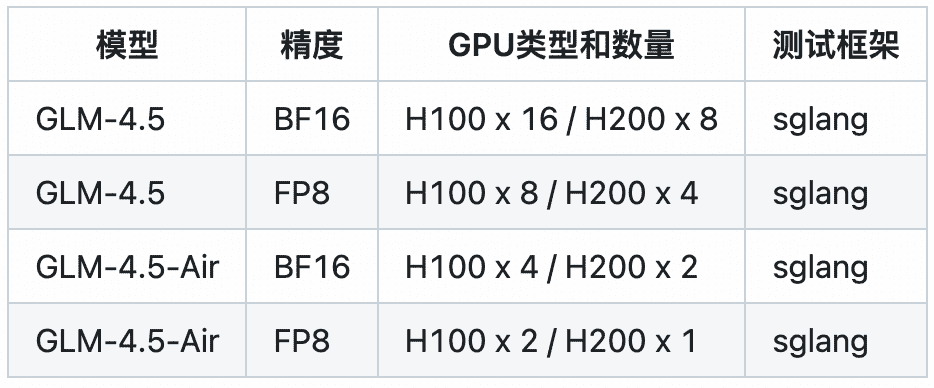
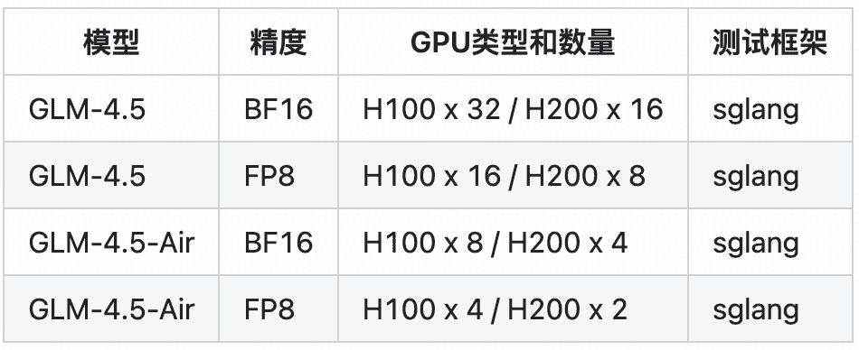
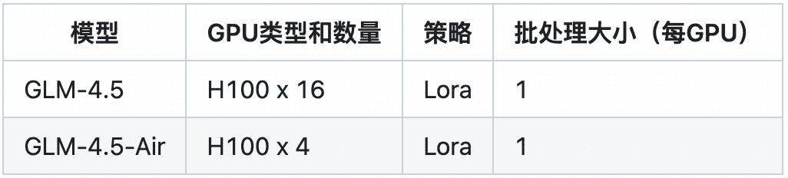
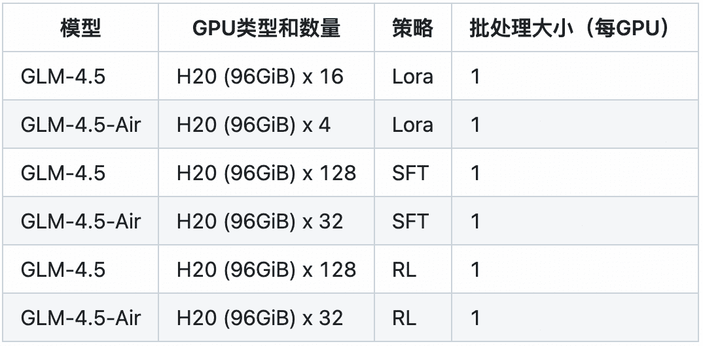

# 本地部署

> 来源：[https://ai.feishu.cn/docx/Rlx5dZ81NoBhqbxInUPclii9nxe](https://ai.feishu.cn/docx/Rlx5dZ81NoBhqbxInUPclii9nxe)

## 模型下载

你可以在 [Hugging Face](https://huggingface.co/spaces/zai-org/GLM-4.5-Space) 或 [ModelScope](https://modelscope.cn/studios/ZhipuAI/GLM-4.5-Demo) 上直接体验模型，也可以按照下面的链接下载模型。

## 系统要求

### 推理

我们提供了"全功能"模型推理的最低和推荐配置。下表中的数据基于以下条件：

1.  所有模型都使用MTP层，并指定--speculative-num-steps 3 --speculative-eagle-topk 1 --speculative-num-draft-tokens 4 以确保具有竞争力的推理速度。

1.  不使用 cpu-offload 参数。

1.  推理批处理大小不超过 8。

1.  所有操作都在原生支持FP8推理的设备上执行，确保权重和缓存都采用FP8格式。

1.  服务器内存必须超过 1T 以确保正常的模型加载和运行。

模型可在下图配置下运行：



在下图配置下，模型可以充分利用其128K上下文长度：



### 微调

使用 [Llama Factory](https://github.com/hiyouga/LLaMA-Factory) 框架，代码可在下图配置下运行：



使用 [Swift](https://github.com/modelscope/ms-swift) 框架，代码可在下图配置下运行：



## 快速开始

请根据requirements.txt安装所需的包。

```
pip install -r requirements.txt
```

### transformers

请参考 inference 文件夹中的 trans_infer_cli.py 代码。

### vLLM

+   BF16和FP8都可以用以下代码启动：

```
vllm serve zai-org/GLM-4.5-Air \
    --tensor-parallel-size 8 \
    --tool-call-parser glm45 \
    --reasoning-parser glm45 \
    --enable-auto-tool-choice \
    --served-model-name glm-4.5-air
```

如果您使用8x H100 GPU并且在运行GLM-4.5模型时遇到内存不足的问题，您需要使用--cpu-offload-gb 16（仅适用于vLLM）。

如果遇到flash infer问题，请使用VLLM_ATTENTION_BACKEND=XFORMERS作为临时替代方案。您也可以指定 TORCH_CUDA_ARCH_LIST='9.0+PTX'来使用flash infer（不同GPU有不同的TORCH_CUDA_ARCH_LIST值，请相应检查）。

### SGLang

+   BF16

```
python3 -m sglang.launch_server \
  --model-path zai-org/GLM-4.5-Air \
  --tp-size 8 \
  --tool-call-parser glm45  \
  --reasoning-parser glm45 \
  --speculative-algorithm EAGLE \
  --speculative-num-steps 3 \
  --speculative-eagle-topk 1 \
  --speculative-num-draft-tokens 4 \
  --mem-fraction-static 0.7 \
  --served-model-name glm-4.5-air \
  --host 0.0.0.0 \
  --port 8000
```

+   FP8

```
python3 -m sglang.launch_server \
 --model-path zai-org/GLM-4.5-Air-FP8 \
  --tp-size 4 \
  --tool-call-parser glm45  \
  --reasoning-parser glm45  \
  --speculative-algorithm EAGLE \
  --speculative-num-steps 3  \
  --speculative-eagle-topk 1  \
  --speculative-num-draft-tokens 4 \
  --mem-fraction-static 0.7 \
  --disable-shared-experts-fusion \
  --served-model-name glm-4.5-air-fp8 \
  --host 0.0.0.0 \
  --port 8000
```

### 请求参数说明

+   使用vLLM和SGLang时，发送请求时默认启用思考模式。如果要禁用思考开关，需要添加 extra_body={"chat_template_kwargs": {"enable_thinking": False}}参数。

+   两者都支持工具调用。请使用OpenAI风格的工具描述格式进行调用。

+   具体代码请参考inference文件夹中的api_request.py。

## 多机多卡

GLM-4.5系列模型可利用 vLLM 框架实现多机多卡部署。若有 N 台机器参与分布式训练，则需在主节点（head node）和所有从节点（worker nodes）分别启动 Ray 服务。

+   主节点启动命令如下：

```
TORCH_CUDA_ARCH_LIST=&quot;9.0+PTX&quot; ray start --block --head --port=6379
```

+   从节点启动命令如下：

```
TORCH_CUDA_ARCH_LIST=&quot;9.0+PTX&quot; ray start --block --address=${HEAD_NODE_ADDRESS}:6379
```

其中，HEAD_NODE_ADDRESS 需替换为实际主节点的 IP 地址，用于确保各从节点正确连接到 head 节点。

---

通过上述流程配置后，可以实现 vLLM 的分布式并行计算，共享多机多卡资源，提升推理/训练效率。