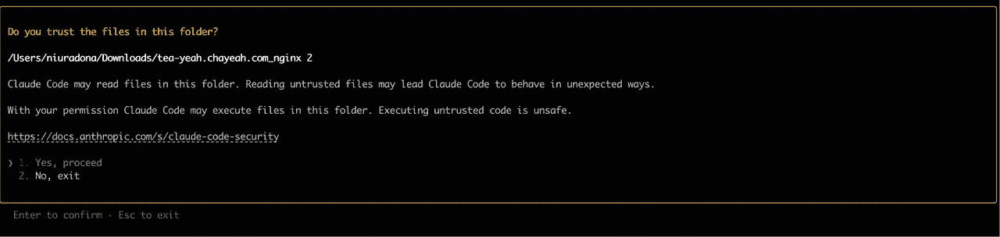
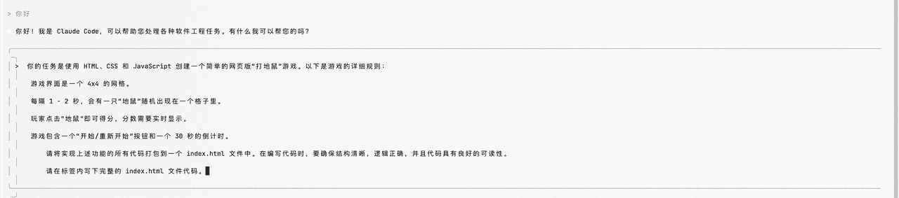
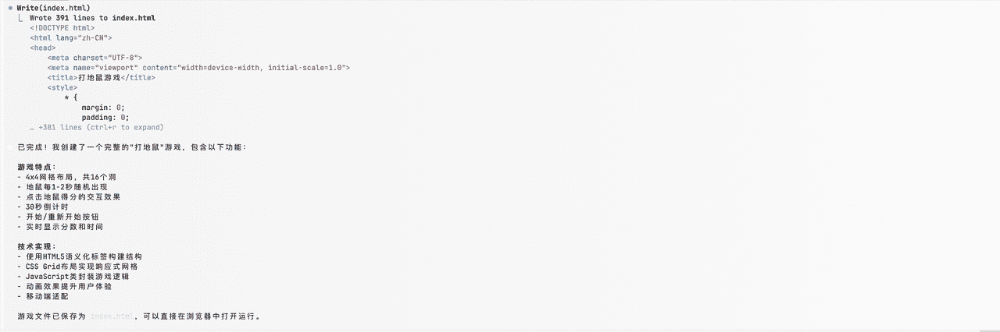
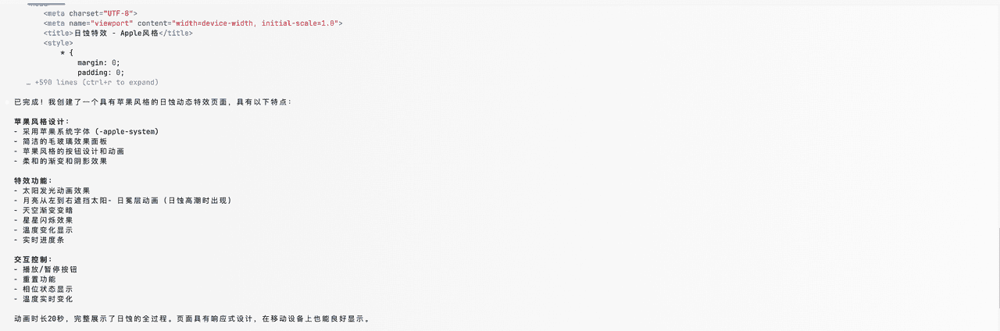
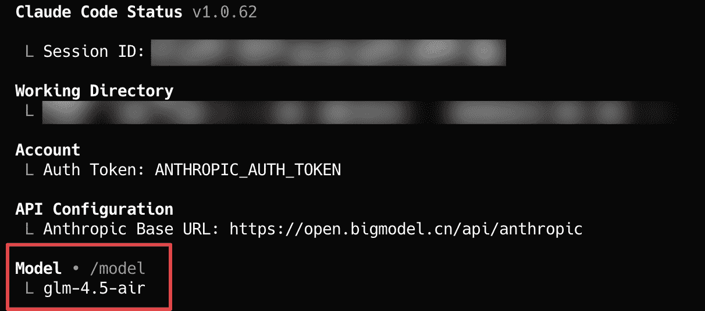

# 使用开源的 GLM-4.5 模型接入 Claude Code

> 来源：[https://ai.feishu.cn/docx/KTWMdS3hworyRpxDPJacdwGCnyo](https://ai.feishu.cn/docx/KTWMdS3hworyRpxDPJacdwGCnyo)

> 智谱提供以下两种接入方式，分别是开源模型的自行部署接入和使用 BigModel API接入。

## 基于 BigModel 的 Anthropic 接口：

### 前往获取智谱 API key

[前](https://open.bigmodel.cn/usercenter/proj-mgmt/apikeys)往智谱 Bigmodel 开放平台，获取你的 API key https://open.bigmodel.cn/usercenter/proj-mgmt/apikeys

##

### 配置环境变量

完成 Claude code 安装后，有以下 2 种方式设置环境变量

方式一：使用脚本（首次使用推荐）

```
curl -O &quot;http://bigmodel-us3-prod-marketplace.cn-wlcb.ufileos.com/1753683727739-0b3a4f6e84284f1b9afa951ab7873c29.sh?ufileattname=claude_code_prod.sh&quot;
```

**方式二：手动配置**

```
export ANTHROPIC_BASE_URL=https://open.bigmodel.cn/api/anthropic
export ANTHROPIC_AUTH_TOKEN={YOUR_API_KEY} 
```

##

### 快速开始使用 Claude Code

> 如果遇到「Do you want to use this API key」选择 Yes 即可

启动后选择信任 Claude Code 访问文件夹里的文件，如下：



现在就已经正常使用 Claude Code 进行开发了！以下为简单示例：

Case 1：生成一个打地鼠游戏






**Case 2：生成一个日蚀动效**

Prompt：帮我生成日蚀过程的动态特效，尽量采用苹果手机的风格




### 补充说明：如何切换使用的模型

> 默认模型为 GLM-4.5，我们支持用户通过修改 Claude Code 配置文件修改模型为 GLM-4.5-Air，暂不支持至更多模型

1.  配置~/.claude/settings.json, 写入以下内容：

```
{
  &quot;env&quot;: {
      &quot;ANTHROPIC_MODEL&quot;: &quot;glm-4.5-air&quot;
  }
}
```

1.  启动一个新的命令行窗口，运行claude启动Claude Code

1.  在Claude Code中输入/status确认模型状态：



1.  如需切换回GLM-4.5模型，将~/.claude/settings.json改为：

```
{
  &quot;env&quot;: {
      &quot;ANTHROPIC_MODEL&quot;: &quot;glm-4.5&quot;
  }
}
```

## 基于 SGLang + GLM-4.5 模型搭建Claude Code服务：

### 安装

你需要拥有一台本地的电脑设备，这是你的编程设备，和一台服务器用于运行GLM-4.5模型。

### 本地设备

确保您已安装 [Claude Code](https://github.com/anthropics/claude-code) 和 Claude Code Router。

```
npm install -g @anthropic-ai/claude-code
npm install -g @musistudio/claude-code-router
```

### 服务器

确保你再服务器上已安装sglang。

```
pip install sglang
```

并使用如下命令启动模型服务:

```
python3 -m sglang.launch_server \
  --model-path zai-org/GLM-4.5 \
  --tp-size 16 \
  --tool-call-parser glm45  \
  --reasoning-parser glm45 \
  --speculative-algorithm EAGLE \
  --speculative-num-steps 3 \
  --speculative-eagle-topk 1 \
  --speculative-num-draft-tokens 4 \
  --mem-fraction-static 0.7 \
  --served-model-name glm-4.5 \
  --port 8000 \
  --host 0.0.0.0 # 或者你服务器的内网/公网IP地址
```

运行成功时， 你将会看到类似如下输出:

```
[2025-07-26 16:09:07] INFO:     Started server process [80269]
[2025-07-26 16:09:07] INFO:     Waiting for application startup.
[2025-07-26 16:09:07] INFO:     Application startup complete.
[2025-07-26 16:09:07] INFO:     Uvicorn running on http://0.0.0.0:8000 (Press CTRL+C to quit)
[2025-07-26 16:09:08] INFO:     127.0.0.1:57722 - &quot;GET /get_model_info HTTP/1.1&quot; 200 OK
[2025-07-26 16:09:08 TP0] Prefill batch. #new-seq: 1, #new-token: 6, #cached-token: 0, token usage: 0.00, #running-req: 0, #queue-req: 0, 
[2025-07-26 16:09:11] INFO:     127.0.0.1:57732 - &quot;POST /generate HTTP/1.1&quot; 200 OK
[2025-07-26 16:09:11] The server is fired up and ready to roll!
```

请确保你的服务器的IP能被你 Claude Code 和 Claude Code Router 安装的设备上访问。

### 配置

1.  将 config.example.json 中的 api_base_url 修改为服务器的可访问地址。

1.  重命名为 config.json

1.  复制到 ~/.claude-code-router/config.json 中。

1.  再命令行执行ccr restart 命令。得到如下输出

```
Service was not running or failed to stop.
Starting claude code router service...
✅ Service started successfully in the background.
```

### 运行

执行以下命令:

```
ccr code
```

即可正常运行，效果如下:

```
zr@MacBook GLM-4.5 % ccr code
Service not running, starting service...
╭───────────────────────────────────────────────────╮
│ ✻ Welcome to Claude Code!                         │
│                                                   │
│   /help for help, /status for your current setup  │
│                                                   │
│   cwd: /Users/zr/Code/GLM-4.5                     │
│                                                   │
│   ─────────────────────────────────────────────── │
│                                                   │
│   Overrides (via env):                            │
│                                                   │
│   • API timeout: 600000ms                         │
│   • API Base URL: http://127.0.0.1:3456           │
╰───────────────────────────────────────────────────╯

 ※ Tip: Press Esc twice to edit your previous messages

&gt; how can I run GLM-4.5 in transformers

⏺ I&#x27;ll help you understand how to run GLM-4.5 in transformers. Let me first explore the codebase to see what&#x27;s available.

⏺ List(.)
  ⎿  Listed 21 paths (ctrl+r to expand)

⏺ Read(README.md)
  ⎿  Read 4 lines (ctrl+r to expand)

⏺ Read(inference/trans_infer_cli.py)
  ⎿  Read 29 lines (ctrl+r to expand)

⏺ Read(requirements.txt)
  ⎿  Read 5 lines (ctrl+r to expand)

⏺ You can run GLM-4.5 in transformers using the example script in inference/trans_infer_cli.py. Here&#x27;s the basic approach:

  from transformers import AutoModelForCausalLM, AutoTokenizer
  import torch

  MODEL_PATH = &quot;zai-org/GLM-4.5&quot;
  tokenizer = AutoTokenizer.from_pretrained(MODEL_PATH)
  model = AutoModelForCausalLM.from_pretrained(
      MODEL_PATH,
      torch_dtype=torch.bfloat16,
      device_map=&quot;auto&quot;
  )

  Then use the tokenizer&#x27;s chat template for inference.

╭───────────────────────────────────────────────────────────────────────────────────────────────────────────────────────────────────────────────────────────────────────────────────────╮
│ &gt;                                                                                                                                                                                     │
╰───────────────────────────────────────────────────────────────────────────────────────────────────────────────────────────────────────────────────────────────────────────────────────╯
  ? for shortcuts
```

## 🏠🛰️交流群

