# BISHENG

> 来源：[https://ai.feishu.cn/docx/RIWPdrSoAogIHYxbgzbcMIXAnte](https://ai.feishu.cn/docx/RIWPdrSoAogIHYxbgzbcMIXAnte)

Gtihub地址：https://github.com/dataelement/bisheng

> **BISH**ENG（毕昇**）是一款主攻 企业级 场**景落地的 开源 大模型应用开发平台。

> 以下过程可以直接在BISHENG Demo环境注册账号直接体验：https://bisheng.dataelem.com/

本章节将带领开发者在 BISHENG 中配置 ChatGLM3-6B 模型 和 Function Call 功能。

# 模型上线

模型文件放到BISHENG的模型仓库路径下，然后访问BISHENG页面，通过导航栏进入“模型”页面即可看到对应模型。

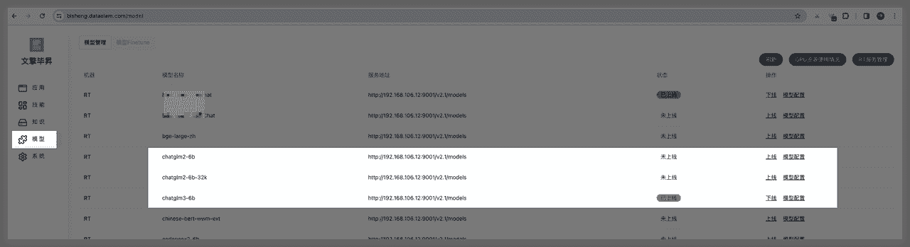

点击【模型配置】按钮，可以配置该模型运行在哪几张GPU卡以及起几个模型实例。具体配置参数建议：

| chatglm2-6b | ``` {   &amp;quot;parameters&amp;quot;: {     &amp;quot;type&amp;quot;: &amp;quot;dataelem.pymodel.huggingface_model&amp;quot;,     &amp;quot;pymodel_type&amp;quot;: &amp;quot;llm.ChatGLM2&amp;quot;,     &amp;quot;gpu_memory&amp;quot;: &amp;quot;15&amp;quot;,     &amp;quot;instance_groups&amp;quot;: &amp;quot;device=gpu;gpus=7&amp;quot;,     &amp;quot;reload&amp;quot;: &amp;quot;1&amp;quot;   } } ``` |
| --- | --- |
| chatglm3 | ``` {   &amp;quot;parameters&amp;quot;: {     &amp;quot;type&amp;quot;: &amp;quot;dataelem.pymodel.huggingface_model&amp;quot;,     &amp;quot;pymodel_type&amp;quot;: &amp;quot;llm.ChatGLM3&amp;quot;,     &amp;quot;gpu_memory&amp;quot;: &amp;quot;15&amp;quot;,     &amp;quot;instance_groups&amp;quot;: &amp;quot;device=gpu;gpus=7&amp;quot;,     &amp;quot;reload&amp;quot;: &amp;quot;1&amp;quot;   } } ``` |

配置完成后，点击【上线】按钮，等待十秒左右完成模型该服务上线。

# 创建技能，应用模型服务

通过导航栏进入“技能”页面，点击【新建】按钮，在弹出的模板列表中选择某个已配置好的模板（或者自己从0开始自定义）。

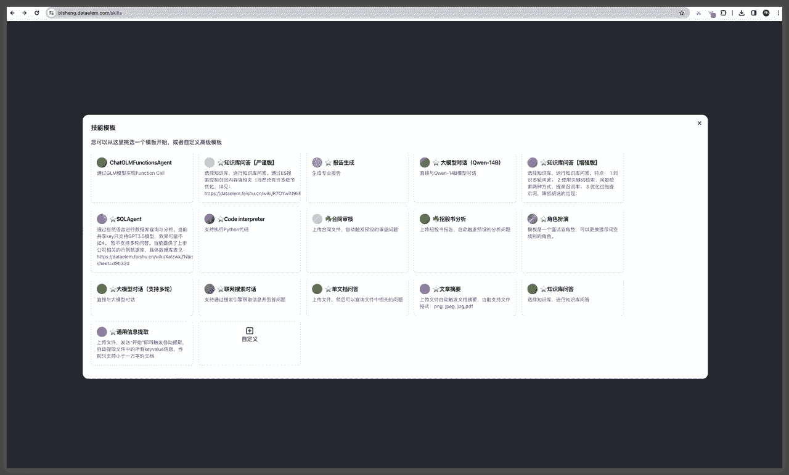

这里我们演示两个场景：一个是是通过模板创建一个使用GLM3-6B运行Function Call的Agent；另一个是通过自定义的方式，来快速构建一个最简单的大模型对话技能；

## 2.1 使用GLM3-6B实现Function Call

在模板列表中选择“ChatGLMFunctionsAgent”模板，进入技能配置页，进行基础信息配置。点击【高级配置】按钮进去“高级配置”页，查看技能详细配置。

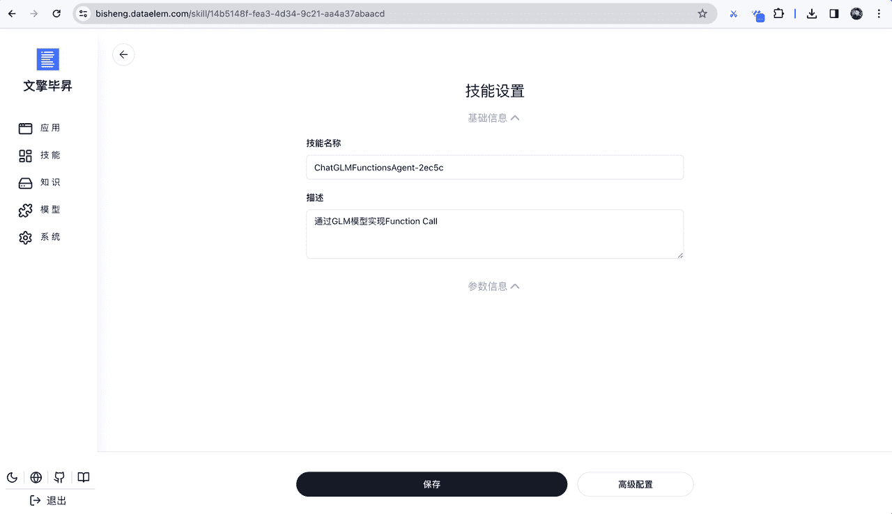

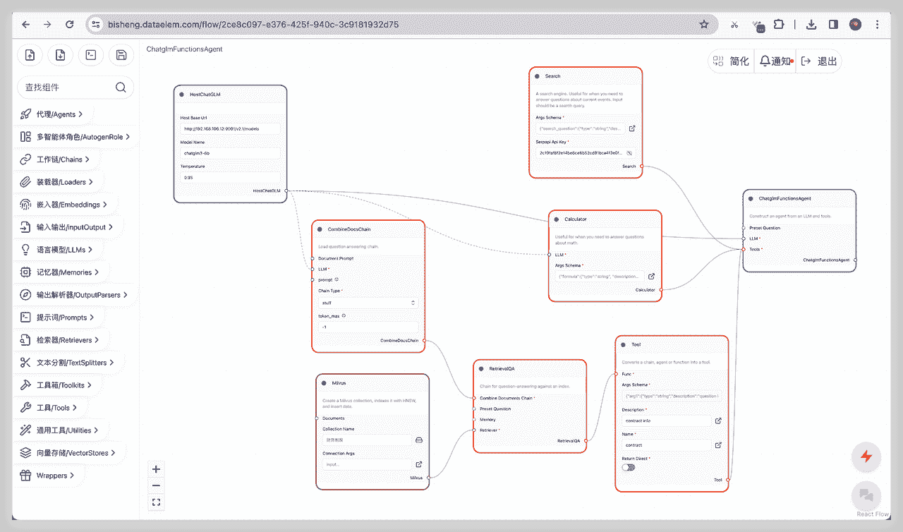

该模板技能中，为ChatGLMFunctionsAgent连接了三个tool：搜索引擎、计算器、知识库。

保持默认配置不用改动，退回到技能列表页，点击【上线】按钮。

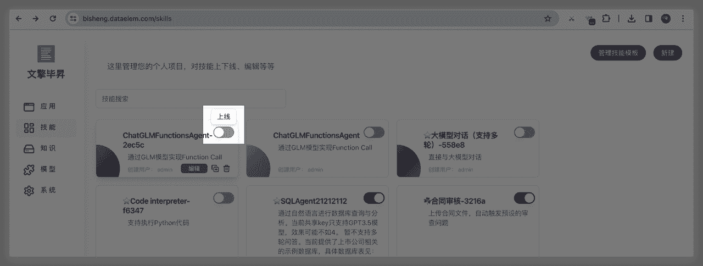

通过导航栏进入“会话”页，点击【新建会话】按钮，选择刚才上线的技能开始正式会话。

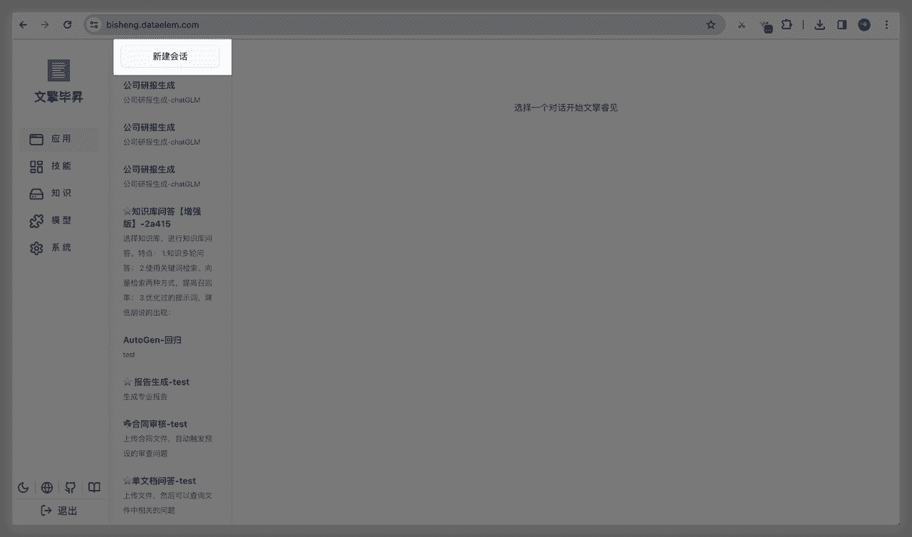

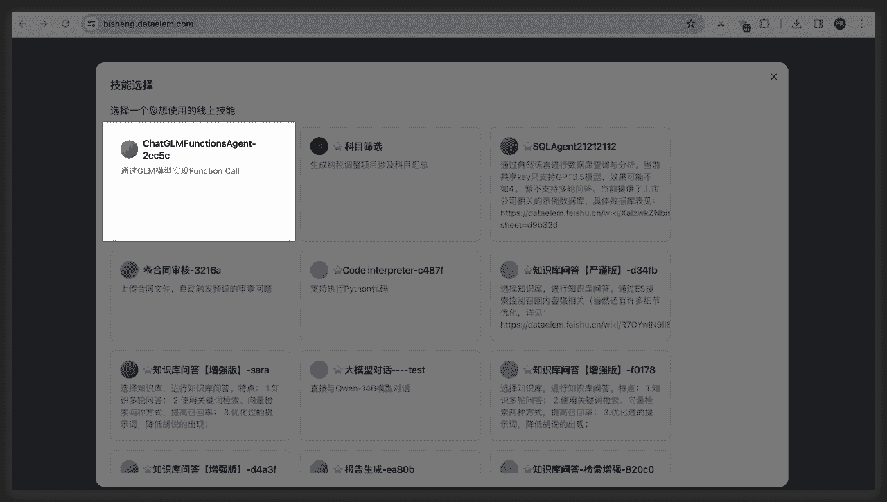

效果示意：

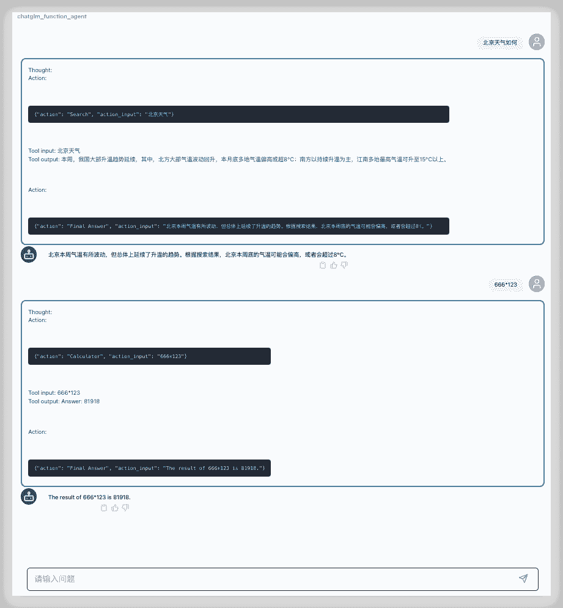

大家还可以为Agent连接更多丰富的tool。

## 2.2简单大模型对话技能

新建技能弹窗中，选择【自定义】，进入“技能设置”页，进行技能基本信息设置，点击【高级配置】按钮，进入“高级配置”页。

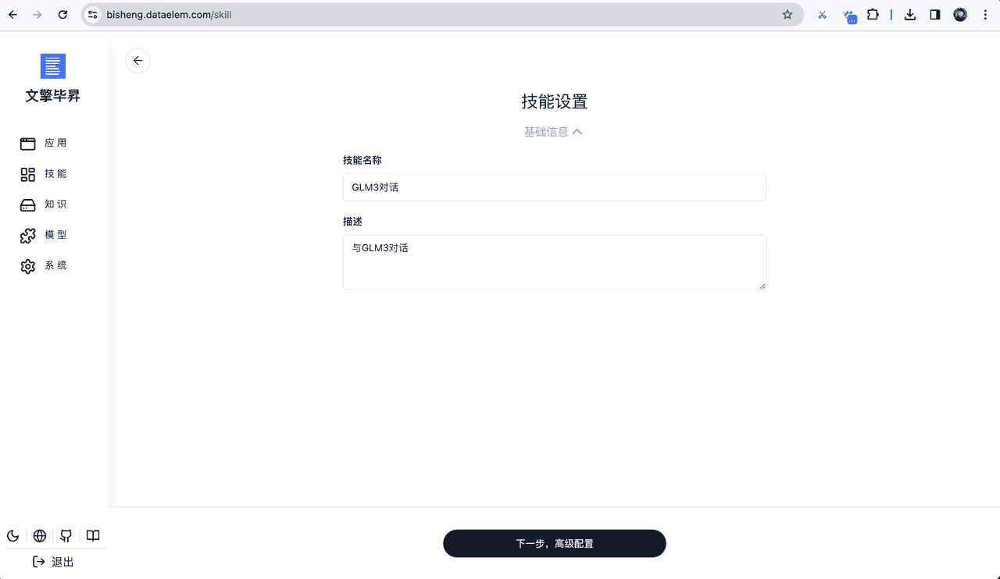

在左侧组件列表中分别选择“HostChatGLM”、“ConversationChain”组件

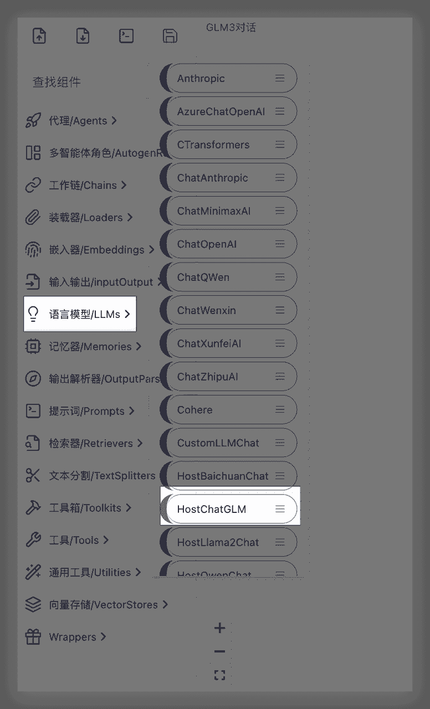

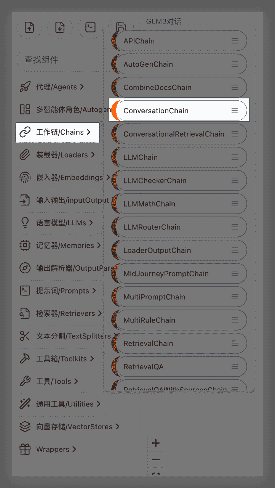

将两个组件连接起来，并填写先前“模型”页面中上线的GLM3-6B模型地址与模型名。10秒钟即完成了简单的大模型对话技能配置。

这次我们不上线技能，直接在高级配置页直接测试效果，我们点击右下角【闪电】按钮，对技能进行校验。

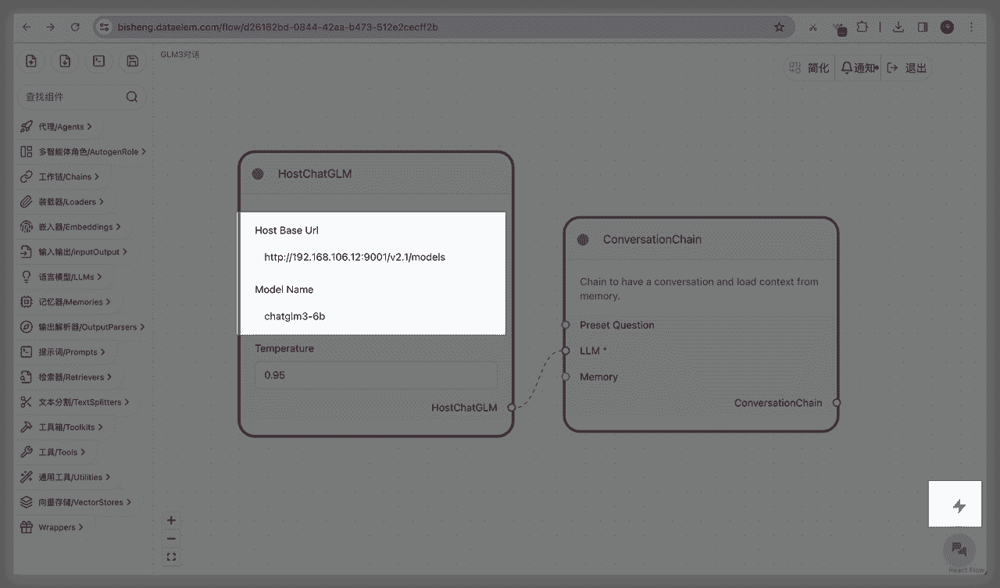

校验无误后，闪电按钮下方的【对话】按钮亮起，即可点击弹出对话效果测试弹窗，与模型对话。

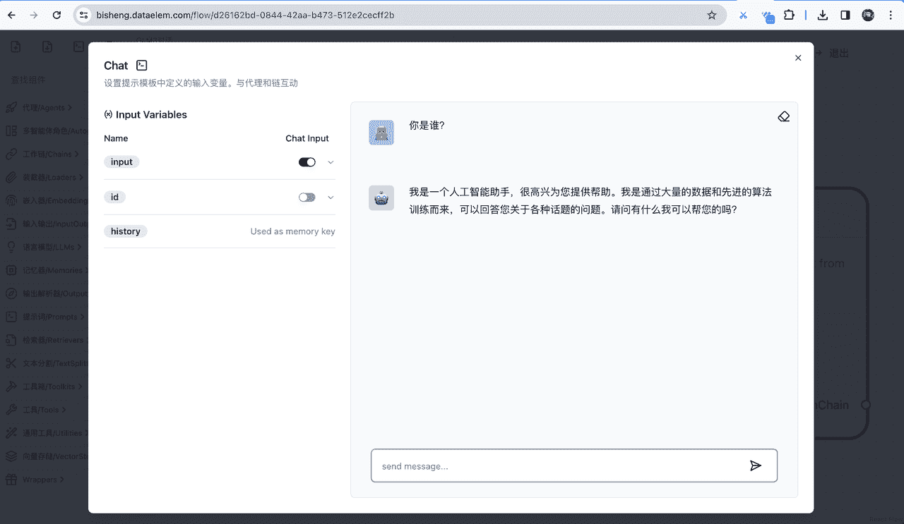

除了以[快速入门](https://dataelem.feishu.cn/wiki/ZxW6wZyAJicX4WkG0NqcWsbynde)两个示例之外，由于在BISHENG平台以Langchain与Langflow生态为基础，还做了许多能力提升，所以可以构建非常多种功能强大的技能，如：报告生成、知识库问答、流程自动化、材料审核、多智能体群聊 等等，配置方法参见BISHENG官方文档知识库：