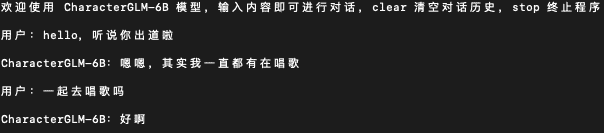

# 快速使用（推理部署）

> 来源：[https://ai.feishu.cn/docx/DL2MdT8EBonlTixkYcMc3YXWn0g](https://ai.feishu.cn/docx/DL2MdT8EBonlTixkYcMc3YXWn0g)

## 子页面目录

这份文档旨在让开发者在五分之内体验上 CharacterGLM-6B 模型

## 源码安装环境配置和检查

本模型没有提供在线体验 DEMO 地址，需要开发者手动配置模型。本届章程将带领开发者共同部署 CharacterGLM-6B 模型。

### 克隆代码和模型

模型基础运行代码已经上传到 github 和 SwanHub 两个平台，两个平台的信息同步。开发者通过以下方式下载模型代码。

+   从 github 下载源码

```
git clone https://github.com/thu-coai/CharacterGLM-6B.git
```

开发者可以通过以下方式下载模型文件

+   [下载](https://github.com/git-lfs/git-lfs?utm_source=gitlfs_site&utm_medium=installation_link&utm_campaign=gitlfs#installing)模型文件前请先确保`git lfs`命令已安装，安装教程请参考这里。

+   模型文件已上传至 Huggingface, Modelscope ,  SwanHub  三个平台，用户可以快速安装模型。

+   若使用 Huggingface 下载模型

```
git lfs install
git clone https://huggingface.co/LingxinAI/CharacterGLM-6b
```

### 安装依赖

使用 pip 安装依赖：

```
cd CharacterGLM-6B
pip install -r requirements.txt
```

[环境配置和检查](https://lslfd0slxc.feishu.cn/wiki/OwCDwJkKbidEL8kpfhPcTGHcnVc)果你担心你的配置不满足最低配置，你可以访问 获取更多信息。

的

### 运行demo

使用本地模型加载并使用命令行来问答

```
python basic_demo/cli_demo.py
```

你将会在类似如下的命令行中进行交互。



通过以下命令启动基于 Streamlit 的网页版 demo：

```
python basic_demo/web_demo_streamlit.py
```