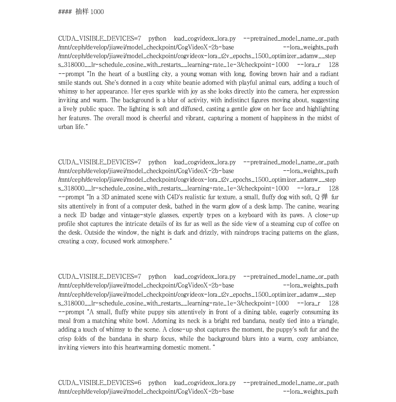

# Lora_hf_text_video

> 来源：[https://ai.feishu.cn/docx/K04Ud7o2NoraRkxmewZczmannrd](https://ai.feishu.cn/docx/K04Ud7o2NoraRkxmewZczmannrd)

### 实验信息

训练数据来源B站,UID:

[Lora_role_5](https://zhipu-ai.feishu.cn/wiki/AzP8wLht7i9daikuzVHcCfNwn1d)抽取数据集46条，[Lora_role_2](https://zhipu-ai.feishu.cn/wiki/Cscyw20uXiFBF6kC14zcpCWwn7d)中166个训练样本（处理脚本错误，存在索引错误的文件，删除后剩余166）

训练过程调整了validation_prompt ，num_validation_videos

```
#!/bin/bash 
export TORCH_LOGS=&quot;+dynamo,recompiles,graph_breaks&quot;
export TORCHDYNAMO_VERBOSE=1
export WANDB_MODE=&quot;online&quot;
# export NCCL_P2P_DISABLE=1
export TORCH_NCCL_ENABLE_MONITORING=0
export WANDB_API_KEY=974207f7173417ef95d2ebad4cbe7f2f9668a093 
export PYTORCH_CUDA_ALLOC_CONF=expandable_segments:True 

GPU_IDS=&quot;0,1,2,3,4,5,6,7&quot;

# Training Configurations
# Experiment with as many hyperparameters as you want!
LEARNING_RATES=(&quot;1e-3&quot;)
LR_SCHEDULES=(&quot;cosine_with_restarts&quot;)
OPTIMIZERS=(&quot;adamw&quot;)
MAX_TRAIN_STEPS=(&quot;318000&quot;) 

# Single GPU uncompiled training
ACCELERATE_CONFIG_FILE=&quot;accelerate_configs/uncompiled_2.yaml&quot;

# Absolute path to where the data is located. Make sure to have read the README for how to prepare data.
# This example assumes you downloaded an already prepared dataset from HF CLI as follows:
#   huggingface-cli download --repo-type dataset Wild-Heart/Disney-VideoGeneration-Dataset --local-dir /path/to/my/datasets/disney-dataset
DATA_ROOT=&quot;/mnt/ceph/develop/jiawei/lora_dataset/Dance-VideoGeneration-Dataset-encoded-2048&quot;
CAPTION_COLUMN=&quot;prompts.txt&quot;
VIDEO_COLUMN=&quot;videos.txt&quot;

# Launch experiments with different hyperparameters
for learning_rate in &quot;${LEARNING_RATES[@]}&quot;; do
  for lr_schedule in &quot;${LR_SCHEDULES[@]}&quot;; do
    for optimizer in &quot;${OPTIMIZERS[@]}&quot;; do
      for steps in &quot;${MAX_TRAIN_STEPS[@]}&quot;; do
        output_dir=&quot;/mnt/ceph/develop/jiawei/model_checkpoint/cogvideox-lora_t2v_epochs_1500_optimizer_${optimizer}__steps_${steps}__lr-schedule_${lr_schedule}__learning-rate_${learning_rate}/&quot;

        cmd=&quot;accelerate launch  --gpu_ids $GPU_IDS  --config_file $ACCELERATE_CONFIG_FILE training/cogvideox_text_to_video_lora.py \
          --pretrained_model_name_or_path /mnt/ceph/develop/jiawei/model_checkpoint/CogVideoX-2b-base \
          --data_root $DATA_ROOT \
          --caption_column $CAPTION_COLUMN \
          --video_column $VIDEO_COLUMN \
          --load_tensors \
          --video_reshape_mode center \
          --height_buckets 480 \
          --width_buckets 720 \
          --frame_buckets 49 \
          --dataloader_num_workers 8 \
          --pin_memory \
          --id_token \&quot;奶糖,\&quot; \
          --validation_prompt \&quot;In a 3D animated scene with C4D&#x27;s realistic fur texture, a small, fluffy dog with soft, Q弹 fur sits attentively in front of a computer desk, bathed in the warm glow of a desk lamp. The canine, wearing a neck ID badge and vintage-style glasses, expertly types on a keyboard with its paws. A close-up profile shot captures the intricate details of its fur as well as the side view of a steaming cup of coffee on the desk. Outside the window, the night is dark and drizzly, with raindrops tracing patterns on the glass, creating a cozy, focused work atmosphere.:::奶糖, A young girl in a white blouse and navy skirt stands in a sunlit park, smiling and holding up two fingers. She&#x27;s surrounded by trees and a pathway, with dappled sunlight casting shadows. A young woman in a school uniform stands on a tree-lined path, surprised, with hands raised. In the park, a woman in a white blouse with a navy collar raises her hands in a playful &#x27;V&#x27; shape, surrounded by lush greenery and sunlight.:::A small, fluffy white puppy sits attentively in front of a dining table, eagerly consuming its meal from a matching white bowl. Adorning its neck is a bright red bandana, neatly tied into a triangle, adding a touch of whimsy to the scene. A close-up shot captures the moment, the puppy&#x27;s soft fur and the crisp folds of the bandana in sharp focus, while the background blurs into a warm, cozy ambiance, inviting viewers into this heartwarming domestic moment. :::In a quaint café, a stationary shot captures a bespectacled white rabbit, perched primly on a wooden chair, intently reading a newspaper. On the table beside it, a steaming cup of coffee emits a inviting aroma, adding to the cozy ambiance of the scene. The rabbit, dressed in a quaint button-up shirt and bow tie, occasionally glances over the rim of its glasses, creating an atmosphere of curiosity and leisure.:::奶糖, A young woman with long dark hair tied into ponytails stands in a cozy, warmly lit room, smiling gently at the camera. She takes a selfie, her hair styled in loose waves, with a playful expression. The background is a plain, light-colored wall, emphasizing her features.\&quot; \
          --validation_prompt_separator ::: \
          --num_validation_videos 5 \
          --validation_epochs 100 \
          --seed 42 \
          --rank 128 \
          --lora_alpha 1 \
          --mixed_precision bf16 \
          --output_dir $output_dir \
          --max_num_frames 49 \
          --train_batch_size 1 \
          --max_train_steps $steps \
          --checkpointing_steps 1000 \
          --gradient_accumulation_steps 1 \
          --gradient_checkpointing \
          --learning_rate $learning_rate \
          --lr_scheduler $lr_schedule \
          --lr_warmup_steps 400 \
          --lr_num_cycles 1 \
          --optimizer $optimizer \
          --beta1 0.9 \
          --beta2 0.95 \
          --weight_decay 0.001 \
          --max_grad_norm 1.0 \
          --allow_tf32 \
          --resume_from_checkpoint latest \
          --report_to wandb \
          --tracker_name cogvideox-lora_t2v_epochs_1500_optimizer_${optimizer}__steps_${steps}__lr-schedule_${lr_schedule}__learning-rate_${learning_rate} \
          --nccl_timeout 100000&quot;
        
        echo &quot;Running command: $cmd&quot;
        eval $cmd
        echo -ne &quot;-------------------- Finished executing script --------------------\n\n&quot;
      done
    done
  done
done

```

#### Huggingface Diffusers  Lora权重

/mnt/ceph/develop/jiawei/model_checkpoint/cogvideox-lora_t2v_epochs_1500_optimizer_adamw__steps_318000__lr-schedule_cosine_with_restarts__learning-rate_1e-3/

#### 结果评价

训练任务在 1e-3的学习率，rank 128,a 1，212的训练样本完成了150次训练，

分别在不同的检查点下测试任务，



[抽样.txt](https://internal-api-drive-stream.feishu.cn/space/api/box/stream/download/all/JeVAbOmfpoSVtHxzI4ucrCZ5nAc)

之前从sat导出diffuser的框架lora权重出现的 图像融合、丢失样本细节的情况，在这里并没有发生，

在不同的抽样步数（1000、4000、10000）中，模型的表现随着训练步数的增加而有所变化，具体总结如下：

1.  **抽样1000**

+   **结果：** 效果有所退步，原始人物形象没有很好地学习到。尽管在某些方面表现还不错，但细节和之前好的样本效果出现了明显变化。

+   **评价：** 生成图像未能保留原来优秀的效果，细节有所丢失。

1.  **抽样4000**

+   **结果：** 人物形象的还原度有所提高，学习到了更多细节。生成的样本质量接近目标训练样本，细节表现较好。

+   **评价：** 没有出现之前从SAT导出权重时的图像融合或样本细节丢失的问题，但部分样本失去了原来独特的效果。

1.  **抽样10000**

+   **结果：** 与4000步的表现相似，人物形象的还原度较高，更多细节得以保留。整体生成结果接近目标训练样本。

+   **评价：** 尽管图像的细节和表现逐步提升，但某些情况下，生成的样本失去了原有的独特性和效果。

综合评价

+   随着训练步数的增加，模型逐渐学习到了更多的细节，且人物形象的还原度有所提高。然而，在追求高还原度的同时，模型生成的图像逐渐丢失了某些原本的优秀特点或效果。

+   尽管细节学习进展明显，但需注意生成的样本有时与初始期望的效果有所偏离。

#### 新的任务

#### 关联任务

###

#### checkpoint-1000

多维表格（LUs5byVXHapKfjsnf0wc3ur1ngn_tblrKliCRZs4nWiU）

#### checkpoint-4000

多维表格（LUs5byVXHapKfjsnf0wc3ur1ngn_tblll8dZV4NYdui8）

#### checkpoint-10000

多维表格（LUs5byVXHapKfjsnf0wc3ur1ngn_tbl1t9qqyIXiRuci）