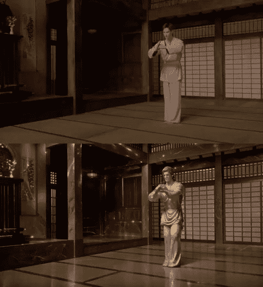

# 社区支持

> 来源：[https://ai.feishu.cn/docx/UKvAdmwIRoHT7Vx2uDtcoBGzn2c](https://ai.feishu.cn/docx/UKvAdmwIRoHT7Vx2uDtcoBGzn2c)

CogVideoX在众多社区衍生出了很多模型结构，这篇文档整理了一些修改后的模型，以及其支持的能力

同时详细介绍了社区生态中一些优秀可被复现的内容，例如运动控制，风格转换（不同场景），人物骨骼绑定生成，线稿控制生成等

### 基础模型

CogVideoX-5B （transformer)

基于CogVideoX5B修改了调整transformer结构与项目

CogVideoX-5B （transformer_Controlnet)

基于CogVideoX5B修改了transformer结构,训练的ControlNet模型列表

CogVideoX-5B （transformer_Loras)

基于CogVideoX5B 微调Loras模型

CogVideoX-5B （SFT)

CogVideoX-2B （transformer)

修改了2B的模型

### Civitai 模型

其它用户上传了CogVideoX的Loras和workflow等资源，baseModel 选择其它，这里列出一下可以搜索到的模型

#### Loras

https://civitai.com/search/models?modelType=LORA&sortBy=models_v9&query=CogVideox

| 上传类型 | 地址 |
| --- | --- |
| 场景控制 | https://civitai.com/models/862575/cogvideox-character-lora-hakos-baelz-3d |
| Live2D人物形象 | https://civitai.com/models/997636/hoshino-ruby-dance-cogvideox15-5b-i2v-img2vid |
| 动作控制 | https://civitai.com/models/927643/shikairo-days-dance-cogvideox-5b-i2v-img2vid |
| 动漫人物 | https://civitai.com/models/898636/burnice-zzz-cogvideox-5b-lora |
| Pose动作控制 | https://civitai.com/models/1010136/cogvideox-fun-v11-5b-inp-mps-loras |
| 镜头控制 | https://civitai.com/models/1011834/cogvideox15-5b-prompt-camera-motion |
| 镜头控制 | https://civitai.com/models/1010236/cogvideo5b-dimensionx-orbitleftloraweights |
| 镜头控制 | https://civitai.com/models/1010183/cogvideo5b-dimensionx-orbituploraweights |

#### Vae

https://civitai.com/models/1009676

#### 基础模型

| 上传类型 | 地址 |
| --- | --- |
| base_model | https://civitai.com/models/1009658/cogvideox-5b-i2v |
| base_model | https://civitai.com/models/1009676/cogvideox-vae |
| base_model | https://civitai.com/models/1009970/cogvideox-5b |
| base_model | https://civitai.com/models/1009892/cogvideox-2b |
|  | https://civitai.com/models/1010106/cogvideox-fun-v11-5b-control |
|  | https://civitai.com/models/1011551/cogvideox-fun-v11-5b-pose |

https://github.com/kijai/ComfyUI-CogVideoXWrapper/pull/311

### 物体控制教程

> [Flux+Redux+Tora](https://zhipu-ai.feishu.cn/wiki/ESSrwoOkeiAxYxkWuA2c9AZ7nnD)让物体在场景中出现，并且按照自己的想法运动， 可以做到这一点！

### 风格转绘

#### LoRAs

> 阿里小组使用Reward Backpropagation 技术实现的风格转绘LoRAs，轻松实现人物的骨骼绑定

> HuggingFace: https://huggingface.co/alibaba-pai/CogVideoX-Fun-V1.1-Reward-LoRAs

>

[cogvideox_1_0_5b_Fun_control_vid2vid (1).json](https://internal-api-drive-stream.feishu.cn/space/api/box/stream/download/all/O0zObC17CoCtf1xKNoNcM9IQnrc)

[eUETNokQ0kUvcXUu.mp4](https://internal-api-drive-stream.feishu.cn/space/api/box/stream/download/all/SSZbbguDwoA60XxN5ggcGIUtndg)

### 镜头控制

#### LoRAs

> 基于CogVideoX1.5模型的镜头控制功能，这个LoRa 可以控制相机在 6 个方向上的移动：左、右、上、下、放大、缩小

> HuggingFace：https://huggingface.co/NimVideo/cogvideox1.5-5b-prompt-camera-motion

### 友情链接

> 更多玩法在[Flux开源社区](https://uafbynknt3r.feishu.cn/wiki/D6fcwKSTTitv9OkuR1scgr0Cnuf)

### Reference

1.  Clark, Kevin, et al. "Directly fine-tuning diffusion models on differentiable rewards.". In ICLR 2024.

1.  Prabhudesai, Mihir, et al. "Aligning text-to-image diffusion models with reward backpropagation." arXiv preprint arXiv:2310.03739 (2023).