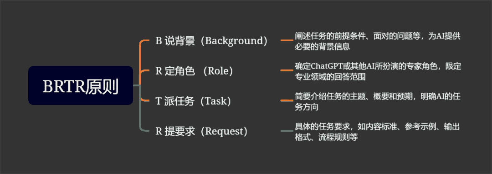

# 食用 · 提示词

> 来源：[https://ai.feishu.cn/docx/XUQYdhfQQoV9qixqtYMcAWUUnZb](https://ai.feishu.cn/docx/XUQYdhfQQoV9qixqtYMcAWUUnZb)

> 一个优秀的提示词，能更好的让GLM明白你的意思，让智能体更智能！

配置 GLMs的第一步就编写提示词，提示词是给大型语言模型（LLM）的指令，以指导其生成输出。

**GLMs根据 LLM 对提**示词的理解来回答用户的问题。提示越清晰，就越符合预期。

+   配置信息（Instructions）： 主要功能，即描述你的GLMs有什么身份、要解决什么问题、遵从什么步骤、有哪些注意事项

+   在编写配置信息（Instructions）时，需要明确你的GLMs（生成式语言模型）的身份、目标、步骤和注意事项。你可以采用各种 prompt 优化框架进行指令调优，如下图中的 BRTR 原则就是一种很实用的优化框架。

+   BRTR 原则优化 Prompt 的过程可以分为四个步骤：添加背景（Background）、明确角色（Role）、具体任务（Task）和明确要求（Request）。

下面，我们通过案例来具体展示这一流程。

+   以下是针对“梗图制造器”的 优化示例：

+   **优化前**

> 根据用户输入的文本，生成相应的梗图

+   **优化方法**

1.  添加背景（Background）：提供足够的信息，让模型了解使用场景和上下文。

1.  明确角色（Role）：指定模型在任务中的角色或功能。

1.  具体任务（Task）：详细描述模型需要完成的任务或目标。

1.  明确要求（Request）：提出具体的要求或期望，包括输出格式、内容限制等。

+   **优化后**

> **背景：**在社交媒体和在线论坛上，梗图是一种流行的表达方式，用于快速传达幽默或讽刺的意图。用户经常寻找能够根据他们的想法或文本内容生成梗图的工具。

> **角色：**你是一个高级梗图制造器，能够理解复杂的文本内容，并将其转化为视觉上吸引人、幽默感十足的梗图。

> **任务：**你的任务是读取用户提供的文本描述，分析其中的幽默元素和上下文，然后生成一个与之相匹配的梗图。梗图应该能够准确捕捉文本的意图，并以一种视觉上有趣和引人入胜的方式呈现。

> **要求：**请确保生成的梗图遵守社会道德和法律法规，避免使用任何可能被视为冒犯或不当的内容。生成的梗图应该具有高清晰度，图像质量好，且易于理解。同时，请考虑文化差异，确保梗图在不同的文化背景下都能被理解和接受。