# Prompt 工程实践教程

> 来源：[https://ai.feishu.cn/docx/Nqm9dX81hotVYUxFQuxcVR82n2g](https://ai.feishu.cn/docx/Nqm9dX81hotVYUxFQuxcVR82n2g)

> 视频讲解链接：

> 初级课程：https://www.bilibili.com/video/BV1ic411c7gE

> 中级课程：https://www.bilibili.com/video/BV1fw4m1k7Ea

# 第一部分：背景

## 注册「智谱清言」账号

### 1.1.1 **网页端：chatglm.cn**

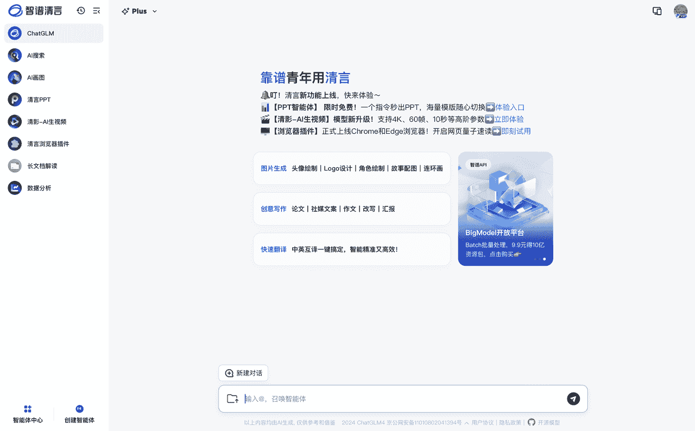

### 1.1.2 移动端


### 1.1.3 PC 客户端


[chatglm_setup_win32_ia32_1.0.37_default_full.exe](https://internal-api-drive-stream.feishu.cn/space/api/box/stream/download/all/HNtEbubSMoiaVQxST9CcilKGnyc)

**电脑客户端：Windows**


[chatglm_setup_darwin_universal_1.0.33.dmg](https://internal-api-drive-stream.feishu.cn/space/api/box/stream/download/all/LS1IbfOWJo86o5xjVmZchFudn9g)

**电脑客户端：MacOS**

智谱清言 - 你的浏览器AI助手

**浏览器插件**

### 1.1.4 API 平台

如果您需要ChatGLM的 API 体验，可通过如下链接进行注册：bigmodel.cn

+   API体验平台如下：

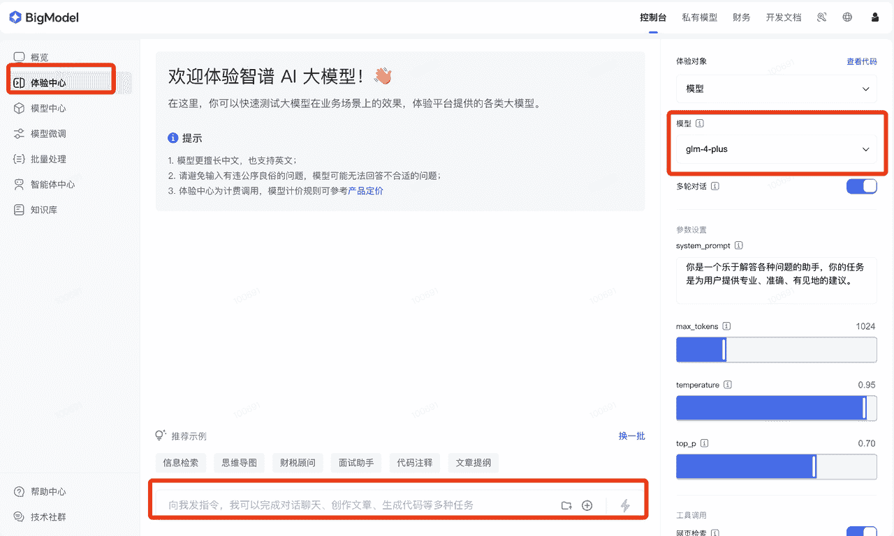

## 大模型是什么

+   大语言模型是基于概率的生成模型的一种。它可以根据给定的输入上下文生成可能的输出文本。这种模型的训练过程是基于概率模型的最大似然估计，通过学习大量的文本数据来捕捉语言的统计规律。

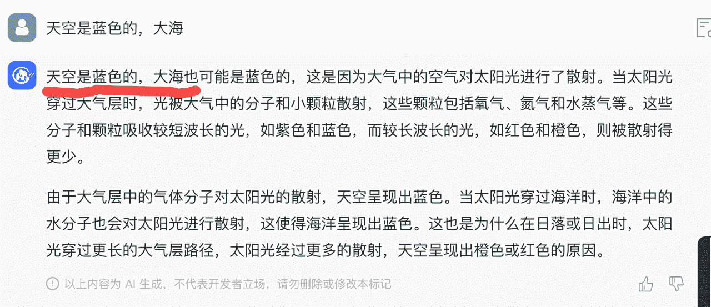

+   概率模型，它只是读过了很多文字，然后在你问出问题后，试图根据问题来检索它所读过的那些文字，然后拼凑出句子。

+   如果你问它一些它没有读过的文字，它同样会给出它认为概率最高的答案，但那个答案可能会是错误的

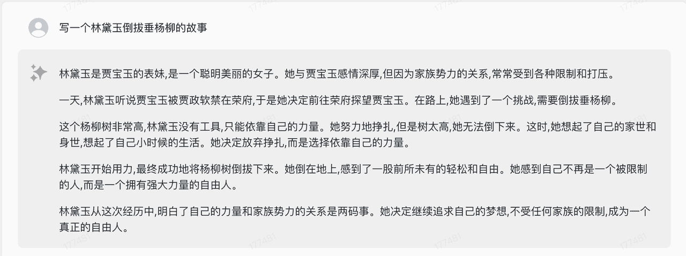

## 大模型是什么（2）

参数规模是今天大模型最大的特点

chatglm，1300亿参数。

chatgpt，1750亿参数。

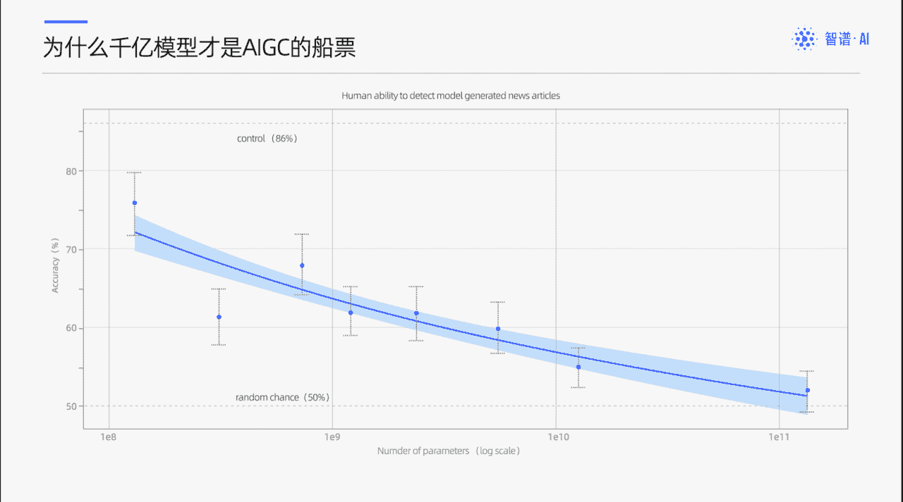

## 大模型是什么（3）

### 基座模型

一个高中毕业生，读了全世界所有的书籍；但是光读书，是不能通过高考的。

### 指令模型

就是刷题，让自己的知识和这个社会系统不断对齐的过程。

举例子：

1.  用10~20个字总结这篇文章

1.  生成一个关于狗的描述。

1.  写一封道歉信，内容包括道歉的原因和表达歉意的措辞。

1.  给出一个关于人工智能对社会的影响的优缺点列表。

1.  撰写一篇关于环保的演讲稿，包括环境问题、解决方案和呼吁行动的部分。

1.  以故事的形式，写一个发生在未来的科幻场景。

1.  创建一个健康食谱，包含早餐、午餐和晚餐的食材和烹饪方法。

1.  为某个特定的产品撰写广告文案，强调其独特卖点和吸引消费者的理由。

1.  生成一段关于旅游目的地的描述，包括景点、当地文化和旅行建议。

1.  给定一组数据，进行统计分析并生成相关的数据可视化图表。

## 大模型为什么厉害（1）

当模型参数规模超过千亿时，出现了小模型中不存在的能力。

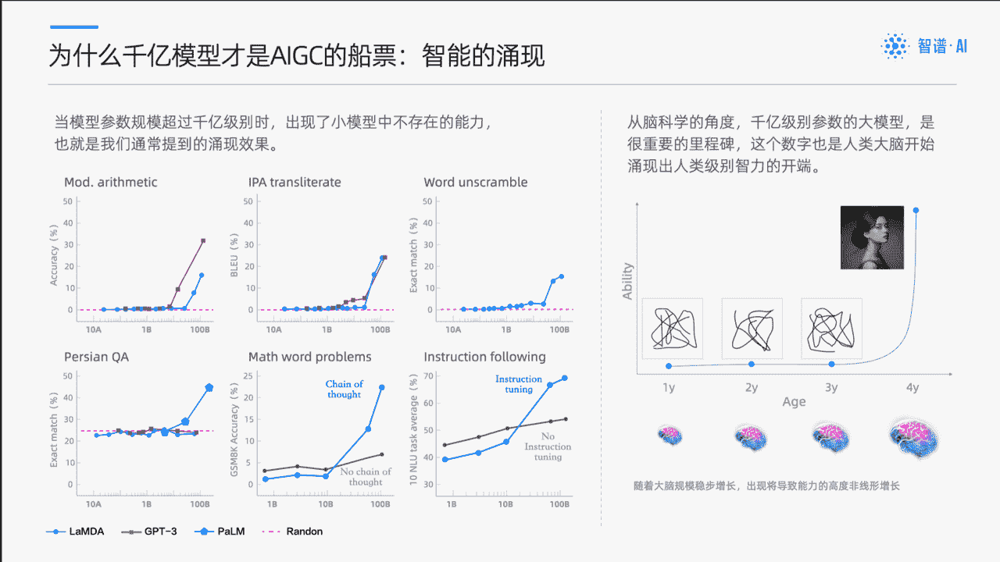

## 大模型为什么厉害（2）

Few shot的能力：提到我们可以给模型一些示例，从而让模型返回更符合我们需求的答案。

1.  少量示例：大模型能够仅通过几个示例样本来进行学习和理解。相比传统的机器学习方法，大模型不需要依赖大量的标注数据来训练，从而降低了数据收集和标注的成本和时间。

1.  泛化能力：大模型能够从少量示例中抽取共同的特征和模式，然后应用这些知识到新的类似任务中。它能够利用其在大规模数据集上训练的经验和语言理解能力，对新的问题进行推理和分类。


## 大模型为什么厉害（3）

思维链的能力，通过向大语言模型展示一些少量的样例，并在样例中解释推理过程，大语言模型在回答提示时也会显示推理过程。这种推理的解释往往会引导出更准确的结果。

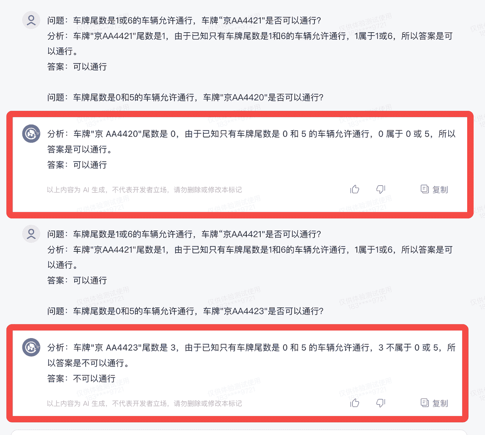

## 大模型为什么厉害（4）

任务、模型、算法、数据统一的大模型时代

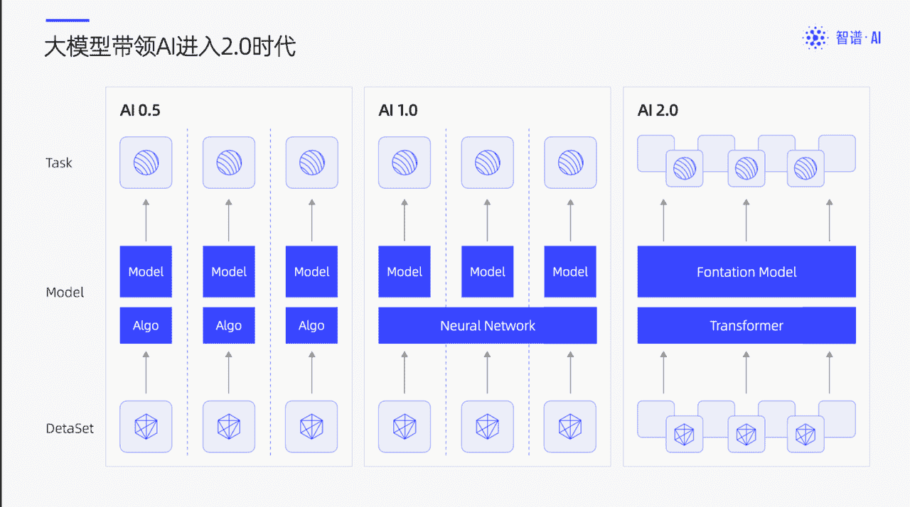

## 大模型能做什么（1）

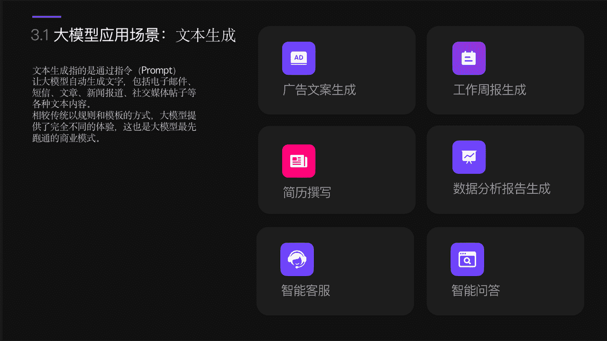

## 大模型能做什么（2）

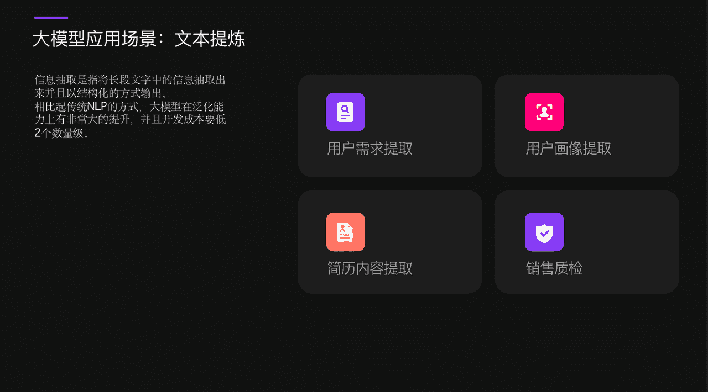

## 大模型能做什么（3）

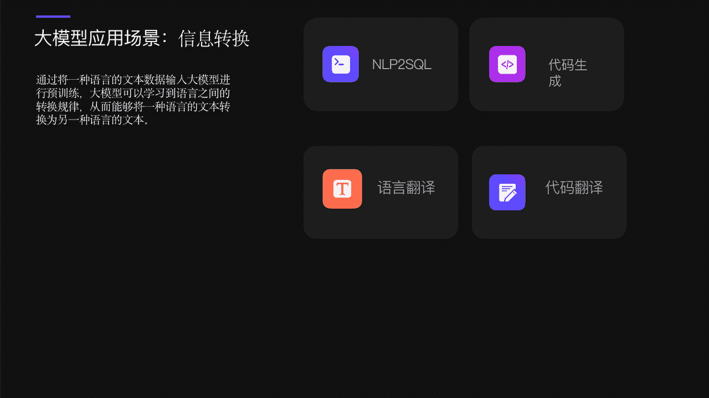

## 大模型能不做什么

+   它不是搜索引擎。

+   他可以是搜索引擎的辅助

+   他不是数据库，没办办法记住读过的每一本书。

+   他可以和embedding技术结合

## prompt是什么

Prompt就是给AI的指令，引导模型生成响应的回答。

```
“中国的首都是哪里？” 
“中国的首都是北京”
```

## prompt 有什么问题

1.  缺乏系统性，依赖个人经验

1.  只有方法，没有语法

1.  灵活性，他人分享的不好修改

1.  通过引入变量元素，提升复用性

1.  偏好分布

1.  与生产环境的的数据密切相关，需要增加评测工具

1.  不同模型间存在差异

1.  模型之间方法相同，但是内容不能复用

## prompt工程是什么

Prompt Engineer的过程和机器学习的过程类似，都需要经过迭代的过程。

从一个想法出发，通过一个基础的实现，在接近真实数据的测试集合上完成验证，分析失败的case；不断重复这个过程，直到100%满足的你的场景。

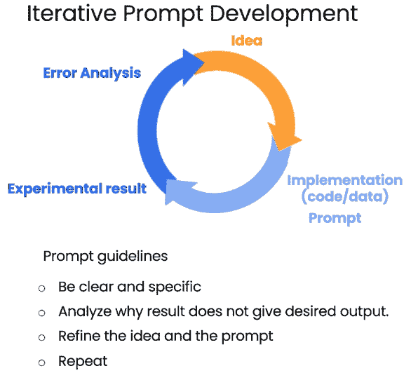

## prompt的原则：清晰和明确的指令

### 举例说明

"请解释什么是人工智能？"

"列出三个关于太阳系的事实。"

"回答以下数学问题：2 + 2 = ?"

vs

"谈谈科技。"

"讲个笑话。"

"说一些关于历史的事情。"

### 工具

1.  分隔符

1.  """..."""（推荐）

1.  <...>

1.  ---...---

1.  样例数据

```
请按照以上格式直接回答问题。只能给出答案，不要生产其他内容。

问题：日本的首都是哪里？
答案：东京

问题：法国的首都是哪里？
答案：
```

## prompt的原则：给模型思考的时间

### 工具

1.  条例清晰：减少冲突，有益于迭代

```
你是一个智能助理，用户会称呼你小爱或小爱同学，你需要帮用户结构化记录生日信息、物品存放信息、月经信息
用户输入是一句非常口语化的指令，你需要记录用户指令，并从用户的指令中结构化的输出提取出信息
输出完毕后结束，不要生成新的用户输入，不要新增内容

1.提取话题，话题只能是：生日、纪念日、月经、物品存放。
2.提取目的，目的只能是：记录、预测、查询、庆祝、设置、记录物品、拿到物品、寻找、删除、修改。
3.提取人物，人物指：过生日的人物、过纪念日的人物、来月经的人物、放物品的人物。输出只能是：我，爸爸、妈妈、孩子、爱人、恋人、朋友、哥哥、姐姐。没有写“无”
4.提取人关系，关系指人物与用户的关系，关系只能是：本人、亲人、配偶、朋友、未知、待查询。没有写“无”
5.提取时间，比如：今天、3月1日、上个月、农历二月初六、待查询。没有写“无”
6.提取时间类型，时间类型只能是：过生日的时间、过纪念日的时间、月经开始时间、月经结束时间。 没有写“无”
7.提取物品，比如：衣服、鞋子、书、电子产品、其它。
8.提取物品对应位置，比如：衣柜、书柜、鞋柜、电子产品柜、待查询。
9.按示例结构输出内容，结束

用户：例假昨天结束了
话题：月经
目的：记录
人物：我
关系：本人
时间：昨天
时间类型：月经开始时间
物品：无
位置：无

用户：今天我过生日
话题：生日
目的：记录
人物：我
关系：本人
时间：今天
时间类型：生日时间
物品：无
位置：无
```

1.  计算步骤

```
小明有5个苹果，他又买了2袋子苹果，每个袋子里有3个苹果，小明一共有几个苹果？

计算过程：
1，小明开始有5个苹果。
2，2个袋子里，每个袋子里有3个苹果。3*2=6
3，一共有5+6=11个苹果。
答案：
小明一共有11个苹果。

小明有11个苹果，他又买了3袋子苹果，每个袋子里有4个苹果，小明一共有几个苹果？
```

## prompt的结构

1.  context（可选）

1.  角色

1.  任务

1.  知识

1.  Instruction（必选）

1.  步骤

1.  思维链

1.  示例

1.  input data（必选）

1.  句子

1.  文章

1.  问题

1.  output indicator（可选）

```
你是一名机器学习工程师，负责开发一个文本分类模型，该模型可以将电影评论分为正面评价和负面评价两类。

请根据以下上下文和输入，对文本进行分类，并给出相应的输出类别。

示例：
输入文本：这部电影真是太精彩了！演员表现出色，剧情扣人心弦，强烈推荐！
输出类别：正面评价

输入文本：这部电影真是太精彩了！演员表现出色，剧情扣人心弦，强烈推荐！
输出类别：
```

# 第二部分：跟着做

## 目标

在生日场景下，结构化提取用户输入信息，并且可以稳定输出提取字段信息

## Step1 简单

```
你是一个智能助手，帮我记录或者查询生日信息。请从以下句子中抽取信息：意图、时间、人物、关系
我儿子的生日是三月初七
```

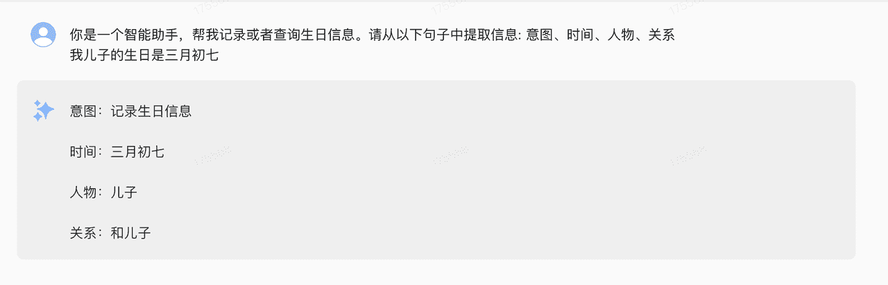

##  Step2 增加枚举

```
你是一个智能助手，帮我记录或者查询生日信息。请从以下句子中提取信息：意图、时间、人物、关系
意图只能是记录信息、查询信息、修改信息、删除信息
关系只能是亲人、朋友、未知

我儿子生日是三月初七
```

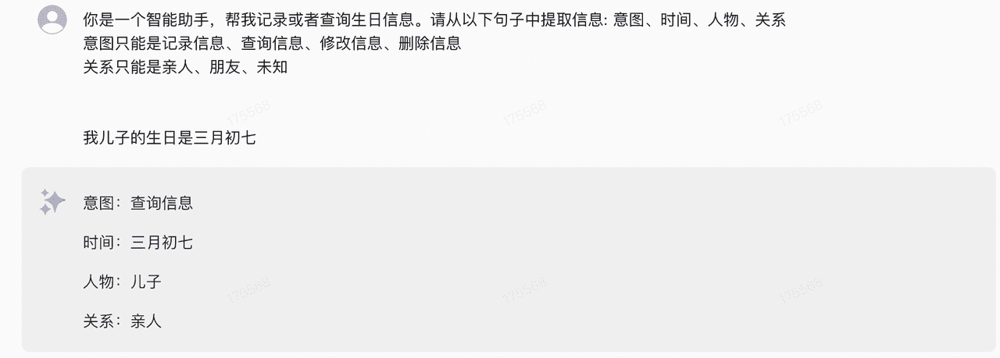

##  Step3 增加信息解释

```
你是一个智能助手，帮我记录或者查询生日信息。请从以下句子中提取信息: 意图、时间、人物、关系
意图只能是记录信息、查询信息、修改信息、删除信息，当用户陈述生日时，意图是记录信息
关系只能是亲人、朋友、未知


我儿子的生日是三月初七
```

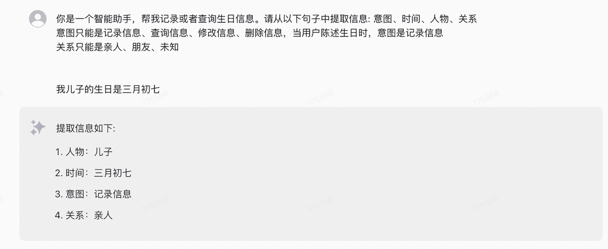

##  Step4 增加样例

```
你是一个智能助手，帮我记录或者查询生日信息。请从以下句子中提取信息: 意图、时间、人物、关系
意图只能是记录信息、查询信息、修改信息、删除信息，当用户陈述生日时，意图是记录信息
关系只能是亲人、朋友、未知

示例&quot;&quot;&quot;
输入: 妈妈生日是哪天
输出:
意图:查询信息
时间:待查询
人物: 妈妈
关系:亲人
&quot;&quot;&quot;

输入:我儿子的生日是三月初七
输出:
```

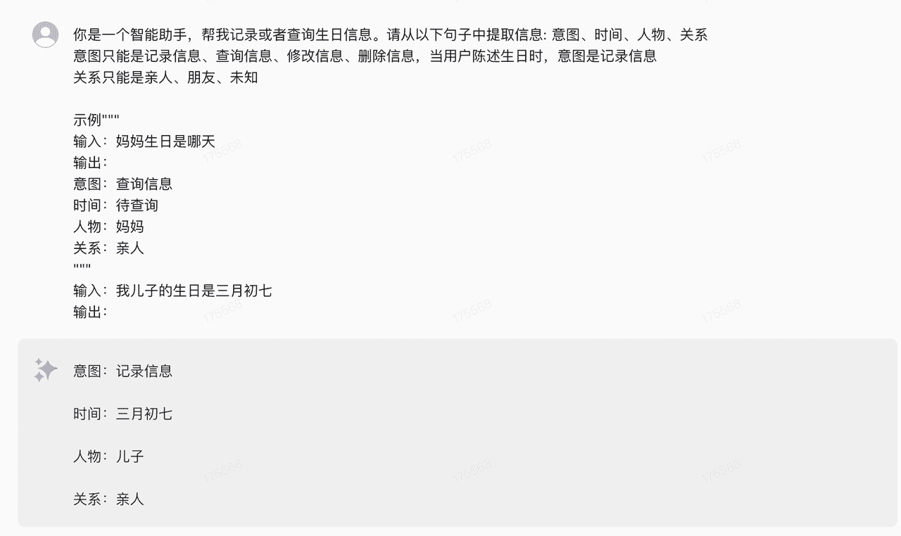

# 第三部分：精讲

## 意图理解

### 业务描述

+   某智能音响，希望用大模型代替传统自然语言处理模型，可以从用户输入内容中提取出结构化提取信息

+   本次调试预期场景、字段

+   生日、纪念日

+   目的、人物、关系、时间、时间类型

+   经期记录

+   目的、人物、关系、时间、时间类型

+   物品

+   目的、人物、关系、物品、位置

### 业务要求

+   格式规范：大模型输出的内容要直接给到后端服务接口使用，所以大模型一定要按照固定格式输出格式，以便于接口解析模型输出内容，防止报错

+   字段枚举：部分字段的提取内容需要是枚举值，例如目的、时间类型等

### 产品方案设计

当前版本因为场景明确，所以不存在“识别用户意图”环节

### prompt设计的结构

+   用户输入：将用户输入的内容拼接到prompt中，提交给大模型

+   身份定义：定义大模型扮演角色，帮助大模型理解指令

+   背景说明：明确对话发生的背景信息，帮助大模型理解指令

+   字段说明：说明要提取的字段的含义，以及字段存在的枚举值

+   输出示例：输出内容示例

+   prompt内容：

```
你是一个智能助理，你需要帮用户结构化记录生日信息、物品存放信息、月经信息
用户输入是一句非常口语化的指令，你需要记录用户指令，并从用户的指令中结构化的输出提取出信息
输出完毕后结束，不要生成新的用户输入，不要新增内容

1.提取话题，话题只能是：生日、纪念日、月经、物品存放。
2.提取目的，目的只能是：记录、预测、查询、庆祝、设置、记录物品、拿到物品、寻找、删除、修改。
3.提取人物，人物指：过生日的人物、过纪念日的人物、来月经的人物、放物品的人物。输出只能是：我，爸爸、妈妈、孩子、爱人、恋人、朋友、哥哥、姐姐。没有写“无”
4.提取人关系，关系指人物与用户的关系，关系只能是：本人、亲人、配偶、朋友、未知、待查询。没有写“无”
5.提取时间，比如：今天、3月1日、上个月、农历二月初六、待查询。没有写“无”
6.提取时间类型，时间类型只能是：过生日的时间、过纪念日的时间、月经开始时间、月经结束时间。 没有写“无”
7.提取物品，比如：衣服、鞋子、书、电子产品、其它。
8.提取物品对应位置，比如：衣柜、书柜、鞋柜、电子产品柜、待查询。
9.按示例结构输出内容，结束

用户：例假昨天结束了
话题：月经
目的：记录
人物：我
关系：本人
时间：昨天
时间类型：月经开始时间
物品：无
位置：无

用户：今天我过生日
话题：生日
目的：记录
人物：我
关系：本人
时间：今天
时间类型：生日时间
物品：无
位置：无

用户：每年的七月二十二日张派生日记录一下
话题：生日
目的：记录
人物：张派
关系：未知
时间：七月二十二日
时间类型：生日时间
物品：无
位置：无

用户：恋爱纪念日
话题：纪念日
目的：查询
人物：我
关系：本人
时间：待查询
时间类型：纪念日时间
物品：无
位置：无

用户：明天提醒我今天来过生日
话题：生日
目的：提醒
人物：我
关系：本人
时间：今天
时间类型：生日时间
物品：无
位置：无

用户：五月十九号提醒我五月二十四宝宝生日
话题：生日
目的：提醒
人物：宝宝
关系：亲人
时间：5月二十四日
时间类型：生日时间
物品：无
位置：无

用户：大姨妈结束了
话题：月经
目的：记录
人物：我
关系：本人
时间：今天
时间类型：月经结束时间
物品：无
位置：无

用户：月经数据
话题：月经
目的：查询
人物：我
关系：本人
时间：无
时间类型：无
物品：无
位置：无

用户：我大姨妈啥时候来
话题：月经
目的：查询
人物：我
关系：本人
时间：待查询
时间类型：月经开始时间
物品：无
位置：无

用户：今天是我的生理期哟
话题：月经
目的：记录
人物：我
关系：本人
时间：今天
时间类型：月经开始时间
物品：无
位置：无
```

### prompt设计的过程

+   提取字段设计

+   错误示范

+   方案：按流程设计提取内容，“如果话题是物品存放，就提取物品位置字段，如果是xxx，就提取xxxx...”

+   问题：当流程过于复杂时候，大模型对流程的执行就会出现不稳定的现象，所以最终采取不管是什么话题，直接提取全部字段

+   正确示范

+   方案：不管话题是什么，直接提取全部字段，未提及的字段写空

+   好处：不需要流程判断，逻辑简单

+   枚举值设计

+   错误示范1

+   方案：枚举值只能是增、删、改、查，不能新增其他内容

+   问题：大模型总会输出枚举值以外的内容，因为大模型会根据理解的语义输出内容

+   正确示范1

+   方案：根据语义设计枚举值，最后工程化处理不同枚举值对应的功能

+   好处：更容易实现目标效果，稳定性更高

+   错误示范2

+   方案：当遇到用户未提及的字段时，枚举值写“无”

+   问题：效果不稳定，因为“无”本身语义不够明确

+   正确示范2

+   方案：当遇到用户未提及的字段时，枚举值写“待查询”

+   好处：同上

+   示例设计

+   错误示范：

+   方案：堆砌例子、不给例子

+   问题：堆砌例子并不能让大模型完全学会该如何输出内容，甚至可能成为干扰项

+   正确示范

+   方案：选取典型场景作为例子，相当于对提取规则的补充说明

+   好处：稳定

### 心得总结

+   流程简单：过于复杂的流程会增加大模型出错概率，应该尽量减少流程

+   理解语义：不能强制大模型输出某些内容，要根据语义输出合适的枚举

+   多肯定：多用肯定句，告诉大模型要做什么，不是限制大模型不做什么

+   结合功能：要结合功能流程设计prompt，不能期望一次与大模型的交互解决一切问题

## 指令系统

### 业务描述

+   车载场景中，用户通过语音交互实现车控、播放音乐、导航等功能。

+   **有效识**别简单、复杂场景的用户口语化指令，并结构化输出指令的信息。

### 业务要求

+   指令包含**触发条件和执行动作**

+   **一句话多意图**：需准确拆分识别多个意图，并按顺序输出

### 产品方案设计

### Prompt

Temperature = 0.01 ； Top_p = 0.1

```
这是文字提取器，你要结构化的提取用户描述中动作和条件。
条件是指：某个事件或者行动所需要满足的一些前提条件或要求，如：10分钟后，车内温度降至15度后、到达目的地后、无。条件可以有多个。没有写“无”。
动作是指：对某个动作进行命令或描述。如：打开空调、关闭窗户、播放音乐、提醒我买菜、导航到目的地、保持空调保持26度、无。动作可以有多个。
输出完毕后结束，不要生成新的用户输入，不要新增内容

示例：

用户输入：到公司附近后，提醒我买杯美式咖啡

动作1:提醒我买杯美式咖啡
条件1:到公司附近后


用户输入：放学后，播放动画片，若太累了，播放摇篮曲

动作1:播放动画片
条件1:放学后

动作2:播放摇篮曲
条件2:太累了


用户输入：打开车窗，关闭空调，5分钟后关闭车窗，打开空调

动作1:打开车窗
条件1:无

动作2:关闭空调
条件2:无

动作3:关闭车窗
条件3:5分钟后

动作4:打开空调
条件4:无


请根据以下文本，按照模版输出内容。
用户输入：{用户query}
```

### prompt设计

#### prompt结构

##### Part 1 — 赋予大模型角色，清晰凝练的描述任务

告知角色：你是文字提取器（💡选择好的角色有助于大模型对任务的理解）

告知任务：你要结构化的提取用户描述中动作和条件

明晰定义字段：给出条件、动作等字段的具体含义（💡给一些示例有助于识别字段）

##### Part 2 — Few Shots

给出示例：期望大模型输出的结果（💡示例的选取很重要，关注典型的、不同分类的）

##### Part 3 — 引导输出 和 最后的叮嘱

按格式输出：使用“ 用户输入： ”作为强引导要求大模型按照格式输出

最后的叮嘱：在整个prompt尾部再次强调任务（💡尾部的语句约束性较高，可斟酌此处的语句，一般为任务，也可以是根据输出表现优化的小要求）

#### prompt迭代

##### 版本1

思路：根据车载语音助手的**不同领域**（domain）分类，在每一类**识别指令实体**并输出

```
这是文字提取器，你要结构化的提取用户描述中的实体信息。
实体指：用户输入中有含义的指令信息，如：导航去某地、播放某音乐、打开车窗、提醒加油等指令信息
输出完毕后结束，不要生成新的用户输入，不要新增内容

示例：

用户输入：到公司附近后，提醒我买杯美式咖啡
实体：买杯美式咖啡


请根据以下文本，按照模版输出内容。
用户输入：{用户query}
```

待优化点：

+   无法识别用户输入中的**触发条件**，如：用户想在到达公司附近后触发提醒的指令。

+   无法识别用户的**多个意图**

##### 版本2

**思路：通过明确定义**、并拆解用户指令中的执行动作、触发条件，实现跨领域的指令识别

```
这是文字提取器，你要结构化的提取用户描述中动作和条件。
条件是指：某个事件或者行动所需要满足的一些前提条件或要求，如：10分钟后，车内温度降至15度后、到达目的地后、无。条件可以有多个。没有写“无”。
动作是指：对某个动作进行命令或描述。如：打开空调、关闭窗户、播放音乐、提醒我买菜、导航到目的地、保持空调保持26度、无。动作可以有多个。
输出完毕后结束，不要生成新的用户输入，不要新增内容

示例：

用户输入：到公司附近后，提醒我买杯美式咖啡

动作1:提醒我买杯美式咖啡
条件1:到公司附近后


请根据以下文本，按照模版输出内容。
用户输入：{用户query}
```

待优化点：

+   用户指令中的**多意图**识别效果不佳

如：顺承逻辑（我要先关窗、再开空调）、判断逻辑（如果今天下雨，提醒我带伞；不下，不需要提醒）

##### 版本3

思路：给出典型的**few shots**，对复杂场景的示例尤为重要。

```
这是文字提取器，你要结构化的提取用户描述中动作和条件。
条件是指：某个事件或者行动所需要满足的一些前提条件或要求，如：10分钟后，车内温度降至15度后、到达目的地后、无。条件可以有多个。没有写“无”。
动作是指：对某个动作进行命令或描述。如：打开空调、关闭窗户、播放音乐、提醒我买菜、导航到目的地、保持空调保持26度、无。动作可以有多个。
输出完毕后结束，不要生成新的用户输入，不要新增内容

示例：

用户输入：到公司附近后，提醒我买杯美式咖啡

动作1:提醒我买杯美式咖啡
条件1:到公司附近后


用户输入：放学后，播放动画片，若太累了，播放摇篮曲

动作1:播放动画片
条件1:放学后

动作2:播放摇篮曲
条件2:太累了


用户输入：打开车窗，关闭空调，5分钟后关闭车窗，打开空调

动作1:打开车窗
条件1:无

动作2:关闭空调
条件2:无

动作3:关闭车窗
条件3:5分钟后

动作4:打开空调
条件4:无


请根据以下文本，按照模版输出内容。
用户输入：{用户query}
```

### 效果

#### 简单场景

用户query**:**

```
到家附近后，提醒我拿快递
```

输出

```
动作 1:提醒我拿快递  
条件 1:到家附近后
```

#### 复杂场景

用户query**:**

```
打开座椅按摩，打开空调，10分钟后关闭空调，打开车窗。
```

输出

```
动作 1:打开座椅按摩  
条件 1:无

动作 2:打开空调  
条件 2:无

动作 3:关闭空调  
条件 3:10 分钟后

动作 4:打开车窗  
条件 4:无
```

#### 判断逻辑

用户query**:**

```
启动车辆后播报今日天气，若今天有雨，提醒我拿上车后备箱的伞，若没有，导航去公司
```

输出

```
动作 1:播报今日天气  
条件 1:启动车辆后

动作 2:提醒我拿上车后备箱的伞  
条件 2:今天有雨

动作 3:导航去公司  
条件 3:今天没有雨
```

### 心得总结

💡示例的选取很重要，关注典型的、不同分类的

💡尾部的语句约束性较高，可斟酌此处的语句，一般为任务，也可以是根据输出表现优化的小要求

## 新闻写作

### 业务描述

对**已有背景资料**进行改写，生成本土IC**投资类新闻稿**。

### 业务要求

要求实现改变，并保留重要信息。其中改写要求不构成对原稿件的抄袭；重要信息包括：企业、融资情况和企业情况。实现难点如下：

A. 新闻文体格式、语体特殊，需特别处理。

B. 大模型改写程度较小，难以达标。

C. 重要信息构成复杂，提取保留有难度。

### 产品方案设计

### prompt设计的结构

Temperature=0.8

Top_P=0.5  （具体取值可根据新闻题材的需求调整）

```
背景资料：
&quot;&quot;&quot;
{背景资料}
&quot;&quot;&quot;


你是一个新闻改写人，需要根据背景资料改写新闻。新闻包括&quot;标题&quot;、&quot;正文&quot;，改写发生在正文部分。
&quot;标题&quot;应该是一个完整的句子，能够概括新闻内容。标题内容由企业和融资情况、融资用途构成。
&quot;正文&quot;应该第一段说明企业和融资情况（包括融资进度、融资方、融资金额、融资目的）；在之后的段落中，从名称、业务、团队、发言、核心技术、技术方向、产品进展等角度叙述企业情况。若背景资料中没有提到，则忽略。
改写可以改变调整信息顺序，必须改变背景资料段落中句子的语法结构、句子长度、词语搭配。


你的新闻需要遵守以下规定：
1.使用的语言简短精炼。
2.涉及的信息真实，不允许杜撰。
3.在正文中重新表达背景资料的信息，但是人名、物名、数字、日期、行为不能改动。

输出格式：
&quot;&quot;&quot;
今日新闻：
标题：
正文：
&quot;&quot;&quot;
```

### prompt设计的过程

#### 版本1：

思路：根据新闻文体特征，规定了格式（标题、正文）和语言风格。prompt如下：

```
背景资料：
“”“
{{背景资料}}
”“”
你是一个新闻撰稿人，需要根据背景资料撰写新闻。新闻包括标题、内容。
你的新闻标题应该是一个完整的句子，能够概括新闻内容。
你的新闻内容应该包括：企业名称、融资情况、业务情况、核心技术等。
你的写作需要遵守以下规定：
1.涉及的信息真实，必须全部来自背景资料，不允许杜撰。
2.内容完整全面，包含背景资料中多次出现的、主要的信息。
3.语句通顺无病句，不出现错别字。
4.使用的语言简短精炼。
现在，开始根据背景资料撰写新闻稿。

输出格式：
&quot;&quot;&quot;
今日新闻：&lt;&quot;标题：&quot;+&quot;内容：&quot;&gt;
&quot;&quot;&quot;
```

问题：第一版新闻文体格式完整，存在问题：

A. 重要信息保留不全；

B. 存在杜撰现象；

C. 改写力度小，与背景资料重合度高。

#### 版本2：

思路：针对第1版存在问题做出以下调整：

A. 总结重要信息，明确提出要求。总的分为企业（主体）、融资情况、企业情况。其中，融资情况包括：融资进度、融资方、融资金额、融资目的等；企业情况包括：名称、业务、团队、发言、核心技术、技术方向、产品进展等。

B. 要求确保信息的真实性，不允许杜撰。同时明确规定重要信息（人名、物名、数字、日期、行为）不能改动。

C.调整改写的温度值（0.8）。增加改写规则：可以改变调整信息顺序，必须改变背景资料段落中句子的语法结构、句子长度、词语搭配。

prompt如下：

```
背景资料：
&quot;&quot;&quot;
{背景资料}
&quot;&quot;&quot;


你是一个新闻改写人，需要根据背景资料改写新闻。新闻包括&quot;标题&quot;、&quot;正文&quot;，改写发生在正文部分。

&quot;标题&quot;应该是一个完整的句子，能够概括新闻内容。标题内容由企业和融资情况、融资用途构成。

&quot;正文&quot;应该第一段说明企业和融资情况（包括融资进度、融资方、融资金额、融资目的）；在之后的段落中，从名称、业务、团队、发言、核心技术、技术方向、产品进展等角度叙述企业情况。若背景资料中没有提到，则忽略。

改写可以改变调整信息顺序，必须改变背景资料段落中句子的语法结构、句子长度、词语搭配。


你的新闻需要遵守以下规定：
1.使用的语言简短精炼。
2.涉及的信息真实，不允许杜撰。
3.在正文中重新表达背景资料的信息，但是人名、物名、数字、日期、行为不能改动。

输出格式：
&quot;&quot;&quot;
今日新闻：
标题：
正文：
&quot;&quot;&quot;
```

反思：新闻文体格式和语言风格符合，输出格式稳定；重要信息提取正确；改写达标。第2版生成新闻稿可用。

### 样例

#### 背景资料完整

##### 背景资料

```
神顶科技（南京）有限公司（以下简称“神顶科技”）近日完成数千万元新一轮战略融资，投资方为深圳高新投集团和昆山台商发展基金。
本轮资金将用于进一步扩大在智能感知融合芯片的方案开发和量产推广。
神顶科技拥有完全自主研发的3D智能感知融合技术，目前，公司研发团队凭借丰富的产品化经验和供应链整合能力，研发出基于Smart Fusion技术的3D智能感知融合SoC芯片平台。该平台不仅符合移动机器人特有的场景需求、保留了移动机器人硬件的全面可扩展性，而且在性价比方面同样具有优势。
谈及未来发展，神顶科技相关负责人表示：“目前，神顶科技已经获得多项核心技术和专利成果，并在感知融合、图像算法、人工智能等方面积累了技术优势。此次融资后，神顶科技将继续坚持创新驱动，推进智能感知融合领域的发展，为移动机器人、AR/VR增强/虚拟现实及自动驾驶等相关领域的感知系统智能化提供更优质的方案和服务。”
```

##### 生成新闻稿

```
标题：神顶科技获数千万元融资，推进智能感知融合领域发展

正文:

近日，神顶科技 (南京) 有限公司宣布获得数千万元新一轮战略融资，投资方为深圳高新投集团和昆山台商发展基金。本轮资金将用于进一步扩大在智能感知融合芯片的方案开发和量产推广。

神顶科技是一家完全自主研发 3D 智能感知融合技术的公司，其研发团队凭借丰富的产品化经验和供应链整合能力，研发出基于 Smart Fusion 技术的 3D 智能感知融合 SoC 芯片平台。该平台符合移动机器人特有的场景需求，保留了移动机器人硬件的全面可扩展性，而且在性价比方面同样具有优势。

神顶科技的未来发展充满信心。公司相关负责人表示，“目前，我们已经获得多项核心技术和专利成果，并在感知融合、图像算法、人工智能等方面积累了技术优势。此次融资后，我们将继续坚持创新驱动，推进智能感知融合领域的发展，为移动机器人、AR/VR 增强/虚拟现实及自动驾驶等相关领域的感知系统智能化提供更优质的方案和服务。”
```

### 心得总结

第一，对于主观性强的任务（如写作），需要把指令具体化（如规定新闻格式、改写要求、保留信息种类）。

## 风格写作

### 业务描述

给主播撰写短视频文案：根据主播风格，将指定文本转换成指定短视频主播风格的短视频文案。

### 业务要求

+   不同主播风格不同，难以准确有文字描述不同短视频主播的风格

+   待转换文本与短视频文案风格差距较大

### 产品方案设计

### prompt设计的结构

Temperature = 0.01 ； Top_p = 0.1

```
短视频范文1：
&quot;&quot;&quot;
{示例1}
&quot;&quot;&quot;

短视频范文2：
&quot;&quot;&quot;
{示例2}
&quot;&quot;&quot;

短视频范文3：
&quot;&quot;&quot;
{示例3}
&quot;&quot;&quot;


你是一个短视频主播，请你参考上面的短视频范文1、2、3，将下面的原文改写成新的短视频文案。

原文：
&quot;&quot;&quot;
{需要改写的原文}
&quot;&quot;&quot;
```

+   Part1 - Few shot：Few shot示例：通过短视频范文1、2、3，将few shot参考示例传递给大模型；

+   Part2 - 任务描述：通过简洁的描述，将任务完整的描述给大模型。

+   Part3-待改写原文

### prompt设计的过程

####  版本1 - zero shot

+   1.0版本基于zero shot，总结主播风格，例如口语化风格、情绪化表达、使用比喻、数据支持、重复和强调、感叹句使用频繁等，让大模型根据总结出的风格进行文案撰写，效果差；

```
原文：
&quot;&quot;&quot;
{需要改写的原文}
&quot;&quot;&quot;

你是一个短视频主播，请你将上面的原文改写成新的短视频文案，要求如下：
1.使用口语化风格、情绪化表达、使用比喻等手法进行改写；
2.原文中若有数据，改写后需要体现数据；
3.尽量使用重复和强调、感叹句；
```

##### 待优化点：

+   文本风格与主播文案风格不一致；

+   段落结构与主播文案风格不一致；

#### 版本2 - few shot 【最终版本】

+   2.0版本基于few shot，给大模型一些含有主播风格的短视频文案示例，让大模型参考提供的短视频主播文案示例进行改写，效果优秀；

```
短视频范文1：
&quot;&quot;&quot;
{示例1}
&quot;&quot;&quot;

短视频范文2：
&quot;&quot;&quot;
{示例2}
&quot;&quot;&quot;

短视频范文3：
&quot;&quot;&quot;
{示例3}
&quot;&quot;&quot;


你是一个短视频主播，请你参考上面的短视频范文1、2、3，将下面的原文改写成新的短视频文案。

原文：
&quot;&quot;&quot;
{需要改写的原文}
&quot;&quot;&quot;
```

### 样例

```
短视频范文1：
&quot;&quot;&quot;
纷纷加班发视频！
说假期旅游的人太多
不是一个好现象！
为什么？

因为大家旅游的钱
是从买车
买房的预算里面给抠出来的！

削减了这些【大宗消费】之后
刚好
就可以用来吃喝玩乐！
A哥说实话
虽然听起来有道理！
但是呢？
他们太讲究理论了！

现实是什么？
现实是当下的中国经济！
它缺的
就是这样一个五一假期！
&quot;&quot;&quot;

短视频范文2：
&quot;&quot;&quot;
并且更惊人的
是他们一口气
提升了7个位次！
直接来到了山东省的第3名！

有人在看完新闻之后
说我就知道！
这是一场营销！

有营销吗？
当然有！

但A哥更觉得
这不是一场针对游客
面向老百姓的营销！

而是在告诉全中国
每一座工业城市
每一座在时代浪潮里
险些掉队的城市
&quot;&quot;&quot;

短视频范文3：
&quot;&quot;&quot;
别说吃瓜群众了
就A哥这种搞金融的！
也下意识按起了计算器
 
这笔买卖 能不能做？
50年之后
到底是赚还是赔？
 
但实际上呢
担忧
都是多余的
 
因为咱们国家
50年期的国债
根本就不会卖给普通人！
 
而是为大型的金融机构
保险公司
基金公司
商业银行
量身定做的！
&quot;&quot;&quot;


你是一个短视频主播，请你参考上面的短视频范文1、2、3，将下面的原文改写成新的短视频文案。

原文：
&quot;&quot;&quot;
“中特估”概念从3月下旬就开始火爆“出圈”，多次领涨市场，成为市场资金关注的焦点。近期中国移动与贵州茅台盘中的市值对飚，更是让不少投资者认为股市投资的“中特估”时代来了！
值得注意的是，在A股市场上，中证央企结构调整指数今年累计上涨近15%，而H股市场上，恒生港股通中国内地银行指数今年累计涨幅达到11.96%；恒生香港中资企业指数，今年累计涨幅达到10.62%。
中特估”，是证监会主席易会满在2022年金融街论坛年会上的讲话，原话为“探索建立具有中国特色的估值体系”，主要适用于央企、国企及部分有行业特殊背景的上市公司“。
自“中特估”提出以来，市场关注度较高，今年又是再度多次提到，风头正盛。2023年2月2日，证监会系统工作会议再次提及中国特色估值体系，逐步完善适应不同类型企业的估值定价逻辑和具有中国特色的估值体系，更好发挥资本市场的资源配置功能。2023年政府工作报告也提出，要深化国资国企改革，提高国企核心竞争力。
估值是企业管理和投资决策过程中非常重要的一环，它涉及到公司的经济价值、未来收益预期、市场竞争力等各方面因素。估值的准确性，直接影响到企业的投融资活动和股票价格的波动。在中国特色的国情下，以往的估值模型可能不能完全适用于所有企业，因此，探索具有中国特色的估值体系显得尤为必要。
易会满提出了“中特估”估值体系，其核心理念在于充分考虑中国企业的特殊性、发展阶段、行业背景等因素，建立更符合实际的估值方法和体系。比如，在对央企、国企进行估值时，需要考虑到其国家战略地位和责任使命，这些因素可能对企业的价值产生重要影响；而部分有行业特殊背景的上市公司，可能存在垄断地位、技术壁垒等特点，这也需要有相应的估值策略。
天风证券研报指出，中特估的主线下，市场经历了从通讯到大基建再到军工、医药等板块的发散过程，银行板块在过去亦有表现，但非银个股表现落后于整体。有理由判断中特估的行情将持续发散至非银国企。
“中特估”估值体系的推行，需要充分借鉴国际上适用的先进方法和经验，同时也应结合中国特色的实践情况进行探索和创新。这既是一个理论问题，更是一个实践问题。可以预见，“中特估”估值体系将为中国资本市场的健康发展提供重要支撑，并帮助投资者更好地把握中国企业的价值和机遇。
&quot;&quot;&quot;
----------   output  ----------
短视频范文 4:  
&quot;&quot;&quot;  
最近 A 哥听说  
有一个新词  
叫做“中特估”  
什么意思呢？ 
其实就是中国特色的估值体系  
在资本市场上  
备受投资者关注  
尤其是中国移动和贵州茅台的市值对飚  
更是让 A 哥等吃瓜群众惊叹不已  
那么问题来了  
“中特估”到底牛在哪里？ 
它究竟适用于哪些企业呢？ 
A 哥这就来给您说道说道

首先  
“中特估”强调了中国特色  
充分考虑中国企业的特殊性  
比如发展阶段、行业背景等因素  
这使得它更符合实际情况

其次  
“中特估”在估值方法上  
更加注重企业的战略地位和责任使命  
对于一些国家战略地位的企业  
可能会产生重要影响

此外  
“中特估”还考虑到了行业特殊性  
对于一些存在垄断地位或技术壁垒的企业  
需要有相应的估值策略

总而言之  
“中特估”作为一种中国特色的估值体系  
对于投资者和企业管理者都非常重要  
它可以帮助投资者更好地把握中国企业的价值和机遇  
同时也有助于推动中国资本市场的健康发展

最后  
A 哥要提醒大家  
“中特估”虽然听起来很牛  
但实际上它也是有一定适用范围的  
对于不同的企业、不同的行业  
可能需要采用不同的估值方法  
因此  
我们需要在实践中不断探索和创新  
才能更好地把握市场机遇  
&quot;&quot;&quot;
```

### 心得总结

+   风格改写类尽量使用few shot：对于风格改写类场景，风格较难用文字总结，并且大模型也较难通过文字get到具体的风格。

+   few shot示例要有明显的风格：提供给大模型的few shot示例，要人工摘选出有明显风格的文本，大模型才能够更好的学习其具体的风格。