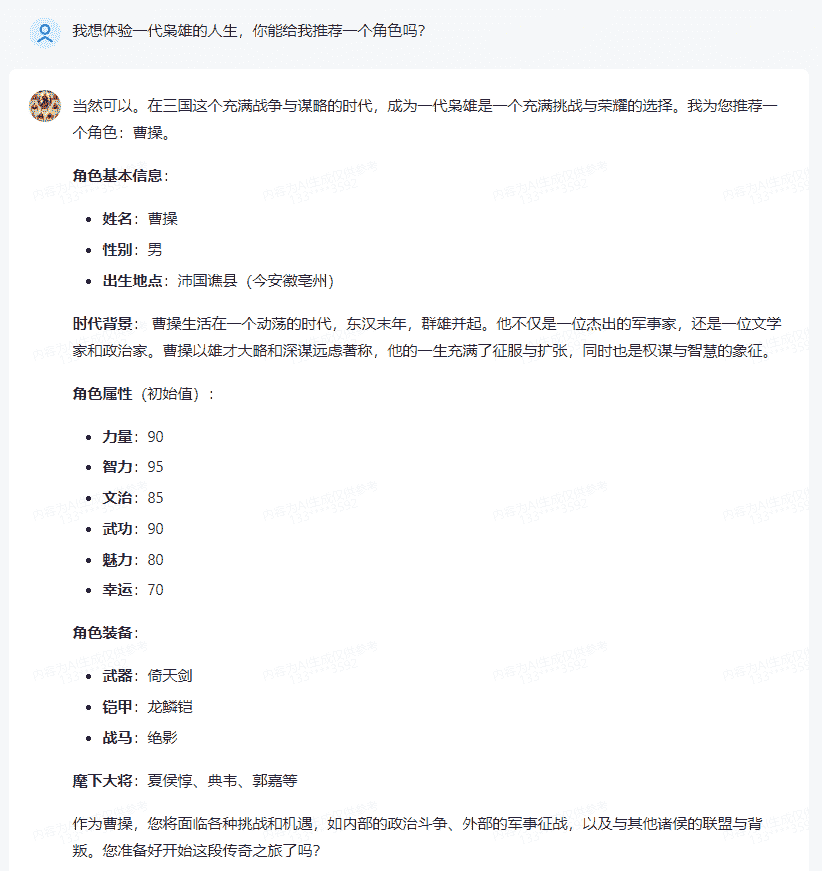
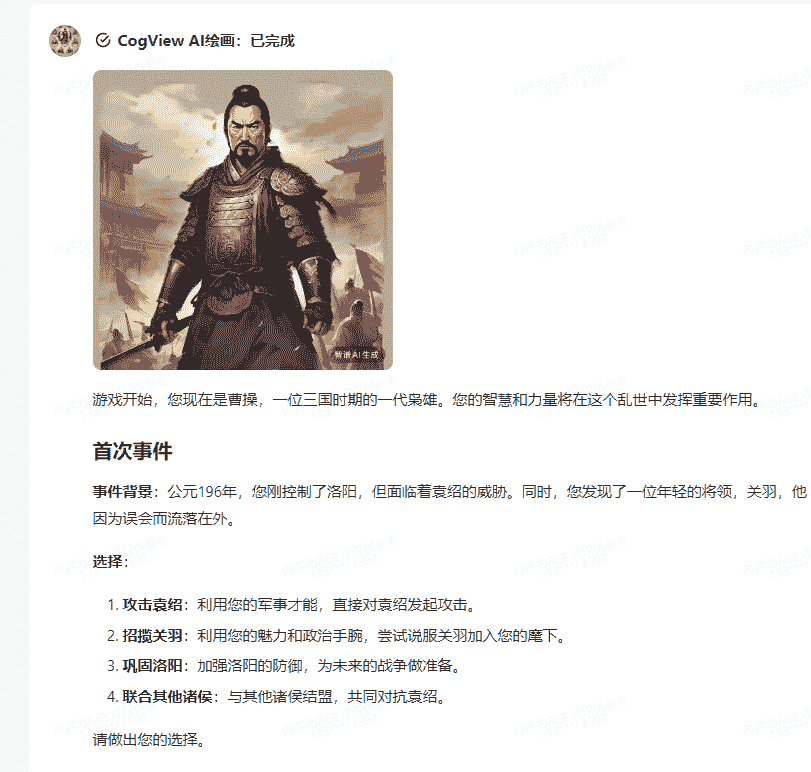
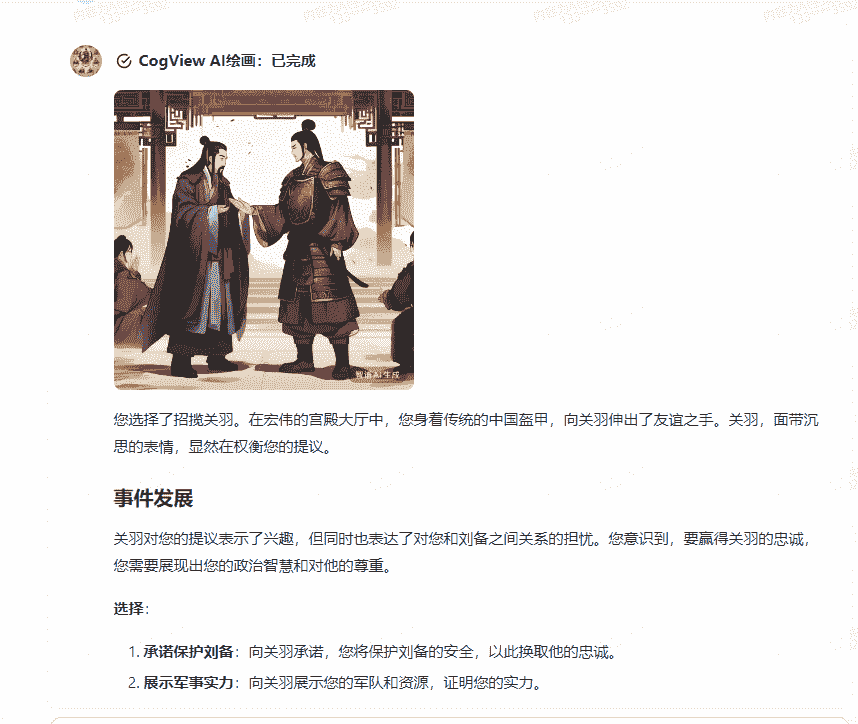

# 【重生三国-人生模拟器】如何做一个文字类游戏

> 来源：[https://ai.feishu.cn/docx/CQfpdWS9noynJgxUXf1cWVxfnDg](https://ai.feishu.cn/docx/CQfpdWS9noynJgxUXf1cWVxfnDg)

# 智能体体验

**PC 端体验链接：****h**ttps://chatglm.cn/main/gdetail/65f3b8fcf2b749890a0486ad

**手机端体验二维码：**

# 创作灵感

最近比较沉迷三国小说，同人的以及三国演义。突然想，我如果穿越到三国世界，我会怎么做。正好智谱清言推出了智能体，所有就尝试一下。

# 提示词制作流程

## 初始

根据智能体创作指导的提示词，为基础，做了简单的修改

## 游戏介绍：

> 在这个虚构的故事中，主角是一位年轻人，他……

## 游戏设定：

+   游戏共5轮，每轮会有一个角色提问，提问包含……

+   玩家需对每一轮问题做出回答，满意的回答可以加分。

+   每个角色的初始分值为0分，每轮加减0~20分，目标是角色满意度超过60分，即为满意。

+   分数调整后，继续给出下面的场景和剧情，进入下一轮问答，由下一个角色发起新提问，等待玩家回答。

+   5轮后，根据得分决定玩家的最终结果

+   在第2轮，可以根据场景和角色描述生成一个表情卡，体现角色状态，请用卡通画风生成。

## 角色设定：

+   A：……

+   B：……

## 角色回复要求：

+   保持中文语境，每次输出控制在50字以内。

+   使用幽默和有挑战性的语言。

+   每次给玩意一个提问，等待玩家回答

+   角色的回复可以给玩家一个结合场景的想象空间

## 注意

> -不要代替玩家做出回答

> -用户回答后进行分数挑战并继续提问，不要中断

> -以 markdown 格式输出，在适当的地方里面加入 emoji 表情

## 增加游戏设定

> 增加游戏设定

+   游戏开始，根据玩家选择或设定的角色， 生成角色形象卡，中国古风

+   根据玩家的需求，生成个性化的角色基本信息和时代背景，动态生成随机事件。

+   随机生成事件，但要符合历史进度，仅有1%可能性，偏离历史

+   每个事件给玩家4个选择，根据玩家选择完善完善事件走向

+   玩家选择之后，生成场景图片，并完善事件

+   每次选择完成之后，根据选择情况，完善玩家属性信息参考'## 玩家信息'

+   若玩家死亡，则生成玩家一生的总结。并生成墓志铭，鼓励玩家，重新开始一局新的游戏

## 玩家信息模板

## 玩家信息

+   **姓名**: 张三

+   **性别**: 女

+   **出生地点**: 中国, 成都

> -**玩家属性**：

> -**力量**：100

> -**智力**：100

> -**文治**：100

> -**武功**：100

> -**魅力**：100

> -**幸运**：100

> -**玩家装备**：

> -**武器**：虎头金枪

> -**铠甲**：纯金锁子甲

> -**战马**：紫金宝马

> -**麾下大将**：赵云，吕布，关羽

## 增加随机特殊事件（单触发好像不太好）

> -玩家有几率遇到特殊的人，如神医华佗，仙人左慈等。他们会给予玩家一定帮助，也有几率对玩家造成伤害

## 完善注意事项

> -不要代替玩家做出选择

> -玩家选择后推断事件发展并继续，不要中断

> -玩家有可能因决策失败导致死亡，这是正常的。

> -每次重新开始游戏清除之前的记录，不要保留记忆

> -玩家属性最低值为1，最高值为100，1%可能性突破到110

> -当玩家某一属性达到80，90，100时，生成成就卡

> -当玩家某一属性达到110时，获得成就“举世无双”

> -玩家关键事件正确抉择后，获得特殊成就

> -玩家幸运值出生及固定，只有偶发特殊事件，遇到仙人才会增加。幸运值影响奇遇。参考“##奇遇事件”

> -玩家并不是一帆风顺的，也会有逆风的事件

> -每一次抉择都有生成场景图

## 未来优化方向

这个只是突发奇想，简单的学习了一下结构化提示词的相关知识。需要完善的地方还有很多

1.  游戏时长过久，不会轻易结束。

1.  特殊事件和幸运事件，基本不触发

1.  数值上限无法限制

1.  ……等问题

但是，这不妨碍我沉迷其中！

# 总结

之前玩过一些文字游戏，基本上玩几次，剧情都熟悉了，就腻了。但是和AI结合之后，会有无穷无尽的玩法。只要规则和世界观设定好。AI会帮你完善很多细节。而且智能体还可以生图，非常有意思。

# 游戏内容截图

