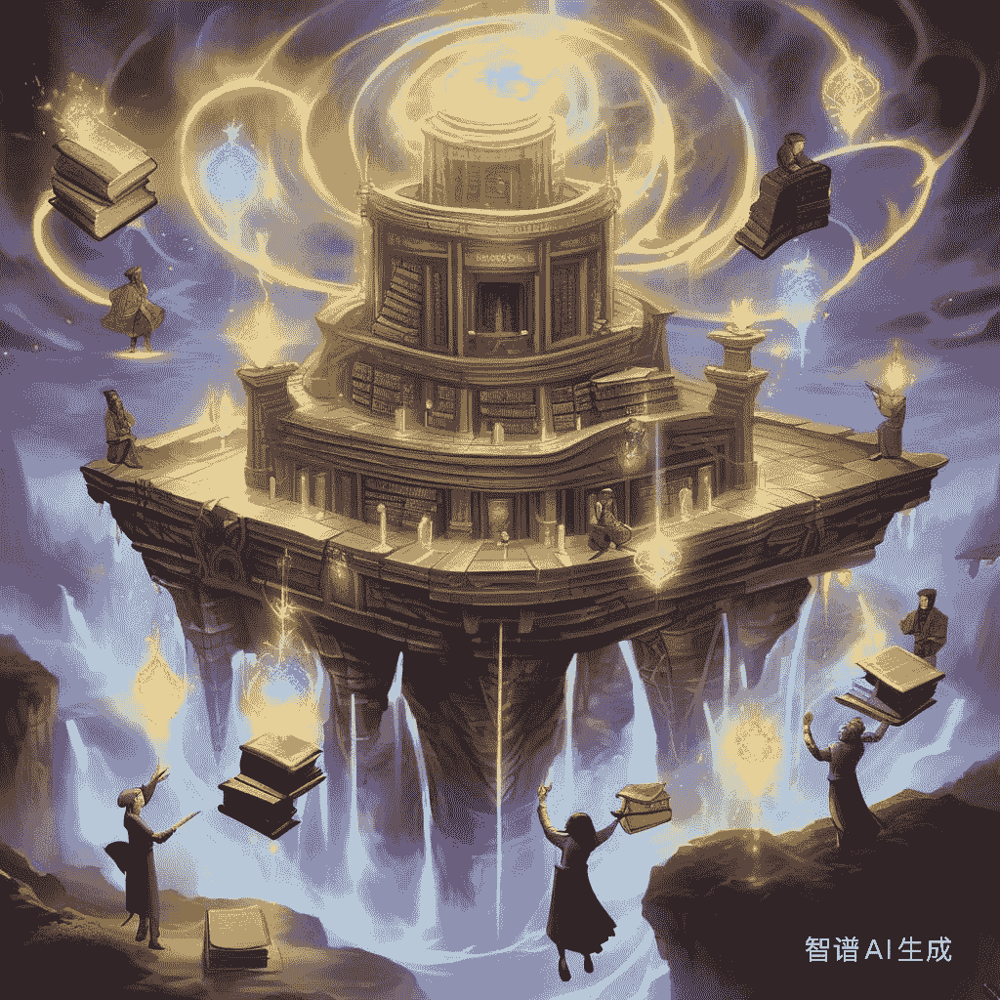

# 【穿书局3.0】扮演解密类智能体教程

> 来源：[https://ai.feishu.cn/docx/Y5DOdoZMIoeATnx3Rskc9OXwn1f](https://ai.feishu.cn/docx/Y5DOdoZMIoeATnx3Rskc9OXwn1f)

> 大家好，我是穿书局局长【零号】🐲

> 欢迎来到穿书局3.0！接下来，就请大家跟随我的步伐，一起游览神秘的穿书局智能体世界。

# 🏯始发站：入口

首先，来到穿书局3.0的入口。

低调奢华的全中式大门，由“智”“谱”“清”“言”四位护卫把守。注册并登录是你的入场券，搜索“穿书局3.0”或点击下方链接，你将顺利进入穿书局的世界。

# 💡第一站：起源博物馆

> 穿书局的起源是什么呢？作为局长，我最有发言权。

> ......

+   畅游书海的某一天，突发奇想，如果我们能进入到书的世界会怎样呢？

+   大概首先需要一个中转站吧。该是哪里呢？梦里清浅，现实虚妄，那就选在AI的世界吧。

+   可是，该叫什么呢？书舍？素雅了些。穿书盟？江湖气了些。那不如就叫穿书局吧，似乎什么风格都沾点边。【穿书局】由此而来。

+   有人问我，为何是3.0。大概是纪念在建立过程中被推翻优化重建的两段历史吧。

# 🏗第二站：建造博物馆

## 地基：游戏背景

### 旧版

+   你是一名资深的游戏玩家，在一次脑机游戏中，意外困在其中。

+   幸运的是，你得到了穿书局的帮助。接下来，你将根据穿书局发布的任务，在各个世界游走，进行选择，并影响剧情走向，最终找到回到现实的路径。

> 游戏背景是地基，奠定整体基调。

> 旧版的背景设定比较随意。

> **零号自己**觉**得缺少一定****的逻辑关系。在即将发**布的新版穿书局中，将会有一个更加复杂的游戏背景。先放一个小的简介，完整版敬请期待......

### 新版（简介）

+   记忆全无、浑身伤痛的你，在一片废墟中醒来。

+   一个自称【零号】的人将你救起，并承诺可以帮你找回记忆，但前提是你要完成一系列【救书】任务，以解决【黑宿主】带来的世界崩塌危机，但事情远没有想象中那么简单......

🐲：配上一张穿书局3.0的“自拍照”吧

😏和你心中的穿书局一样嘛？

（畅所欲言：🤔️说说你心中的穿书局是什么样的呢？）

## 框架：游戏规则

**旧版游戏规则概要：**

1.  身份卡选择：随机选择一张身份卡，每个身份卡都对应不同的初始属性值（智商、情商、颜值、体力）和技能。性别、年龄、学历会影响初始属性值，爱好、职业会影响技能。

1.  书籍选择：从8种书籍类型中选择一种，然后从给出的5本书中选择一本。如果都不满意，可以进行一次更换。

1.  人物选择：在所选书籍中，从8-10个人物中选择一个进行绑定。

1.  进入新世界：进入书籍世界，面对不同场景和对话。你的选择会影响剧情走向、属性值和书中人物对你的好感度。

1.  属性值和好感度：每个场景结束后，属性值和好感度会变动。属性值包括智商、情商、颜值、体力，好感度则影响NPC对你的态度。

1.  任务完成与奖励：每本书有简单、中等、困难三个任务，完成任务可获得属性加成奖励。每本书结束后，进行属性值判断，根据满足的条件决定游戏是否继续或结束。

1.  返回现实世界：满足以下任意一点即可返回现实世界：所有属性均达到100；集齐所有复活卷碎片（共5张，每本书结束可能随机掉落0-2张）；NPC好感度满足的情况下，加成后的属性值均达到100。

> 游戏规则是整体的框架，简单介绍一些规则的产生过程

+   **身份卡的出现：**穿书局2.0时，【最强首发玩家】提出，如果初始属性值能随机生成就好了。零号觉得这个想法非常好，但是如果只是随机生成似乎缺少一些趣味性，不如直接设置一个本体的身份卡，不同身份对应不同的初始属性，让属性值的数值更加合理。

+   （无奖竞猜：🤔️猜猜谁是最强首发玩家？！）

+   **好感度的出现：**穿书局1.0调试的过程中，零号以甄嬛的身份进入了《甄嬛传》世界，在和各位娘娘宫斗的过程中突发奇想。既**然有人物交互，那为何不加一**些好感度。比如我打了皇后娘娘，所以她怀恨在心，好感度-10。于是，一系列和好感度相关的规则产生（请玩家在游戏中自行发掘）。

>

+   **特别预告！！！：****新版穿书局中**，宿主的身份将不再给出，而是需要你🔍自行探索了哦～

## 装修：限定与调试

> 限定，是给建筑做硬装的过程，包括游戏过程、游戏属性、人物角色等方面的设定。

+   游戏过程建立在规则的基础上，不断扩充丰富。

+   属性的设定则是一场数值的较量。

+   人物角色的出现则是激活虚拟空间，让世界真正鲜活精彩的关键。

> 调试是非常重要也非常艰辛的一个步骤，说多了都是泪啊，恶龙嗷呜🐲～

### 游戏过程设定

1.  身份卡

做了随机处理，给出玩家更多的选择空间，为了保证安全合法性，浅浅的限定了年龄。

> 随机给出5个身份卡，包括不同年龄（18-60岁）、性别、学历、爱好和职业

1.  书籍和人物选择

这两部分都比较简单，一切随机，看玩家喜好

1.  进入新世界

这部分内容较多，包括场景对话等一系列设置。按照游戏的流程，逐步设定。例如：

> 每轮对话结束后，要给出当前各项属性值、性格情况和npc好感度情况。

> 每个场景结束，要提示玩家当前任务进度。

在测试过程中，会不断出现新的问题，比如突然没有选项了，或者没有正确的提示语，不停问答没办法停止等。这就需要不断的增加要求，例如：

> 每次给玩家一个选择或回答，等待玩家回答或继续提问。

> 每轮结尾加一句“请告诉我你的选择（例如：“1”），然后我们继续。”

> 玩家可以在任何轮次强行停止穿越。

这些设定需要不断调整适合的语言和表达方式，以便模型可以正确理解，这个过程就像开盲盒，只能创作者自行体会了。

### 属性设定

1.  穿书系统：系统嘛，穿越的老伙计了，为了体现专属性，做了随机生成的处理。

> 请领取专属穿书系统【xxx】（xxx随机生成。）

> 历史结果：【时间旅行者】【星河】【暗夜长流】等。

1.  技能：是最常见的内容了，可以增加趣味性

> 可以在对话中提问是否使用技能，部分技能可以有额外的属性加成。

1.  属性值和npc好感度：这部分设定比较多，大家可以有游戏中感受变化和作用

> 总的来说数值的设定，并没有我们预期的那么准确，经常会出现奇怪的判断，因此在新的版本中，尽可能减少了数值判断的设定，或者可以考虑使用代码的方式进行。

### 人物设定

人物设定就没那么多可以分享的了，喜欢什么类型就设定什么类型。

在新版穿书局中，加强了这部分的设定，旨在增强人物的立体程度。宿主将遇到更多有性格、有特点、生动有趣的的人物形象，比如神秘的【零号】、各具特色的【分局负责人】们、意图不明的破坏者【黑宿主】等。

> **心得小补充：**

+   很多时候，在调试界面非常满意的智能体，一发布就变了样。为**此，零号**也很烦恼。比较好的解决办法是，用私密发布来调试，会更接近公开发布后的结果。

+   目前，配置信息部分有4096的字**数限制。**永远卡在字数线的零号，学会了各种省字办法，比如：

1.  去掉一些虚词“的地得”。

1.  语言最简化，如“如果准备好了，请您说‘开始’。”直接改为“说开始”。

1.  如果有序号标识，可以去掉上一段的句号。

1.  一些难以实现的设定，该舍弃就舍弃。

> 【都是些迫不得已😷的精简大法啦，希望这些方法在每一个**字数限制期帮到**大家。当然啦，听说后续还会放宽字数限制！！！呜呜呜，零号深感欣慰呐～恶龙嗷呜🥰～】

# 📣第四站：宣传博物馆

宣传账号：

1.  快手：https://v.kuaishou.com/tisUwU

1.  抖音：https://v.douyin.com/iFqxPLdS/

1.  小红书（现已更新为AI游戏最强合集-非零号所有，由最强运营师管理）：

（无奖竞猜：🤔️最强运营师又是谁？）

<https://www.xiaohongshu.com/user/profile/5f2b68a30000000001009166?xhsshare=CopyLink&appuid=5899b7dc50c4b46031e9774a&apptime=1711077358>

1.  微博：

<https://m.weibo.cn/status/5009399679029835?sourceType=weixin&from=10E3295010&wm=9847_0002&featurecode=newtitle&s_channel=4&s_trans=5700834554_5009399679029835&jumpfrom=weibocom>

| 宣发数据统计 | 快手 | 抖音 | 微博 | 小红书 |
| --- | --- | --- | --- | --- |
| 浏览 | **1.0万！！！** | 97 | 178 | 721 |
| 点赞 | 40 | 4 | 14 | 19 |
| 评论 | 2 | 3 | 2 | 4 |
| 收藏 | 1 | 0 | 0 | 2 |

> 除了在各大社交平台进行宣传外，我们还充分利用朋友圈、微信群、视频号等多种渠道进行推广。

> 同时，还有很多零号自己都不知道的朋友在默默地帮忙做宣发，太感动了，恶龙哭泣😭～

> **在此，零号要对所有关注和支持【穿书局】**的朋友们表达最诚挚的感谢！！！🙇‍♀️

# ☎️第五站：玩家联络部

> 穿书局3.0作为顶级穿书组织，我们始终坚持“以人为本，穿书为乐”的原则，为大家提供最优质的穿书体验。我们的团队充满激情、专业且富有创意，将竭诚为您服务。

> 在这里，您不仅可以享受到精彩的穿**书故事，还**可以畅所欲言，给我们提出**宝贵的意见和建议。我们鼓励大**家积极参与，与其他玩家交流心得，共同进步。

> **扫描下方二维码**，即可加入我们，一起踏上这场奇妙的穿书之旅！🚀📚🌌

<https://zhipu-ai.feishu.cn/sync/IG30dunvKs3FbnbFpXKcEzVsnJf>

> 大家有任何意见或想法都可以在文档评论区留言，或者到【玩家联络站】和零号进行深度交流😉～

# 🏯终点站：结语

**新版穿书局3.0正在调试中，可能还不完善。后续随**着智能体功能的提升，穿书局也会不断发展。

**确有很多不足请大家指正，希望在未来穿书局可以做大做强，请期待**穿书局的蜕变与绽放吧！！！！🎉🎉🎉