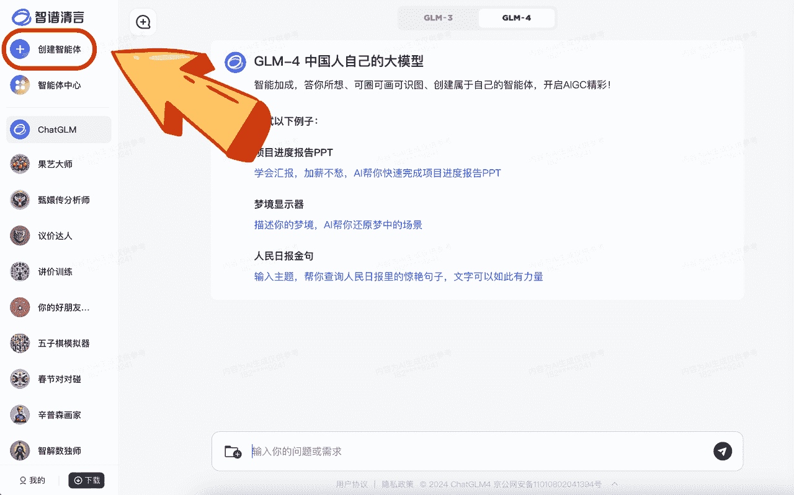
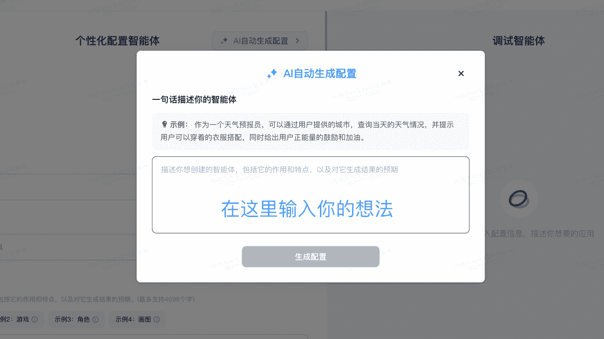
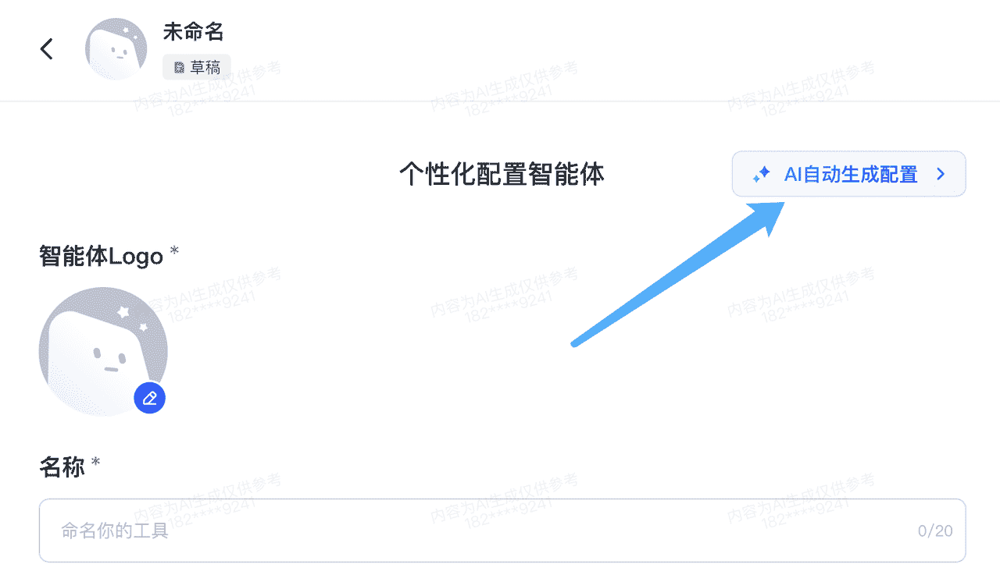

# 快速创建第一个智能体

> 来源：[https://ai.feishu.cn/docx/IeBXdu2ZvoYUr8xM20Ac8Popnh5](https://ai.feishu.cn/docx/IeBXdu2ZvoYUr8xM20Ac8Popnh5)

> 本教程教大家快速上手，通过自然语言对话的方式，跑通全流程，快速创建第一个智能体！~

# 打开清言

打开htt**ps://**chatglm.cn/main/toolsCenter，点击创建智能体，进入智能体的应用界面，即可开始创建智能体啦。

# 第二步：AI 配置

然后我们点击 **AI 自动生成配置。**

把创建GLMs的想法，在用自然语**言，一句话的方**式告诉GLM生成器，点击“生成智能体配置”。

它会帮助你一步步自动创建你的GLMs，包含“命名 → 生成头像 → 明确功能 → 调整 →生成”等流程。

叮咚～不到半分钟，你的 GLMs 已经全自动完成配置✌️

# 第三步：发布

🔥目前，我们为您提供了三种发布方式——私密、通过链接分享和公开。

**🔒私密（仅自己可用）：**您的GLMs仅对创建者开放，不对外公开。

**🔗分享（通过链接打开可对话）：**创建者可以通过链接分享GLMs，其他人可以通过这个链接访问和使用。

**🌐公开（提交到智能体中心）：**您的GLMs对所有用户开放，类似于在应用商店中公开发布软件。

**恭喜你🎉，拥有了自己的第一个 G**LMs，快分享给你的小伙伴一起用用吧！