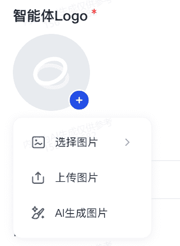
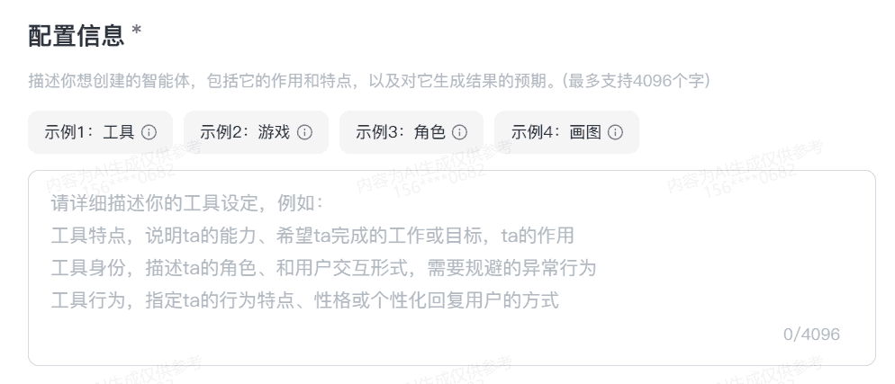
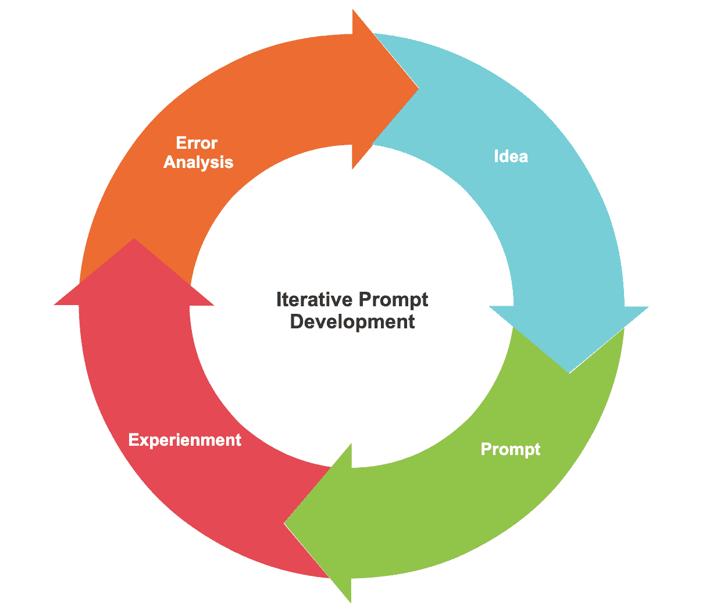
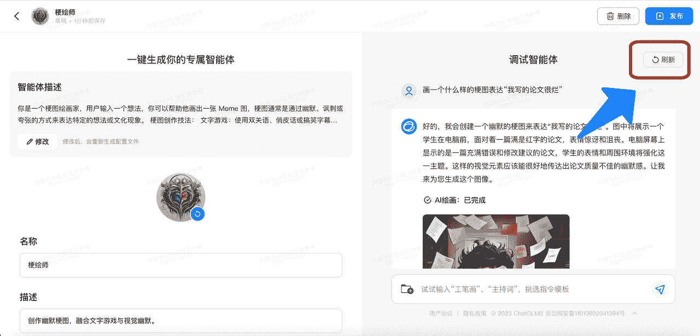
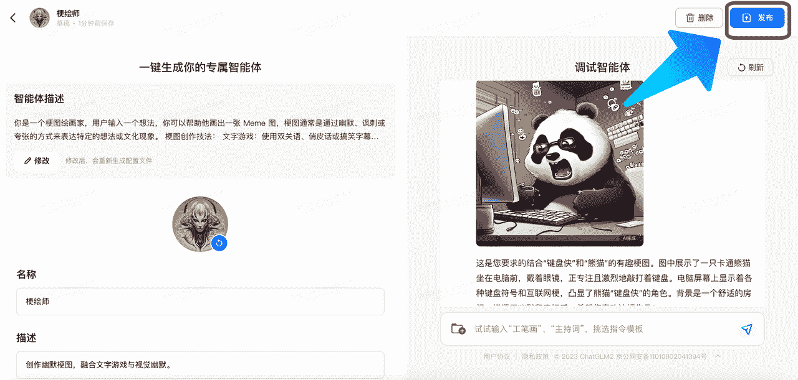
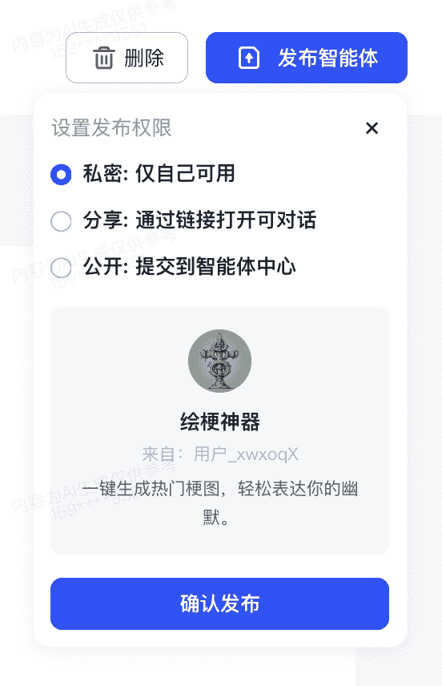

# 创作智能体标准流程

> 来源：[https://ai.feishu.cn/docx/WVpNdMvZ5ouyeKxcusLcISwVndh](https://ai.feishu.cn/docx/WVpNdMvZ5ouyeKxcusLcISwVndh)

# 创建与配置

**一个智能体由以下几部分组成👇**

+   **头像：**你有三种方式配置头像——选择默认头像、自行上传、调用 Cogview 生成头像

+   **名称：**即给你的GLMs起一个响亮的名字

+   **简介： **对你创建的GLMs写一句话介绍

+   ⭐**配置信息：**主要功能，即描述你的GLMs有什么身份、要解决什么问题、遵从什么步骤、有哪些注意事项

+   **开场白：**你的智能体会主动使用这句话与用户打招呼

+   **推荐问题：**默认出现在未对话前的窗口内，预设的提问，引导提示用户对话

+   **模型能力调用：**目前包括联网能力、AI绘画能力和代码能力

+   **知识库文件：**构建知识库，为智能体提供个性化的知识输入，更好的解决问题

+   **[new]** **添加API：**通过调用三方的API接口，来丰富智能体的能力

#### 输入基本信息

我们先想好一个创意点子，然后输入智能体的名称，再去根据名称生成一个头像。

如果你有更想使用的头像，也可以选择本地上传。

然后我们在简介内，用简单的一句话描述我们智能体的功能。

#### 输入配置信息

在这里描述你想创建的智能体，包括它的作用和特点，以及对它生成结果的预期。(最多支持4096个字)

这是非常关键的一部分！不过好心的清言，已经为我们准备了出色的模板。

结构化的提示词，让GLMs更好地释放自己的能力。

# 其他配置

💘 模**型能力调用**

1.  如果你想让智能体获取目前互联网上最新的信息，那么就打开【联网能力】，如果你仅想做一个基于知识库的问答bot，那么就不要打开。

1.  如果你想让智能体拥有AI绘画的能力，那么就打开【AI绘画】，另外，记得在上面的配置信息里写好触发AI绘画的条件哦。

1.  如果你想让智能体拥有更复杂的逻辑计算，那么就打开【代码能力】，如果

**💘 ****知****识库文件**

如果你有一些文件，比如人物的背景故事，又或是丰富的学习资料，都可以选择上传至知识库。

清言通过解析后，会学会你上传的这些知识哦。

# **调整与发布**

💘 调**试智能体**

填写完信息会后自动保存， 我们可以在右侧“调试智能体”一栏中进行试用，若结果不满意，可以在左侧配置中进行内容调整，调整后的内容将实时生效，点击“刷新”按钮即可使用调试后的最新版。

+   在GLMs的“调试智能体”区域，测试智能体的实际表现，如果不符合预期，根据智能体的目标，分析不符合预期的原因，不断迭代配置信息，直到智能体的表现符合预期。

💘 智**能体发布**

经过多次测试，达到自己满意的程度后，就可以在右上角点击“发布”按钮进行发布啦。

🔥目前，我们为您提供了三种发布方式——私密、通过链接分享和公开。

**🔒 ****私****密（仅自己可用）：**您的GLMs仅对创建者开放，不对外公开。

**🔗 ****分****享（通过链接打开可对话）：**创建者可以通过链接分享GLMs，其他人可以通过这个链接访问和使用。

**🌐 ****公****开（提交到智能体中心）：**您的GLMs对所有用户开放，类似于在应用商店中公开发布软件。

