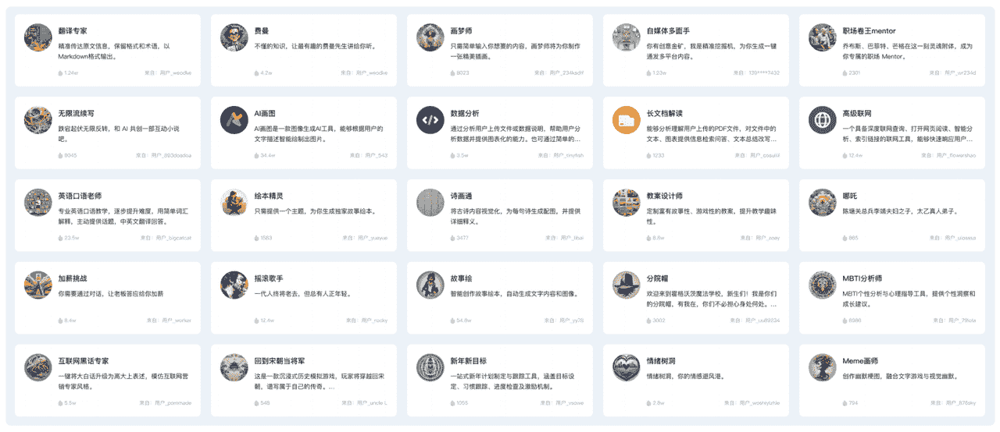
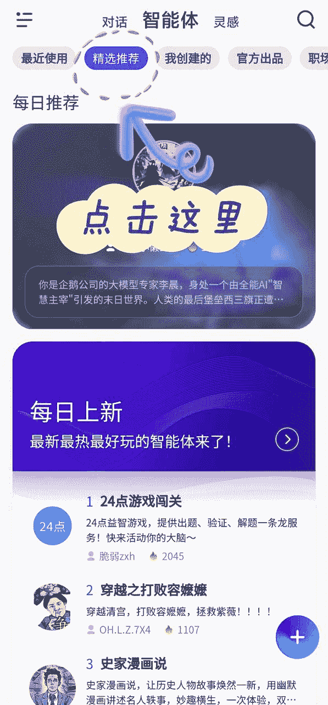
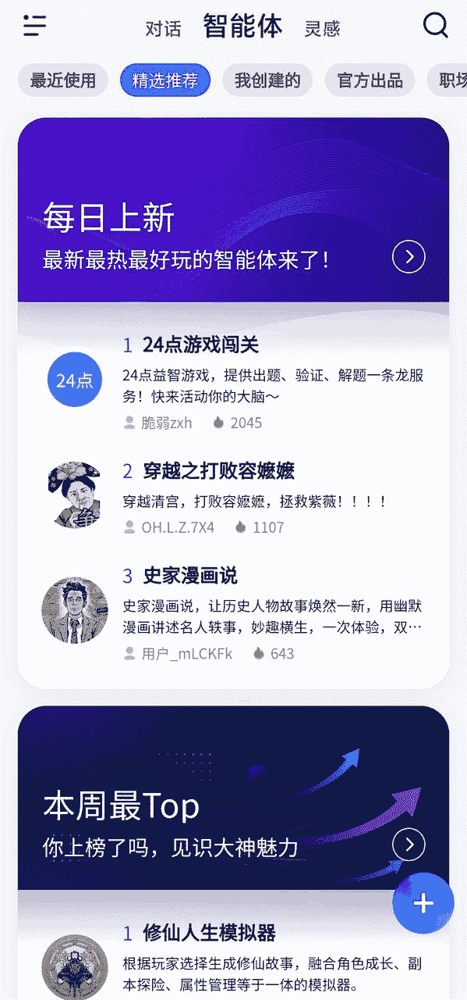
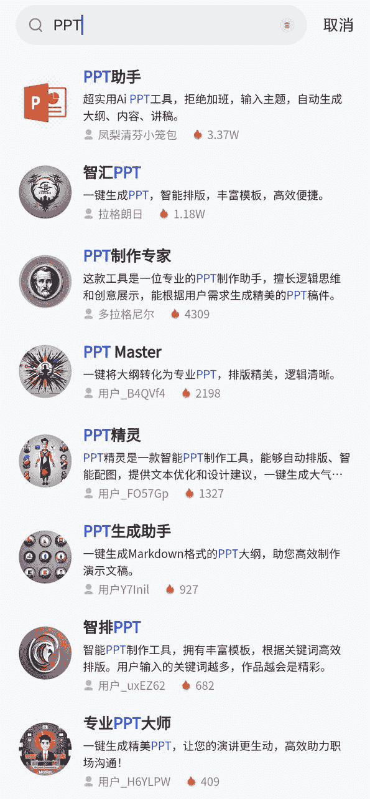

# 如何加入智能体中心

> 来源：[https://ai.feishu.cn/docx/Nm7KdAalaoMzFkxC9x0cD2LknTb](https://ai.feishu.cn/docx/Nm7KdAalaoMzFkxC9x0cD2LknTb)

🌟 智谱清言的智**能体中心现**已上线，集合了近万个官方和用户创造的智能体，覆盖了职场效率、社交娱乐、生活助手、AI写作、学生资源、AI绘画和虚拟对话等多个领域。用户只需点击感兴趣的智能体，就能轻松开启智能对话体验。

### （**一）如何访问智能体中心**

** 1️⃣ PC 端智能体中心：**https://chatglm.cn/main/toolsCenter

2️⃣ **APP 端智能体中心：**

点击【精品推荐】，进入推荐智能体中心。

### （**二）如何搜索更多智能体**

**🔍 **想探索更多智能体的乐趣？使用搜索功能，轻松找到你感兴趣的智能体，以“📕”为例，搜出“📕爆款写作专家”，“📕标题专家”，“📕爆款文案助手”，“📕爆款视频大师”，“📕文章重写”，“爆款📕助手”等多个智能体，选择你需要的用起来吧。

### （三）**如何入选智能体中心**

1️⃣ 创建智能体时，选择**“公开”**选项，将其提交到智能体中心。

2️⃣ **积极分享**您的智能体链接给亲朋好友，通过增加**使用量和**互动，提升智能体的**热度。智能体**的热度越高，其在智能体中心的排名就越靠前。

3️⃣ 如果您对自己的智能体创意充满信心，并希望得到更**多的曝光**，可以联系我们的官方工作人员进行毛遂自荐。官方工作人员的联系方式可以在本文末尾找到。

💌 不**要迟疑！联系我们，**让我们帮助您推广优秀的智能体作品！

🏠 从**这里，下载智谱清言**

❤️ **从这里，加入技术开发者交流群**

---