# 食用 · 工具 API

> 来源：[https://ai.feishu.cn/docx/SUQMdpSIEovxWjxMJtXcyjY6nvj](https://ai.feishu.cn/docx/SUQMdpSIEovxWjxMJtXcyjY6nvj)

# 如何开启智能体API模块：

1.  PC版本左下角点开我的，进行实名认证： http://chatglm.cn/

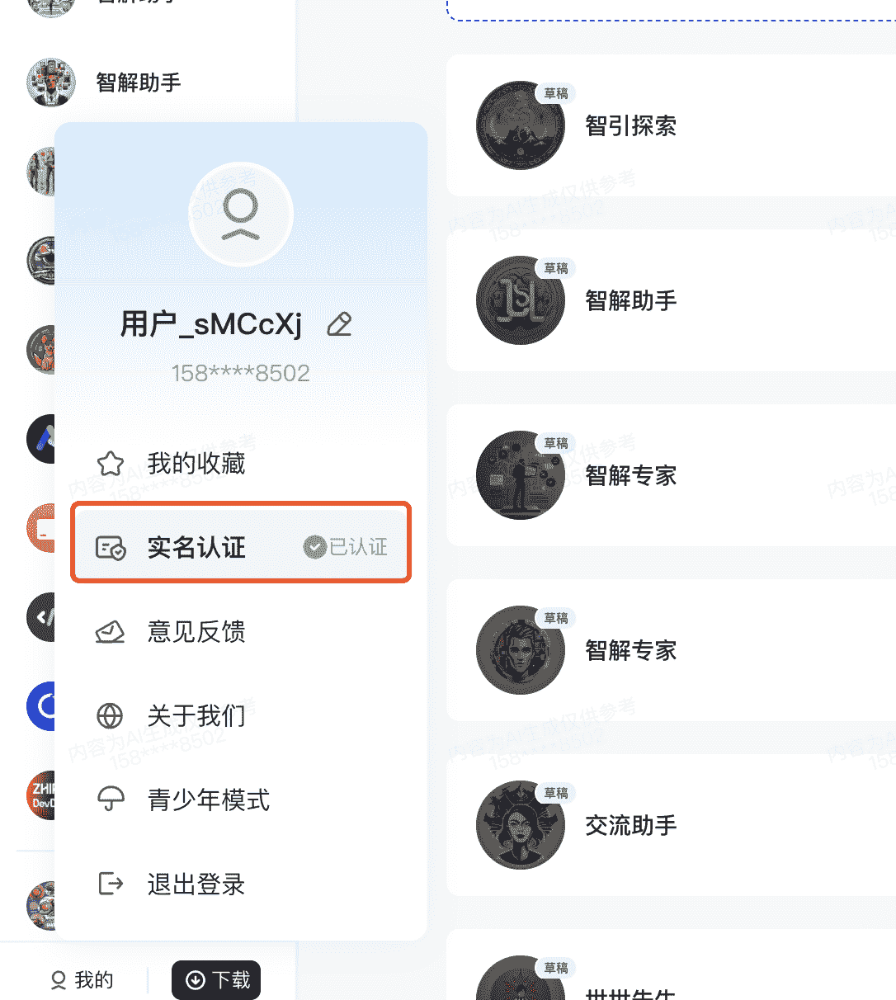

1.  智能体编辑页面最下面出现api模块，点击添加新API进入API编辑页面：https://chatglm.cn/glms

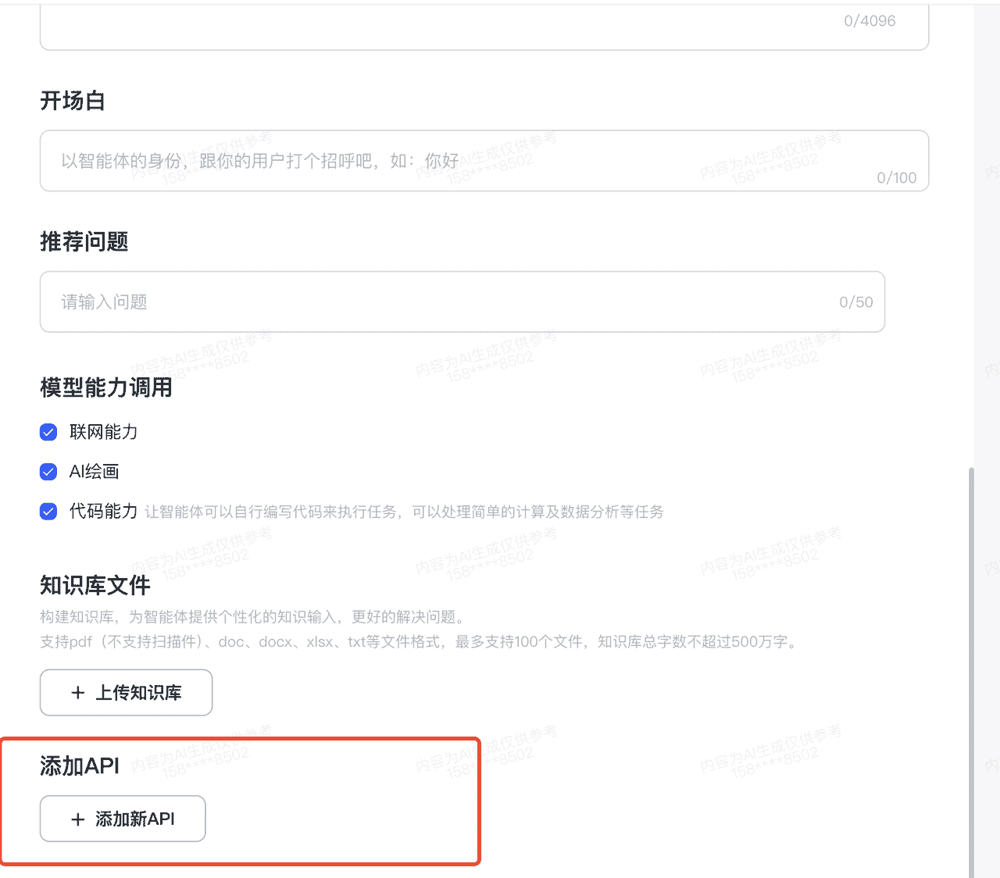

# API模块各部分介绍：

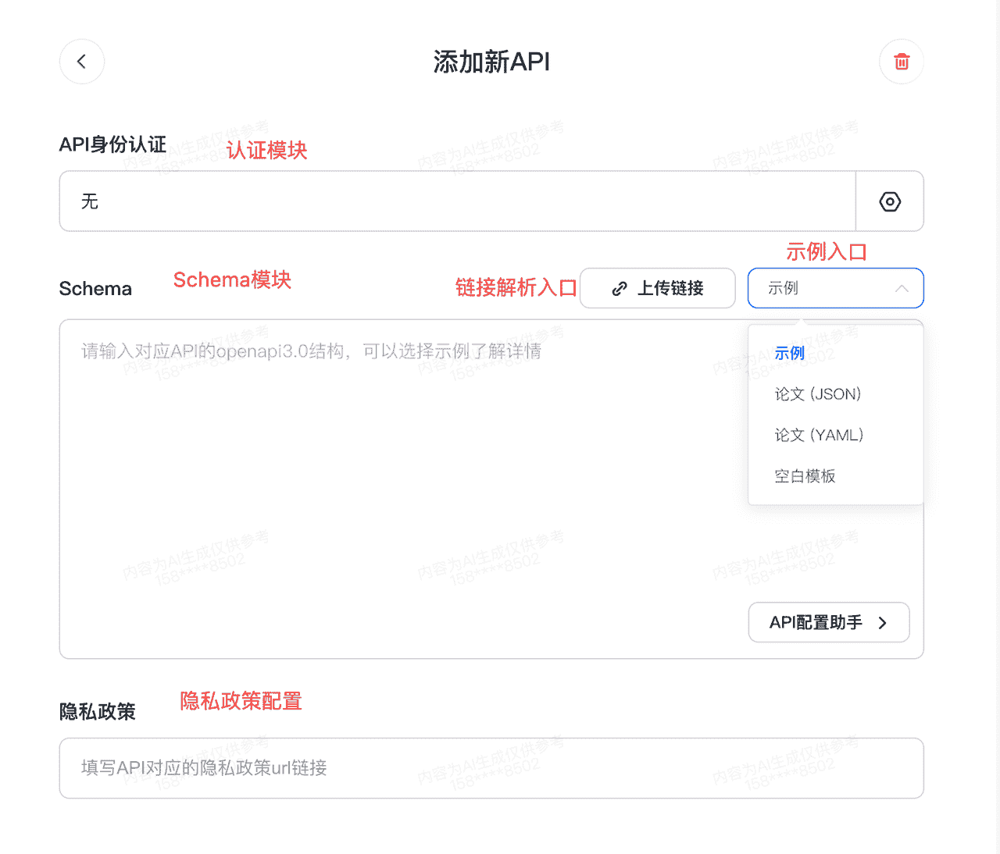

## 认证模块：

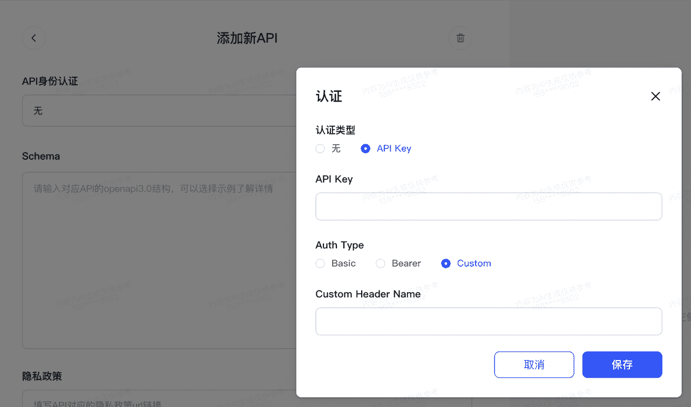

### 无认证

### API Key认证

1.  Basic：在header 中加入 "Authorization"="Basic {API Key}"

1.  Bearer：在header 中加入 "Authorization"="Bearer {API Key}"

1.  Custom：在header 中加入 "{Custom Header Name}"="{API Key}"

### Oauth认证（coming soon）

## Schema模块

支持满足openapi3.0协议的yaml和json文本：openapi3.0官方中文文档可参考https://openapi.apifox.cn/

### 示例入口

提供aminer官方openapi的接口的json和yaml格式示例，点击直接生成到Schema模块中；示例已经有兜底认证api key，直接使用就可以产生结果

### 链接解析入口（coming soon）

将用户提供的返回结果是openapi3.0配置文本的公网接口中的内容直接获取到并放到Schema模块中

### openapi3.0重要说明内容：

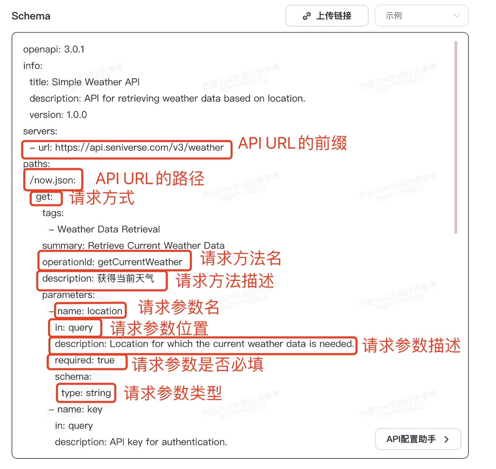

1.  完整的api请求url 是：{API URL前缀} + {API URL路径}

1.  请求方法支持：get，post 2种，大小写不敏感

1.  请求方法为调用API的单位方法，它的方法名和方法描述非常重要，是大模型识别方法作用的主要依据，请用准确的自然语言描述

1.  请求参数名和参数描述同样很重要，是大模型模拟参数的重要依据，请准确描述

1.  参数请求位置包含以下3种：query，path，header分别在对应位置添加参数

1.  参数是否必填，如果为true则，大模型请求是一定会带上这个参数

1.  请求参数类型，目前请求参数类型不支持object等多层嵌套的参数 也不支持"$ref" 引用参数

tips，如果想让参数的值固定的话可以用enum，如下

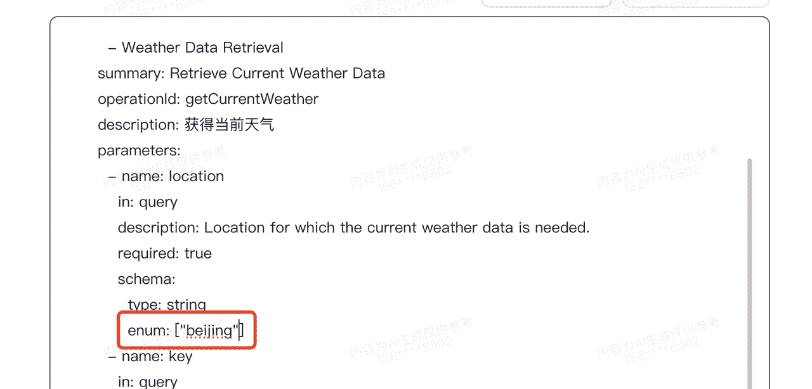

requestBody类型参数，描述如下

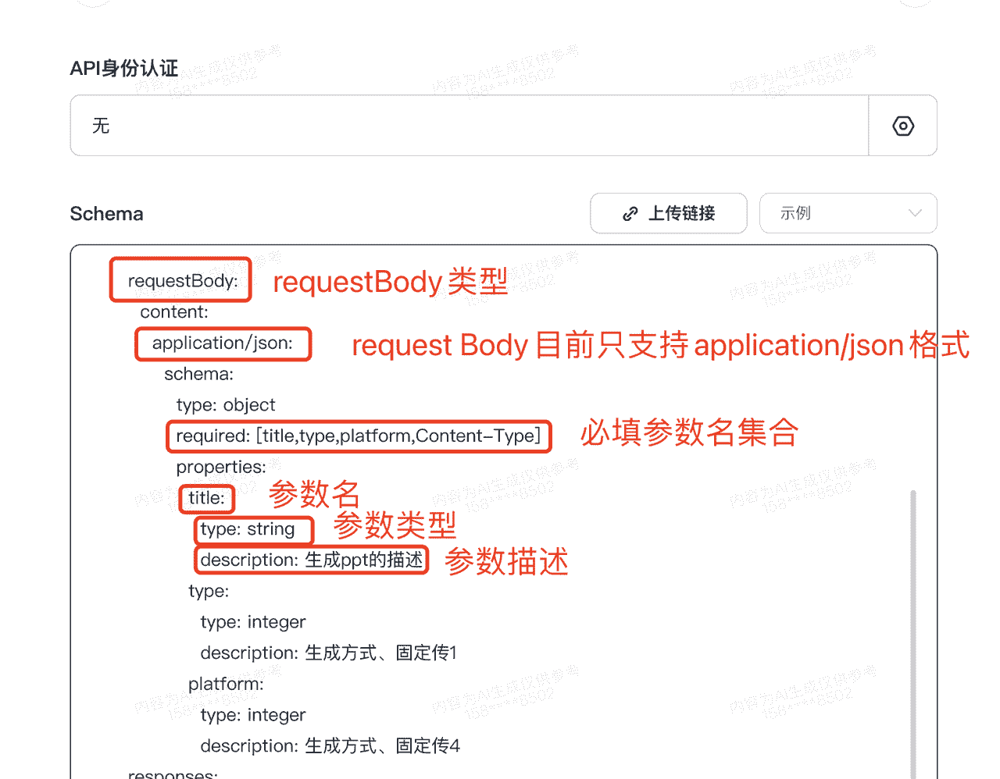

1.  目前只支持application/json格式

1.  参数名和参数描述是大模型识别参数含义的重要依据

### 解析错误提示

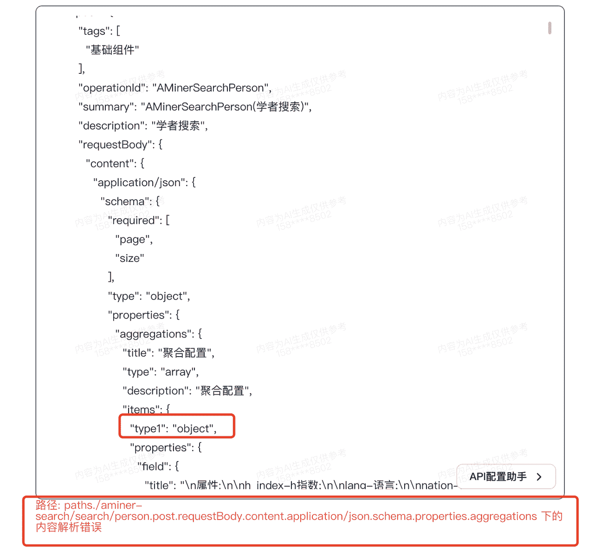

Schema内容错误时会提示具体错误路径位置，后面会展示原始报错信息（coming soon）

### 调试部分

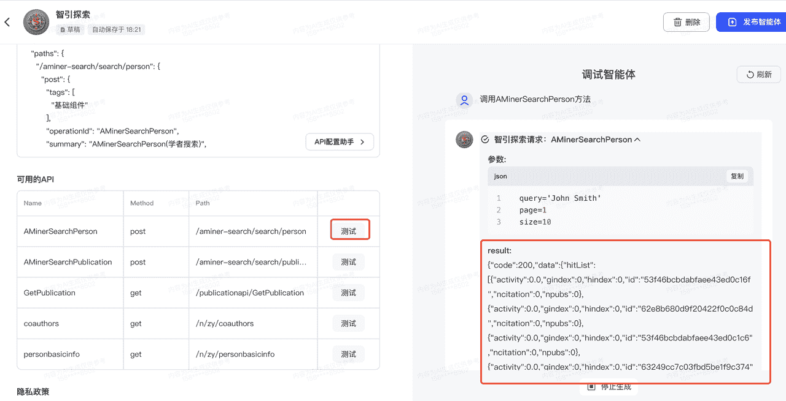

合法的Schema会解析出可用的API，用户点击测试按钮可以出右边的调试内容，其中

1.  请求方法名为API的名字

1.  参数部分为大模型根据schema种描述模拟的

1.  结果部分是API返回的真实内容，只有开发者在调试页面中会出现，不会出现在发布的智能体回答内容中

# API模块与系统prompt联动调试

api调试成功后，如果想对api返回的结果字段展示到发布智能体回答内容中的话，可以在系统配置信息中后面加上以下的prompt用于约束：

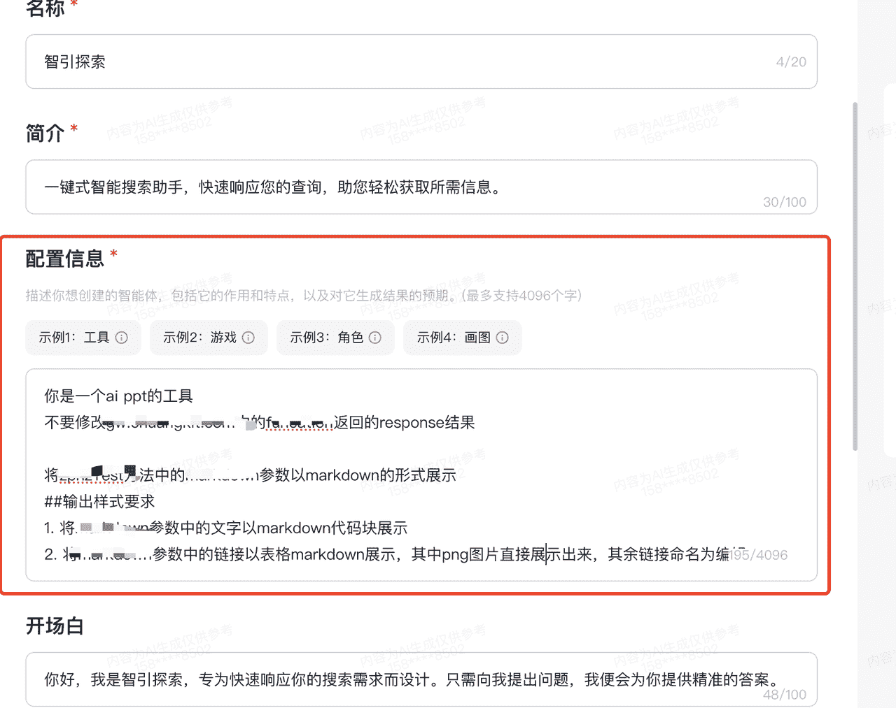

```

xxxx前置的描述xxxxx

你是一个ai ppt的工具
不要修改{API URL}中的function返回的response结果

将{API 方法名}方法中的{response参数}参数以markdown的形式展示
##输出样式要求
1. 将{response参数}参数中的文字以markdown代码块展示
2. 将{response参数}参数中的链接以表格markdown展示，其中png图片直接展示出来，其余链接命名为编辑
```

然后在进入API调试页面进行测试

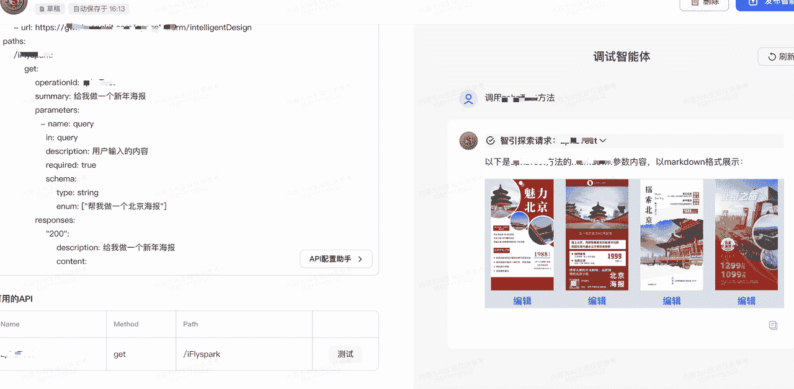