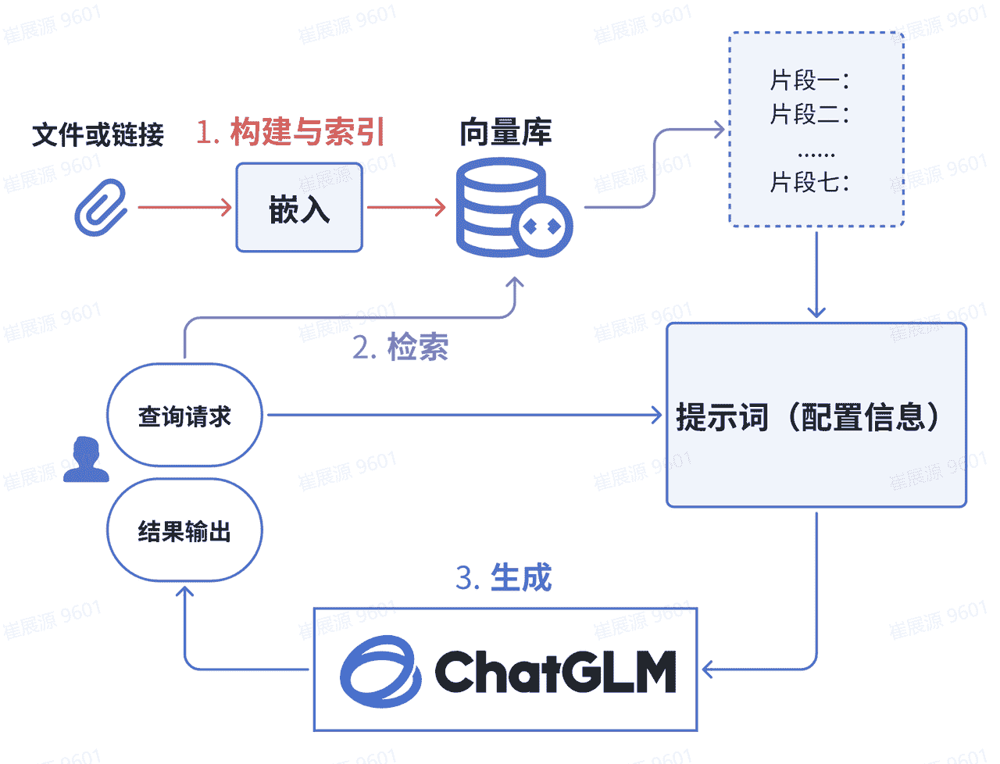
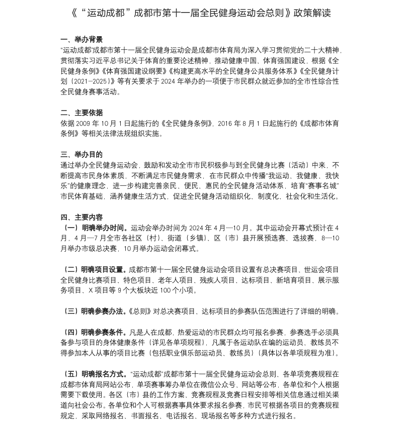
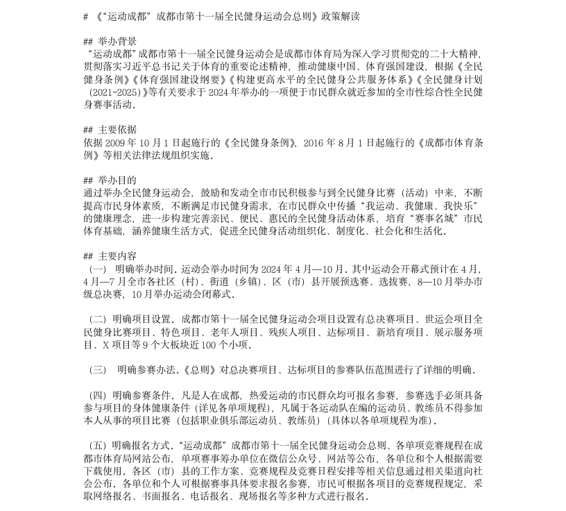

# 食用 · 知识库

> 来源：[https://ai.feishu.cn/docx/RiOhdP8GjopBxexSYXvcuFocnAE](https://ai.feishu.cn/docx/RiOhdP8GjopBxexSYXvcuFocnAE)

# 一、概述

**检索增强生成技术（Retrieval Augme**nt**ed **G**ener**ation，RAG）是一种革新性的自然语言处理方法，它将信息检索与大语言模型的生成能力结合起来。RAG 创新地在生成大语言模型的回复之前，从知识库中检索相关数据，并运用这些数据来引导生成流程，从而显著增强了所生成内容的准确性与可追溯性。



---

# 二、实践指南

## 1.格式


> 对大语言模型的友好程度：txt>docx/doc>pdf。

若排版复杂（水印、大量图片和复杂表格）, 解析成纯文本效果不佳。目前是大语言模型，并不能在上传知识库阶段解析文件中的图片，故格式越接近纯文本效果越好，但txt使用不如docx、doc广泛。

+   [**推荐使用方法：将do**](https://www.runoob.com/markdown/md-title.html)**cx/doc文件全选复****制粘贴到txt文件，再用m**arkdown语法来标记txt的层级标题（最后的#号后面有空格）。

```
# 一级标题
## 二级标题
### 三级标题
```

> **良好排版范例：**



[范例.docx](https://internal-api-drive-stream.feishu.cn/space/api/box/stream/download/all/SyOObyQ68o9LjgxvJkCcAajdnad)



[范例.txt](https://internal-api-drive-stream.feishu.cn/space/api/box/stream/download/all/QA0hbIDiNoMPBVxsLCucLVUFn1c)

## 2.提示词

结合具体的使用场景，在配置信息中加入对应提示词。

+   如会议信息查询这类需要精准按照知识库回答的场景，则选择严格模式。

{参考信息}指的是知识库文件或者URL。

```
**严格：**你必须在回答中严格遵守{参考信息}。不要依赖你之前的知识，仅使用{参考信息}**中的内**容进行回复，若遇**到超出**知识库的内容，请回答：抱歉，没有相关信息。
标准：使用{参考信息}检索到的上下文片段来回答问题。
松散：使用{参考信息}检索到的上下文片段来回答问题，但是要用你对于{话题，注意替换}的了解进行判断。
```

---

# 三、原理

## 1.**构建和索引知识库**

+   **文件导入**：用户上传文件或者URL构建知识库。

+   **分块与嵌入**：知识库中的文本会按照字符、长度或语义被拆分，并通过词嵌入模型转换成连续向量表示，这些向量便于在向量空间中进行高效检索。

+   **索引创建**：将嵌入后的文本块存储在专门设计的向量数据库中，以便后续快速、准确地检索与给定查询语句相似的文本片段。

## 2.**检索阶段**

+   **输入处理**：当用户提交一个问题或指令时，RAG系统对输入进行预处理，并计算其对应的嵌入向量表示。

+   **检索相关文档**：系统会在索引库中执行近似最近邻搜索，找出与输入查询向量最接近的文本片段。类似在搜索引擎中寻找与查询关键词最相关的文档，只是这里的比较是基于向量距离而非关键词匹配。

## 3.**生成阶段**

+   **融合检索结果与生成模型**：检索得到的最有价值的若干个文档片段被选择出来，作为额外的上下文输入，与配置信息（提示词）和对话上下文一起送入到生成模型中

+   **生成答案**：大语言模型利用检索到的信息引导生成过程，生成更加准确、具有事实依据的回复。

---

# 四、开发者

+   需要有Python编程基础

## 智谱开放平台文档

1.  [智谱开放平台-控制台](https://open.bigmodel.cn/overview)

1.  智谱开放平台-接口文档-向量模型

1.  智谱开放平台-接口文档-文件管理

## 开源项目推荐

### **L**angchain-Chatchat

+   **链接：**

+   **视频教程：**

> 💡欢迎一键三连

> 关注up主**ChatGLM**

> 获取最新教程！

+   **文档 ：**


[ChatGLM + LangChain 实践培训.pdf](https://internal-api-drive-stream.feishu.cn/space/api/box/stream/download/all/Tn8DbI85voEHNxxGhkbcr3iAnih)

### GLM-CookBook：GLM大模型入门指南

### **茴香豆**

+   **链接：**

+   **视频教程:**

### **动手学大模型应用开发**