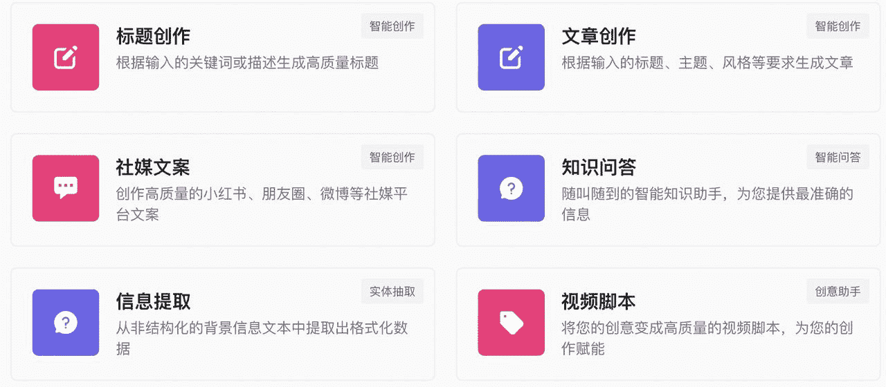
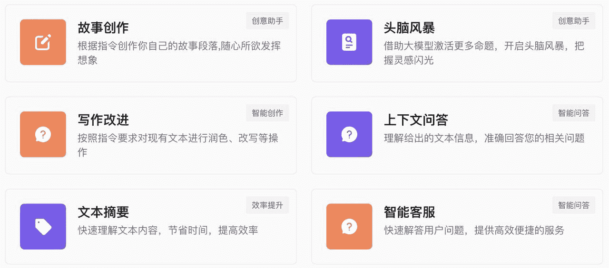

# 2.2 产品 · API 开放平台

> 来源：[https://ai.feishu.cn/docx/OaxTdA4MYovEsjxvIKwcuruWneg](https://ai.feishu.cn/docx/OaxTdA4MYovEsjxvIKwcuruWneg)

> 智谱AI [开放平台](https://open.bigmodel.cn/trialcenter?utm_campaign=open&_channel_track_key=OWTVNma9) 提供了[智谱](https://open.bigmodel.cn/trialcenter?utm_campaign=open&_channel_track_key=OWTVNma9)AI各类大模型服务的开放API服务，让您可以轻松地将ChatGLM3的强大功能集成到您的应用程序中。您可以使用手机号快速进行注册，我们为您提供了超大限额的免费体验额度，欢迎点击 这里 注册体验。

> 如果您是[CCF](https://www.ccf.org.cn/)会员、AI生态开发者（如[Dify](https://dify.ai/)）也可以使用对应站点的账号进行三方授权登录，我们同样为您准备了免费体验权限。

部分场景示[例⬇️，](https://open.bigmodel.cn/launch?spreadparam=open_source&utm_source=open_source&utm_campaign=%E5%BC%80%E6%BA%90%E6%B4%BB%E5%8A%A8&_channel_track_key=IsvswZ2J)更多场景等你注册体验哦～ 点击  -> 免费体验

介绍视频

[大模型B端产品视频-AI应用演示.mp4](https://internal-api-drive-stream.feishu.cn/space/api/box/stream/download/all/HlMjbl9Keoi0cXx4RNmc6iDLnuv)

# ⭐️  Link

智谱AI大模型开放平台**：**

> 官网：https://open.bigmodel.cn/

> 开发文档：https://open.bigmodel.cn/dev/api

> 开源教程：https://github.com/metaglm/glm-cookbook

### 合作/贡献

欢迎您在帮助在各类主流开发工具中集[成、完善智谱开放平](https://www.langchain.com/)台[的能力，包括但不限于](https://github.com/run-llama/llama_index)L[angChain、LlamaI](https://github.com/microsoft/semantic-kernel)ndex、semantic-kernel，也欢迎加入生态合作建设。

我也欢迎各位开发者在自己的开发框架中加入特殊的请求头，以方便我们统计用量。在SDK中调用智谱API时，请在http请求header中设置x-request-sdk为对应的平台，以便我们统计调用来源并给与资源支持。

下面将举出一个例子：

> 假设你的开源框架为 ABC

> 你的请求方式可以为:

> ABC-request-sdk

# 🏠 微信交流群

# 🏠 关注公众号

<https://zhipu-ai.feishu.cn/sync/I447dldoQsFFP6bcGUYcAaOVnQc>