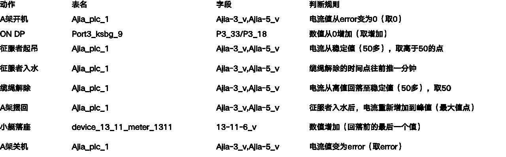

# 【已结束】深远海船舶作业 · 大模型应用赛（24 万）

> 来源：[https://ai.feishu.cn/docx/X5IadJ88XoEZPkxCs7tcP3K5nnd](https://ai.feishu.cn/docx/X5IadJ88XoEZPkxCs7tcP3K5nnd)

**比赛平台：****https://competiti**ons.zhipuai.cn/match

欢迎参加「GLM深远海船舶作业大模型应用赛」

智谱作为大模型领域的领军者，正积极探索大模型技术在各行业实际生产中的落地应用。

党的二十大报告明确指出要加快建设海洋强国。在此背景下，探索大模型与海洋作业建设的深度融合成为一项重要课题。深远海船舶，凭借其卓越的综合性能，成为深远海洋作业活动的核心承载平台，在海洋探索、观测以及走向深蓝的进程中发挥着不可替代的作用。

本次赛题聚焦于AI大模型在深远海船舶作业场景中的应用，旨在通过AI大模型技术提升深远海作业效率。赛题将深入探究大语言模型在工业领域时序数据处理的潜力。

赛方将为参赛选手提供某深远海船舶的推进系统、甲板机械设备等真实设备数据。选手需运用GLM-4系列模型API进行比赛，利用大语言模型的语义理解及函数调用等功能，准确解析用户的自然语言查询，并访问相关设备数据以完成赛题问答。

值得注意的是，本次赛题虽以海洋作业为背景，但所涉及的时序数据处理问题具有广泛的工业场景适用性，其解决方案可拓展至多个工业领域。

> **主办单位：**

> 芜湖市人民政府

> 中国信息通信研究院

> **承办单位：**

> 芜湖市工业和信息化局

> **合作单位：**

> 北京智谱华章科技有限公司

> 海南省木杉智科技有限公司

# **赛程赛制**

以下所有时间点为北京时间（GMT+8）

请注意，报名时间以外的其他时间点可能会有变动，请参赛者密切关注本网站和邮件通知。

一、报名组队与实名认证：2024年12月18日至2025年2月23日

1.  报名：需在[“数境”平台](https://www.industrial-bigdata.com/)和“[清竞](https://competitions.zhipuai.cn/match)”比赛平台都完成注册和报名。未在双平台报名者将视为无效参赛。

1.  参赛形式：可单人或组队参赛，每队最多三人。每位选手仅限加入一支队伍。

1.  报名信息：确保信息准确有效，否则组委会可取消参赛资格及奖励。

1.  报名截止：2月23日24:00前完成报名、组队变更等操作。

1.  实名认证：比赛复赛结束之前，需在清竞比赛平台完成实名认证，否则将无法参与领奖。

大赛官方交流群：


比赛平台：[“数境”](https://www.industrial-bigdata.com/)平台和“[清竞](https://competitions.zhipuai.cn/match)”比赛平台

**二、初赛阶段（**2024年12月18至2025年2月26日）

1.   报名成功的参赛队伍将通过指定平台使用大模型API，在本地调试算法后在线提交结果。初赛分为 A 榜（2024年12月18日至2025年2月23日）和B 榜（2025年2月24日至2025年2月26日）。初赛成绩由 A 榜（30%）和B 榜（70%）成绩加权得出。

+    A 榜期间，系统每天提供3次提交机会，实时评测并返回成绩。排行榜每小时更新，按评测指标排序，展示历史最优成绩。A 榜最后一次评测截止时间为2025年2月23日18:00。

+   B 榜期间，评测标准与 A 榜相同，但赛题难度有所变化。B 榜最后一次评测截止时间为2025年2月26日18:00。

1.   初赛淘汰与复赛晋级代码审核：2025年2月27日-2025年3月3日

+   未产出成绩的队伍复赛资格。

+   ** 前50名的参赛队**伍将晋级复赛，最终将结合选手具体方案决定，复赛名单于2025年3月3日公布。

3. 参赛队伍可以使用除承办方提供的训练数据外的其他标注数据。若对数据使用有疑问，请邮件联系组委会：wei.jia@zhipuai.cn。

**三、复赛阶段**（2025年3月4日至2025年3月21日）

1.  晋级参赛队伍将通过指定平台使用大模型API，在本地调试算**法后在线提交结果。复赛同样分为 A 榜（2025年3月4**日至2025年3月18日）和B 榜（2025年3月19日至2025年3月21日）。复赛成绩由 A 榜（30%）和B 榜（70%）成绩加权得出。

+   A 榜期间，系统每天提供3次提交机会，实时评测并返回成绩。排行榜每小时更新，按评测指标排序，并显示队伍所在赛区。A 榜最后一次评测截止时间为2025年3月18日18:00。

+    B 榜期间，评测标准与 A 榜相同，但赛题将进行调整。B榜最后一次评测截止时间为2025年3月21日18:00。

1.   复赛淘汰与决赛晋级审核：**2025年3月22日**

+    复赛阶段排名前 9 的队伍将晋级决赛答辩环节。组委会将对代码进行审核，审核不通过的队伍将被取消答辩资格，晋级名额将依据排行榜顺延。

1.  参赛队伍可以使用除承办方提供的训练数据外的其他标注数据。若对数据使用有疑问，请邮件联系组委会：wei.jia@zhipuai.cn。

**四、决赛答辩**（暂定2025年3月底，具体时间待通知）

1.  决赛将以线下或线上答辩形式进行。晋级队伍需准备答辩材料，包括答辩PPT、参赛总结和核心代码。

1.  晋级团队需提交答辩PPT初稿，提交时间将另行通知。组委会将审核并提供修改建议，随后团队需提交终稿。答辩的具体时间和地点将另行通知。

1.  答辩流程包括15分钟的队伍陈述和10分钟的评委问答。评委将根据技术思路、理论深度和答辩表现进行评分。

1.  决赛分数由复赛成绩（占60%）和答辩成绩（占40%）加权得出。主办方将根据决赛分数颁发奖项。

# **奖项及奖励**

+   比赛奖金

本次大赛奖金总额为24万元人民币。具体奖金分布如下（所有奖金均为税前）：

+   一等奖 1名  奖金人民币 100,000元，颁发获奖证书。

+   二等奖 3名  奖金人民币30,000元，颁发获奖证书。

+   三等奖 5名  奖金人民币10,000元，颁发获奖证书。

+   优秀baseline 2名 奖金人民币 2000元

另，获奖团队将获得一次乘坐科考船出海体验的机会。

# **数据简介**

### 1、数据**介绍**

本赛题的数据集来源于某深远海船舶的设备数据。数据集包含这些该船的推进系统和甲板机械设备的数据。

数据集中，您可以了解到不同设备的各个维度的数据，如电流、电压、功率以及转速等数据，这些数据可以帮助您更直观了解到船舶各个时刻的运行状态。

+   甲板机械数据：主要包括A架、绞车以及折臂吊车数据：

+   A架：A架右舷角度、1启动柜电流、2启动柜电压、一号门架主液压泵-Ua电压

+   绞车：绞车A放缆长度、绞车变频器-Ia电流、绞车B放缆长度

+   折臂吊车：折臂吊车液压-Uc电压、折臂吊车液压-St视在功率、折臂吊车液压-频率

+   推进系统数据：主要包括发电机组、推进器以及舵桨数据：

+   发电机组：一号柴油发电机组转速、二号柴油发电机组燃油消耗率、停泊/应急发电机组转速

+   推进器：一号推进变频器功率允许、艏推主开关电流、可伸缩推方位命令

+   舵桨：一号舵桨转舵-频率、右舵桨主开关电流、二号舵桨方位命令

### 2、赛题数据说明

设备过程数据表格通过前缀区分类型，分别有Ajia，Jiaoche，device和Port四类，分别表示A架，绞车、电表和船舶工况相关数据；数据的后缀，分别有"_1"和"_2"，其中，表示不同的时间段，其中，"_1"的时间跨度从2024年5月16日到2024年5月30日，"_2"的时间跨度从2024年8月15日到2024年9月14日。如："Ajia_plc_1_1"表示A架从2024年5月16日到2024年5月30日的数据。具体的字段释义可以查看字段释义.csv文件。

设备参数详情包含一些船舶工况参数的相关信息，包括相关参数的上限、下限以及报警值等信息。

**赛题数据包：**


[初赛数据1217.zip](https://internal-api-drive-stream.feishu.cn/space/api/box/stream/download/all/MsEqb19s9o8B0Ax6HKkcK9m5n1G)

**赛题数据（动作和规则对照）**



# **赛题内容**

## **1.** **评测任务概述**

本次比赛目的是探究大语言模型在工业领域时序数据的应用。该方案应利用大语言模型的语义理解和函数调用等功能，准确解析用户的自然语言查询，并通过访问相关设备的数据，提供以下服务：查询船舶状态、查询设备相关知识、统计各类设备运行指标以及对实际可能遇到的问题提供解决方案以辅助决策。

## **2.** **评测方式**

### **2.1 初赛阶段**

选手报名成功后，参赛队伍通过清竞平台下载数据，并在本地调试算法。然后，参赛队伍在线提交结果。在初赛期间，赛事主办方会提供设备数据查询的API供选手使用和测试数据集供选手评估模型效果。参赛选手可以手动提交评估结果文件，系统会实时评估并返回成绩。排行榜每小时更新一次，按照评估指标从高到低进行排序。每个队伍每天的提交次数限制为3次。排行榜将展示参赛队伍在初赛阶段的历史最佳成绩进行排名。为了确保比赛的公平和公正，参赛选手需要在初赛截止日期之前提交结果文件。赛事主办方将核实问答结果的可复现性，并对通过验证的选手进入复赛。如果有队伍未在初赛期间进行提交或未提交结果文件，则他们的复赛提交将被视为无效。

### **提交物**

**初赛**阶段，参赛队伍本地调试算法，在清竞比赛平台在线提交结果，结果文件命名为"参赛队名称_result"，以utf-8编码格式保存。文件格式见submit_example.jsonl。

### **2.2 复赛阶段**

在复赛阶段，比赛组织方将使用测试集评估参赛选手提供的镜像文件中的算法模型的性能，以确定算法的优劣并进行排名。复赛阶段的测试数据集文件规范与初赛阶段保持一致。

复赛结束后，参赛队伍需要提交相关代码，模型的镜像文件和说明文档（具体要求请参见规则章节）。赛题组织方将审核优胜参赛队伍的代码，要求代码符合比赛主题和相关规范。对于未提交或审核不通过的队伍，将取消其决赛资格和比赛奖励，并通知递补选手。最终的队伍排名将根据复赛成绩计算，并在官方完成代码审核后公布榜单。

### 提交物

**复赛阶段，参赛队伍本地调试算法，在清竞比赛平台在线提交结果，结果文件为docker镜像文件和说明文档，命名为"参赛队伍名**称_result"。 文件包含模型权重文件，模型配置文件，模型预测脚本，如果需要向量引擎，知识文件等，需要一并打包提交。

## **3.评测指标**

赛事主办方会根据选手提供的回答与参考答案（answer）进行对比，并根据关键字段命中情况进行评分。

#### 参数说明：

**评分公式：**

**示例问题：**

```
[
    {
        &quot;question&quot;: &quot;24年5月19日A架的开机时间分别是几点，关机时间分别是几点？（请以XX:XX输出）？&quot;
        &quot;answer&quot;: &quot;5月19日A架的开机时间是07:30、15:41，关机时间是15:39、17:24&quot;
    }
]
```

** **

**关键词list**

key_list: [“07:30”, “15:41”, “15:39”, “17:24”]

**计分示例：**

命中1个：1/4=0.25

命中2个：2/4=0.5

命中3个：3/4=0.75

命中4个：4/4=1

## **4.注意事项**

+   baseline开源需要提供jupyter-notebook文件及详细的readme作为目录。